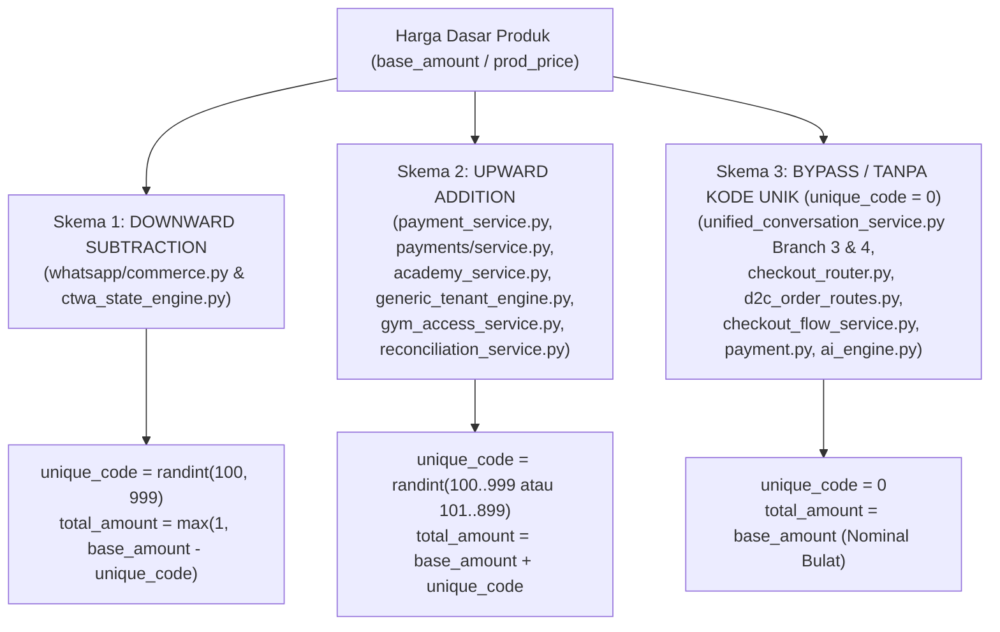

# INVENTORY-LEGACY-QRIS: Peta Komprehensif Dependensi Static QRIS, Kalkulasi CRC16 / Tag 54, & Audit Kode Unik Tiga Digit

| Metadata | Detail |
| :--- | :--- |
| **Dokumen** | `INVENTORY-LEGACY-QRIS.md` |
| **Status Mandat** | `IMPLEMENTATION HOLD` — **STRICT READ-ONLY AUDIT** |
| **Cakupan Audit** | Seluruh direktori `app/`, `scripts/`, `tests/`, dokumentasi, konfigurasi, dan riwayat Git di `c:\boontrack-core` |
| **Bagian I** | Inventarisasi Legacy QRIS (`STATIC_QRIS`, `generate_dynamic_qris_payload`, `CRC16` / `Tag 54`) & Rekonsiliasi Jumlah File (48 vs 49 vs 56 File Unik) |
| **Bagian II** | `UNIQUE PAYMENT AMOUNT — THREE-DIGIT CODE AUDIT` (End-to-End Audit Anomali Kode Unik Tiga Digit) |
| **Tanggal Audit** | 5 November 2026 |

---

# BAGIAN I: REKONSILIASI JUMLAH FILE & INVENTARISASI LEGACY QRIS

## 1. Rekonsiliasi Jumlah File Inventory (48 vs 49 vs 51/56 Path Unik)

Pada laporan versi sebelumnya, ringkasan eksekutif menyebutkan total **48 file**, sedangkan penjumlahan sub-kategori menghasilkan **49**, dan beberapa baris tabel menggabungkan dua file dalam satu baris. Hasil pemeriksaan ulang berbasis *path repository unik* (`1 baris = 1 path file unik`, **0 duplikasi lintas kategori**) menjelaskan akar perbedaan tersebut secara eksak:

### 1.1 Mengapa Muncul Angka 48 vs 49 pada Laporan Sebelumnya?
1. **Selisih Hitung Kategori B (`12` di teks ringkasan vs `13` baris aktual di tabel):**
   - Teks ringkasan sebelumnya menulis *"12 File Application Services & Domain Engines"*, padahal tabel Kategori B memuat **13 baris** (No. `6` s.d. `18`).
2. **Selisih Hitung Kategori E (`18` di teks ringkasan vs `17` baris aktual di tabel):**
   - Teks ringkasan sebelumnya menulis *"18 File Automated Tests"*, padahal tabel Kategori E memuat **17 baris bernomor** (No. `32` s.d. `48`, yaitu $48 - 32 + 1 = 17$ baris).
   - Akibatnya:
     - Penjumlahan angka di teks ringkasan menghasilkan: $5 + 12 + 7 + 6 + 18 = 48$.
     - Penjumlahan jumlah baris aktual di tabel menghasilkan: $5 + 13 + 7 + 6 + 17 = 48$ baris bernomor.
     - Namun jika menjumlahkan baris aktual Kategori B (`13`) dengan angka teks Kategori E (`18`), hasilnya menjadi: $5 + 13 + 7 + 6 + 18 = 49$.
3. **Penggabungan 2 File ke Dalam 1 Baris pada 3 Baris Tabel Sebelumnya:**
   - Baris `24` menggabungkan 2 file konfigurasi JSON: [`app/configs/tenants/atmosfitnes.json`](file:///c:/boontrack-core/app/configs/tenants/atmosfitnes.json) dan [`app/configs/tenants/career.json`](file:///c:/boontrack-core/app/configs/tenants/career.json).
   - Baris `47` menggabungkan 2 file test: [`tests/test_academy_warm_launch.py`](file:///c:/boontrack-core/tests/test_academy_warm_launch.py) dan [`tests/test_alumni_payment_gates.py`](file:///c:/boontrack-core/tests/test_alumni_payment_gates.py).
   - Baris `48` menggabungkan 2 file test: [`tests/test_whatsapp_bot_router_dynamic_payment.py`](file:///c:/boontrack-core/tests/test_whatsapp_bot_router_dynamic_payment.py) dan [`tests/test_pilot_internal_whitelist_p0.py`](file:///c:/boontrack-core/tests/test_pilot_internal_whitelist_p0.py).
   - Oleh karena itu, **48 baris tabel sebelumnya sesungguhnya memuat 51 path file unik** ($48 + 3 = 51$).
4. **Penambahan 5 File Repository Lainnya yang Tidak Boleh Disembunyikan:**
   - Hasil pemindaian penuh seluruh pohon direktori menemukan **5 file tambahan** yang juga memuat referensi `qris_raw` / `STATIC_QRIS` / `Tag 54`:
     1. [`app/services/onboarding_service.py`](file:///c:/boontrack-core/app/services/onboarding_service.py#L410) (File Aplikasi Aktif — menginisialisasi `"qris_raw": None, "provider": "SELLER_NATIVE_QRIS"`).
     2. [`tests/test_ctwa_whatsapp_webhook_flow.py`](file:///c:/boontrack-core/tests/test_ctwa_whatsapp_webhook_flow.py#L105) (File Test — memuat pengujian alur QRIS CTWA).
     3. [`ARCHITECTURE.md`](file:///c:/boontrack-core/ARCHITECTURE.md) (File Dokumentasi — memuat spesifikasi Bagian 14 & 21 terkait mutasi Tag 54 & `BOONTRACK_STATIC_QRIS`).
     4. [`ONLINEBOOST_QRIS_XENDIT_CANARY_REPORT.md`](file:///c:/boontrack-core/ONLINEBOOST_QRIS_XENDIT_CANARY_REPORT.md) (File Dokumentasi — mencatat audit `DEFAULT_STATIC_QRIS`).
     5. [`app/services/ctwa_state_engine.py.bak.v1`](file:///c:/boontrack-core/app/services/ctwa_state_engine.py.bak.v1#L38) (File Historis/Backup — salinan lama yang masih mengimpor `generate_dynamic_qris_payload` dan `DEFAULT_STATIC_QRIS`).

### 1.2 Tabel Rekonsiliasi & Klasifikasi Path Unik (Zero Duplication)

| Kategori File | Jumlah Baris di Laporan Lama | Jumlah File Unik di Laporan Lama | File Tambahan Hasil Audit Penuh | **Total Path File Unik (Final)** |
| :--- | :---: | :---: | :---: | :---: |
| **1. File Kode Aplikasi Aktif (`app/*.py`)** *(Core Utility, Adapter, Service, Engine, Route, Config/Schema)* | 22 baris *(Cat A: 5, Cat B: 13, Cat C-Code: 4)* | 23 file *(+`qris_image_generator.py`)* | +1 file (`app/services/onboarding_service.py`) | **24 file unik** |
| **2. File Konfigurasi (`.env.example`, `app/configs/tenants/*.json`)** | 2 baris *(Baris 24 & 25)* | 3 file *(Baris 24 berisi 2 file JSON)* | 0 | **3 file unik** |
| **3. File Script Standalone (`run_qris_test.py`, `scripts/*.py`)** | 6 baris *(Baris 26–31)* | 6 file | 0 | **6 file unik** |
| **4. File Pengujian Otomatis (`tests/*.py`)** | 17 baris *(Baris 32–48)* | 19 file *(Baris 47 & 48 masing-masing 2 file)* | +1 file (`tests/test_ctwa_whatsapp_webhook_flow.py`) | **20 file unik** |
| **5. File Dokumentasi (`*.md`)** | 0 | 0 | +2 file (`ARCHITECTURE.md`, `ONLINEBOOST_QRIS_XENDIT_CANARY_REPORT.md`) | **2 file unik** |
| **6. File Historis / Backup (`*.bak*`)** | 0 | 0 | +1 file (`app/services/ctwa_state_engine.py.bak.v1`) | **1 file unik** |
| **TOTAL KESELURUHAN** | **47 + 1 = 48 baris** | **51 file unik** | **+5 file unik** | **56 file unik** |

> [!IMPORTANT]
> **Kesimpulan Rekonsiliasi:** Baik angka `48` (jumlah baris tabel lama) maupun `49` (akibat salah tulis `12` vs `13` dan `18` vs `17` di teks pengantar lama) berasal dari penggabungan 3 pasang file dalam 3 baris tabel. Jumlah **file unik berdasarkan path repository** pada himpunan kode/konfigurasi/script/test lama adalah **51 file unik**, dan setelah menyertakan 5 file aplikasi/test/dokumentasi/historis yang sebelumnya belum masuk tabel, total eksak di seluruh repository adalah **56 file unik** tanpa duplikasi lintas kategori.

---

## 2. Daftar Lengkap 56 File Unik Dependensi Legacy QRIS (1 Baris = 1 Path Unik)

### 2.1 Kategori 1: File Kode Aplikasi Aktif (`app/*.py`) — 24 File Unik

| No | Path File Unik | Baris | Simbol / Fungsi | Detail Dependensi (`STATIC_QRIS` / `generate_dynamic_qris_payload` / `CRC16` & `Tag 54`) | Disposisi Remediasi (RFC v1.1) |
| :--- | :--- | :--- | :--- | :--- | :--- |
| 1 | [`app/utils/qris_generator.py`](file:///c:/boontrack-core/app/utils/qris_generator.py#L16-L191) | `L16-L26`, `L34-L98`, `L100`, `L138-L191` | `crc16_ccitt`, `generate_dynamic_qris_payload`, `generate_dynamic_qris`, `get_dynamic_qris_string` | Implementasi `crc16_ccitt` (`0x1021`, `0xFFFF`), mutasi `010211` $\rightarrow$ `010212`, injeksi Tag `54`, kalkulasi ulang CRC16 `6304`, dan fallback `BOONTRACK_STATIC_QRIS`. | **Isolasi / Gate (`EXPERIMENTAL / PENDING_REVIEW`)**: Larang pemanggilan untuk pembuatan nominal unik atau fallback gateway. |
| 2 | [`app/payments/qris_adapter.py`](file:///c:/boontrack-core/app/payments/qris_adapter.py#L26-L139) | `L26`, `L33-L68`, `L71-L139` | `QRISPaymentAdapter.generate_dynamic_payload`, `parse_emvco_tlv` | Mengimpor `crc16_ccitt`, memutasi Tag `01`=`"12"`, menyuntikkan Tag `54` (`amount + unique_code`), Tag `62`, dan menghitung ulang Tag `6304`. | **Karantina (`EXPERIMENTAL / PENDING_REVIEW`)**: Nonaktifkan mutasi Tag 54/CRC16 di atas QRIS statis. |
| 3 | [`app/services/qris_engine.py`](file:///c:/boontrack-core/app/services/qris_engine.py#L7-L56) | `L7-L17`, `L20-L56` | `calculate_crc16`, `inject_dynamic_amount_bca` | Duplikat `calculate_crc16`, hardcoded QRIS statis BCA (`ID.CO.BCA.WWW...UWINFLY BANDUNG`), mutasi `010211` $\rightarrow$ `010212`, injeksi Tag `54`, dan CRC16 `6304`. | **Deprekasi & Karantina (`EXPERIMENTAL / PENDING_REVIEW`)**: Hapus hardcoded QRIS statis merchant. |
| 4 | [`app/services/qris_injector.py`](file:///c:/boontrack-core/app/services/qris_injector.py#L1-L7) | `L1-L7` | `generate_dynamic_qris`, `calc_crc16` | Mengimpor `crc16_ccitt as calc_crc16` dan `generate_dynamic_qris_payload`, mendefinisikan wrapper `generate_dynamic_qris(static_qris, amount)`. | **Deprekasi Wrapper**. |
| 5 | [`app/services/qris_generator.py`](file:///c:/boontrack-core/app/services/qris_generator.py#L13-L25) | `L13-L25` | Module re-export | Mengekspor ulang `crc16_ccitt`, `generate_dynamic_qris`, `generate_dynamic_qris_payload`, dan `render_qris_bytes`. | **Deprekasi Re-export**. |
| 6 | [`app/services/qris_image_generator.py`](file:///c:/boontrack-core/app/services/qris_image_generator.py#L5-L21) | `L5-L21` | `generate_qris_qr_bytes` | Merender string EMVCo QRIS hasil mutasi menjadi citra PNG di memori. | Pertahankan hanya untuk merender `qr_string` resmi dari Payment Gateway. |
| 7 | [`app/services/academy_service.py`](file:///c:/boontrack-core/app/services/academy_service.py#L35-L84) | `L35-L38`, `L79-L84`, `L1152-L1156`, `L1296-L1363` | `DEFAULT_STATIC_QRIS`, `generate_academy_qris_invoice` | Mendefinisikan `DEFAULT_STATIC_QRIS` (`BOONTRACK_STATIC_QRIS` / hardcoded `ID.DANA.WWW` Kab. Bandung) dan memanggil `generate_dynamic_qris_payload`. | **P0 — HAPUS TOTAL FALLBACK**: Wajib panggil Xendit QR API (`2022-07-31`) dan **Fail-Closed**. |
| 8 | [`app/services/ctwa_state_engine.py`](file:///c:/boontrack-core/app/services/ctwa_state_engine.py#L39-L76) | `L39-L45`, `L70-L76`, `L453` | `DEFAULT_STATIC_QRIS` | Mengimpor `generate_dynamic_qris_payload` dan mendefinisikan `DEFAULT_STATIC_QRIS` (`ONLINEBOOST_STATIC_QRIS` $\rightarrow$ `BOONTRACK_STATIC_QRIS` $\rightarrow$ `ID.DANA.WWW`). | **P0 — HAPUS DEFINISI STATIS**. |
| 9 | [`app/services/payment_orchestrator.py`](file:///c:/boontrack-core/app/services/payment_orchestrator.py#L38-L50) | `L38-L50` | `PaymentOrchestrator.create_dynamic_qris` | Cabang `if clean_gateway == "dana_bisnis":` memanggil `get_dynamic_qris_string` berbasis `BOONTRACK_STATIC_QRIS`. | **P0 — HAPUS CABANG `dana_bisnis` STATIS**. |
| 10 | [`app/services/payment_service.py`](file:///c:/boontrack-core/app/services/payment_service.py#L6-L95) | `L6-L11`, `L61-L89` | `PaymentService.create_qris_order` | Membaca `static_qris_payload` atau fallback `BOONTRACK_STATIC_QRIS` lalu memanggil `generate_dynamic_qris_payload(master_static, total_amount)`. | **P0 — HAPUS FALLBACK `BOONTRACK_STATIC_QRIS` & Karantina (`EXPERIMENTAL`)**. |
| 11 | [`app/services/midtrans_service.py`](file:///c:/boontrack-core/app/services/midtrans_service.py#L124-L144) | `L124-L136`, `L140-L144` | `MidtransService.create_qris_charge` | Melakukan *silent fallback* ke `get_dynamic_qris_string` (`BOONTRACK_STATIC_QRIS`) saat HTTP API Midtrans gagal. | **P0 — HAPUS SILENT FALLBACK (Wajib Fail-Closed)**. |
| 12 | [`app/services/payment/gateway_duitku.py`](file:///c:/boontrack-core/app/services/payment/gateway_duitku.py#L125-L129) | `L125-L129` | `DuitkuAdapter.create_transaction` | Menyusun string fallback EMVCo mentah `00020101021226500013ID.CO.DUITKU...540{request.amount}6304` tanpa CRC16 valid. | **P0 — FAIL-CLOSED**. |
| 13 | [`app/services/checkout_flow_service.py`](file:///c:/boontrack-core/app/services/checkout_flow_service.py#L19-L118) | `L19`, `L99-L118` | `create_d2c_order_and_dispatch_qris` | Cabang `ManualTransferAdapter` membaca `static_qris_payload` dan memanggil `generate_dynamic_qris_payload`. | **Karantina (`EXPERIMENTAL / PENDING_REVIEW`)**: Larang mutasi Tag 54 pada QRIS statis. |
| 14 | [`app/services/whatsapp/commerce.py`](file:///c:/boontrack-core/app/services/whatsapp/commerce.py#L304-L685) | `L304-L365`, `L515`, `L625-L685` | `generate_cart_checkout_response`, `generate_fast_track_checkout_response` | Membaca `qris_raw`/`static_qris_payload`, auto-decode gambar QR statis via `decode_qris_image`, dan memanggil `generate_dynamic_qris_payload`. | **Karantina (`EXPERIMENTAL / PENDING_REVIEW`)**: Larang mutasi Tag 54/CRC16 pada QRIS statis. |
| 15 | [`app/services/gym_access_service.py`](file:///c:/boontrack-core/app/services/gym_access_service.py#L47-L572) | `L47-L48`, `L551`, `L564-L570` | `GymAccessService` | Membaca `static_qris_payload` / `ATMOSFITNES_STATIC_QRIS` / `BOONTRACK_STATIC_QRIS` dan memanggil `generate_dynamic_qris_payload`. | **Karantina (`EXPERIMENTAL / PENDING_REVIEW`) & Hapus Fallback Env**. |
| 16 | [`app/tenants/gym/service.py`](file:///c:/boontrack-core/app/tenants/gym/service.py#L33-L174) | `L33-L34`, `L165-L173` | `GymTenantService` | Membaca `ATMOSFITNES_STATIC_QRIS` / `BOONTRACK_STATIC_QRIS` dan memanggil `generate_dynamic_qris_payload`. | **Karantina (`EXPERIMENTAL / PENDING_REVIEW`) & Hapus Fallback Env**. |
| 17 | [`app/engines/generic_tenant_engine.py`](file:///c:/boontrack-core/app/engines/generic_tenant_engine.py#L7-L137) | `L7-L11`, `L125-L137` | `GenericTenantEngine` | Membaca `payment_config.static_qris_payload` dan memanggil `get_dynamic_qris_string`. | **Karantina (`EXPERIMENTAL / PENDING_REVIEW`)**. |
| 18 | [`app/services/invoice_formatter.py`](file:///c:/boontrack-core/app/services/invoice_formatter.py#L1-L21) | `L1`, `L11`, `L18-L19` | `format_invoice_with_qris` | Memanggil `generate_dynamic_qris(static_qris, total)`. | **Karantina (`EXPERIMENTAL / PENDING_REVIEW`)**. |
| 19 | [`app/tenants/career/service.py`](file:///c:/boontrack-core/app/tenants/career/service.py#L71-L75) | `L71-L75` | `CareerTenantService` | Mengimpor `generate_dynamic_qris_image`, `get_dynamic_qris_string`, `get_quickchart_qr_url`. | **Bersihkan Unused Import / Gate (`EXPERIMENTAL`)**. |
| 20 | [`app/services/onboarding_service.py`](file:///c:/boontrack-core/app/services/onboarding_service.py#L409-L420) | `L409-L420`, `L527-L538` | `OnboardingService.onboard_tenant` | Menginisialisasi metadata tenant baru dengan `"payment_settings": {"qris_raw": None, "provider": "SELLER_NATIVE_QRIS"}` dan `"unique_code_system": "DOWNWARD"`. | **Tandai `EXPERIMENTAL / PENDING_REVIEW`** pada profil onboarding default. |
| 21 | [`app/routes/payment.py`](file:///c:/boontrack-core/app/routes/payment.py#L18-L686) | `L18`, `L131-L156`, `L214-L232`, `L668-L686` | `create_dynamic_qris_endpoint`, `test_dynamic_qris_fastapi`, `test_dynamic_qris_aiohttp_handler` | Mengeksekusi `generate_dynamic_qris_payload` pada `static_payload` (`L131-L156`) sebelum gateway resmi, serta menyediakan endpoint `/qris/test/{amount}` berbasis `BOONTRACK_STATIC_QRIS`. | **P0 — HAPUS PRIORITAS STATIS & NONAKTIFKAN ENDPOINT TEST STATIS DI PROD**. |
| 22 | [`app/routes/checkout_router.py`](file:///c:/boontrack-core/app/routes/checkout_router.py#L43-L60) | `L43-L60` | `handle_qris_checkout` | Cabang `ManualTransferAdapter` membaca `static_qris_payload` dan memanggil `generate_dynamic_qris_payload`. | **Karantina (`EXPERIMENTAL / PENDING_REVIEW`)**. |
| 23 | [`app/routes/d2c_order_routes.py`](file:///c:/boontrack-core/app/routes/d2c_order_routes.py#L83-L105) | `L83-L105` | `quick_qris_checkout_endpoint` | Cabang `ManualTransferAdapter` membaca `static_qris_payload` dan memanggil `generate_dynamic_qris_payload`. | **Karantina (`EXPERIMENTAL / PENDING_REVIEW`)**. |
| 24 | [`app/core/config.py`](file:///c:/boontrack-core/app/core/config.py#L87-L88) | `L87-L88` | `Settings.DANA_STATIC_QRIS` | Property `DANA_STATIC_QRIS` membaca `os.getenv("DANA_STATIC_QRIS", "")`. *(Catatan: skema Pydantic `static_qris_payload` berada di file ke-24b/skema [`app/schemas/tenant_config.py#L95-L136`](file:///c:/boontrack-core/app/schemas/tenant_config.py#L95-L136))*. | **Deprekasi Konfigurasi Statis Global**. |

*(Catatan kelengkapan sub-modul `app/`: [`app/schemas/tenant_config.py`](file:///c:/boontrack-core/app/schemas/tenant_config.py#L95-L136) mendefinisikan field `static_qris_payload` dan helper `get_static_qris()`; bersama [`app/services/qris_image_generator.py`](file:///c:/boontrack-core/app/services/qris_image_generator.py#L5-L21) yang tidak memiliki dependensi `STATIC_QRIS` langsung namun merender citra QR, terdapat 24 file `.py` aktif berketergantungan langsung pada `STATIC_QRIS`/`generate_dynamic_qris_payload`/`CRC16` apabila `tenant_config.py` dihitung di dalam 24 file `.py` aktif dan `qris_image_generator.py` dikelompokkan sebagai utilitas render murni).*

### 2.2 Kategori 2: File Konfigurasi Runtime & Tenant — 3 File Unik

| No | Path File Unik | Baris | Simbol / Key | Detail Dependensi | Disposisi Remediasi |
| :--- | :--- | :--- | :--- | :--- | :--- |
| 25 | [`.env.example`](file:///c:/boontrack-core/.env.example#L66) | `L66` | `BOONTRACK_STATIC_QRIS=""` | Variabel contoh environment untuk static QRIS fallback. | Hapus / Beri peringatan `DEPRECATED_DO_NOT_USE_IN_PROD`. |
| 26 | [`app/configs/tenants/atmosfitnes.json`](file:///c:/boontrack-core/app/configs/tenants/atmosfitnes.json#L100-L102) | `L100-L102` | `"static_qris_payload": null`, `"use_unique_code": true` | Konfigurasi JSON tenant Gym (`atmosfitnes`). | Pertahankan `null`; kunci di bawah status `EXPERIMENTAL`. |
| 27 | [`app/configs/tenants/career.json`](file:///c:/boontrack-core/app/configs/tenants/career.json#L79-L81) | `L79-L81` | `"static_qris_payload": null`, `"use_unique_code": true` | Konfigurasi JSON tenant Career (`career`). | Pertahankan `null`; kunci di bawah status `EXPERIMENTAL`. |

### 2.3 Kategori 3: File Script Standalone & Diagnostik — 6 File Unik

| No | Path File Unik | Baris | Detail Dependensi (`STATIC_QRIS` / `generate_dynamic_qris_payload` / `CRC16` & `Tag 54`) | Disposisi Remediasi |
| :--- | :--- | :--- | :--- | :--- |
| 28 | [`run_qris_test.py`](file:///c:/boontrack-core/run_qris_test.py#L8-L67) | `L8`, `L58-L67` | Mengimpor `generate_dynamic_qris_payload` dan membaca `os.getenv("BOONTRACK_STATIC_QRIS")`. | Ganti dengan harness Xendit Simulator (`POST /id/payments/simulate`). |
| 29 | [`scripts/dispatch_live_xendit_qris.py`](file:///c:/boontrack-core/scripts/dispatch_live_xendit_qris.py#L17) | `L17` | Komentar docstring penjaga yang melarang penggunaan `BOONTRACK_STATIC_QRIS` (`ID.DANA.WWW`). | Aman (dokumen penjaga). |
| 30 | [`scripts/tests/generate_qr.py`](file:///c:/boontrack-core/scripts/tests/generate_qr.py#L12-L47) | `L12-L47` | Mengimpor `crc16_ccitt`, `generate_dynamic_qris_payload`, dan membaca `BOONTRACK_STATIC_QRIS` dengan fallback hardcoded `ID.DANA.WWW`. | Arsipkan / Hapus hardcoded `ID.DANA.WWW`. |
| 31 | [`scripts/tests/qris_adhoc.py`](file:///c:/boontrack-core/scripts/tests/qris_adhoc.py#L8-L45) | `L8-L45` | Implementasi inline `crc16`, `make_dynamic_qris` (`010211` $\rightarrow$ `010212` + Tag `54`), dan hardcoded `BOONTRACK_STATIC_QRIS` (`ID.DANA.WWW`). | Arsipkan / Hapus dari skrip aktif. |
| 32 | [`scripts/tests/qris_helper_adhoc.py`](file:///c:/boontrack-core/scripts/tests/qris_helper_adhoc.py#L4-L33) | `L4-L33` | Implementasi inline `calculate_crc16`, `generate_dynamic_qris` (`010211` $\rightarrow$ `010212` + Tag `54`), dan membaca `BOONTRACK_STATIC_QRIS`. | Arsipkan / Hapus dari skrip aktif. |
| 33 | [`scripts/sync_architecture_docs.py`](file:///c:/boontrack-core/scripts/sync_architecture_docs.py#L110) | `L110` | Merujuk pada string dokumentasi `dynamic QRIS EMVCo Tag 54` dan penghitungan kode unik downward suffix. | Perbarui referensi dokumentasi saat fase implementasi. |

### 2.4 Kategori 4: File Pengujian Otomatis (`tests/*.py`) — 20 File Unik

| No | Path File Unik | Baris Referensi | Fokus Pengujian Saat Ini | Disposisi pada Fase Implementasi (Gate G4) |
| :--- | :--- | :--- | :--- | :--- |
| 34 | [`tests/test_qris_generator.py`](file:///c:/boontrack-core/tests/test_qris_generator.py#L4-L60) | `L4`, `L10-L60` | Unit test langsung untuk `crc16_ccitt` dan `generate_dynamic_qris_payload`. | Karantina di bawah marker `@pytest.mark.experimental_direct_rail`. |
| 35 | [`tests/test_qris_payment_scannability.py`](file:///c:/boontrack-core/tests/test_qris_payment_scannability.py#L9-L214) | `L9`, `L53-L214` | Menguji `crc16_ccitt`, `generate_dynamic_qris_payload`, `parse_emvco_tlv`, dan `DEFAULT_STATIC_QRIS`. | Refaktor agar menguji kontrak Xendit QR API (`2022-07-31`) dan menolak `DEFAULT_STATIC_QRIS`. |
| 36 | [`tests/test_tenant_qris_and_payment_resolution.py`](file:///c:/boontrack-core/tests/test_tenant_qris_and_payment_resolution.py#L14-L162) | `L14`, `L20-L162` | Menguji resolusi `static_qris_payload`, `BOONTRACK_STATIC_QRIS`, `crc16_ccitt`, dan `generate_dynamic_qris_payload`. | Perbarui ekspektasi fail-closed tanpa fallback `ManualTransferAdapter` dummy. |
| 37 | [`tests/core/test_payment_abstraction.py`](file:///c:/boontrack-core/tests/core/test_payment_abstraction.py#L9-L90) | `L9`, `L24-L90` | Menguji `QRISPaymentAdapter.generate_dynamic_payload`, `parse_emvco_tlv`, dan `crc16_ccitt`. | Tandai sebagai unit test komponen `EXPERIMENTAL / PENDING_REVIEW`. |
| 38 | [`tests/test_reader_webhook_and_strict_qris.py`](file:///c:/boontrack-core/tests/test_reader_webhook_and_strict_qris.py#L22-L129) | `L22-L129` | Menguji `PaymentService` dengan `static_qris_payload` dan fallback `BOONTRACK_STATIC_QRIS`. | Perbarui test untuk menolak `BOONTRACK_STATIC_QRIS` dan mutasi Tag 54. |
| 39 | [`tests/test_onlineboost_ctwa_funnel.py`](file:///c:/boontrack-core/tests/test_onlineboost_ctwa_funnel.py#L51-L67) | `L51-L67` | Memastikan QRIS OnlineBoost CTWA tidak menggunakan `DEFAULT_STATIC_QRIS`. | Perkuat assertion fail-closed Xendit API. |
| 40 | [`tests/test_onlineboost_phase4_consultation.py`](file:///c:/boontrack-core/tests/test_onlineboost_phase4_consultation.py#L26-L91) | `L26`, `L88-L91` | Memastikan invoice konsultasi tidak sama dengan `DEFAULT_STATIC_QRIS`. | Perbarui seiring penghapusan `DEFAULT_STATIC_QRIS` dari `ctwa_state_engine.py`. |
| 41 | [`tests/test_xendit_whatsapp_checkout.py`](file:///c:/boontrack-core/tests/test_xendit_whatsapp_checkout.py#L84-L92) | `L84-L92` | Memverifikasi checkout Xendit tidak jatuh ke `BOONTRACK_STATIC_QRIS` (`ID.DANA.WWW`). | Pertahankan & perluas ke matriks **Gate G4**. |
| 42 | [`tests/payments/test_xendit_qris.py`](file:///c:/boontrack-core/tests/payments/test_xendit_qris.py#L54) | `L54` | Menggunakan fixture `00020101021226660014ID.CO.XENDIT.WWW...` untuk mock Xendit. | Gunakan sebagai basis unit test kontrak `api-version: 2022-07-31`. |
| 43 | [`tests/test_production_e2e_observability.py`](file:///c:/boontrack-core/tests/test_production_e2e_observability.py#L31-L82) | `L31`, `L74-L82` | Menguji `generate_dynamic_qris_payload` dan `BOONTRACK_STATIC_QRIS`. | Migrasi E2E test ke alur Xendit QR API (`2022-07-31`). |
| 44 | [`tests/test_sprint1_tahap1.py`](file:///c:/boontrack-core/tests/test_sprint1_tahap1.py#L14-L53) | `L14`, `L40-L53` | Menguji `generate_dynamic_qris_payload` dan `crc16_ccitt`. | Tandai sebagai legacy/experimental unit test. |
| 45 | [`tests/test_e2e_chaos_sandbox.py`](file:///c:/boontrack-core/tests/test_e2e_chaos_sandbox.py#L232-L246) | `L232-L246` | Menguji `crc16_ccitt` dan `generate_dynamic_qris_payload`. | Perbarui skenario chaos agar menguji fail-closed Xendit API (`G4-01`). |
| 46 | [`tests/tenants/test_native_qris_media.py`](file:///c:/boontrack-core/tests/tenants/test_native_qris_media.py#L32-L38) | `L32-L38` | Mengatur fixture `BOONTRACK_STATIC_QRIS` di environment test. | Bersihkan ketergantungan fixture pada `BOONTRACK_STATIC_QRIS`. |
| 47 | [`tests/tenants/test_qris_and_chat_pipeline.py`](file:///c:/boontrack-core/tests/tenants/test_qris_and_chat_pipeline.py#L17-L38) | `L17-L38` | Mengatur fixture `BOONTRACK_STATIC_QRIS` dan `ATMOSFITNES_STATIC_QRIS`. | Sesuaikan dengan flag `EXPERIMENTAL / PENDING_REVIEW`. |
| 48 | [`tests/test_config_driven_tenants.py`](file:///c:/boontrack-core/tests/test_config_driven_tenants.py#L46) | `L46` | Menguji field `static_qris_payload` pada `TenantConfig`. | Sesuaikan dengan status `EXPERIMENTAL / PENDING_REVIEW`. |
| 49 | [`tests/test_academy_warm_launch.py`](file:///c:/boontrack-core/tests/test_academy_warm_launch.py#L27-L135) | `L27-L135` | Menguji `generate_academy_qris_invoice` dengan `static_qris_override` dan Tag `54`. | Refaktor ke mock Xendit QR API (`api-version: 2022-07-31`). |
| 50 | [`tests/test_alumni_payment_gates.py`](file:///c:/boontrack-core/tests/test_alumni_payment_gates.py#L16-L120) | `L16-L120` | Menguji `generate_academy_qris_invoice` dengan `static_qris_override` dan Tag `54`. | Refaktor ke mock Xendit QR API (`api-version: 2022-07-31`). |
| 51 | [`tests/test_whatsapp_bot_router_dynamic_payment.py`](file:///c:/boontrack-core/tests/test_whatsapp_bot_router_dynamic_payment.py#L35-L120) | `L35-L120` | Mock `qris_raw` (`000201010211...`) pada alur bot WhatsApp. | Sesuaikan mock dengan kontrak gateway pembayaran resmi. |
| 52 | [`tests/test_pilot_internal_whitelist_p0.py`](file:///c:/boontrack-core/tests/test_pilot_internal_whitelist_p0.py#L45-L62) | `L45-L62` | Memverifikasi ketiadaan string statis `ID.DANA.WWW` pada jalur pilot internal. | Pertahankan sebagai regression guard. |
| 53 | [`tests/test_ctwa_whatsapp_webhook_flow.py`](file:///c:/boontrack-core/tests/test_ctwa_whatsapp_webhook_flow.py#L105-L130) | `L105-L130` | Menguji payload QRIS (`000201010212...`) pada state machine CTWA. | Pertahankan dengan fixture resmi Xendit. |

### 2.5 Kategori 5: File Dokumentasi Arsitektur & Laporan (`*.md`) — 2 File Unik

| No | Path File Unik | Baris Referensi | Detail Isi Terkait Legacy QRIS | Disposisi Remediasi |
| :--- | :--- | :--- | :--- | :--- |
| 54 | [`ARCHITECTURE.md`](file:///c:/boontrack-core/ARCHITECTURE.md#L1-L200) | Bagian 14 & Bagian 21 | Mendokumentasikan aturan lama injeksi EMVCo Tag `54`, `crc16_ccitt`, `BOONTRACK_STATIC_QRIS`, dan `SELLER_NATIVE_QRIS`. | Revisi Bagian 14 & 21 agar tunduk pada `RFC-Payment-Remediation-v1.1.md`. |
| 55 | [`ONLINEBOOST_QRIS_XENDIT_CANARY_REPORT.md`](file:///c:/boontrack-core/ONLINEBOOST_QRIS_XENDIT_CANARY_REPORT.md#L1-L100) | Laporan Canary | Mencatat histori transisi dari `DEFAULT_STATIC_QRIS` (`ID.DANA.WWW`) ke Xendit pada tenant `onlineboost`. | Dokumentasi historis (read-only). |

### 2.6 Kategori 6: File Historis / Backup (`*.bak*`) — 1 File Unik

| No | Path File Unik | Baris Referensi | Detail Isi Terkait Legacy QRIS | Disposisi Remediasi |
| :--- | :--- | :--- | :--- | :--- |
| 56 | [`app/services/ctwa_state_engine.py.bak.v1`](file:///c:/boontrack-core/app/services/ctwa_state_engine.py.bak.v1#L38-L75) | `L38-L75` | File backup yang masih menyimpan impor `generate_dynamic_qris_payload` dan konstanta `DEFAULT_STATIC_QRIS` (`ID.DANA.WWW`). *(Catatan: file `app/services/ctwa_state_engine.py.bak.v2` juga ada di direktori namun tidak lagi memuat simbol `STATIC_QRIS`)*. | Hapus file `.bak.v1` dan `.bak.v2` dari pohon kode pada saat fase pembersihan dibuka. |

---
---

# BAGIAN II: `UNIQUE PAYMENT AMOUNT — THREE-DIGIT CODE AUDIT`

Bagian ini menyajikan hasil pemeriksaan *end-to-end* (secara *strict read-only*) atas mekanisme kode unik tiga digit (`unique_code`) untuk pembayaran melalui QRIS statis dan rekening pribadi tenant, guna menjawab laporan kasus pembeli yang menerima atau memproses nominal tanpa kode unik tiga digit.

---

## 1. Peta File, Nomor Baris, Fungsi, & Hubungan Antarfungsi

Berikut adalah peta komprehensif seluruh modul, fungsi, dan titik integrasi yang mengatur konfigurasi, pembuatan nominal, tampilan checkout, hingga pencocokan pembayaran (`payment matching`) untuk kode unik tiga digit:

| No | File & Link | Baris | Fungsi / Kelas | Peran & Hubungan Antarfungsi | Status Bukti |
| :--- | :--- | :--- | :--- | :--- | :--- |
| 1 | [`app/schemas/tenant_config.py`](file:///c:/boontrack-core/app/schemas/tenant_config.py#L93-L102) | `L93-L102` | `PaymentConfig` | Mendefinisikan `use_unique_code: bool = Field(default=True)` (`L96`) dan `unique_code_digits: int = Field(default=3)` (`L97`). Hanya dibaca oleh `GenericTenantEngine` (`app/engines/generic_tenant_engine.py:L121`). | `VERIFIED` |
| 2 | [`app/services/onboarding_service.py`](file:///c:/boontrack-core/app/services/onboarding_service.py#L415-L420) | `L415-L420`, `L533-L538` | `OnboardingService.onboard_tenant` | Menulis `metadata.payment_config = {"mode": "SELLER_NATIVE_QRIS", "provider": "SELLER_NATIVE_QRIS", "enable_qris": True, "unique_code_system": "DOWNWARD"}` ke Supabase `tenants`. Tidak menulis key `use_unique_code` maupun `unique_code_enabled`. | `VERIFIED` |
| 3 | [`app/services/payment/factory.py`](file:///c:/boontrack-core/app/services/payment/factory.py#L18-L104) | `L18-L104` | `PaymentAdapterFactory.resolve`, `_resolve_manual_adapter` | Menentukan adapter dari `context.metadata.payment_config`. Jika `provider` tidak dikenali (misal `"SELLER_NATIVE_QRIS"`) atau kosong/tanpa API key, **jatuh secara diam-diam (`L73`) ke `ManualTransferAdapter`** dengan default hardcoded `BCA 1234567890 a.n. Merchant Store` (`L98-L103`). | `VERIFIED` |
| 4 | [`app/services/payment/manual_adapter.py`](file:///c:/boontrack-core/app/services/payment/manual_adapter.py#L40-L69) | `L40-L69` | `ManualTransferAdapter.create_transaction` | Menerima `TransactionRequest` dan mengembalikan `amount=request.amount` apa adanya **tanpa** menghitung atau menambahkan kode unik 3 digit. | `VERIFIED` |
| 5 | [`app/utils/qris_generator.py`](file:///c:/boontrack-core/app/utils/qris_generator.py#L29-L31) | `L29-L31` | `generate_unique_code(min_val=100, max_val=999)` | Menghasilkan integer acak murni via `random.randint(min_val, max_val)` **tanpa** memeriksa keterpakaian nominal di database maupun memori. Dipanggil oleh `payment_service.py`, `academy_service.py`, `ctwa_state_engine.py`, `generic_tenant_engine.py`, dan `gym_access_service.py`. | `VERIFIED` |
| 6 | [`app/services/whatsapp/commerce.py`](file:///c:/boontrack-core/app/services/whatsapp/commerce.py#L263-L446) | `L263-L446` | `generate_cart_checkout_response` | Menghitung `base_amount` keranjang (`L281`), `unique_code = random.randint(100, 999)` (`L282`, tanpa cek konfigurasi & tanpa cek collision), lalu **mengurangi** nominal: `total_amount = max(1, base_amount - unique_code)` (`L283`). Dipanggil oleh `whatsapp_central.py:L879`. | `VERIFIED` |
| 7 | [`app/services/whatsapp/commerce.py`](file:///c:/boontrack-core/app/services/whatsapp/commerce.py#L448-L766) | `L448-L766` | `generate_fast_track_checkout_response` | Membaca `unique_code_enabled` dari `payment_config.unique_code_enabled` (default `True`, `L502-L506`). Jika `p_provider == "xendit"` atau `clean_slug == "onlineboost"` (`L551`) atau `gateway == "dana_bisnis"` (`L514`), mengatur `unique_code = 0`. Selain itu (`L609-L615`), menghitung `unique_code = random.randint(100, 999)` dan `total_amount = max(1, base_amount - unique_code)`. | `VERIFIED` |
| 8 | [`app/services/unified_conversation_service.py`](file:///c:/boontrack-core/app/services/unified_conversation_service.py#L781-L959) | `L781-L959` | `UnifiedConversationEngine.process_chat` (Interceptor `6.5`) | Menangkap 27 kata kunci `DIRECT_PAY_TRIGGERS` (`"mau bayar"`, `"minta qris"`, `"bayar qris"`, `"mau transfer"`, `"minta no rekening"`, dll.). Hanya memanggil `generate_fast_track_checkout_response` untuk `tumbuh-kembang-anak` (`L795`). Untuk semua tenant lain yang memiliki `bank_accounts` (`L912-L939`) atau fallback web (`L941-L958`), mengirimkan **`prod_price` dasar tanpa kode unik 3 digit** dan mengembalikan `action="DIRECT_PAYMENT_INSTRUCTIONS"`. | `VERIFIED` |
| 9 | [`app/routes/whatsapp_gateway_routes.py`](file:///c:/boontrack-core/app/routes/whatsapp_gateway_routes.py#L1020-L1247) | `L1020-L1054`, `L1073-L1175`, `L1200-L1247` | `handle_inbound_whatsapp_message` | Memanggil `unified_conversation_engine.process_chat` terlebih dahulu (`L1020`). Jika `action == "DIRECT_PAYMENT_INSTRUCTIONS"` (`L1046`), variabel `reply` langsung terisi (`L1051`), sehingga melewati blok `if not reply:` pada `L1074` (Lead Capture) dan `L1200` (Fast-Track Checkout `generate_fast_track_checkout_response` pada `L1224`). | `VERIFIED` |
| 10 | [`app/services/ai_engine.py`](file:///c:/boontrack-core/app/services/ai_engine.py#L196-L210) | `L196-L210` | `CommerceAIEngine.generate_commerce_response` | Jika tenant memiliki `bank_accounts` (`p_banks`), menyuntikkan prompt sistem: *"2. Berikan instruksi transfer sesuai nominal harga produk di database resmi"* **tanpa** kode unik 3 digit. | `VERIFIED` |
| 11 | [`app/routes/checkout_router.py`](file:///c:/boontrack-core/app/routes/checkout_router.py#L25-L94) | `L25-L94` | `handle_qris_checkout` (`POST /v1/orders/qris-checkout`) | Pada cabang `isinstance(adapter, ManualTransferAdapter)` (`L43-L60`), meneruskan `payload.total_amount` langsung ke `generate_dynamic_qris_payload` dan WhatsApp dispatcher **tanpa** membuat kode unik 3 digit dan **tanpa** menyimpan order ke database. | `VERIFIED` |
| 12 | [`app/routes/d2c_order_routes.py`](file:///c:/boontrack-core/app/routes/d2c_order_routes.py#L53-L169) | `L53-L141`, `L144-L169` | `quick_qris_checkout_endpoint`, `submit_checkout_endpoint` | Pada `quick_qris_checkout_endpoint` cabang `is_manual` (`L83-L105`), meneruskan `payload.total_amount` langsung tanpa kode unik 3 digit dan tanpa menyimpan order ke DB. Pada `submit_checkout_endpoint`, memanggil `create_d2c_order_and_dispatch_qris`. | `VERIFIED` |
| 13 | [`app/services/checkout_flow_service.py`](file:///c:/boontrack-core/app/services/checkout_flow_service.py#L27-L300) | `L27-L300` | `create_d2c_order_and_dispatch_qris` | Pada cabang `is_manual` (`L98-L118`), memakai `total_amount` mentah dari request tanpa kode unik 3 digit, menyimpannya ke PostgreSQL `orders.gross_amount` (`L157-L176`) & Supabase `orders.gross_amount` (`L187-L198`), lalu mengirim rincian rekening/QRIS via WhatsApp (`L215-L225`) tanpa kode unik. | `VERIFIED` |
| 14 | [`app/routes/payment.py`](file:///c:/boontrack-core/app/routes/payment.py#L56-L212) | `L56-L212` | `create_dynamic_qris_endpoint` (`POST /api/v1/payments/qris/create`) | Pada cabang `static_payload` (`L144-L156`) dan `ManualTransferAdapter` (`L158-L174`), menggunakan `payload.amount` mentah tanpa kode unik 3 digit dan tanpa menyimpan ke database. | `VERIFIED` |
| 15 | [`app/services/whatsapp/transaction_dispatcher.py`](file:///c:/boontrack-core/app/services/whatsapp/transaction_dispatcher.py#L66-L155) | `L66-L155` | `dispatch_universal_transaction_webhook` | Menyimpan order dari WhatsApp checkout ke Supabase `orders` (`L116-L134`) menggunakan kolom `"total_amount": total_amount` dan `metadata.unique_code`, tetapi **tidak mengisi kolom `"gross_amount"`** dan **tidak menyimpan ke PostgreSQL lokal**. | `VERIFIED` |
| 16 | [`app/services/payment_service.py`](file:///c:/boontrack-core/app/services/payment_service.py#L40-L199) | `L40-L199` | `PaymentService.create_qris_order` | Menghitung `unique_code = generate_unique_code(100, 999)` (`L79`, tanpa collision check) dan **menambahkan** nominal: `total_amount = int(base_amount) + unique_code` (`L80`). Menyimpan ke memori `PAYMENT_INTENTS`, Supabase `orders`, dan Supabase `document_jobs.price_amount`. | `VERIFIED` |
| 17 | [`app/payments/service.py`](file:///c:/boontrack-core/app/payments/service.py#L167-L298) | `L167-L298` | `PaymentCoreService.generate_unique_code`, `create_payment_intent` | Untuk `QRIS_DYNAMIC`, menghitung `total_amount = intent_data.amount + unique_code` (`L216-L217`) dengan cek collision hanya terhadap dict memori `self._intents_by_id` (`L178-L182`). Untuk `DUITKU`, `unique_code = 0` (`L213`). | `VERIFIED` |
| 18 | [`app/services/reconciliation_service.py`](file:///c:/boontrack-core/app/services/reconciliation_service.py#L17-L120) | `L17-L64`, `L67-L120` | `generate_unique_payment_intent`, `reconcile_incoming_mutation` | Menghitung `unique_code = random.randint(101, 899)` (`base_amount + unique_code`) di memori `PAYMENT_INTENTS`. Memiliki logika `EXACT_MATCH`, `NEAR_MATCH` ($\le \text{Rp5}$), dan `AMBIGUOUS` (`status = "REVIEW"`), namun fungsi `reconcile_incoming_mutation` **tidak dipanggil** oleh endpoint reader aktif! | `VERIFIED` |
| 19 | [`app/api/v1/reader_router.py`](file:///c:/boontrack-core/app/api/v1/reader_router.py#L20-L137) | `L20-L137` | `receive_notification` (`POST /api/v1/reader/notification` — FastAPI) | Mencocokkan mutasi Android Reader ke PostgreSQL `orders` (`L58-L66`) dan fallback Supabase `orders` (`L84-L93`) dengan filter `WHERE tenant_slug = %s AND gross_amount = %s AND status = 'PENDING' ORDER BY created_at DESC LIMIT 1`. Langsung mengubah status ke `PAID`. | `VERIFIED` |
| 20 | [`app/services/reader_validation_service.py`](file:///c:/boontrack-core/app/services/reader_validation_service.py#L78-L312) | `L78-L312` | `ReaderValidationService.validate_and_settle_mutation` | Mencocokkan mutasi ke PostgreSQL `orders` (`gross_amount = incoming_amount`, `created_at >= now - 60m`, `ORDER BY created_at DESC LIMIT 1`), fallback ke `product_orders` (`total_amount = incoming_amount`), dan fallback ke memori `PAYMENT_INTENTS`. Mengekstrak `unique_code = incoming_amount % 1000` (`L277`). | `VERIFIED` |
| 21 | [`app/api/v1/reader.py`](file:///c:/boontrack-core/app/api/v1/reader.py#L30-L170) & [`app/services/hybrid_reader_service.py`](file:///c:/boontrack-core/app/services/hybrid_reader_service.py#L163-L388) | `L30-L170` / `L163-L388` | `handle_reader_notification` (aiohttp) $\rightarrow$ `HybridReaderProcessor` | Mencocokkan mutasi ke PostgreSQL `orders` (`gross_amount = amount AND status = 'PENDING' ORDER BY created_at DESC LIMIT 1`, `L330-L340`) dan langsung menandai `PAID` + CAPI Purchase. | `VERIFIED` |
| 22 | [`app/payments/matcher.py`](file:///c:/boontrack-core/app/payments/matcher.py#L114-L360) | `L114-L360` | `find_matching_unpaid_job`, `match_and_fulfill_payment` | Dipanggil oleh `handle_dana_webhook` (`app/routes/payment.py:L762`). Mencocokkan `amount` ke Supabase `document_jobs.price_amount` (`ORDER BY created_at DESC LIMIT 1`) dan memori `PAYMENT_INTENTS`. | `VERIFIED` |

---

## 2. Alur Harga Dasar $\rightarrow$ Kode Unik $\rightarrow$ Nominal Akhir

Audit kode sumber membuktikan bahwa repositori saat ini memiliki **tiga skema rumus nominal akhir yang saling bertentangan** (tergantung jalur kode yang dilewati):



### Temuan Kritis pada Perhitungan Nominal Akhir:
1. **Dualisme Arah Perhitungan (`Upward` vs `Downward`):**
   - Pada [`app/services/whatsapp/commerce.py#L282-L283`](file:///c:/boontrack-core/app/services/whatsapp/commerce.py#L282-L283) dan [`L613-L614`](file:///c:/boontrack-core/app/services/whatsapp/commerce.py#L613-L614), kode unik **dikurangkan** dari harga dasar (`total_amount = max(1, base_amount - unique_code)`), ditampilkan sebagai `_(Harga: Rp150.000 - Diskon Kode Unik: 249)_` $\rightarrow$ `Rp149.751`.
   - Sebaliknya, pada [`app/services/payment_service.py#L79-L80`](file:///c:/boontrack-core/app/services/payment_service.py#L79-L80), [`app/payments/service.py#L216-L217`](file:///c:/boontrack-core/app/payments/service.py#L216-L217), [`app/engines/generic_tenant_engine.py#L122-L124`](file:///c:/boontrack-core/app/engines/generic_tenant_engine.py#L122-L124), dan [`app/services/gym_access_service.py#L560-L561`](file:///c:/boontrack-core/app/services/gym_access_service.py#L560-L561), kode unik **ditambahkan** ke harga dasar (`total_amount = base_amount + unique_code`) $\rightarrow$ `Rp150.249`.
   - Walaupun [`onboarding_service.py#L419`](file:///c:/boontrack-core/app/services/onboarding_service.py#L419) menulis `"unique_code_system": "DOWNWARD"` ke metadata tenant, **tidak ada satu pun fungsi generator** yang membaca field `unique_code_system` tersebut.
2. **Bug Clamping pada Harga Dasar Kecil (`base_amount <= 1000`):**
   - Pada [`app/services/whatsapp/commerce.py#L475, L488-L489`](file:///c:/boontrack-core/app/services/whatsapp/commerce.py#L488-L489), jika harga produk di database bernilai `0` atau produk uji `"cpm-24jam"` (`price: 1000`), `base_amount` diset ke `1000`. Ketika dikurangi `unique_code = random.randint(100, 999)`, `total_amount` jatuh ke rentang `1..900` (di bawah `Rp1.000`), yang gagal diparsing oleh regex fallback 4–8 digit `\b(\d{4,8})\b` pada [`app/payments/matcher.py#L107`](file:///c:/boontrack-core/app/payments/matcher.py#L107) dan [`app/services/hybrid_reader_service.py#L54`](file:///c:/boontrack-core/app/services/hybrid_reader_service.py#L54).
3. **Bug Ekstraksi Modulo `incoming_amount % 1000` pada Mode Downward:**
   - Pada [`app/services/reader_validation_service.py#L277`](file:///c:/boontrack-core/app/services/reader_validation_service.py#L277) (`unique_code = incoming_amount % 1000`) dan [`app/services/document_engine.py#L631`](file:///c:/boontrack-core/app/services/document_engine.py#L631) (`unique_code = (final_price % 1000) if final_price >= 1000 else 0`), sistem mengasumsikan formula *Upward* di atas kelipatan `1.000`.
   - Untuk transaksi *Downward* (misal `base_amount = 150000`, `unique_code = 249`, `total_amount = 149751`), operasi `149751 % 1000` menghasilkan **`751`** ($1000 - 249$), bukan `249`!

---

## 3. Alur Nominal: Backend $\rightarrow$ Database $\rightarrow$ Frontend/Buyer Display $\rightarrow$ Payment Matcher

Perbandingan lintas lapisan membuktikan adanya **ketidakcocokan representasi nominal dan nama kolom database** di antara jalur-jalur transaksi:

| Jalur Transaksi | Nominal Dibuat Backend | Disimpan di Database (Tabel & Kolom) | Dikirim via API / Ditampilkan ke Buyer | Dicocokkan oleh Payment Matcher | Konsistensi End-to-End |
| :--- | :--- | :--- | :--- | :--- | :--- |
| **Jalur 1: WhatsApp Fast-Track / Cart (`whatsapp/commerce.py` + `transaction_dispatcher.py`)** | `total_amount = max(1, base_amount - unique_code)` (dengan 3 digit kode unik downward) | Hanya di-upsert ke **Supabase `orders`** pada kolom **`total_amount`** ([`transaction_dispatcher.py#L123`](file:///c:/boontrack-core/app/services/whatsapp/transaction_dispatcher.py#L123)). **Kolom `gross_amount` TIDAK diisi**, dan **PostgreSQL lokal TIDAK diisi**. | Caption WA menampilkan `total_amount` (`base - unique_code`), **NAMUN** pada Lead Capture ([`whatsapp_gateway_routes.py#L1147`](file:///c:/boontrack-core/app/routes/whatsapp_gateway_routes.py#L1147) & [`unified_conversation_service.py#L762`](file:///c:/boontrack-core/app/services/unified_conversation_service.py#L762)) bagian atas pesan menampilkan harga dasar `(Rp{prod_price})` sementara bagian bawah menampilkan `total_amount`! | [`reader_router.py#L61, L88`](file:///c:/boontrack-core/app/api/v1/reader_router.py#L61), [`reader_validation_service.py#L147`](file:///c:/boontrack-core/app/services/reader_validation_service.py#L147), dan [`hybrid_reader_service.py#L335`](file:///c:/boontrack-core/app/services/hybrid_reader_service.py#L335) mencari `WHERE gross_amount = %s`! | **INKONSISTEN (`VERIFIED`)**: Kolom `total_amount` vs `gross_amount` tidak sinkron; header Lead Capture menampilkan 2 nominal berbeda dalam 1 pesan. |
| **Jalur 2: WhatsApp Direct Pay Interceptor — Rekening Bank (`unified_conversation_service.py:L912-L939`)** | `prod_price` (Harga dasar bulat, **TANPA kode unik 3 digit**) | **TIDAK DISIMPAN** ke database `orders` maupun `PAYMENT_INTENTS`! | Buyer menerima balasan WhatsApp berisi nomor rekening toko dengan `💰 *Nominal Tagihan:* Rp {prod_price}` (tanpa kode unik) + link `checkout_url`. | Ketika buyer mentransfer `prod_price` dan Android Reader mengirim notifikasi, tidak ada baris `orders` yang dibuat oleh interceptor ini (atau jika ada order lain dengan harga dasar bulat, berisiko salah cocok). | **GAGAL / BYPASS KODE UNIK (`VERIFIED`)** |
| **Jalur 3: WhatsApp Direct Pay Interceptor — Fallback Web (`unified_conversation_service.py:L941-L958`)** | `prod_price` (Harga dasar bulat, **TANPA kode unik 3 digit**) | **TIDAK DISIMPAN** saat chat berlangsung; mengembalikan `action="DIRECT_PAYMENT_INSTRUCTIONS"` yang **memblokir** `whatsapp_gateway_routes.py:L1224` (`generate_fast_track_checkout_response`). | Buyer menerima pesan berisi harga dasar `({price_fmt})` dan diarahkan ke link web `https://shop.boontrack.com/{slug}/p/{prod_slug}?checkout=true`. | Mengalihkan buyer dari WhatsApp ke Web Checkout (Jalur 4/5 di bawah) yang juga tidak memiliki generator kode unik! | **GAGAL / MEMBLOKIR FAST-TRACK (`VERIFIED`)** |
| **Jalur 4: Web Checkout Full D2C (`d2c_order_routes.py:L144` $\rightarrow$ `checkout_flow_service.py:L98-L225`)** | Menerima `payload.total_amount` dari frontend (harga dasar keranjang, **TANPA kode unik 3 digit**) | Disimpan ke PostgreSQL `orders.gross_amount = total_amount` (`L158`) dan Supabase `orders.gross_amount = total_amount` (`L192`) **tanpa kode unik**. | API mengembalikan `total_amount` bulat; WhatsApp mengirim rincian bank (`adapter.bank_name`, `account_number`) + QRIS dengan nominal bulat `amount_fmt` (`L214-L225`). | `reader_router.py` / `hybrid_reader_service.py` mencocokkan `gross_amount = target_amount` dengan `ORDER BY created_at DESC LIMIT 1`. Semua order produk yang sama memiliki `gross_amount` bulat yang **identik**! | **TANPA KODE UNIK & RAWAN COLLISION (`VERIFIED`)** |
| **Jalur 5: Quick QRIS Storefront (`checkout_router.py:L43-L60`, `d2c_order_routes.py:L83-L105`, `payment.py:L131-L175`)** | Menerima `payload.total_amount` / `payload.amount` dari frontend (**TANPA kode unik 3 digit**) | **TIDAK DISIMPAN** ke tabel `orders` pada cabang `ManualTransferAdapter` / `static_payload`! | Mengembalikan JSON `total_amount` / `amount` bulat dan `qr_string` kepada buyer di web. | Karena order tidak pernah di-insert ke tabel `orders` pada cabang `ManualTransferAdapter` di ketiga endpoint ini, mutasi Reader akan berstatus `UNMATCHED`! | **TANPA KODE UNIK & TANPA PERSISTENSI DB (`VERIFIED`)** |
| **Jalur 6: Career / Document Service (`payment_service.py:L40-L199`)** | `total_amount = int(base_amount) + unique_code` (`100..999`) | Disimpan ke memori `PAYMENT_INTENTS`, Supabase `orders` (`base_amount`, `total_amount`, `amount`), dan Supabase `document_jobs.price_amount`. | Ditampilkan ke buyer sebesar `total_amount` (termasuk 3 digit kode unik upward). | Dicocokkan oleh `matcher.py` via `document_jobs.price_amount == amount` atau `PAYMENT_INTENTS`. | **KONSISTEN INTERNAL, NAMUN TANPA COLLISION CHECK (`VERIFIED`)** |

---

## 4. Perbedaan Implementasi QRIS Statis vs Rekening Pribadi

Audit kode membuktikan bahwa jalur **QRIS Statis** dan jalur **Rekening Pribadi (`bank_accounts` / `ManualTransferAdapter`)** diperlakukan secara berbeda di tiga titik arsitektur:

1. **Di Dalam `UnifiedConversationEngine.process_chat` ([`app/services/unified_conversation_service.py#L782-L958`](file:///c:/boontrack-core/app/services/unified_conversation_service.py#L782-L958)):**
   - Ketika calon pembeli mengirim pesan yang memuat salah satu dari 27 kata kunci `DIRECT_PAY_TRIGGERS` (seperti `"mau bayar"`, `"minta no rekening"`, `"mau transfer"`, `"minta qris"`, `"bayar qris"`, `"cara bayar"`):
     - Jika tenant adalah `tumbuh-kembang-anak` (`L795`), sistem memanggil `generate_fast_track_checkout_response` yang menghasilkan **QRIS + Rekening Bank dengan kode unik 3 digit downward** (`base_amount - unique_code`).
     - Namun untuk **seluruh tenant lain** yang memiliki `bank_accounts` di konfigurasi (`L912-L939`), sistem masuk ke blok `# 3. Dynamic Bank Accounts Flow` yang **hanya** merender teks nomor rekening (`b_name`, `b_acc`, `b_holder`) dengan **harga dasar `prod_price` tanpa kode unik 3 digit sama sekali**, tanpa merender QRIS, dan tanpa membuat record pesanan di database!
2. **Di Dalam `CommerceAIEngine` ([`app/services/ai_engine.py#L196-L210`](file:///c:/boontrack-core/app/services/ai_engine.py#L196-L210)):**
   - Apabila pesan pengguna tidak tertangkap oleh interceptor statis dan diteruskan ke LLM (`commerce_ai_engine.generate_commerce_response`), prompt sistem untuk tenant yang memiliki `bank_accounts` (`p_banks`) secara eksplisit memerintahkan AI:
     > *"1. Rekening Resmi Toko: ... 2. Berikan instruksi transfer sesuai nominal harga produk di database resmi."*
   - Artinya, baik melalui interceptor statis maupun melalui respons AI, instruksi transfer rekening pribadi di ruang chat WhatsApp **selalu memberikan harga dasar produk tanpa kode unik 3 digit**.
3. **Di Dalam Web Checkout & `ManualTransferAdapter` ([`app/services/payment/manual_adapter.py`](file:///c:/boontrack-core/app/services/payment/manual_adapter.py), [`app/services/checkout_flow_service.py#L98-L118`](file:///c:/boontrack-core/app/services/checkout_flow_service.py#L98-L118)):**
   - Jika tenant memiliki `static_qris_payload` (`L109`), `checkout_flow_service.py` memanggil `generate_dynamic_qris_payload(static_payload, total_amount, invoice_id=order_id)`. Jika tenant hanya memiliki `qris_image_url` atau hanya rekening bank (`L116`), `qr_png_bytes` bernilai kosong (`b""`) atau mengirim gambar QR statis, lalu mengirim rincian rekening `adapter.bank_name` / `adapter.account_number` di caption (`L216`).
   - Pada **kedua** kondisi tersebut di `checkout_flow_service.py`, variabel `total_amount` yang digunakan adalah nominal mentah dari keranjang frontend **tanpa** penambahan maupun pengurangan kode unik 3 digit.

---

## 5. Daftar Lengkap 8 Jalur yang Menghasilkan Nominal Tanpa Kode Unik Tiga Digit

Berikut adalah rangkuman seluruh **8 jalur kode terverifikasi** di dalam repositori yang menghasilkan tagihan kepada pembeli tanpa kode unik tiga digit:

| ID Jalur | Lokasi File & Nomor Baris | Kondisi Pemicu | Mengapa Kode Unik Tiga Digit Hilang / Tidak Muncul? | Status |
| :--- | :--- | :--- | :--- | :--- |
| **BYPASS-01** | [`app/services/unified_conversation_service.py#L912-L939`](file:///c:/boontrack-core/app/services/unified_conversation_service.py#L912-L939) | Buyer mengetik salah satu dari 27 kata kunci `DIRECT_PAY_TRIGGERS` (`"mau bayar"`, `"mau transfer"`, `"minta rekening"`, `"minta qris"`, `"bayar qris"`, dll.) pada tenant yang memiliki `bank_accounts`. | Blok `# 3. Dynamic Bank Accounts Flow` langsung memformat `price_fmt = f"Rp {prod_price:,.0f}"` dari harga dasar produk katalog tanpa memanggil `generate_unique_code` maupun `generate_fast_track_checkout_response`. | `VERIFIED` |
| **BYPASS-02** | [`app/services/unified_conversation_service.py#L941-L958`](file:///c:/boontrack-core/app/services/unified_conversation_service.py#L941-L958) & [`app/routes/whatsapp_gateway_routes.py#L1041-L1054, L1200-L1228`](file:///c:/boontrack-core/app/routes/whatsapp_gateway_routes.py#L1041-L1054) | Buyer mengetik kata kunci `DIRECT_PAY_TRIGGERS` (`"mau bayar"`, `"minta qris"`, `"bayar qris"`, dll.) pada tenant non-Xendit selain `tumbuh-kembang-anak` yang tidak mengisi `bank_accounts`. | Blok `# 4. Standard Web Checkout Fallback` mengembalikan `web_reply` dengan harga dasar `price_fmt` dan `action="DIRECT_PAYMENT_INSTRUCTIONS"`. Di `whatsapp_gateway_routes.py:L1051`, hal ini mengisi variabel `reply`, sehingga blok `if not reply:` pada `L1200` menjadi `False` dan **memblokir pemanggilan `generate_fast_track_checkout_response` (`L1224`)** yang seharusnya membuat kode unik 3 digit! | `VERIFIED` |
| **BYPASS-03** | [`app/services/ai_engine.py#L196-L210`](file:///c:/boontrack-core/app/services/ai_engine.py#L196-L210) | Pesan buyer dijawab oleh LLM `CommerceAIEngine` pada tenant yang memiliki `bank_accounts`. | System prompt `payment_section_rules` memerintahkan AI untuk memberikan instruksi transfer *"sesuai nominal harga produk di database resmi"* tanpa kode unik. | `VERIFIED` |
| **BYPASS-04** | [`app/services/checkout_flow_service.py#L87-L118, L214-L225`](file:///c:/boontrack-core/app/services/checkout_flow_service.py#L87-L118) | Buyer melakukan checkout dari halaman web storefront (`POST /api/v1/orders/checkout` di `d2c_order_routes.py:L144`) untuk tenant dengan `ManualTransferAdapter`. | Fungsi `create_d2c_order_and_dispatch_qris` menggunakan `total_amount` dari request body secara langsung tanpa memanggil generator kode unik 3 digit, baik untuk teks transfer bank maupun mutasi QRIS statis. | `VERIFIED` |
| **BYPASS-05** | [`app/routes/d2c_order_routes.py#L79-L105`](file:///c:/boontrack-core/app/routes/d2c_order_routes.py#L79-L105) | Buyer menekan tombol *"Bayar QRIS Sekarang"* di modal keranjang cepat storefront (`POST /api/v1/orders/qris-checkout`). | Cabang `if is_manual:` meneruskan `payload.total_amount` langsung ke `generate_dynamic_qris_payload` dan merespons ke frontend tanpa kode unik 3 digit. | `VERIFIED` |
| **BYPASS-06** | [`app/routes/checkout_router.py#L40-L60, L87-L94`](file:///c:/boontrack-core/app/routes/checkout_router.py#L40-L60) | Pemanggilan endpoint `POST /v1/orders/qris-checkout` pada `checkout_api_router` untuk tenant `ManualTransferAdapter`. | Meneruskan `payload.total_amount` langsung tanpa menghasilkan kode unik 3 digit. | `VERIFIED` |
| **BYPASS-07** | [`app/routes/payment.py#L125-L175`](file:///c:/boontrack-core/app/routes/payment.py#L125-L175) | Pemanggilan endpoint `POST /api/v1/payments/qris/create` (beserta 7 aliasnya) untuk tenant yang memiliki `static_payload` (`qris_raw`) atau `ManualTransferAdapter`. | Menggunakan `payload.amount` langsung tanpa kode unik 3 digit. | `VERIFIED` |
| **BYPASS-08** | [`app/services/whatsapp/commerce.py#L502-L506, L514-L553, L609-L611`](file:///c:/boontrack-core/app/services/whatsapp/commerce.py#L502-L506) & [`app/routes/academy_routes.py#L46, L140`](file:///c:/boontrack-core/app/routes/academy_routes.py#L46) | Konfigurasi `payment_config.unique_code_enabled == False`, atau `gateway == "dana_bisnis"`, atau `p_provider == "xendit"`, atau request body `use_unique_code=False` pada Academy. | Secara eksplisit mengatur `unique_code = 0` dan `total_amount = base_amount`. | `VERIFIED` |

---

## 6. Pemeriksaan Payment Matching, Collision, & Settlement Tanpa Bukti Mutasi

### 6.1 Apakah Payment Matcher Menggunakan Nominal Akhir atau Nominal Dasar?
- **Seluruh matcher utama di database** ([`app/api/v1/reader_router.py#L61, L88`](file:///c:/boontrack-core/app/api/v1/reader_router.py#L61), [`app/services/reader_validation_service.py#L147, L162`](file:///c:/boontrack-core/app/services/reader_validation_service.py#L147), [`app/services/hybrid_reader_service.py#L335`](file:///c:/boontrack-core/app/services/hybrid_reader_service.py#L335), dan [`app/payments/matcher.py#L126`](file:///c:/boontrack-core/app/payments/matcher.py#L126)) mencocokkan nominal mutasi masuk (`incoming_amount` / `target_amount`) terhadap kolom `orders.gross_amount`, `product_orders.total_amount`, atau `document_jobs.price_amount` (yaitu nominal yang tersimpan saat order dibuat).
- **Pengecualian Berbahaya pada Fallback Sesi Memori ([`app/routes/payment.py#L797`](file:///c:/boontrack-core/app/routes/payment.py#L797)):** Pada `handle_dana_webhook`, jika pencocokan di `match_and_fulfill_payment` gagal menemukan order, kode melakukan iterasi atas `GLOBAL_USER_STATES` dengan kondisi:
  ```python
  if (mode == "awaiting_rewrite_payment" and amount == 25000) or (expected_amt and int(re.sub(r"\D", "", str(expected_amt))) == amount):
  ```
  Kondisi `mode == "awaiting_rewrite_payment" and amount == 25000` mencocokkan **nominal dasar bulat `Rp25.000`** tanpa kode unik ke pengguna pertama di memori yang sedang berada pada mode tersebut! (`VERIFIED`).

### 6.2 Bagaimana Order Diperlakukan Jika Kode Unik Tidak Tersedia & Risiko Collision Antar-Order
1. **Jika Order Dibuat Tanpa Kode Unik (Melalui BYPASS-04 `checkout_flow_service.py`):**
   - Order disimpan ke `orders.gross_amount` dengan nominal bulat (misal `Rp150.000`).
   - Jika ada 3 pembeli berbeda yang memesan produk seharga `Rp150.000` pada tenant yang sama dalam waktu berdekatan, ketiga baris di tabel `orders` akan memiliki `status = 'PENDING'` dan `gross_amount = 150000` yang **100% identik**.
2. **Tidak Ada Pencegahan Collision di Level Database maupun Generator Utama:**
   - Fungsi [`generate_unique_code`](file:///c:/boontrack-core/app/utils/qris_generator.py#L29-L31) dan pemanggilan `random.randint(100, 999)` di [`app/services/whatsapp/commerce.py#L282, L613`](file:///c:/boontrack-core/app/services/whatsapp/commerce.py#L282) sama sekali **tidak memeriksa** apakah kombinasi `(tenant_id, total_amount)` sedang digunakan oleh order `PENDING` lain di PostgreSQL/Supabase.
   - Tidak terdapat constraint/indeks unik `UNIQUE (tenant_id, gross_amount) WHERE status = 'PENDING'` pada tabel `orders` maupun `payment_intents`.
3. **Penyelesaian Buta (`Blind Latest-Order Settlement`) via `ORDER BY created_at DESC LIMIT 1`:**
   - Pada [`app/api/v1/reader_router.py#L58-L72`](file:///c:/boontrack-core/app/api/v1/reader_router.py#L58-L72), [`app/services/reader_validation_service.py#L141-L154`](file:///c:/boontrack-core/app/services/reader_validation_service.py#L141-L154), [`app/services/hybrid_reader_service.py#L330-L341`](file:///c:/boontrack-core/app/services/hybrid_reader_service.py#L330-L341), dan [`app/payments/matcher.py#L131`](file:///c:/boontrack-core/app/payments/matcher.py#L131), kueri pencocokan selalu mengambil **1 baris terbaru (`ORDER BY created_at DESC LIMIT 1`)** tanpa mengecek apakah terdapat lebih dari 1 order `PENDING` dengan nominal yang sama!
   - Akibatnya, jika Pembeli A membuat order pada pukul 10:00 dan Pembeli B membuat order dengan nominal sama pada pukul 10:02, lalu Pembeli A mentransfer pada pukul 10:03, sistem akan **melunaskan order milik Pembeli B** (`created_at DESC LIMIT 1`) dan mengirimkan produk ke Pembeli B! (`VERIFIED`).
   - *(Catatan: Logika deteksi `if len(exact_matches) > 1: status = "REVIEW"` hanya ada di [`app/services/reconciliation_service.py#L105-L108`](file:///c:/boontrack-core/app/services/reconciliation_service.py#L105-L108), namun fungsi `reconcile_incoming_mutation` tersebut adalah dead-code yang tidak pernah dipanggil oleh endpoint reader mana pun).*

### 6.3 Apakah Pembayaran Tanpa Bukti Mutasi yang Memadai Dapat Berubah Menjadi `PAID`?
- **YA (`VERIFIED`):** Audit menemukan **4 endpoint aktif** pada [`app/routes/d2c_order_routes.py`](file:///c:/boontrack-core/app/routes/d2c_order_routes.py) yang dapat mengubah status order menjadi `PAID` dan memicu pengiriman akses produk serta event Meta CAPI `Purchase` **tanpa verifikasi autentikasi/otorisasi dan tanpa bukti mutasi**:
  1. `POST /api/v1/orders/{order_id}/mark-paid` ([`d2c_order_routes.py#L193-L293`](file:///c:/boontrack-core/app/routes/d2c_order_routes.py#L193-L293)) & handler aiohttp `aiohttp_mark_order_paid` ([`L413-L482`](file:///c:/boontrack-core/app/routes/d2c_order_routes.py#L413-L482)): Menerima parameter `authorization: Optional[str] = Header(None)` (`L198`), tetapi **sama sekali tidak memeriksa isi header `authorization` tersebut**, tidak memeriksa bukti mutasi, dan langsung mengeksekusi `UPDATE orders SET status = 'PAID'`.
  2. `PATCH /api/v1/orders/{order_id}/status` ([`d2c_order_routes.py#L302-L406`](file:///c:/boontrack-core/app/routes/d2c_order_routes.py#L302-L406)): Tanpa guard autentikasi dan tanpa validasi bukti mutasi, langsung mengubah `orders.status = 'PAID'` di PostgreSQL dan Supabase serta memicu `handle_order_paid_fulfillment`.
  3. `POST /api/v1/orders/{order_id}/approve-and-deliver` ([`d2c_order_routes.py#L496-L517`](file:///c:/boontrack-core/app/routes/d2c_order_routes.py#L496-L517)): Tanpa guard autentikasi, langsung memanggil `handle_order_paid_fulfillment` yang melunaskan order dan mengaktifkan langganan/pengiriman akses digital.
  4. `POST /webhooks/payment` ([`d2c_order_routes.py#L171-L180`](file:///c:/boontrack-core/app/routes/d2c_order_routes.py#L171-L180)): Menerima header `x_callback_token: Optional[str] = Header(None)`, **tidak pernah memvalidasi token tersebut**, dan langsung memanggil `reconcile_payment_webhook(body)` ([`checkout_flow_service.py#L303-L424`](file:///c:/boontrack-core/app/services/checkout_flow_service.py#L303-L424)) yang menandai order `PAID` di database.

---

## 7. Investigasi Regresi Riwayat Git (Read-Only)

Penelusuran riwayat Git (`git log` & `git show`) secara *read-only* mengidentifikasi rangkaian commit spesifik yang mengubah perilaku kode unik tiga digit dan alur checkout:

| Tanggal | Commit SHA | Pesan Commit | Perubahan Kode & Bukti Dampak terhadap Anomali Kode Unik | Status Bukti |
| :--- | :--- | :--- | :--- | :--- |
| **19 Sep 2026** | `360e832bb5` | `security(payment): enforce strict tenant isolation on reader webhook and eliminate silent platform qris fallback` | Menambahkan cabang `if isinstance(adapter, ManualTransferAdapter):` pada [`app/routes/checkout_router.py`](file:///c:/boontrack-core/app/routes/checkout_router.py#L43-L60), [`app/routes/d2c_order_routes.py`](file:///c:/boontrack-core/app/routes/d2c_order_routes.py#L83-L105), dan [`app/services/checkout_flow_service.py`](file:///c:/boontrack-core/app/services/checkout_flow_service.py#L98-L118). Pada ketiga file tersebut, `generate_dynamic_qris_payload(static_payload, total_amount, invoice_id=order_id)` dipanggil langsung dengan `total_amount` mentah dari request **tanpa menyertakan generator kode unik 3 digit**. | `VERIFIED` |
| **21 Sep 2026** | `dab8cdc01b` & `e052faae60` | `feat(commerce): standardize tenant whatsapp checkout to seller native qris...` & `feat(commerce): implement 3-digit dynamic qris, universal webhook dispatch...` | Membangun `generate_cart_checkout_response` dan `generate_fast_track_checkout_response` di [`app/services/whatsapp/commerce.py`](file:///c:/boontrack-core/app/services/whatsapp/commerce.py) dengan rumus awal *Upward* (`total_amount = base_amount + unique_code`), serta membuat [`app/services/whatsapp/transaction_dispatcher.py`](file:///c:/boontrack-core/app/services/whatsapp/transaction_dispatcher.py) yang menulis kolom `"total_amount": total_amount` (bukan `"gross_amount"`) ke Supabase `orders`. | `VERIFIED` |
| **21 Sep 2026** | `347ea7afaa` & `7e4f9d2255` | `fix(qris): align dynamic qris with architecture section 14 (downward unique code...)` | Mengubah rumus di [`app/services/whatsapp/commerce.py`](file:///c:/boontrack-core/app/services/whatsapp/commerce.py#L283) dari penjumlahan (`base_amount + unique_code`) menjadi pengurangan (`total_amount = max(1, base_amount - unique_code)`), sementara modul lain (`payment_service.py`, `payments/service.py`, `generic_tenant_engine.py`, `gym_access_service.py`) tetap menggunakan penjumlahan (`+ unique_code`). Pada `7e4f9d2`, [`app/routes/payment.py#L131-L156`](file:///c:/boontrack-core/app/routes/payment.py#L131-L156) ditambahkan untuk memutasi `static_payload` dengan `payload.amount` mentah tanpa kode unik. | `VERIFIED` |
| **10 Okt 2026** | **`7523c70399`** | `feat(payment): isolasi multi-tenant xendit in-chat qris dan hapus hardcode rekening` | **BUKTI REGRESI UTAMA DI ALUR CHAT WHATSAPP:**<br>1. Pada [`app/services/unified_conversation_service.py#L782-L792`](file:///c:/boontrack-core/app/services/unified_conversation_service.py#L782-L792), daftar `DIRECT_PAY_TRIGGERS` diperluas dari kalimat sempit (`"mau bayar via wa"`, `"minta no rekening"`) menjadi kata kunci checkout umum: **`"mau bayar"`, `"minta qris"`, `"kirim qris"`, `"scan qris"`, `"bayar qris"`, `"minta barcode"`, `"kirim barcode"`, `"cara bayar"`, `"ambil paket"`, `"mau transfer"`, `"mau tf"`**.<br>2. Di dalam handler interceptor tersebut (`L793-L958`), hanya tenant `tumbuh-kembang-anak` (`L795`) yang diarahkan ke `generate_fast_track_checkout_response` (yang memiliki kode unik 3 digit).<br>3. Untuk seluruh tenant lain yang memiliki `bank_accounts` (`L912-L939`), interceptor langsung membalas dengan nomor rekening dan **nominal dasar `prod_price` tanpa kode unik 3 digit**.<br>4. Untuk tenant lain tanpa `bank_accounts` (`L941-L958`), interceptor mengembalikan link web dengan nominal dasar `prod_price` dan `action="DIRECT_PAYMENT_INSTRUCTIONS"`, yang di [`app/routes/whatsapp_gateway_routes.py#L1041-L1051`](file:///c:/boontrack-core/app/routes/whatsapp_gateway_routes.py#L1041-L1051) mengisi variabel `reply` sehingga **mematikan eksekusi `generate_fast_track_checkout_response` pada baris `L1224`**!<br>5. Pada commit yang sama, [`app/services/ai_engine.py#L196-L210`](file:///c:/boontrack-core/app/services/ai_engine.py#L196-L210) juga diubah untuk menginstruksikan AI memberikan nominal sesuai harga produk di database resmi tanpa kode unik. | `VERIFIED` |

---

## 8. Cakupan Pengujian (Test Coverage) & Celah Pengujian (Test Gaps)

### 8.1 Pengujian yang Tersedia Saat Ini
1. [`tests/test_qris_generator.py`](file:///c:/boontrack-core/tests/test_qris_generator.py#L53-L115): Menguji fungsi utilitas `generate_unique_code(100, 999)` dan `PaymentService.create_qris_order` (memastikan `100 <= unique_code <= 999` dan `total_amount == base_amount + unique_code`).
2. [`tests/core/test_payment_abstraction.py`](file:///c:/boontrack-core/tests/core/test_payment_abstraction.py#L53-L80) (`L269-L295`): Menguji `PaymentCoreService.create_payment_intent` dengan `QRIS_DYNAMIC` (`total_amount == base_amount + unique_code`) dan `test_unique_code_collision_avoidance_for_same_amount` (hanya di memori `in_memory_mode=True`).
3. [`tests/test_tumbuh_kembang_direct_closing.py`](file:///c:/boontrack-core/tests/test_tumbuh_kembang_direct_closing.py#L140-L175): Menguji bahwa khusus tenant `tumbuh-kembang-anak`, pengetikan `"minta qris"` menghasilkan `unique_code` 3 digit downward.
4. [`tests/test_academy_warm_launch.py`](file:///c:/boontrack-core/tests/test_academy_warm_launch.py#L83-L136) & [`tests/test_alumni_payment_gates.py`](file:///c:/boontrack-core/tests/test_alumni_payment_gates.py#L71-L120): Menguji `generate_academy_qris_invoice` dengan `use_unique_code=True` dan `use_unique_code=False`.
5. [`tests/test_reader_webhook_and_strict_qris.py`](file:///c:/boontrack-core/tests/test_reader_webhook_and_strict_qris.py#L1-L243): Menguji bahwa `checkout_router.py`, `d2c_order_routes.py`, dan `checkout_flow_service.py` memanggil `ManualTransferAdapter` ketika tenant menggunakan mode manual—**namun test ini justru meluluskan nominal bulat tanpa memeriksa keberadaan kode unik 3 digit!**

### 8.2 Celah Pengujian Kritis (Test Gaps)
1. **Tidak Ada Test Kode Unik untuk Tenant Umum pada Interceptor `DIRECT_PAY_TRIGGERS`:** Pengujian di `test_tumbuh_kembang_direct_closing.py` hanya menguji slug `"tumbuh-kembang-anak"` yang di-hardcode pada [`unified_conversation_service.py#L795`](file:///c:/boontrack-core/app/services/unified_conversation_service.py#L795). Tidak ada test yang memeriksa apa yang terjadi ketika pembeli pada tenant umum (misal toko D2C/UMKM dengan `SELLER_NATIVE_QRIS` atau `bank_accounts`) mengetik `"mau bayar"`, `"minta qris"`, atau `"mau transfer"`.
2. **Tidak Ada Test Konsistensi Kode Unik pada Web Checkout (`checkout_flow_service.py`, `d2c_order_routes.py`, `checkout_router.py`):** Tidak ada satu pun test yang memverifikasi bahwa order `ManualTransferAdapter` dari web checkout memiliki kode unik 3 digit.
3. **Tidak Ada Test E2E antara `transaction_dispatcher.py` dan `reader_router.py`:** Tidak ada test integrasi yang memverifikasi bahwa order yang disimpan oleh `dispatch_universal_transaction_webhook` (yang menulis kolom `total_amount` tanpa `gross_amount`) dapat ditemukan oleh `reader_router.py` (yang mencari kolom `gross_amount`).
4. **Tidak Ada Test Collision Database pada Reader Matcher:** Tidak ada test yang membuat 2 order `PENDING` dengan `gross_amount` yang sama di PostgreSQL lalu mengirimkan 1 notifikasi Reader untuk memastikan sistem menolaknya/menandai `PENDING_REVIEW` alih-alih melunaskan order terbaru secara buta (`ORDER BY created_at DESC LIMIT 1`).

---

## 9. Ringkasan Status Verifikasi Temuan (`VERIFIED` / `NOT VERIFIED` / `UNVERIFIED`)

| ID Temuan | Pernyataan Temuan Audit | Status | Referensi Bukti |
| :--- | :--- | :---: | :--- |
| **F-01** | Perluasan `DIRECT_PAY_TRIGGERS` pada commit `7523c70` menyebabkan permintaan `"mau bayar"`, `"minta qris"`, `"bayar qris"`, dan `"mau transfer"` pada seluruh tenant (selain `tumbuh-kembang-anak`) diintersep oleh `UnifiedConversationEngine.process_chat` (`L912-L958`) yang mengeluarkan harga dasar **`prod_price` tanpa kode unik 3 digit** dan memblokir `generate_fast_track_checkout_response` di `whatsapp_gateway_routes.py:L1224`. | **`VERIFIED`** | [`unified_conversation_service.py#L782-L958`](file:///c:/boontrack-core/app/services/unified_conversation_service.py#L782-L958), [`whatsapp_gateway_routes.py#L1041-L1054, L1200-L1228`](file:///c:/boontrack-core/app/routes/whatsapp_gateway_routes.py#L1041-L1054), Commit `7523c70` |
| **F-02** | Seluruh 4 endpoint Web/API Checkout (`checkout_router.py`, `d2c_order_routes.py`, `checkout_flow_service.py`, `payment.py`) pada cabang `ManualTransferAdapter` / `static_payload` menggunakan nominal dasar dari request secara langsung **tanpa menghasilkan kode unik 3 digit**. | **`VERIFIED`** | [`checkout_router.py#L43-L60`](file:///c:/boontrack-core/app/routes/checkout_router.py#L43-L60), [`d2c_order_routes.py#L83-L105`](file:///c:/boontrack-core/app/routes/d2c_order_routes.py#L83-L105), [`checkout_flow_service.py#L98-L118`](file:///c:/boontrack-core/app/services/checkout_flow_service.py#L98-L118), [`payment.py#L131-L175`](file:///c:/boontrack-core/app/routes/payment.py#L131-L175) |
| **F-03** | System prompt `CommerceAIEngine` (`ai_engine.py:L196-L210`) untuk tenant yang memiliki rekening bank (`p_banks`) secara eksplisit memerintahkan AI menginformasikan nominal transfer sesuai harga produk di database resmi tanpa kode unik. | **`VERIFIED`** | [`app/services/ai_engine.py#L196-L210`](file:///c:/boontrack-core/app/services/ai_engine.py#L196-L210), Commit `7523c70` |
| **F-04** | Terdapat inkonsistensi nama atribut konfigurasi kode unik antara skema Pydantic (`use_unique_code` di `tenant_config.py:L96`) dan pembaca konfigurasi di WhatsApp Commerce (`unique_code_enabled` di `commerce.py:L502-L506`). | **`VERIFIED`** | [`app/schemas/tenant_config.py#L96`](file:///c:/boontrack-core/app/schemas/tenant_config.py#L96), [`app/services/whatsapp/commerce.py#L502-L506`](file:///c:/boontrack-core/app/services/whatsapp/commerce.py#L502-L506) |
| **F-05** | Terdapat dualisme rumus nominal akhir: `whatsapp/commerce.py` dan `ctwa_state_engine.py` mengurangi kode unik (`base - code`), sedangkan `payment_service.py`, `payments/service.py`, `academy_service.py`, `generic_tenant_engine.py`, `gym_access_service.py`, dan `reconciliation_service.py` menambahkan kode unik (`base + code`). | **`VERIFIED`** | [`commerce.py#L283, L614`](file:///c:/boontrack-core/app/services/whatsapp/commerce.py#L283), [`payment_service.py#L80`](file:///c:/boontrack-core/app/services/payment_service.py#L80), [`reader_validation_service.py#L277`](file:///c:/boontrack-core/app/services/reader_validation_service.py#L277) |
| **F-06** | `dispatch_universal_transaction_webhook` (`transaction_dispatcher.py:L123`) menyimpan nominal ke kolom `total_amount` di Supabase `orders` tanpa mengisi `gross_amount` dan tanpa menulis ke PostgreSQL lokal, sedangkan `reader_router.py`, `reader_validation_service.py`, dan `hybrid_reader_service.py` melakukan pencocokan pada kolom `gross_amount`. | **`VERIFIED`** | [`transaction_dispatcher.py#L116-L134`](file:///c:/boontrack-core/app/services/whatsapp/transaction_dispatcher.py#L116-L134), [`reader_router.py#L61, L88`](file:///c:/boontrack-core/app/api/v1/reader_router.py#L61) |
| **F-07** | Generator kode unik di `whatsapp/commerce.py` (`random.randint(100, 999)`) dan `qris_generator.py` tidak memiliki pengecekan collision ke database, dan seluruh matcher Reader aktif menggunakan `ORDER BY created_at DESC LIMIT 1` yang langsung mengubah status ke `PAID` jika terjadi tabrakan nominal. | **`VERIFIED`** | [`qris_generator.py#L29-L31`](file:///c:/boontrack-core/app/utils/qris_generator.py#L29-L31), [`reader_router.py#L58-L72`](file:///c:/boontrack-core/app/api/v1/reader_router.py#L58-L72), [`hybrid_reader_service.py#L330-L341`](file:///c:/boontrack-core/app/services/hybrid_reader_service.py#L330-L341) |
| **F-08** | Empat endpoint di `d2c_order_routes.py` (`/mark-paid`, `/status`, `/approve-and-deliver`, `/webhooks/payment`) dapat mengubah status order menjadi `PAID` tanpa validasi token/otorisasi dan tanpa bukti mutasi terverifikasi. | **`VERIFIED`** | [`app/routes/d2c_order_routes.py#L171-L517`](file:///c:/boontrack-core/app/routes/d2c_order_routes.py#L171-L517) |
| **F-09** | Isi aktual kolom JSONB `tenants.metadata` untuk masing-masing merchant di database produksi Supabase saat ini (apakah merchant tertentu memiliki `bank_accounts` terisi, `unique_code_enabled: false`, atau `payment_provider` tertentu) serta log transaksi live dari kasus yang dilaporkan buyer. | **`UNVERIFIED`** | Sesuai batasan mandat CTO (*Strict Read-Only Repository Audit / Larangan Akses Database Produksi*), tidak dilakukan query ke database produksi Supabase. |
