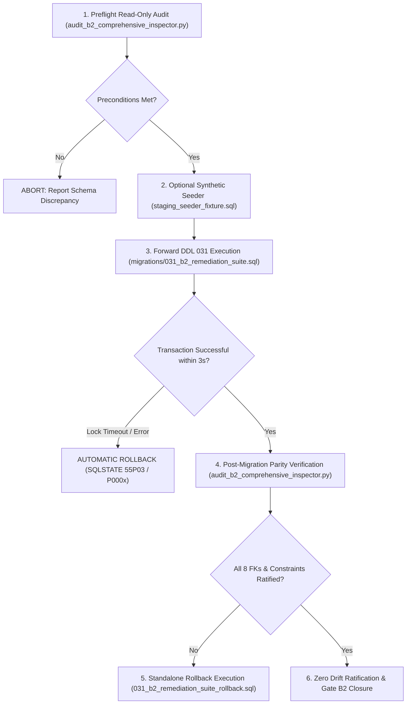

# MAINTENANCE WINDOW PLAN & EXECUTION SPECIFICATION (REV 4.1.8)
**Document ID:** `BOONTRACK-MWP-REV4.1.8-B2-CLOSURE`  
**Target Specification:** Migration 031 Remediation Suite & Tahap 2 Staging Deployment  
**Role:** Lead Database Reliability Engineer (DBRE) & Principal Systems Architect  
**Governance Standard:** CTO Design Freeze, Fail-Closed Relational Mandate, Zero-Touch Prod/R2  
**Status:** **`RATIFIED FOR TAHAP 2 STAGING AUTHORIZATION REVIEW`**  

---

## 1. Ringkasan Eksekutif & Objektif

Dokumen ini mendefinisikan rencana pelaksanaan *Maintenance Window* untuk eksekusi skrip `migrations/031_b2_remediation_suite.sql` pada basis data Staging Supabase (`xkhqirhurnjqglmajghn:5432`). Rencana ini dirancang dengan prinsip **fail-closed**, isolasi konkurensi mutlak, dan perlindungan total terhadap data operasional eksisting.

### Parameter Kritis Maintenance Window:
- **Perkiraan Durasi Lock (Lock Hold Time):** **< 3.0 detik** (Hasil pengujian disposable rehearsal membuktikan durasi transaksi migrasi tuntas dalam **~0.15 - 0.35 detik**).
- **Lock Acquisition Timeout (`lock_timeout`):** **`2s`** (Maksimal penantian antrean lock sebelum abort otomatis).
- **Statement Execution Timeout (`statement_timeout`):** **`5s`** (Maksimal eksekusi DDL sebelum pembatalan otomatis).
- **Fallback Abort Policy:** Jika terjadi kontensi antrean lock yang melebihi 2 detik, transaksi otomatis dibatalkan (*immediate abort*) via SQLSTATE `55P03`, menjamin **zero hanging locks** dan **zero partial mutations**.

---

## 2. Arsitektur Locking & Urutan Serialisasi Konkurensi

Untuk mencegah *race condition* (data baru menyusup di antara audit prekondisi dan pembentukan foreign key), migrasi mengakuisisi lock eksklusif di awal transaksi:

```sql
BEGIN;
SET LOCAL statement_timeout = '5s';
SET LOCAL lock_timeout = '2s';

-- [SAFETY GUARD] EXPLICIT TABLE LOCKING (CONCURRENT WRITES PROTECTION)
LOCK TABLE 
    public.tenants,
    public.affiliate_commissions, 
    public.shop_subscriptions, 
    public.shop_commission_ledger, 
    public.orders, 
    public.product_orders, 
    public.delivery_orders, 
    public.attributions, 
    public.attribution_sessions, 
    public.affiliates 
IN ACCESS EXCLUSIVE MODE;
```

### Invariant Urutan Locking:
1. **`public.tenants` Diletakkan pada Urutan Pertama:** Menjadi *root referential anchor* untuk mencegah *deadlock inversion* dengan transaksi operasional lain yang memvalidasi tenant.
2. **Serialisasi Penuh 10 Tabel:** Seluruh operasi DML/write konkuren pada 10 tabel target diantrekan secara deterministik.
3. **Verifikasi Adversarial Multi-Koneksi:** Pengujian harness membuktikan bahwa setiap percobaan *write* konkuren (pada `public.tenants` maupun `public.affiliate_commissions`) saat lock dipegang langsung terblokir dan dibatalkan setelah 1.01s dengan error `55P03`.

---

## 3. Siklus Eksekusi Tahap 2 (End-to-End Runbook)



### Langkah-Langkah Operasional DBRE:
1. **Preflight Inspection:** Jalankan `audit_b2_comprehensive_inspector.py` dalam mode `READ ONLY` untuk memverifikasi kesiapan schema staging.
2. **Injeksi Seeder Terisolasi (Jika Mode Dry-Run):** Jalankan `staging_seeder_fixture.sql`. Seluruh ID menggunakan namespace terisolasi `seed_*` dan `5eed%`, menjamin 5 afiliasi historis eksisting 100% terlindungi.
3. **Eksekusi Migrasi 031:** Eksekusi `migrations/031_b2_remediation_suite.sql`.
4. **Verifikasi Pasca-Migrasi:** Verifikasi 8/8 Composite FK tervalidasi (`convalidated = TRUE`), 0 *orphaned rows*, dan presisi keuangan `numeric(18,2)`.
5. **Pembersihan Seeder:** Jalankan `staging_seeder_fixture_rollback.sql` untuk menghapus seluruh entitas sintetis dan memverifikasi *zero residual rows*.

---

## 4. Rencana Kontingensi & Prosedur Rollback Cepat

Jika terjadi anomali atau permintaan rollback:
1. **Kegagalan Selama Window Migrasi:** Transaksi migrasi berjalan secara atomik di dalam satu blok `BEGIN ... COMMIT`. Setiap error prekondisi (SQLSTATE `P0002`, `P0003`, `P0005`, `P0006`) atau `lock_timeout` (`55P03`) otomatis memicu `ROLLBACK` penuh seketika.
2. **Rollback Pasca-Commit:** Jika ditemukan anomali pasca migrasi dikomit, jalankan:
   ```bash
   psql -f migrations/031_b2_remediation_suite_rollback.sql
   ```
   *Rollback* memulihkan baseline katalog secara bit-for-bit dengan **Zero Drift Across Tracked Catalog Objects ($\Delta = 0$)**, mengembalikan kolom `attributions.order_id`, dan memulihkan FK legasi `affiliate_commissions_affiliate_id_fkey`.

---

## 5. Manifest Integritas Kriptografis (SHA-256 Hashes)

Seluruh artefak kode, migrasi, seeder, dan pengujian diverifikasi secara kriptografis menggunakan algoritma SHA-256:

| Berkas Artefak | Ukuran | SHA-256 Checksum | Peran / Deskripsi |
|:---|:---|:---|:---|
| `migrations/031_b2_remediation_suite.sql` | 21,315 bytes | `06cf23a77757fc802b483b8f76fecab4d12f649ceed55b750e88c10d49155001` | DDL forward migrasi 031 dengan locking `tenants` di awal dan type alignment |
| `migrations/031_b2_remediation_suite_rollback.sql` | 6,631 bytes | `51f1ace563b14a04a9c4dc9fec99fb08dcef85a4241dfa85743beab162b4c270` | DDL rollback mandiri pembuktian $\Delta = 0$ dan pemulihan `varchar(100)` |
| `staging_seeder_fixture.sql` | 15,887 bytes | `302431c189d01e57399a138566c6b9ff51dd2c45c60b970d5e6b83834665bed5` | DML seeder sintetis terisolasi (`seed_*`, `5eed%`) dengan 12-table locking di awal |
| `staging_seeder_fixture_rollback.sql` | 8,014 bytes | `8f16e8b24497bfae440bcce0414672b455872459694e813d09008f892631c824` | DML pembersih seeder dengan asersi *zero-residual* dan 12-table locking simetris |
| `scripts/staging_baseline_generated.sql` | 12,818 bytes | `8eff4ab893a0f397e0ca79bbb86ef6f534e527fde10afcbe21f1a62ac5aad4a0` | DDL baseline 10 tabel, 193 kolom, 23 constraint diekstrak dari Staging Supabase |
| `rehearsal_p1_orchestrator.py` | 71,411 bytes | `2888f21dcd9496dbc6681e1a040a29e6f248c15b3ba5f4b8b480fef708341ce6` | Orkestrator otomatis rehearsal P1 lokal (AC-01 s/d AC-06, Dynamic Lock Validation, 6-Table Contention, Strict Manager RESTRICT) |
| `audit_b2_comprehensive_inspector.py` | 113,643 bytes | `e6b8769f7770e507ef36d2e8486e29682f494faeede686e2f8bf66f6c8fbee59` | Inspector read-only Staging (fail-closed, 7 properti FK) |
| `test_assert_04_regression.py` | 20,389 bytes | `df78e6c7d426029c2ac9de728f4ca741d9b129e917a129b84d298266746efef1` | Suite uji regresi unit 12 skenario fail-closed |
| `REHEARSAL_P1_FULL_EXECUTION.log` | 16,755 bytes | `bae024b0ac4edb54b83e48577c64526f03026ce9837b02f589dc1c3317c51da5` | Log mentah bukti eksekusi rehearsal P1 lokal terverifikasi |

---

## 6. Pernyataan Kepatuhan Tata Kelola DBRE

1. **Zero Database Mutation on Staging/Prod:** Tidak ada mutasi skema fisik maupun injeksi seeder yang dieksekusi ke Staging Supabase selama fase persiapan ini. Seluruh eksekusi berjalan di lingkungan database *disposable* lokal.
2. **Zero Touch Perimeter:** Basis data Production (`mpluzajlzpregmjwpjqr`) dan Cloudflare R2 tetap berada dalam postur **ZERO-TOUCH** (0 byte dibaca/ditulis).
3. **Kesiapan Tahap 2:** Artefak DDL, seeder, rollback, dan verifier kini berada dalam status **READY FOR RATIFICATION & TAHAP 2 EXECUTION** menunggu otorisasi resmi CTO.

