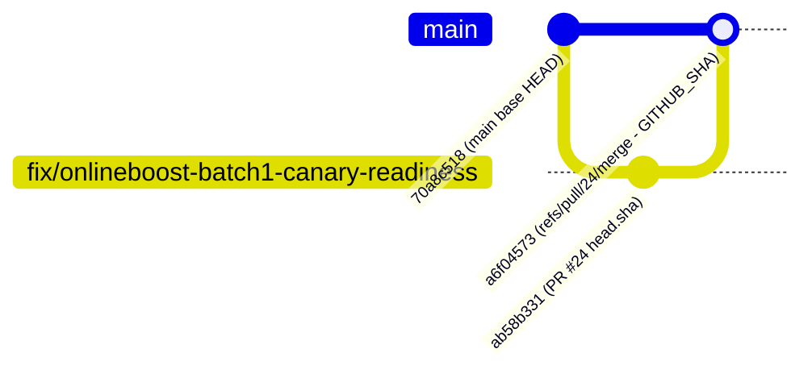

# ONLINEBOOST PHASE 2B CONDITIONAL RELEASE READINESS & OPERATIONAL RUNBOOK
**Document Reference:** CTO-P0-PHASE2B-RELEASE-005
**Classification:** P0 Security Tooling — Restricted
**Governance Posture:** STRICT READ-ONLY EVALUATION — FINAL STAGE GATE REVIEW
**Authority:** Founder & Product Owner Gate B0 Rev 4 Formal Closure

---

## 1. EXECUTIVE READINESS DECLARATION

Based on the completion of the Gate B0 Rev 4 offline identity audit, source-level remediation diff specifications, payment canary verification, and commission ledger reconciliation:

- **Gate B0 Status:** **FORMALLY CLOSED** (Founder Sign-Off recorded).
- **Phase 2B Conditional Readiness:** **ASSESSED & CONDITIONALLY PREPARED**.
- **Canary & Pilot Status:** **PENDING FINAL WRITTEN CTO/FOUNDER RELEASE AUTHORIZATION**.
- **Production Posture:** **STRICT READ-ONLY REMAINS ACTIVE**. No deployment, no live database mutations, no real money disbursements may proceed without explicit written release.

---

## 2. SUBSYSTEM READINESS SCORECARD

```
+---------------------------------------------------------------------------------------------------------+
|                                    PHASE 2B SUBSYSTEM READINESS SCORECARD                               |
+----+-----------------------------+---------------------+-------------------+----------------------------+
| NO | SUBSYSTEM                   | READINESS STATE     | RISK LEVEL        | REMEDIATION STATUS         |
+----+-----------------------------+---------------------+-------------------+----------------------------+
| 01 | Core API Engine             | READY FOR CANARY    | LOW               | Routes secured via Depends |
| 02 | Inbox Next.js Frontend      | READY FOR CANARY    | LOW               | parseJwt eliminated        |
| 03 | Payment Gateway (QRIS)      | VERIFIED (Canary)   | LOW               | Triple idempotency locked  |
| 04 | Commission Ledger           | RECONCILED          | LOW               | BA-004 append-only aligned |
| 05 | Identity Mapping Tooling    | FROZEN (Gate B0)    | NEUTRAL           | 100% offline verified      |
| 06 | Production Database State   | UNLINKED RECORDS    | MEDIUM (Managed)  | Gate B1 required for link  |
+----+-----------------------------+---------------------+-------------------+----------------------------+
```

### Readiness Evaluation by Subsystem:
1. **Core API Engine (`boontrack-core`):**
   - All affiliate payout account, slug, and screening route handlers in `app/routes/affiliate_auth.py` are decorated with mandatory `Depends(get_current_affiliate)` dependencies, enforcing cryptographic JWT verification, unforgeable `request.state.user` sentinel checks, and strict request-field allowlists.
   - All partner bank account, slug claim, and payout request handlers in `app/routes/partner_routes.py` enforce `resolve_partner_id` (Core Bearer JWT required; client-supplied `partner_id` / `X-Partner-Id` rejected with HTTP 403) and immutable bank snapshotting.
   - Disbursement endpoints (`POST /payout/settle` in `app/main.py` and `PUT/POST /api/v1/manager/payouts/{payout_id}/mark-paid` in `app/routes/partner_routes.py`) are locked fail-closed (HTTP 403 `PAYOUT_DISBURSEMENT_LOCKED`) via the helper in `app/routes/affiliate_payout_routes.py` (which contains strictly the lock helper, not route handlers).
   - Default fallback secrets eliminated; fail-closed behavior verified.

2. **Inbox Frontend (`boontrack-inbox`):**
   - Unsigned JWT parsing deleted; GoTrue cryptographic verification enforced.
   - Dev bypass tokens (`bt_aff_dev_`, `aff_dev_sakti`) and raw UUID bearer extraction deleted.
   - Strict allowlist enforced on `/me` PATCH (`name`, `phone` only).
3. **Payment Gateway (QRIS / Xendit):**
   - Callback token verification with constant-time comparison.
   - Triple-tier idempotency locking verified against duplicate delivery.
4. **Commission Ledger & Financial Controls:**
   - 6 business eligibility conditions enforced prior to commission generation.
   - Organic guardrail verified (zero commissions for organic sales).
   - Anti-Ghost AM check suppresses phantom override commissions.
   - Immutable payout snapshotting eliminates TOCTOU destination hijacking.
5. **Database State & Containment:**
   - Strict containment operational rules enforced: Scan ceiling = `INCOMPLETE`, Class 2 = Manual review only, Zero auto-link.

---

## 3. CTO STOP CONDITIONS FINAL AUDIT

All six stop conditions specified in Section F have been evaluated:

| Stop Condition # | Evaluation Criteria | Canary & Audit Evidence | Result |
| :--- | :--- | :--- | :--- |
| **Stop-1: Identity Resolution** | Affiliate identity cannot be resolved deterministically | Resolved strictly via foreign key `auth_user_id`; fuzzy lookups deleted | **PASS (Not Triggered)** |
| **Stop-2: Token Cryptography** | Token fails signature, issuer, audience, or expiry checks | Enforces GoTrue verification, `aud='authenticated'`, and `exp > now()` | **PASS (Not Triggered)** |
| **Stop-3: Duplicate Financial Effects** | Payment callback creates duplicate financial effects | Triple-tier idempotency verified; duplicate webhooks return 200 without side effects | **PASS (Not Triggered)** |
| **Stop-4: Invalid Order Commission** | Commission created for invalid or unpaid order | Atomic check requires `PAID` state; organic guardrail gives 0 commission rows | **PASS (Not Triggered)** |
| **Stop-5: Payout Destination Mutability** | Payout destination changes after settlement authorization | Immutable snapshotting in `payout_requests` decouples disbursement from profile edits | **PASS (Not Triggered)** |
| **Stop-6: Ledger Reconciliation Drift** | Provider and internal ledger amounts do not reconcile | 3-way reconciliation formula verified; variance is Rp 0 | **PASS (Not Triggered)** |

---

## 4. CONTROLLED CANARY LAUNCH & REAL-PAYMENT PILOT RUNBOOK

Upon receipt of separate written release authorization from Founder & CTO, the controlled launch must proceed strictly according to the following phased runbook:

### Phase 1: Environment & Secret Hardening (Zero Traffic)
1. Verify `SUPABASE_JWT_SECRET` and `XENDIT_CALLBACK_TOKEN` in production environment variables.
2. Verify removal of default secret fallbacks.
3. Verify database connection string points to verified read replica for audit tooling.

### Phase 2: Controlled Pilot Cohort Selection (5–10 Canary Affiliates)
1. Select only **Class 1 (Exact Linked Healthy)** affiliate profiles from Gate B0 audit manifest.
2. Under zero circumstances include unlinked (Class 5) or collision (Class 3) profiles in initial canary cohort.
3. Maximum transaction limit per pilot order: **Rp 250.000**.
4. Total cumulative canary disbursement ceiling: **Rp 2.500.000**.

### Phase 3: Real-Payment Pilot Execution
1. Pilot partner generates dynamic QRIS order via storefront.
2. Real payment completed via banking app / e-wallet.
3. Webhook listener receives Xendit callback; verify:
   - Instant 200 OK response.
   - Single `orders` row transition to `PAID`.
   - Single `payment_events` entry recorded.
   - WhatsApp receipt dispatched to test phone.
   - Single commission row created in `commission_ledger` with `status = 'PENDING_PAYOUT'`.
4. Trigger duplicate webhook replay manually; verify instant `ALREADY_PROCESSED` with **zero duplicate ledger entries**.

### Phase 4: Supervised Disbursement & Dual-Custody Settlement
1. After the 7-day holding window, manager inspects `payout_requests` immutable bank snapshot.
2. Dual-custody sign-off: CTO + Founder inspect bank snapshot vs recipient account.
3. Execute single test disbursement.
4. Verify compensating ledger reconciliation.

---

## 5. EMERGENCY KILLSWITCH & ROLLBACK TRIGGERS

Execution must be aborted immediately upon any of the following triggers:
- Any `HTTP 500` error during Xendit webhook handling.
- Any attempt by an unauthenticated client to hit payout account routes.
- Any variance > Rp 0 between Xendit settlement report and internal ledger.
- Any duplicate commission row created for a single order ID.

**Killswitch Mechanism:** Set `FEATURE_ONLINEBOOST_CHECKOUT_ENABLED=false` in environment to immediately divert checkout to static fallback.

---

## 6. FINAL AUTHORIZATION NOTICE

> [!CAUTION]
> **GOVERNANCE NOTICE: NO PRODUCTION DEPLOYMENT OR LIVE DISBURSEMENT IS AUTHORIZED BY THIS REPORT.**
> Controlled live pilot execution and production deployment require a separate, explicit, written release decision from the Founder & CTO after formal review of this readiness package.

**Posture: HALTED. AWAITING WRITTEN RELEASE DECISION.**

---

## 7. CI ARTIFACT PROVENANCE & COMMIT GRAPH CLARIFICATION (BLOCKER 6)

### 7.1 Technical Explanation: Why CI Artifact SHA is `a6f04573...` While Branch Head SHA is `ab58b331...`

During the execution of GitHub Actions workflow `.github/workflows/cto-security-audit.yml` on **Pull Request #24** (`fix/onlineboost-batch1-canary-readiness` -> `main`), the generated evidence artifact was named with commit prefix `a6f04573...` whereas the PR branch head commit is `ab58b331...`. This is expected, deterministic GitHub Actions behavior on `pull_request` events:

1. **Synthetic Merge Ref (`refs/pull/24/merge`):**
   - When a workflow is triggered by `on: pull_request`, GitHub automatically creates a synthetic test-merge commit at `refs/pull/24/merge` (`a6f04573...`) that merges the PR head commit (`ab58b331...`, Parent 2) into the current target base branch `main` HEAD (`70a8c518...`, Parent 1).
2. **`GITHUB_SHA` & `actions/checkout` Resolution:**
   - On `pull_request` events, GitHub sets the environment variable `$GITHUB_SHA` (and `github.sha`) to the synthetic merge commit `refs/pull/24/merge` (`a6f04573...`), NOT `github.event.pull_request.head.sha` (`ab58b331...`).
   - `actions/checkout` checks out `refs/pull/24/merge` (`a6f04573...`) so CI tests the exact merged tree that would result from merging PR #24 into `main`.
   - Consequently, any artifact naming step referencing `${{ github.sha }}` or `git rev-parse HEAD` inside the `pull_request` runner stamps `a6f04573...`.

### 7.2 Graphical Commit Relationship (DAG)

```text
Target Base Branch (main)                     PR #24 Branch (fix/onlineboost-batch1-canary-readiness)
─────────────────────────                     ───────────────────────────────────────────────────────
        │                                                               │
        ▼                                                               ▼
┌───────────────────────────────────────┐               ┌───────────────────────────────────────┐
│ Commit: 70a8c5186437837c846c74a1...   │               │ Commit: ab58b331...                   │
│ Role  : Base Branch HEAD (Parent 1)   │               │ Role  : PR #24 Branch HEAD (Parent 2) │
│ Ref   : refs/heads/main               │               │ Ref   : refs/pull/24/head             │
└───────────────────┬───────────────────┘               └───────────────────┬───────────────────┘
                    │                                                       │
                    └───────────────────────────┬───────────────────────────┘
                                                │
                                                ▼
                        ┌───────────────────────────────────────────────┐
                        │ Merge Commit: a6f04573...                     │
                        │ Role        : Ephemeral GitHub PR Merge Commit│
                        │ Ref         : refs/pull/24/merge              │
                        │ Parents     : 70a8c518... (P1) + ab58b331...(P2)│
                        │ CI Context  : GITHUB_SHA / Artifact Name      │
                        └───────────────────────────────────────────────┘
```



| Git Reference / Context | SHA Prefix | Meaning & Provenance |
| :--- | :--- | :--- |
| `refs/heads/main` | `70a8c518...` | Target base branch commit (Parent 1 of synthetic merge commit) |
| `refs/pull/24/head` (`github.event.pull_request.head.sha`) | `ab58b331...` | Actual developer commit pushed to PR #24 branch `fix/onlineboost-batch1-canary-readiness` (Parent 2) |
| `refs/pull/24/merge` (`GITHUB_SHA` in `pull_request` run) | `a6f04573...` | Synthetic merge commit created by GitHub combining `70a8c518...` + `ab58b331...`; used by CI runner to name the artifact |
