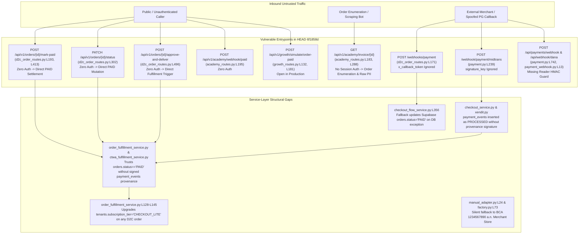
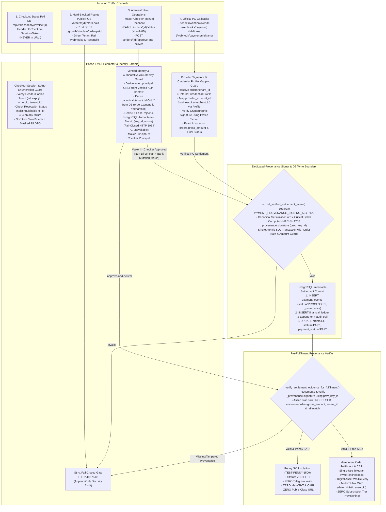

# PHASE 1 IMPLEMENTATION PLAN v1.1 — PAYMENT SECURITY CONTAINMENT (FINAL)

**Repository:** `boontrack-core`  
**Baseline Commit:** `HEAD 6f1858d` (`docs/rev4-1-remediation-and-review`)  
**Priority:** `P0 — Financial & Payment Security`  
**Operational Status:** `FINAL SECURITY ADDENDUM INTEGRATED / SOURCE IMPLEMENTATION HOLD`  
**Database & Production Status:** `ZERO-TOUCH`  
**Prerequisite References:**
- [RFC-Payment-Remediation-v1.1.md](file:///c:/boontrack-core/RFC-Payment-Remediation-v1.1.md)
- [INVENTORY-LEGACY-QRIS.md](file:///c:/boontrack-core/INVENTORY-LEGACY-QRIS.md)
- [PHASE-1-IMPLEMENTATION-PLAN.md](file:///c:/boontrack-core/PHASE-1-IMPLEMENTATION-PLAN.md) *(Superseded by v1.1)*

---

## 1. Executive Summary & CTO Final Security Mandates

Dokumen **Phase 1 Implementation Plan v1.1 (Final)** ini merupakan cetak biru kontainmen keamanan pembayaran `boontrack-core` yang telah mengintegrasikan seluruh keputusan kebijakan, koreksi desain, dan **enam penguatan keamanan akhir CTO**. Tidak ada perubahan kode sumber, migrasi database, perubahan konfigurasi runtime, maupun akses produksi yang dilakukan pada tahap ini (`SOURCE IMPLEMENTATION: HOLD`).

### 1.1 Deklarasi Invarian Keamanan Phase 1 v1.1
1. **Single Authoritative Anti-Replay Store (PostgreSQL SSOT):**
   - PostgreSQL ditetapkan sebagai **satu-satunya penyimpanan anti-replay otoritatif (*Single Authoritative Replay Store*)** lintas worker dengan keunikan atomik pada `(key_id, nonce)` dan bukti replay persisten.
   - Redis **dilarang** menjadi fallback otoritatif alternatif dari PostgreSQL; Redis hanya boleh digunakan sebagai *L1 fast-reject cache/optimization*. Jika PostgreSQL tidak tersedia, seluruh request mutasi wajib **fail-closed (`HTTP 503`)**.
2. **Strict HMAC Identity & Canonical Tenant Binding:**
   - Identitas aktor (`actor_principal`) wajib berasal murni dari **konteks autentikasi yang telah terverifikasi secara kriptografis** (ikatan `key_id` $\rightarrow$ `service_principal` pada konfigurasi server atau klaim `sub` dari Verified Admin JWT), **bukan** dari `actor_id` di request body.
   - Kepemilikan order (`canonical_tenant_id`) wajib diverifikasi terhadap relasi internal database (`INNER JOIN tenants t ON o.tenant_id = t.id::text`) tanpa fallback `OR o.tenant_slug = t.slug` dan tanpa pernah memercayai `tenant_id` dari request body.
3. **Dedicated Provenance Signing Key, Canonical Serialization, & DB Write Boundary:**
   - `payment_events` menggunakan **kunci penandatangan provenance khusus (`PAYMENT_PROVENANCE_SIGNING_KEYRING_JSON`)** yang terpisah secara kriptografis dari kunci mutasi internal HMAC.
   - Signature provenance mencakup seluruh field pembayaran kritis melalui **serialisasi kanonik deterministik**, dilengkapi versi kunci (`prov_key_id`), rotasi kunci, batas akses secret, dan pembatasan penulisan database sehingga `payment_events` tidak dapat dimanipulasi untuk melewati guard fulfillment.
4. **Provider Account Binding via Internal Credential Profile:**
   - Identitas eksternal provider (`merchant_id`, `business_id`, atau `device_id`) **tidak pernah dianggap identik dengan `tenant_id`**. Setiap `provider_account_id` wajib dipetakan melalui **Internal Credential Profile** milik tenant ke `canonical_tenant_id` (`tenants.id`) yang sah.
5. **Checkout Session Security (Zero URL/Log/Referer Leakage & Anti-Enumeration):**
   - Token sesi checkout (`X-Checkout-Session-Token` atau cookie `__Host-bt_checkout_st`) **dilarang keras dikirim melalui URL query parameter**, difilter dari access log, disertai header `Referrer-Policy: no-referrer`, mendukung rotasi kunci dan pencabutan (*revocation*), serta menghasilkan respons `HTTP 404` konstan yang tidak membocorkan keberadaan order.
6. **Maker-Checker Dual Principal Control & Bukti Mutasi (Direct Tenant Rail Disabled):**
   - Maker dan Checker wajib berasal dari identitas terverifikasi dengan **principal yang berbeda (`maker_principal_id != checker_principal_id`)**.
   - **Hash file bukti (`proof_artifact_sha256`) hanya menjamin keutuhan file dan TIDAK PERNAH dianggap sebagai bukti kebenaran settlement pembayaran**; validasi tetap mewajibkan pencocokan referensi mutasi rekening bank yang unik (`bank_statement_mutation_id`) dan nominal eksak. Jalur ini tetap **DISABLED (`HTTP 403`)** untuk Direct Tenant Rail.
7. **Public `/mark-paid` Disabled, `CHECKOUT_LITE` Decoupled, `/simulate/order-paid` Blocked in Prod, & Dummy Account `1234567890` Eliminated:**
   - Public `/mark-paid` tidak boleh melakukan settlement (`HTTP 403`), auto-upgrade `CHECKOUT_LITE` dihapus total dari fulfillment order, `/growth/simulate/order-paid` mati di production (`HTTP 403`), dan fallback rekening dummy `1234567890` dihapus secara *fail-closed* (`HTTP 422`).

---

## 2. Current-State Architecture & Vulnerability Surface

Pada baseline `HEAD 6f1858d`, `boontrack-core` menjalankan **Dual-Runner Architecture** (FastAPI pada [`app/main.py`](file:///c:/boontrack-core/app/main.py) dan `aiohttp.web` pada [`main.py`](file:///c:/boontrack-core/main.py)) dengan permukaan kerentanan yang teridentifikasi sebagai berikut:



---

## 3. Endpoint & Caller Inventory (Read-Only vs. Mutation Classification)

| Endpoint & Lokasi Kode | Runner | Klasifikasi Target v1.1 (Final) | Status Auth Saat Ini (`6f1858d`) | Pemanggil (`Callers`) | Mutasi Status / Fulfillment / CAPI? | Risiko Saat Ini |
| :--- | :---: | :--- | :--- | :--- | :--- | :--- |
| **`POST /api/v1/orders/{order_id}/mark-paid`**<br>**`POST /v1/orders/{order_id}/mark-paid`**<br>[`app/routes/d2c_order_routes.py:L193-L293, L413-L495`](file:///c:/boontrack-core/app/routes/d2c_order_routes.py#L193-L495) | FastAPI & aiohttp | **DISABLED PUBLIC SETTLEMENT** *(Selalu ditolak `HTTP 403 PUBLIC_MARK_PAID_DISABLED`)* | **NONE** (`authorization` header di [`L198`](file:///c:/boontrack-core/app/routes/d2c_order_routes.py#L198) diabaikan; aiohttp [`L413`](file:///c:/boontrack-core/app/routes/d2c_order_routes.py#L413) tanpa header check). | 0 pemanggil di `boontrack-inbox` / `frontend`. Hanya dipanggil di 3 file test lama. | **YA** (Saat ini memutasi `orders.status='PAID'`, memicu fulfillment, upgrade tier `CHECKOUT_LITE`, Telegram invite, & Meta CAPI). | **CRITICAL (`CVSS 9.8`)**: Pelunasan tanpa otorisasi & lintas tenant. |
| **`POST /api/v1/admin/orders/{order_id}/reconcile-manual/request`** & **`/approve`** | FastAPI & aiohttp | **MAKER-CHECKER ADMINISTRATIVE RECONCILIATION** *(Disabled untuk Direct Tenant Rail)* | Belum ada di `6f1858d`. | Workflow rekonsiliasi keuangan internal (Verified Maker Principal $\neq$ Verified Checker Principal + Unik `bank_statement_mutation_id` + Append-Only Audit). | **DISABLED UNTUK DIRECT TENANT RAIL** (`HTTP 403 DIRECT_TENANT_RAIL_DISABLED`). | Dikunci penuh dengan canonical `orders.tenant_id == tenants.id` & Maker-Checker. |
| **`PATCH /api/v1/orders/{order_id}/status`**<br>**`PATCH /v1/orders/{order_id}/status`**<br>[`app/routes/d2c_order_routes.py:L302-L406`](file:///c:/boontrack-core/app/routes/d2c_order_routes.py#L302-L406) | FastAPI *(+ aiohttp parity)* | **ADMINISTRATIVE NON-SETTLEMENT MUTATION** *(Dilarang mengubah status ke `PAID`/`SETTLED`/`LUNAS`)* | **NONE** (Hanya membaca `x_correlation_id` di [`L307`](file:///c:/boontrack-core/app/routes/d2c_order_routes.py#L307)). | 0 pemanggil di `boontrack-inbox` / `frontend`. Dipanggil di [`tests/test_security_audit_fixes.py:L142`](file:///c:/boontrack-core/tests/test_security_audit_fixes.py#L142). | **YA** (Saat ini mengizinkan transisi ke `PAID` dan memicu `handle_order_paid_fulfillment` di [`L386`](file:///c:/boontrack-core/app/routes/d2c_order_routes.py#L386)). | **CRITICAL (`CVSS 9.8`)**: Bypass settlement & ketiadaan cek `tenant_id`. |
| **`POST /api/v1/orders/{order_id}/approve-and-deliver`**<br>**`POST /api/v1/orders/{order_id}/approve-and-deliver`**<br>[`app/routes/d2c_order_routes.py:L496-L517`](file:///c:/boontrack-core/app/routes/d2c_order_routes.py#L496-L517) | FastAPI *(+ aiohttp parity)* | **ADMINISTRATIVE FULFILLMENT TRIGGER** *(Hanya berjalan jika signature provenance `payment_events` valid)* | **NONE** | 0 pemanggil di `boontrack-inbox` / `frontend`. Dipanggil di [`tests/test_zero_trust_fulfillment.py:L88`](file:///c:/boontrack-core/tests/test_zero_trust_fulfillment.py#L88). | **YA** (Memicu `handle_order_paid_fulfillment`). | **HIGH (`CVSS 8.6`)**: Tanpa autentikasi & tanpa validasi `tenant_id`. |
| **`GET /api/v1/academy/invoice/{order_id}`**<br>[`app/routes/academy_routes.py:L183-L192, L288-L293, L317`](file:///c:/boontrack-core/app/routes/academy_routes.py#L183-L317) | FastAPI & aiohttp | **SESSION-AUTHORIZED READ-ONLY STATUS** *(Header/Cookie Session Token Only — Zero URL Token — Uniform 404 + PII Masked DTO)* | Public tanpa token sesi checkout di `6f1858d`. | Halaman checkout pembeli (polling status pembayaran QRIS). | **TIDAK** (Murni baca, zero side-effect). | **HIGH (`CVSS 7.5`)**: Rawan enumerasi `order_id` dan kebocoran PII pelanggan. |
| **`POST /webhooks/payment`**<br>**`POST /api/v1/webhooks/payment`**<br>**`POST /api/v1/webhook/payment`**<br>[`app/routes/d2c_order_routes.py:L171-L180`](file:///c:/boontrack-core/app/routes/d2c_order_routes.py#L171-L180) | FastAPI | **PROVIDER WEBHOOK (Xendit Callback)** | **NONE** (`x_callback_token` di [`L174`](file:///c:/boontrack-core/app/routes/d2c_order_routes.py#L174) diabaikan). | Callback Payment Gateway / Test suite. | **YA** (Memanggil [`reconcile_payment_webhook`](file:///c:/boontrack-core/app/services/checkout_flow_service.py#L303)). | **CRITICAL (`CVSS 9.8`)**: Tanpa verifikasi token & tanpa pemetaan credential profile. |
| **`POST /webhook/payment/midtrans`** (& 3 alias)<br>[`app/routes/payment.py:L239-L422, L859-L868`](file:///c:/boontrack-core/app/routes/payment.py#L239-L422) | FastAPI & aiohttp | **PROVIDER WEBHOOK (Midtrans Callback)** | **NONE** (`signature_key` di [`L250`](file:///c:/boontrack-core/app/routes/payment.py#L250) tidak diverifikasi SHA-512). | Midtrans Webhook Engine. | **YA** (Mutasi `orders.status='PAID'`, `reconcile_payment_webhook`, WABA e-receipt, `dispatch_all_capi`). | **CRITICAL (`CVSS 9.8`)**: Tanpa verifikasi SHA-512 & tanpa pemetaan credential profile. |
| **`POST /api/v1/academy/webhook/paid`**<br>[`app/routes/academy_routes.py:L195-L220, L295-L302, L318`](file:///c:/boontrack-core/app/routes/academy_routes.py#L195-L318) | FastAPI & aiohttp | **SIGNED INTERNAL / PG CALLBACK ONLY** | **NONE** | Internal Academy callback / test suite. | **YA** (Memanggil [`academy_bot.handle_webhook_paid`](file:///c:/boontrack-core/app/services/academy_service.py#L412)). | **CRITICAL (`CVSS 9.8`)**: Terbuka tanpa verifikasi signature/token. |
| **`POST /api/v1/growth/simulate/order-paid`**<br>[`app/routes/growth_routes.py:L132-L203`](file:///c:/boontrack-core/app/routes/growth_routes.py#L132-L203) | FastAPI & aiohttp | **DISABLED IN PRODUCTION** | **NONE** | Pengujian internal atribusi afiliasi. | **YA** (Memicu komisi afiliasi & CAPI). | **HIGH (`CVSS 8.2`)**: Terbuka di production tanpa auth. |
| **`POST /api/payments/webhook`** ([`payment.py:L742`](file:///c:/boontrack-core/app/routes/payment.py#L742))<br>**`POST /api/webhook/payment-reader`** & **`/dana`** ([`payment_webhook.py:L13`](file:///c:/boontrack-core/app/routes/payment_webhook.py#L13)) | FastAPI & aiohttp | **DIRECT TENANT RAIL (Disabled by Default; Credential Profile Mapped)** | **NONE** | Aplikasi Android Notification Reader. | **YA** (Mengubah status order `WAITING_PAYMENT` menjadi `PAID`). | **CRITICAL (`CVSS 9.1`)**: Direct Tenant Rail belum layak produksi & tanpa HMAC guard. |

---

## 4. Security Risk Register (Final v1.1)

| Risk ID | Severity | Lokasi Komponen | Deskripsi Kerentanan | Mitigasi Arsitektural v1.1 (Final) |
| :--- | :---: | :--- | :--- | :--- |
| **RISK-P1-01** | **CRITICAL** | [`app/services/payment/manual_adapter.py:L24`](file:///c:/boontrack-core/app/services/payment/manual_adapter.py#L24)<br>[`app/services/payment/factory.py:L73, L100`](file:///c:/boontrack-core/app/services/payment/factory.py#L73) | Fallback otomatis ke rekening dummy `BCA 1234567890 a.n. Merchant Store` saat konfigurasi pembayaran tenant kosong/rusak. | Diprioritaskan ke **High-Risk Perimeter Lockdown (Stage 2A)**: hapus default `1234567890` di `ManualTransferAdapter` & `PaymentAdapterFactory`, tolak checkout secara *fail-closed* (`HTTP 422 PAYMENT_METHOD_UNCONFIGURED`). |
| **RISK-P1-02** | **CRITICAL** | [`app/routes/d2c_order_routes.py:L193-L517`](file:///c:/boontrack-core/app/routes/d2c_order_routes.py#L193-L517) | Endpoint `/mark-paid`, `PATCH /status`, dan `/approve-and-deliver` terbuka tanpa auth dan mengizinkan settlement publik. | Nonaktifkan settlement pada `/mark-paid` (`HTTP 403`); larang `PATCH /status` mengubah status menjadi `PAID`; terapkan Maker-Checker dengan principal terverifikasi yang berbeda + unik `bank_statement_mutation_id` (tetap disabled untuk Direct Tenant Rail). |
| **RISK-P1-03** | **CRITICAL** | [`app/routes/d2c_order_routes.py:L171`](file:///c:/boontrack-core/app/routes/d2c_order_routes.py#L171)<br>[`app/routes/payment.py:L239`](file:///c:/boontrack-core/app/routes/payment.py#L239) | `/webhooks/payment` mengabaikan `x_callback_token`; `/webhook/payment/midtrans` mengabaikan SHA-512 `signature_key`; asumsi keliru bahwa `merchant_id`/`business_id` sama dengan `tenant_id`. | Wajibkan verifikasi kriptografis provider (`hmac.compare_digest`) dan petakan `provider_account_id` (`business_id`/`merchant_id`) melalui **Internal Credential Profile** ke `canonical_tenant_id` (`orders.tenant_id`) di **Stage 3** (sebelum fulfillment guard). |
| **RISK-P1-04** | **CRITICAL** | [`app/services/checkout_service.py:L184`](file:///c:/boontrack-core/app/services/checkout_service.py#L184)<br>[`app/routes/xendit.py:L433`](file:///c:/boontrack-core/app/routes/xendit.py#L433)<br>[`app/services/order_fulfillment_service.py:L63`](file:///c:/boontrack-core/app/services/order_fulfillment_service.py#L63) | Baris `payment_events` dapat dimasukkan sebagai `PROCESSED` tanpa provenance bertanda tangan, atau berbagi kunci dengan internal mutation HMAC. | Gunakan **dedicated provenance signing key (`PAYMENT_PROVENANCE_SIGNING_KEYRING_JSON`)** yang terpisah dari internal mutation HMAC, tanda tangani seluruh field pembayaran kritis secara kanonik sebelum insert `PROCESSED`, batasi jalur write DB, dan verifikasi ulang signature sebelum fulfillment/CAPI. |
| **RISK-P1-05** | **HIGH** | Replay attack lintas worker & pemalsuan `actor_id`/`tenant_id` di request body | Penggunaan Redis sebagai fallback otoritatif dari PostgreSQL membuka celah split-brain replay; pembacaan `actor_id`/`tenant_id` dari body memungkinkan spoofing identitas. | Tetapkan PostgreSQL sebagai **satu-satunya authoritative replay store** dengan keunikan atomik `(key_id, nonce)` (Redis hanya L1 cache; fail-closed jika PG down). Ambil `actor_principal` murni dari konteks auth terverifikasi dan `canonical_tenant_id` murni dari relasi internal DB (`o.tenant_id = t.id::text`). |
| **RISK-P1-06** | **HIGH** | [`app/routes/academy_routes.py:L183, L288`](file:///c:/boontrack-core/app/routes/academy_routes.py#L183) | `GET /api/v1/academy/invoice/{order_id}` rawan enumerasi order, kebocoran PII, serta risiko kebocoran token jika dikirim via URL query string. | Wajibkan pengiriman token sesi checkout hanya melalui header `X-Checkout-Session-Token` atau cookie `__Host-bt_checkout_st` (**dilarang di URL**), terapkan normalisasi respons `HTTP 404` konstan yang tidak membocorkan keberadaan order, dukung rotasi & revokasi token, serta masking PII. |
| **RISK-P1-07** | **HIGH** | [`app/services/order_fulfillment_service.py:L128-L145`](file:///c:/boontrack-core/app/services/order_fulfillment_service.py#L128-L145)<br>[`app/services/checkout_flow_service.py:L352-L361`](file:///c:/boontrack-core/app/services/checkout_flow_service.py#L352-L361) | Fulfillment order produk D2C meng-upgrade `tenants.subscription_tier = 'CHECKOUT_LITE'`, dan kegagalan DB pada `reconcile_payment_webhook` tetap memaksa update Supabase `status='PAID'`. | Hapus total kode mutasi `CHECKOUT_LITE` dari `handle_order_paid_fulfillment` dan hapus fallback update `PAID` di dalam blok `except` pada `reconcile_payment_webhook`. |

---

## 5. Target-State Payment Security Design (Final v1.1)

Diagram berikut menggambarkan arsitektur target Phase 1 v1.1 yang memisahkan **Authoritative Anti-Replay Store (PostgreSQL)**, **Internal Credential Profile Mapping**, **Dedicated Provenance Signing Key**, dan **Zero-Leak Checkout Session Polling**:



---

## 6. Detailed Security Architecture Specifications (Reinforcements #1 – #6)

### 6.1 Anti-Replay Architecture: Single Authoritative PostgreSQL Store (Penguatan #1)
1. **Satu Authoritative Replay Store Lintas Worker (PostgreSQL):**
   - Seluruh proses worker FastAPI dan aiohttp berbagi **satu authoritative replay store di PostgreSQL**.
   - **Larangan Redis sebagai Fallback Otoritatif:** Redis **dilarang keras** dijadikan fallback otoritatif alternatif apabila PostgreSQL gagal, dan Redis tidak pernah menjadi penentu akhir diterimanya suatu request mutasi. Jika Redis mengalami *eviction*, *restart*, atau *partition*, mengandalkan Redis sebagai fallback akan membuka celah *replay* lintas worker.
   - **Peran Redis (Murni L1 Fast-Reject Cache):**
     - Sebelum membuka transaksi PostgreSQL, guard boleh melakukan pengecekan cepat `SISMEMBER` / `GET payment:hmac:replay_cache:{key_id}:{nonce}` di Redis.
     - Jika *cache hit* di Redis $\rightarrow$ tolak cepat (`HTTP 403 HMAC_REPLAY_DETECTED`).
     - Jika *cache miss* atau Redis mati $\rightarrow$ wajib lanjut ke pemeriksaan dan klaim atomik di **PostgreSQL Authoritative Store**.
2. **Keunikan Atomik `(key_id, nonce)` & Persistent Replay Evidence:**
   - Klaim anti-replay dieksekusi secara atomik di PostgreSQL dengan menyimpan bukti replay persisten (*persistent replay evidence*):
     - Mengikat pasangan unik `(key_id, nonce)` (`event_id = f"hmac_nonce:{key_id}:{nonce}"` dengan constraint `UNIQUE`).
     - Menyimpan metadata bukti audit: `key_id`, `nonce`, `verified_actor_principal`, `canonical_tenant_id`, `order_id`, `http_method`, `canonical_path`, `request_timestamp`, `body_sha256`, `client_ip`, dan `consumed_at_utc`.
   - Pernyataan SQL mengeksekusi `INSERT ... ON CONFLICT (event_id) DO NOTHING RETURNING event_id`.
   - Apabila `RETURNING` tidak mengembalikan baris (berarti `(key_id, nonce)` sudah pernah diklaim oleh worker mana pun), guard mencatat log keamanan `PERSISTENT_REPLAY_EVIDENCE_REJECTED` dan langsung menolak request dengan `HTTP 403 HMAC_REPLAY_DETECTED`.
3. **Strict Fail-Closed saat Authoritative Store Tidak Tersedia:**
   - Apabila koneksi PostgreSQL gagal, timeout, atau mengalami error saat mencoba menulis klaim `(key_id, nonce)`, request mutasi **WAJIB langsung ditolak secara fail-closed (`HTTP 503 AUTHORITATIVE_REPLAY_STORE_UNAVAILABLE`)**.

### 6.2 HMAC Identity Binding & Canonical Tenant Resolution (Penguatan #2)
1. **Actor Identity Wajib Berasal dari Verified Authentication Context:**
   - **Larangan Percaya Payload/Header Klaim Sendiri:** Field seperti `actor_id`, `agent_id`, `user_id`, atau `tenant_id` di dalam JSON request body **tidak pernah dipercaya** sebagai identitas otoritatif.
   - **Untuk Service-to-Service Internal HMAC:**
     - Setiap `key_id` di dalam `PAYMENT_INTERNAL_HMAC_KEYRING_JSON` memiliki definisi server-side yang tidak dapat diubah oleh pemanggil:
       ```json
       {
         "pim_k202611_reconciler": {
           "secret": "<high_entropy_secret>",
           "status": "ACTIVE",
           "bound_principal": "svc:finance_reconciler_worker",
           "allowed_endpoints": ["POST:/api/v1/orders/*/approve-and-deliver"]
         }
       }
       ```
     - Begitu signature HMAC untuk `key_id` terverifikasi, `verified_actor_principal` diambil langsung dari `keyring[key_id].bound_principal` di memori server. Header `X-Payment-Internal-Actor` wajib sama persis dengan `bound_principal` tersebut (`hmac.compare_digest`).
   - **Untuk Operasi Admin Manusia:**
     - `verified_actor_principal` (`users.id` / JWT `sub`), `verified_roles`, dan `actor_tenant_id` diambil murni dari hasil dekode kriptografis Verified Admin JWT serta validasi status aktif user di database.
2. **Canonical Tenant Identity Diverifikasi Terhadap Relasi Order Internal:**
   - Guard selalu me-resolve `canonical_tenant_id` (`tenants.id`) langsung dari database melalui relasi internal:
     ```sql
     SELECT
         o.id AS order_id,
         o.tenant_id AS canonical_tenant_id,
         o.tenant_slug AS recorded_tenant_slug,
         o.gross_amount,
         o.status,
         o.payment_status,
         o.product_id,
         t.id::text AS verified_tenant_id,
         t.slug AS verified_tenant_slug
     FROM orders o
     INNER JOIN tenants t
         ON o.tenant_id = t.id::text
     WHERE o.id = %s
     LIMIT 1;
     ```
   - **Zero `tenant_slug` `OR` Fallback:** Klausa `OR o.tenant_slug = t.slug` dilarang digunakan pada query otorisasi. Resolusi legacy `tenant_slug` untuk data historis pra-cutoff diisolasi sepenuhnya di dalam helper read-only `resolve_legacy_order_tenant_id_isolated(order_id)` yang hanya mengizinkan lookup deterministik 1-ke-1 ke `tenants.id` untuk order lama (`created_at < PHASE1_CANONICAL_TENANT_CUTOFF_UTC`).
   - String kanonik yang diverifikasi oleh `verify_internal_payment_hmac` wajib menggunakan `verified_tenant_id` hasil query relasional di atas:
     ```text
     v1|{key_id}|{timestamp}|{nonce}|{http_method_upper}|{canonical_path}|{order_id}|{verified_tenant_id}|{verified_actor_principal}|{sha256_hex(raw_request_body)}
     ```
   - Dengan demikian, meskipun pemanggil memalsukan `tenant_id` di dalam body request, nilai yang digunakan untuk memverifikasi HMAC dan otorisasi adalah `verified_tenant_id` dari relasi `orders` $\leftrightarrow$ `tenants` di PostgreSQL.

### 6.3 Provenance Integrity: Dedicated Signing Key, Canonical Serialization, & DB Write Boundary (Penguatan #3)
1. **Dedicated Provenance Signing Key (`PAYMENT_PROVENANCE_SIGNING_KEYRING_JSON`):**
   - Penandatanganan dan verifikasi provenance `payment_events` menggunakan keyring khusus `PAYMENT_PROVENANCE_SIGNING_KEYRING_JSON` yang **100% terpisah** dari `PAYMENT_INTERNAL_HMAC_KEYRING_JSON` (kunci mutasi internal) dan `CHECKOUT_SESSION_HMAC_KEYRING_JSON` (kunci sesi checkout).
   - **Aturan Pemisahan Kunci:** Guard startup/konfigurasi memvalidasi bahwa nilai secret di dalam `PAYMENT_PROVENANCE_SIGNING_KEYRING_JSON` **tidak boleh sama** dengan secret mana pun di `PAYMENT_INTERNAL_HMAC_KEYRING_JSON` atau `APP_MASTER_KEY` (*fail-closed* jika terdeteksi penggunaan ulang secret yang sama).
2. **Canonical Serialization atas Seluruh Field Pembayaran Kritis:**
   - Objek provenance diserialisasi menggunakan **Canonical JSON (RFC 8785 / `json.dumps(..., sort_keys=True, separators=(',', ':'), ensure_ascii=True)`)** atas tepat **17 field pembayaran kritis** berikut sebelum dihitung HMAC-SHA256-nya:
     ```json
     {
       "actor_principal": "pg_webhook:xendit",
       "canonical_tenant_id": "7f9c2a10-...",
       "credential_profile_id": "cred_xendit_onlineboost_prod",
       "currency": "IDR",
       "event_id": "evt_xnd_99887766",
       "order_id": "ORD-OB-20261105-001",
       "prov_key_id": "prv_k202611_v1",
       "provider": "XENDIT",
       "provider_account_id": "5f4e3d2c1b0a998877665544",
       "provider_event_id": "qrpy_99887766",
       "rail_type": "NATIVE_PG",
       "schema_version": "1.1",
       "settlement_status": "PROCESSED",
       "sku_id": "kelas-inkubasi-ctwa-batch-1-scale",
       "verification_method": "XENDIT_CALLBACK_TOKEN",
       "verified_amount": 249000,
       "verified_at_utc": "2026-11-05T13:00:00Z"
     }
     ```
   - `signature = HMAC-SHA256(provenance_keyring[prov_key_id].secret, canonical_json_bytes)`.
3. **Key Version, Rotation, Verification, & Secret Access Boundaries:**
   - **Key States:**
     - `ACTIVE`: Digunakan oleh writer untuk menandatangani baris `payment_events` baru dan oleh verifier untuk memvalidasi baris yang ada.
     - `VERIFY_ONLY`: Kunci lama pasca-rotasi yang hanya diizinkan untuk memverifikasi baris `payment_events` historis (`verified_at_utc <= key.rotated_out_at_utc`) dan **dilarang** menandatangani settlement baru.
     - `REVOKED`: Ditolak sepenuhnya baik untuk penandatanganan maupun verifikasi.
   - **Secret Access Boundary:** Secret `PAYMENT_PROVENANCE_SIGNING_KEYRING_JSON` hanya dienkapsulasi di dalam modul private `app/core/security/provenance_authority.py`. Fungsi ini hanya menerima objek `VerifiedSettlementReceipt` bertipe tertutup yang hanya dapat diinstansiasi setelah validator kriptografis provider atau validator Maker-Checker berhasil dieksekusi.
4. **Pembatasan Database Write (`payment_events` Write Boundary):**
   - **Eliminasi Raw Insert di Luar Gatekeeper:** Seluruh perintah `INSERT INTO payment_events` atau `UPDATE payment_events` di luar `provenance_authority.commit_verified_settlement_transaction(...)` dihapus.
   - **Atomic Cross-Checked SQL Write:** Pernyataan `INSERT INTO payment_events` dikombinasikan dengan CTE / subquery penjaga ke tabel `orders` dan `tenants`:
     ```sql
     INSERT INTO payment_events (
         provider, event_id, reference_id, event_type, payload, status,
         processed_at, created_at, updated_at, order_id, provider_event_id, amount, raw_payload
     )
     SELECT
         %s, %s, o.id, 'PAYMENT_SETTLED', %s::jsonb, 'PROCESSED',
         %s, %s, %s, o.id, %s, o.gross_amount, %s::jsonb
     FROM orders o
     INNER JOIN tenants t ON o.tenant_id = t.id::text
     WHERE o.id = %s
       AND o.tenant_id = %s
       AND o.gross_amount = %s
       AND COALESCE(UPPER(o.status), '') NOT IN ('PAID', 'SETTLED', 'COMPLETED', 'SUCCEEDED', 'LUNAS')
     ON CONFLICT (event_id) DO NOTHING
     RETURNING event_id;
     ```
   - **Proteksi Terhadap Manipulasi Database Langsung:** Sekalipun baris `payment_events` diubah atau disuntikkan secara paksa di database menjadi `status = 'PROCESSED'`, atau `orders.gross_amount` diubah di DB setelah penandatanganan, fungsi `verify_settlement_evidence_for_fulfillment(order_id)` akan membangun ulang canonical JSON menggunakan nilai otoritatif `(o.id, o.tenant_id, o.product_id, o.gross_amount)` dari tabel `orders` dan mencocokkannya dengan `_provenance.signature`. Manipulasi satu byte pun pada nominal, `tenant_id`, SKU, atau status akan menyebabkan ketidakcocokan HMAC dan menggagalkan fulfillment/CAPI secara *fail-closed* (`REJECTED_UNVERIFIED_SETTLEMENT`).

### 6.4 Provider Account Binding via Internal Credential Profile (Penguatan #4)
1. **Larangan Menganggap `merchant_id`, `business_id`, atau `device_id` Identik dengan `tenant_id`:**
   - Identifier eksternal yang dikirim oleh Payment Gateway atau perangkat (`business_id` pada Xendit, `merchant_id` pada Midtrans, `merchantCode` pada Duitku, atau `device_id` pada Android Reader) adalah ID milik sistem pihak ketiga dan **dilarang keras** dibandingkan langsung dengan `tenant_id` atau `tenant_slug`.
2. **Resolusi Dua Arah Melalui Internal Credential Profile:**
   - Setiap tenant yang mengaktifkan metode pembayaran memiliki **Internal Credential Profile** (`credential_profile_id`) yang tersimpan di konfigurasi internal (`tenants.metadata->'payment_config'`).
   - Saat webhook masuk untuk `order_id`:
     1. **Langkah 1 (Order $\rightarrow$ Canonical Tenant):** Resolve `canonical_tenant_id` (`tenants.id`) dari `orders` (`INNER JOIN tenants t ON o.tenant_id = t.id::text`).
     2. **Langkah 2 (Canonical Tenant $\rightarrow$ Internal Credential Profile):** Muat profil kredensial internal yang terikat secara eksklusif pada `(canonical_tenant_id, provider)`. Profil ini memuat:
        - `credential_profile_id` (ID profil internal BoonTrack),
        - `canonical_tenant_id` (`tenants.id`),
        - `expected_provider_account_id` (misal `xendit_business_id: "64a1..."` atau `midtrans_merchant_id: "G123456789"`, atau konstanta eksplisit `PLATFORM_MANAGED_XENDIT_ACCOUNT_ID` jika tenant terdaftar menggunakan akun agregator resmi BoonTrack),
        - Secret verifikasi webhook (`callback_token` / `server_key`) milik profil tersebut.
     3. **Langkah 3 (Verifikasi Ikatan Akun & Kriptografi):**
        - Pastikan `provider_account_id` pada payload webhook cocok secara eksak (`hmac.compare_digest`) dengan `expected_provider_account_id` pada profil kredensial internal tersebut.
        - Pastikan jika order menyimpan `provider_account_id` atau `credential_profile_id` pada saat pembuatan invoice/QRIS, nilainya juga cocok.
        - Verifikasi tanda tangan kriptografis webhook (`x-callback-token` / SHA-512 `signature_key`) menggunakan secret dari `credential_profile_id` tersebut.
     4. Jika `provider_account_id` tidak terpetakan ke `credential_profile_id` milik `orders.tenant_id`, tolak webhook dengan `HTTP 403 PROVIDER_ACCOUNT_BINDING_MISMATCH`.

### 6.5 Checkout Session Security: Lifecycle, Zero URL Leakage, & Anti-Enumeration (Penguatan #5)
1. **Token Issuance & Ownership Binding:**
   - Saat invoice dibuat melalui `create_academy_invoice` (atau endpoint pembuatan checkout), server menerbitkan `checkout_session_token` yang diikat secara kriptografis ke:
     - `cs_key_id`: ID kunci aktif dari `CHECKOUT_SESSION_HMAC_KEYRING_JSON`.
     - `jti`: 128-bit random identifier unik untuk sesi checkout tersebut.
     - `order_id`: ID order (`orders.id`).
     - `canonical_tenant_id`: ID tenant kanonik (`tenants.id`).
     - `iat`: Waktu penerbitan (Unix epoch).
     - `exp`: Waktu kedaluwarsa (`min(invoice_expires_at, iat + 86400)`).
   - Format token: `v1.<cs_key_id>.<iat>.<exp>.<jti>.<hmac_sha256_hex>`, di mana HMAC dihitung atas `f"cs:v1:{cs_key_id}:{iat}:{exp}:{jti}:{order_id}:{canonical_tenant_id}"`.
   - `jti` dan `exp` disimpan pada `orders.metadata['checkout_session'] = {'jti': jti, 'exp': exp, 'revoked': False}` saat pembuatan order.
2. **Larangan Mutlak Token di URL, Access Logs, atau Referer Headers:**
   - **Zero Token in URL:** Pengiriman token sesi melalui URL query parameter (`?token=...`, `?st=...`) atau path parameter **dilarang keras dan diabaikan/ditolak**, karena URL tercatat di access log reverse-proxy/CDN, riwayat browser, dan bocor melalui header `Referer`.
   - **Transport Resmi yang Diizinkan:**
     1. Custom HTTP Request Header: `X-Checkout-Session-Token: <token>`, **ATAU**
     2. Cookie terproteksi: `Set-Cookie: __Host-bt_checkout_st=<token>; Path=/api/v1/academy/invoice; Secure; HttpOnly; SameSite=Strict; Max-Age=86400`.
   - **Log Sanitization & Response Headers:**
     - Middleware logging FastAPI dan aiohttp memfilter/menyensor header `X-Checkout-Session-Token` dan `Cookie` sehingga tidak pernah tertulis ke file log atau stdout.
     - Respons `GET /api/v1/academy/invoice/{order_id}` wajib menyertakan header:
       - `Referrer-Policy: no-referrer`
       - `Cache-Control: no-store, no-cache, must-revalidate, private`
       - `X-Content-Type-Options: nosniff`
3. **Expiration, Revocation, Key Rotation, & Polling Compatibility:**
   - **Expiration:** Token ditolak otomatis jika `now_epoch > int(exp)`.
   - **Revocation:** Token langsung dicabut (*revoked*) apabila `orders.metadata['checkout_session']['revoked'] == True`, `orders.status == 'CANCELLED'`, atau `jti` tidak cocok dengan `orders.metadata['checkout_session']['jti']` (sehingga penerbitan ulang sesi otomatis mencabut sesi lama).
   - **Key Rotation:** `CHECKOUT_SESSION_HMAC_KEYRING_JSON` mendukung kunci `ACTIVE` dan `VERIFY_ONLY` sehingga rotasi kunci tidak memutus sesi polling pembeli yang sedang berlangsung.
   - **Polling Compatibility:** Frontend checkout menerima `checkout_session_token` pada JSON body respons `POST` pembuatan invoice (serta cookie `__Host-bt_checkout_st`) dan mengirimkannya pada header `X-Checkout-Session-Token` saat melakukan polling `GET /api/v1/academy/invoice/{order_id}`.
4. **Indistinguishable Anti-Enumeration Response:**
   - Untuk mencegah penyerang mengetahui apakah suatu `order_id` ada atau tidak di database:
     - Pada setiap panggilan `GET /api/v1/academy/invoice/{order_id}`, server **selalu menjalankan komputasi HMAC-SHA256 secara konstan** (menggunakan dummy payload jika `order_id` tidak ditemukan di DB atau jika header `X-Checkout-Session-Token` kosong).
     - Baik ketika `order_id` tidak ditemukan, milik tenant berbeda, token tidak dikirim, token kedaluwarsa/dicabut, maupun signature salah, server mengembalikan respons yang **100% identik**:
       - Status: `HTTP 404 Not Found`
       - Body: `{"detail": "Invoice not found"}`
     - Saat token valid, respons mengembalikan **Sanitized Public Invoice DTO** (dengan `customer_name`, `customer_phone`, `customer_email` ter-masking, serta tanpa `metadata`, `fulfillment_metadata`, `download_url`, atau `telegram_single_invite_link`).

### 6.6 Maker-Checker: Verified Distinct Principals & Proof Hash Limitations (Penguatan #6)
1. **Verified Identity & Distinct Principals (`maker_principal_id != checker_principal_id`):**
   - Identitas **Maker** dan **Checker** wajib diambil murni dari konteks autentikasi terverifikasi (Verified Admin JWT dengan validasi signature kriptografis + pengecekan user aktif dan role di database), **tidak pernah** dari field `maker_id` / `checker_id` di dalam JSON body.
   - **Pemisahan Principal Mutlak:**
     - `maker_principal_id` (canonical `users.id` / JWT `sub` dari pembuat request rekonsiliasi) dan `checker_principal_id` (canonical `users.id` / JWT `sub` dari penyetuju rekonsiliasi) **wajib merupakan dua principal manusia yang berbeda** (`maker_principal_id != checker_principal_id` DAN `maker_email != checker_email`).
     - Jika seorang admin mencoba menyetujui request yang dibuat oleh principal dirinya sendiri (walaupun menggunakan sesi atau token JWT yang berbeda), sistem menolak secara *fail-closed* dengan `HTTP 403 MAKER_CHECKER_PRINCIPAL_COLLISION`.
2. **Invarian Bukti Mutasi: Hash File Bukti BUKAN Verifikasi Kebenaran Pembayaran:**
   - **Aturan Keamanan Eksplisit:** `proof_artifact_sha256` (hash SHA-256 dari gambar struk/bukti transfer) **hanya berfungsi sebagai *tamper-evidence* atas file lampiran** (membuktikan file yang dilihat Checker sama dengan file yang diunggah Maker), dan **DILARANG KERAS dianggap sebagai verifikasi bahwa dana telah benar-benar masuk**.
   - Agar tahap Checker dapat menyetujui rekonsiliasi manual (khusus untuk alur non-Direct-Tenant-Rail yang diizinkan secara administratif):
     1. Wajib mencantumkan referensi mutasi kredit bank yang terverifikasi (`bank_statement_mutation_id`, `creditor_bank_account` yang terdaftar resmi pada profil tenant, `settled_amount == orders.gross_amount`, dan `mutation_settled_at_utc >= orders.created_at`).
     2. `bank_statement_mutation_id` memiliki constraint keunikan (`UNIQUE`) di ledger rekonsiliasi sehingga **satu mutasi bank riil tidak pernah dapat digunakan untuk melunaskan lebih dari satu `order_id`**.
     3. Seluruh aksi Maker dan Checker dicatat pada **append-only audit trail** sebelum memanggil `provenance_authority.commit_verified_settlement_transaction(...)`.
3. **Tetap Disabled untuk Direct Tenant Rail:**
   - Seluruh jalur rekonsiliasi manual dan webhook reader untuk **Direct Tenant Rail** tetap dikunci dalam status **DISABLED (`HTTP 403 DIRECT_TENANT_RAIL_DISABLED`)** selama Direct Tenant Rail berstatus `EXPERIMENTAL / PENDING_REVIEW`.

---

## 7. Dummy Account `1234567890` Removal Plan (`P0-B` — Stage 2A Perimeter Lockdown)

1. **[`ManualTransferAdapter.__init__`](file:///c:/boontrack-core/app/services/payment/manual_adapter.py#L22-L38):**
   - Hapus parameter default `bank_name: str = "BCA"`, `account_number: str = "1234567890"`, dan `account_holder: str = "Merchant Store"`.
   - Wajibkan minimal satu instrumen pembayaran tenant yang valid (rekening lengkap `bank_name` + `account_number` + `account_holder`, atau `qris_image_url` valid) dan tolak dengan `PaymentConfigurationError` jika `account_number` termasuk dalam daftar hitam rekening dummy (`"1234567890"`, `"0000000000"`, `"1111111111"`) atau `account_holder == "Merchant Store"`.
2. **[`PaymentAdapterFactory.resolve` & `_resolve_manual_adapter`](file:///c:/boontrack-core/app/services/payment/factory.py#L18-L104):**
   - Hapus fallback ke `_resolve_manual_adapter` pada [`L73`](file:///c:/boontrack-core/app/services/payment/factory.py#L73) dan hapus nilai fallback `"BCA"`, `"1234567890"`, `"Merchant Store"` pada [`L99-L101`](file:///c:/boontrack-core/app/services/payment/factory.py#L99-L101).
   - Lempar `PaymentConfigurationError` (`HTTP 422 PAYMENT_METHOD_UNCONFIGURED`) apabila `payment_config` kosong, `provider` tidak dikenal, atau kredensial PG (`xendit`, `duitku`, `manual`) tidak lengkap.
3. **Penanganan Fail-Closed di Keempat Caller Checkout:**
   - [`app/routes/d2c_order_routes.py:L79, L155`](file:///c:/boontrack-core/app/routes/d2c_order_routes.py#L79), [`app/services/checkout_flow_service.py:L87`](file:///c:/boontrack-core/app/services/checkout_flow_service.py#L87), [`app/routes/checkout_router.py:L40`](file:///c:/boontrack-core/app/routes/checkout_router.py#L40), dan [`app/routes/payment.py:L129`](file:///c:/boontrack-core/app/routes/payment.py#L129) menangkap `PaymentConfigurationError` sebelum membuat order di DB atau mengirim pesan WhatsApp, dan mengembalikan `HTTP 422`.

---

## 8. Implementation Sequence (By Risk & Dependency)

Urutan implementasi mempertahankan struktur 5 tahap yang telah disetujui CTO:
- **Stage 1:** Security Foundation (Authoritative PG Anti-Replay Store, Verified Identity & Canonical Tenant Guard, Credential Profile Mapper, Dedicated Provenance Authority, & Checkout Session Token Signer).
- **Stage 2:** High-Risk Perimeter Lockdown — **2A: Dummy-Account `1234567890` Elimination** + **2B: Public `/mark-paid` Disablement, Direct Tenant Rail Disablement, Maker-Checker Gate, Prod Simulation Block, & Zero-Leak Session-Authorized `GET /invoice/{id}`**.
- **Stage 3:** Provider Webhook Hardening, Credential Profile Account Binding, & Pre-Insert `payment_events` Provenance (**dilakukan sebelum Fulfillment Guard**).
- **Stage 4:** Fulfillment & CAPI Provenance Verifier + Subscription Tier Provisioning Decoupling + `BTA-PENNY-0097A53F` / `TEST-PENNY-1500` Isolation.
- **Stage 5:** Final Compatibility — FastAPI/aiohttp Dual-Runner Parity & Regression Test Suite.

### Rincian File demi File per Stage

| Stage | Path File | Fungsi / Komponen Terdampak | Alasan Perubahan & Dependensi | Pengujian Pembuktian |
| :---: | :--- | :--- | :--- | :--- |
| **1** | [`app/services/payment/base.py`](file:///c:/boontrack-core/app/services/payment/base.py) | `PaymentConfigurationError`, `PaymentAuthorizationError`, `SettlementProvenanceError` | Kontrak exception dasar tanpa dependensi. | `test_payment_exception_contracts` |
| **1** | [`app/core/security/provenance_authority.py`](file:///c:/boontrack-core/app/core/security/provenance_authority.py) *(Baru)* | `VerifiedSettlementReceipt`, `commit_verified_settlement_transaction`, `verify_settlement_provenance_record` | Mengisolasi `PAYMENT_PROVENANCE_SIGNING_KEYRING_JSON` (terpisah dari internal mutation HMAC), melakukan canonical JSON serialization atas 17 field pembayaran kritis, mendukung rotasi `prov_key_id`, dan mengunci SQL write boundary ke `payment_events`. | `test_provenance_key_separation`, `test_canonical_provenance_signature_and_rotation`, `test_db_write_boundary_blocks_unverified_event` |
| **1** | [`app/core/security/payment_auth_guard.py`](file:///c:/boontrack-core/app/core/security/payment_auth_guard.py) *(Baru)* | `claim_authoritative_pg_nonce`, `verify_internal_payment_hmac`, `resolve_canonical_order_tenant_strict`, `resolve_tenant_credential_profile`, `verify_maker_checker_principals`, `issue_checkout_session_token`, `verify_checkout_session_token` | Menegakkan PostgreSQL sebagai satu-satunya authoritative replay store `(key_id, nonce)` (fail-closed `HTTP 503` jika PG down; Redis hanya L1 cache), mengambil `actor_principal` murni dari konteks auth terverifikasi, memvalidasi `orders.tenant_id = tenants.id` tanpa fallback `OR tenant_slug`, memetakan `provider_account_id` via credential profile, dan mengelola token sesi checkout (header/cookie only). | `test_pg_authoritative_replay_store_fail_closed`, `test_reject_body_actor_and_tenant_spoofing`, `test_credential_profile_account_binding`, `test_checkout_session_token_lifecycle` |
| **2A** | [`app/services/payment/manual_adapter.py`](file:///c:/boontrack-core/app/services/payment/manual_adapter.py)<br>[`app/services/payment/factory.py`](file:///c:/boontrack-core/app/services/payment/factory.py)<br>+ 4 Checkout Callers | `ManualTransferAdapter.__init__`, `PaymentAdapterFactory.resolve`, `_resolve_manual_adapter`, `d2c_order_routes.py`, `checkout_flow_service.py`, `checkout_router.py`, `payment.py` | Menghapus default/fallback rekening dummy `1234567890` di perimeter checkout dan menolak tenant tanpa konfigurasi pembayaran valid dengan `HTTP 422`. | Test Matrix #7 & #8 |
| **2B** | [`app/routes/d2c_order_routes.py`](file:///c:/boontrack-core/app/routes/d2c_order_routes.py)<br>[`app/routes/growth_routes.py`](file:///c:/boontrack-core/app/routes/growth_routes.py)<br>[`app/routes/academy_routes.py`](file:///c:/boontrack-core/app/routes/academy_routes.py) | `mark_order_paid_endpoint`, `aiohttp_mark_order_paid`, Maker-Checker endpoints, `update_order_status_endpoint`, `approve_and_deliver_order_endpoint`, `simulate_order_paid_*`, `get_academy_invoice`, `aiohttp_get_invoice`, `academy_webhook_paid` | Mematikan settlement pada public `/mark-paid` (`HTTP 403`), mengunci Direct Tenant Rail (`HTTP 403`), menerapkan Maker $\neq$ Checker + unik `bank_statement_mutation_id`, memblokir `/growth/simulate/order-paid` di prod (`HTTP 403`), dan melindungi `GET /invoice/{id}` dengan `X-Checkout-Session-Token` (zero URL token, uniform `HTTP 404`, PII masking). | Test Matrix #1, #2, #3, #4, #6, #12 |
| **3** | [`app/routes/d2c_order_routes.py`](file:///c:/boontrack-core/app/routes/d2c_order_routes.py)<br>[`app/routes/payment.py`](file:///c:/boontrack-core/app/routes/payment.py)<br>[`app/routes/payment_webhook.py`](file:///c:/boontrack-core/app/routes/payment_webhook.py)<br>[`app/routes/xendit.py`](file:///c:/boontrack-core/app/routes/xendit.py)<br>[`app/services/checkout_service.py`](file:///c:/boontrack-core/app/services/checkout_service.py)<br>[`app/services/checkout_flow_service.py`](file:///c:/boontrack-core/app/services/checkout_flow_service.py) | `unified_payment_webhook_endpoint`, `midtrans_webhook`, `unified_payment_webhook`, reader webhooks, `_record_settlement_and_ledger_sync`, `execute_order_settlement_transaction`, `reconcile_payment_webhook` | Memverifikasi signature callback PG dan memetakan `provider_account_id` melalui credential profile ke `orders.tenant_id`, menyalurkan seluruh penulisan `payment_events` (`PROCESSED`) melalui `provenance_authority.commit_verified_settlement_transaction`, serta menghapus fallback update `PAID` pada blok `except` di `reconcile_payment_webhook`. | Test Matrix #5, #6, #9, #11 |
| **4** | [`app/services/order_fulfillment_service.py`](file:///c:/boontrack-core/app/services/order_fulfillment_service.py)<br>[`app/services/ctwa_fulfillment_service.py`](file:///c:/boontrack-core/app/services/ctwa_fulfillment_service.py) | `verify_settlement_evidence_for_fulfillment`, `handle_order_paid_fulfillment`, `fulfill_onlineboost_ctwa_order` | Memverifikasi ulang signature provenance `payment_events` (`prov_key_id`) sebelum mengizinkan fulfillment atau CAPI, menghapus total auto-upgrade `CHECKOUT_LITE` ([`L128-L145`](file:///c:/boontrack-core/app/services/order_fulfillment_service.py#L128-L145)), dan mempertahankan isolasi penuh `BTA-PENNY-0097A53F` / `TEST-PENNY-1500`. | Test Matrix #9, #10, #11, #13 |
| **5** | `tests/test_phase1_payment_security_containment.py` & 4 Legacy Test Files | Suite pengujian otomatis FastAPI & aiohttp | Pembuktian paritas penuh kedua runner dan regresi 0 pada seluruh 16 skenario matriks pengujian. | Test Matrix #1 s.d. #16 |

---

## 9. Positive & Negative Test Matrix (Final v1.1 — 16 Scenarios)

| # | Skenario Pengujian | Jenis | Target Komponen | Input & Kondisi Awal | Expected Result (Hasil Wajib) | Bukti Verifikasi (Evidence) |
| :-: | :--- | :---: | :--- | :--- | :--- | :--- |
| **1** | **Call ke public `/mark-paid`** | Negative | `POST /api/v1/orders/{id}/mark-paid`<br>`POST /v1/orders/{id}/mark-paid` | Dipanggil tanpa auth, dengan `APP_MASTER_KEY`, maupun dengan kredensial apa pun. | **DITOLAK (`HTTP 403 PUBLIC_MARK_PAID_DISABLED`)**. Tidak pernah melakukan settlement; `orders.status` tetap `'PENDING'`. | Assert `HTTP 403` di FastAPI & aiohttp + DB `status == 'PENDING'`. |
| **2** | **Authoritative PostgreSQL Anti-Replay & Fail-Closed Outage** | Negative | `claim_authoritative_pg_nonce` & `/approve-and-deliver` | (a) Nonce `(key_id, nonce)` dikirim ulang pada worker berbeda saat Redis kosong/evicted; (b) PostgreSQL replay store disimulasikan down/unreachable sementara Redis hidup. | (a) **DITOLAK (`HTTP 403 HMAC_REPLAY_DETECTED`)** oleh PostgreSQL constraint + bukti replay tercatat; (b) **FAIL-CLOSED (`HTTP 503 AUTHORITATIVE_REPLAY_STORE_UNAVAILABLE`)** (Redis tidak pernah menjadi fallback otoritatif). | Assert `HTTP 403` pada (a), assert `HTTP 503` pada (b), dan zero mutasi/fulfillment. |
| **3** | **HMAC Identity Binding vs. Body `actor_id` / `tenant_id` Spoofing** | Negative | `verify_internal_payment_hmac` & Admin Mutation Endpoints | Request memiliki signature valid dari `key_id` layanan A atau JWT Admin Tenant B, tetapi body JSON mengirim `{"actor_id": "superadmin", "tenant_id": "<tenant_a_uuid>"}`. | **DITOLAK (`HTTP 403`)**. Sistem mengabaikan `actor_id`/`tenant_id` di body, menggunakan `verified_actor_principal` dari auth context dan `canonical_tenant_id` dari join `orders.tenant_id = tenants.id`. | Assert `HTTP 403` (`CROSS_TENANT_ACCESS_DENIED` / `PRINCIPAL_MISMATCH`). |
| **4** | **Unauthenticated atau `PAID`-mutating call ke `PATCH /status`** | Negative | `PATCH /api/v1/orders/{id}/status` | (a) Tanpa auth; (b) Dengan auth valid tetapi body `{"status": "PAID"}`. | **DITOLAK (`HTTP 401/403 SETTLEMENT_VIA_STATUS_PATCH_FORBIDDEN`)**. `orders.status` tetap `'PENDING'`. | Assert `HTTP 401/403` + DB `status == 'PENDING'`. |
| **5** | **Checkout Session Security on `GET /invoice/{id}` (Header/Cookie vs. URL Token, Revocation, & Anti-Enumeration)** | Positive & Negative | `GET /api/v1/academy/invoice/{id}` | (a) Header `X-Checkout-Session-Token` valid; (b) Token dikirim via URL query `?st=<valid_token>` tanpa header; (c) Token telah di-revoke (`revoked=True`) atau expired; (d) `order_id` tidak ada atau milik order lain. | (a) **BERHASIL (`HTTP 200 OK`)** dengan `Referrer-Policy: no-referrer`, `Cache-Control: no-store`, & PII ter-masking; (b), (c), & (d) **DITOLAK (`HTTP 404 Not Found` identik)**; token di URL ditolak dan tidak membocorkan keberadaan order. | Assert `HTTP 200` pada (a); assert `HTTP 404` dengan body & header identik pada (b), (c), dan (d). |
| **6** | **Provider Account Binding via Internal Credential Profile** | Negative & Positive | `POST /webhook/xendit`<br>`POST /webhooks/payment`<br>`POST /webhook/payment/midtrans` | (a) Webhook memiliki signature valid dari akun merchant B, tetapi `order_id` milik `tenant_a` yang credential profile-nya terikat ke `provider_account_id` A; (b) Webhook menggunakan `merchant_id == tenant_id` palsu; (c) Webhook cocok dengan credential profile `tenant_a`. | (a) & (b) **DITOLAK (`HTTP 403 PROVIDER_ACCOUNT_BINDING_MISMATCH`)**; (c) **DITERIMA (`HTTP 200 OK`)**. | Assert `HTTP 403` pada (a) & (b); assert `HTTP 200` pada (c). |
| **7** | **Checkout dengan tenant tanpa bank account / payment config atau rekening dummy `1234567890`** | Negative | `PaymentAdapterFactory.resolve` & 4 endpoint checkout | Tenant dengan `payment_config = {}`, kredensial PG tidak lengkap, provider tidak dikenal, atau `account_number = "1234567890"`. | **DITOLAK (`HTTP 422 PAYMENT_METHOD_UNCONFIGURED`)**. Zero fallback ke `BCA 1234567890 a.n. Merchant Store`. | Assert `HTTP 422`, `PaymentConfigurationError`, dan ketiadaan string `"1234567890"`. |
| **8** | **Checkout dengan tenant yang memiliki konfigurasi valid** | Positive | `PaymentAdapterFactory.resolve` & endpoint checkout | Tenant Xendit valid, Tenant Duitku valid, dan Tenant Manual Transfer dengan rekening riil (`BCA 8899776655 a.n. PT Toko Asli`). | **BERHASIL (`HTTP 200 OK`)**. Adapter yang sesuai dikembalikan beserta `checkout_session_token`. | Assert tipe adapter dan detail rekening/QRIS riil. |
| **9** | **Provenance Key Separation & Tampered `payment_events` Manipulation Attempt** | Negative | `provenance_authority` & `verify_settlement_evidence_for_fulfillment` | (a) Baris `payment_events` (`status='PROCESSED'`) ditandatangani menggunakan `PAYMENT_INTERNAL_MUTATION_HMAC_SECRET` (bukan `PAYMENT_PROVENANCE_SIGNING_KEYRING`); (b) Baris `payment_events` (`PROCESSED`) disuntikkan langsung ke DB atau `verified_amount` / `sku_id` diubah setelah ditandatangani. | (a) & (b) **DITOLAK (`REJECTED_UNVERIFIED_SETTLEMENT` / `SettlementProvenanceError`)**. Zero Telegram invite, zero WA delivery, zero CAPI. | Assert penolakan provenance dan spy fulfillment/CAPI `call_count == 0`. |
| **10** | **Order dengan Provenance Valid & Verifikasi Zero `CHECKOUT_LITE` Mutation** | Positive | `process_xendit_webhook_core` $\rightarrow$ `handle_order_paid_fulfillment` / `fulfill_onlineboost_ctwa_order` | Order produksi (`Rp249.000`) dengan baris `payment_events` (`status='PROCESSED'`, `_provenance.signature` dari `PAYMENT_PROVENANCE_SIGNING_KEYRING` valid, 17 field kanonik cocok). | **FULFILLMENT & CAPI BERJALAN 1X**, **DAN** `tenants.subscription_tier` **TIDAK BERUBAH** (tidak di-upgrade ke `CHECKOUT_LITE`). | Assert delivery & CAPI sukses 1x + assert `tenants.subscription_tier` tetap pada nilai awal. |
| **11** | **Replay Webhook / Duplicate Settlement Event** | Positive (Idempotency) | `POST /webhook/xendit`<br>`POST /webhook/payment/midtrans`<br>`fulfill_onlineboost_ctwa_order` | Pengiriman payload webhook settlement yang identik berulang kali (serial maupun paralel). | **IDEMPOTEN (`HTTP 200 OK`, `ALREADY_PROCESSED`)**. Hanya 1 baris `financial_ledger`, 1 single-use Telegram link, 1 pesan WA, dan 1 CAPI event. | Assert `idempotent == True` dan jumlah eksekusi side-effect == `1`. |
| **12** | **Maker-Checker Principal Collision, Proof Hash Limitation, & Direct Tenant Rail Disablement** | Negative & Positive | Maker-Checker Admin Reconciliation Endpoints | (a) Order Direct Tenant Rail; (b) Maker dan Checker memiliki `principal_id` yang sama (`maker_sub == checker_sub`); (c) Memiliki `proof_artifact_sha256` tetapi tanpa `bank_statement_mutation_id` unik yang cocok dengan rekening tenant & nominal order. | (a) **DITOLAK (`HTTP 403 DIRECT_TENANT_RAIL_DISABLED`)**; (b) **DITOLAK (`HTTP 403 MAKER_CHECKER_PRINCIPAL_COLLISION`)**; (c) **DITOLAK (`HTTP 422 UNVERIFIED_BANK_MUTATION`)** karena hash file bukti bukan bukti kebenaran pembayaran. | Assert `HTTP 403` pada (a) & (b), serta `HTTP 422` pada (c). |
| **13** | **Penny SKU `TEST-PENNY-1500` & Case Study `BTA-PENNY-0097A53F`** | Positive / Isolation | `process_xendit_webhook_core`<br>`fulfill_onlineboost_ctwa_order`<br>`handle_order_paid_fulfillment` | (a) Settlement Xendit `Rp1.500` untuk `TEST-PENNY-1500`; (b) Percobaan settlement `Rp1.500` untuk SKU reguler `Rp249.000`; (c) Percobaan manual reconcile untuk `TEST-PENNY-1500`. | (a) Status `VERIFIED`, **ZERO Telegram invite**, **ZERO Meta/TikTok CAPI**, **ZERO URL kelas publik**; (b) **DITOLAK (`HTTP 400 AMOUNT_MISMATCH`)**; (c) **DITOLAK (`HTTP 403`)**. Record `BTA-PENNY-0097A53F` tidak disentuh. | Assert `single_use_invite_link is None`, `capi_result.status == "skipped"`, `HTTP 400` pada (b), dan `HTTP 403` pada (c). |
| **14** | **Production Hard-Block on `/growth/simulate/order-paid`** | Negative | `POST /api/v1/growth/simulate/order-paid` | Dipanggil saat `APP_ENV="production"` (baik tanpa auth maupun dengan internal HMAC). | **DITOLAK (`HTTP 403 SIMULATION_PROHIBITED_IN_PRODUCTION`)**. Zero komisi afiliasi, zero CAPI. | Assert `HTTP 403` di FastAPI & aiohttp. |
| **15** | **Key Rotation (`ACTIVE`, `VERIFY_ONLY`, `REVOKED`) across Internal HMAC, Provenance Signer, & Checkout Session** | Positive & Negative | `payment_auth_guard.py` & `provenance_authority.py` | (a) Verifikasi event/sesi lama dengan kunci `VERIFY_ONLY`; (b) Percobaan menandatangani settlement baru dengan kunci `VERIFY_ONLY`; (c) Penggunaan kunci `REVOKED`. | (a) **BERHASIL DIVERIFIKASI**; (b) & (c) **DITOLAK (`HTTP 403 KEY_NOT_ACTIVE_OR_REVOKED`)**. | Assert verifikasi historis sukses pada (a) dan penolakan pada (b) & (c). |
| **16** | **FastAPI & aiohttp Dual-Runner Parity** | Negative (Runner Parity) | Seluruh endpoint Phase 1 v1.1 pada `app/main.py` (FastAPI) dan `main.py` (aiohttp) | Menembakkan seluruh vektor serangan (#1 s.d. #15) ke FastAPI dan aiohttp secara berpasangan. | **KEDUA RUNNER MENOLAK SECARA IDENTIK (`HTTP 401/403/404/422/503`)** tanpa celah asimetri antara FastAPI dan aiohttp. | Tabel paritas respons FastAPI vs aiohttp 100% konsisten. |

---

## 10. Rollback Plan & Zero Insecure Revival Rule

Setiap grup perubahan mematuhi **Zero Insecure Revival Rule** (rollback dilarang keras menghidupkan kembali rekening dummy `1234567890`, menjadikan Redis sebagai fallback otoritatif dari PostgreSQL, menyatukan kunci provenance dengan kunci mutasi internal, menaruh token sesi di URL, membuka `/mark-paid`, atau mengaktifkan Direct Tenant Rail):

1. **Jika Terjadi Kendala Rotasi Kunci (`PAYMENT_INTERNAL_HMAC_KEYRING_JSON` / `PAYMENT_PROVENANCE_SIGNING_KEYRING_JSON` / `CHECKOUT_SESSION_HMAC_KEYRING_JSON`):**
   - Pindahkan `key_id` sebelumnya kembali ke status `ACTIVE` atau `VERIFY_ONLY` di dalam konfigurasi keyring JSON tanpa mengubah kode atau menonaktifkan verifikasi signature.
2. **Jika Terjadi Gangguan pada PostgreSQL Authoritative Replay Store:**
   - Biarkan endpoint mutasi tetap *fail-closed* (`HTTP 503`) hingga koneksi PostgreSQL pulih. **Dilarang** mengubah kode agar menerima request mutasi hanya berdasarkan Redis.
3. **Jika Tenant Manual Transfer Mengalami `HTTP 422 PAYMENT_METHOD_UNCONFIGURED`:**
   - Perbarui data rekening riil tenant di `tenants.metadata.payment_config` atau sesuaikan pemetaan pembacaan key di `_resolve_manual_adapter`. **Dilarang keras** mengembalikan default `"1234567890"`.
4. **Jika Webhook Provider Ditolak Akibat `PROVIDER_ACCOUNT_BINDING_MISMATCH`:**
   - Lengkapi `expected_provider_account_id` (`business_id` / `merchant_id`) pada profil kredensial internal tenant di DB, lalu lakukan webhook replay resmi dari dashboard provider. **Dilarang** mematikan pemeriksaan credential profile binding.

---

## 11. Acceptance Criteria (Final v1.1)

1. **PostgreSQL Single Authoritative Replay Store:** Keunikan `(key_id, nonce)` ditegakkan secara atomik di PostgreSQL beserta bukti replay persisten; Redis hanya berfungsi sebagai cache/optimasi; kegagalan PostgreSQL menyebabkan *fail-closed* (`HTTP 503`).
2. **Verified Context Identity & Canonical Tenant Relation:** `actor_principal` berasal murni dari konteks autentikasi terverifikasi; `canonical_tenant_id` diverifikasi terhadap relasi internal `orders.tenant_id = tenants.id` tanpa fallback `OR tenant_slug` dan tanpa memercayai body request.
3. **Isolated Provenance Signing Key & Canonical Serialization:** Provenance `payment_events` ditandatangani dengan `PAYMENT_PROVENANCE_SIGNING_KEYRING_JSON` (terpisah dari internal mutation HMAC) atas 17 field pembayaran kritis secara kanonik, mendukung rotasi kunci, dan mengunci batas penulisan DB sehingga `payment_events` tidak dapat dimanipulasi untuk melewati guard fulfillment.
4. **Credential Profile Provider Account Binding:** `provider_account_id` (`business_id`, `merchant_id`, `device_id`) dipetakan melalui profil kredensial internal ke `canonical_tenant_id` yang sah dan tidak pernah dianggap identik dengan `tenant_id`.
5. **Zero-Leak Checkout Session Security:** Token sesi checkout dikirim hanya via header `X-Checkout-Session-Token` atau cookie `__Host-bt_checkout_st` (dilarang di URL/logs/referer), mendukung kedaluwarsa, revokasi, dan rotasi kunci, serta mengembalikan `HTTP 404` konstan yang tidak membocorkan keberadaan order.
6. **Verified Maker-Checker & Proof Hash Boundary:** Maker dan Checker wajib memiliki principal terverifikasi yang berbeda (`maker_principal_id != checker_principal_id`); hash file bukti tidak dianggap sebagai bukti kebenaran pembayaran; jalur ini tetap **DISABLED (`HTTP 403`)** untuk Direct Tenant Rail.
7. **Zero Dummy Account `1234567890`, Public `/mark-paid` Disabled, `CHECKOUT_LITE` Decoupled, Prod Simulation Blocked, & `BTA-PENNY-0097A53F` Protected:** Seluruh 16 skenario pada Test Matrix lulus 100% di FastAPI dan aiohttp tanpa menyentuh record `BTA-PENNY-0097A53F`.

---

## 12. Unresolved Risks (Deferred to Phase 2 & Phase 3)

1. **Database-Level DDL Migrations, Trigger Immutability, & RLS (Phase 2):** Pembuatan tabel fisik khusus `security_replay_nonces`, trigger PostgreSQL `BEFORE UPDATE OR DELETE ON payment_events RAISE EXCEPTION` untuk penegakan append-only di level engine DB, constraint `FOREIGN KEY (order_id, tenant_id)`, dan `FORCE ROW LEVEL SECURITY` akan dieksekusi pada Phase 2 setelah CTO memberikan izin migrasi database.
2. **Keputusan Arsitektural Direct Tenant Rail (Phase 2/3):** Direct Tenant Rail tetap dinonaktifkan (`EXPERIMENTAL / PENDING_REVIEW`) hingga mekanisme *scoped uniqueness lock* dan integrasi mutasi bank terstandarisasi disetujui CTO.
3. **Decommissioning File Legacy QRIS (Phase 3):** Pembersihan fisik file utilitas QRIS statis/CRC16 yang tercatat di [INVENTORY-LEGACY-QRIS.md](file:///c:/boontrack-core/INVENTORY-LEGACY-QRIS.md) akan dilakukan pada Phase 3.

---

## 13. CTO Authorization Gate

Seluruh enam penguatan keamanan akhir CTO telah diintegrasikan secara utuh ke dalam **[PHASE-1-IMPLEMENTATION-PLAN-v1.1.md](file:///c:/boontrack-core/PHASE-1-IMPLEMENTATION-PLAN-v1.1.md)**.

**Status Saat Ini:** `SOURCE IMPLEMENTATION: HOLD`  
Menunggu **otorisasi tertulis CTO** sebelum memulai implementasi kode sumber Phase 1.
