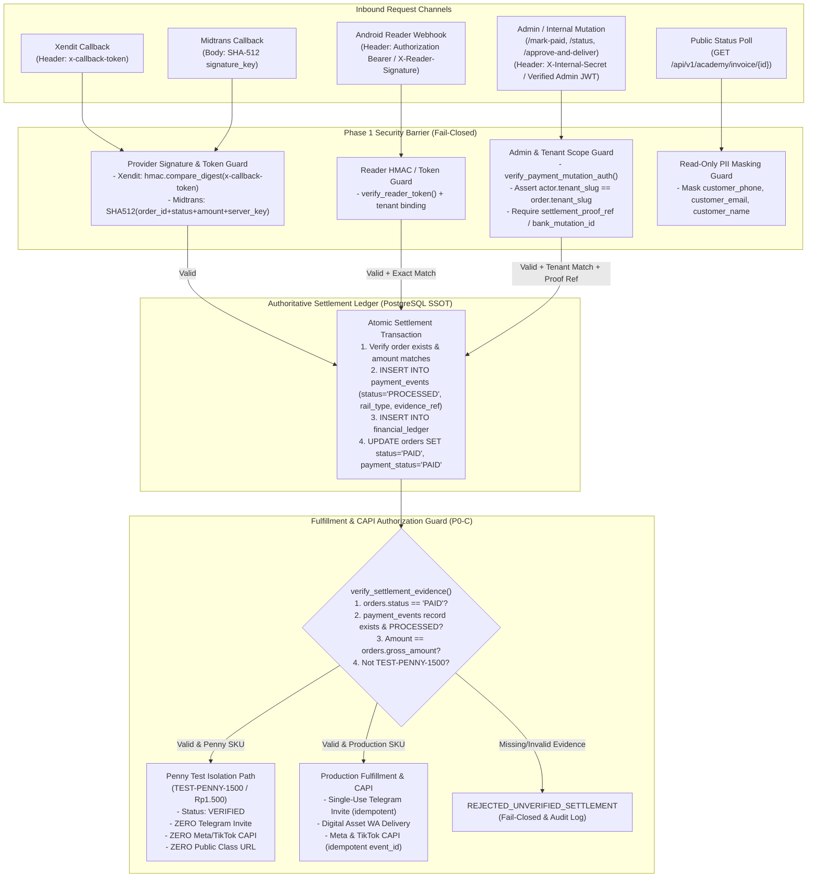

# PHASE 1 IMPLEMENTATION PLAN — PAYMENT SECURITY CONTAINMENT

**Repository:** `boontrack-core`  
**Baseline Commit:** `HEAD 6f1858d` (`docs/rev4-1-remediation-and-review`)  
**Priority:** `P0 — Financial & Payment Security`  
**Operational Status:** `PLANNING AUTHORIZED / IMPLEMENTATION HOLD`  
**Prerequisite References:**
- [RFC-Payment-Remediation-v1.1.md](file:///c:/boontrack-core/RFC-Payment-Remediation-v1.1.md)
- [INVENTORY-LEGACY-QRIS.md](file:///c:/boontrack-core/INVENTORY-LEGACY-QRIS.md)

---

## 1. Executive Summary

Dokumen ini menyajikan rencana implementasi **Phase 1 — Payment Security Containment** yang siap dieksekusi begitu mendapatkan otorisasi tertulis CTO. Tujuan utama Phase 1 adalah **menghentikan seluruh vektor manipulasi status pembayaran tanpa otorisasi, mengeliminasi pengalihan pembayaran ke rekening dummy `1234567890`, dan mengunci gerbang fulfillment serta konversi iklan (Meta/TikTok CAPI) di balik bukti settlement terverifikasi** tanpa merusak operasional tenant yang sudah memiliki konfigurasi valid maupun callback resmi dari Payment Gateway.

### Empat Pilar Kontainmen Phase 1

1. **P0-A — Payment Status Authorization Barrier:**
   - Menutup celah *Zero-Authentication* pada endpoint mutasi status pembayaran ([`POST /api/v1/orders/{order_id}/mark-paid`](file:///c:/boontrack-core/app/routes/d2c_order_routes.py#L193-L293), [`POST /v1/orders/{order_id}/mark-paid`](file:///c:/boontrack-core/app/routes/d2c_order_routes.py#L413-L482), [`PATCH /api/v1/orders/{order_id}/status`](file:///c:/boontrack-core/app/routes/d2c_order_routes.py#L302-L406), [`POST /api/v1/orders/{order_id}/approve-and-deliver`](file:///c:/boontrack-core/app/routes/d2c_order_routes.py#L496-L517)) serta endpoint simulasi/webhook internal yang saat ini mengabaikan header kredensial ([`POST /webhooks/payment`](file:///c:/boontrack-core/app/routes/d2c_order_routes.py#L171-L180), [`POST /webhook/payment/midtrans`](file:///c:/boontrack-core/app/routes/payment.py#L239-L422), [`POST /api/v1/academy/webhook/paid`](file:///c:/boontrack-core/app/routes/academy_routes.py#L195-L220), [`POST /api/v1/growth/simulate/order-paid`](file:///c:/boontrack-core/app/routes/growth_routes.py#L132-L203)).
   - Memisahkan secara tegas mekanisme autentikasi **Admin/Internal Operator** (`X-Internal-Secret` / `Authorization: Bearer`) dari **Official Provider Webhook** (`x-callback-token` Xendit, SHA-512 `signature_key` Midtrans, HMAC `X-Reader-Signature` Android Reader) sehingga callback resmi provider tetap diterima tanpa terblokir oleh guard admin internal.
   - Menegakkan **Tenant Ownership Scoping** pada mutasi order dan **PII Masking** pada endpoint baca publik status invoice.

2. **P0-B — Dummy Account `1234567890` Elimination (Strict Fail-Closed):**
   - Menghapus nilai default `account_number: str = "1234567890"`, `bank_name: str = "BCA"`, dan `account_holder: str = "Merchant Store"` pada [`ManualTransferAdapter.__init__`](file:///c:/boontrack-core/app/services/payment/manual_adapter.py#L22-L29) serta fallback otomatis ke rekening dummy pada [`PaymentAdapterFactory.resolve`](file:///c:/boontrack-core/app/services/payment/factory.py#L72-L104).
   - Menjamin perilaku *fail-closed* (`HTTP 422 Unprocessable Entity — PAYMENT_METHOD_UNCONFIGURED`) apabila tenant belum mengonfigurasi metode pembayaran atau kredensial provider tidak lengkap, sembari mempertahankan operasional normal bagi tenant dengan konfigurasi Xendit, Duitku, atau rekening manual/QRIS statis yang valid.

3. **P0-C — Fulfillment & CAPI Authorization Guard:**
   - Menetapkan **Single Settlement Evidence Invariant**: *Tidak ada satupun fulfillment (entitlement Academy, single-use Telegram invite, pengiriman produk digital via WhatsApp, upgrade tier `CHECKOUT_LITE`) maupun pengiriman event konversi iklan (Meta CAPI / TikTok CAPI) yang boleh dieksekusi sebelum bukti settlement tervalidasi secara kriptografis/otoritatif dan tercatat di immutable ledger (`payment_events`).*
   - Menolak klaim status `status="PAID"` yang dikirim langsung dari payload aplikasi tanpa bukti settlement dari **Native PG Rail** atau bukti mutasi terautentikasi dari **Direct Tenant Rail**.

4. **P0-D & P0-E — Incident Protection (`BTA-PENNY-0097A53F`), Verification Matrix, & Safe Rollback:**
   - Menjaga isolasi insiden transaksi `BTA-PENNY-0097A53F` (`TEST-PENNY-1500`, `Rp1.500`, `onlineboost`) agar Phase 1 tidak menghidupkan kembali *static DANA fallback*, *pseudo-dynamic QRIS*, *Telegram invite* untuk penny SKU, atau *Meta/TikTok CAPI* untuk penny SKU.
   - Menyediakan matriks 14 pengujian positif/negatif dan rencana rollback per grup perubahan yang tidak akan pernah membuka kembali rekening dummy atau bypass pembayaran.

---

## 2. Current-State Architecture

Arsitektur pembayaran dan fulfillment pada `boontrack-core` (`HEAD 6f1858d`) berjalan di atas **Dual-Runner Architecture** (FastAPI pada [`app/main.py`](file:///c:/boontrack-core/app/main.py) dan `aiohttp.web` pada [`main.py`](file:///c:/boontrack-core/main.py)) dengan dua jalur pembayaran (*Dual-Rail Payment Architecture*):

```mermaid
flowchart TD
    subgraph Callers["External & Internal Callers"]
        PubUser["Unauthenticated HTTP Client / Buyer"]
        XenditGW["Xendit Webhook Engine"]
        MidtransGW["Midtrans Webhook Engine"]
        ReaderApp["Android Notification Reader"]
        AdminOp["Admin / Internal Service"]
    end

    subgraph Routes["Current Route Layer (HEAD 6f1858d)"]
        XenditRoute["app/routes/xendit.py\nPOST /webhook/xendit\n(Validates x-callback-token)"]
        MarkPaid["app/routes/d2c_order_routes.py\nPOST .../orders/{id}/mark-paid\n(NO AUTH CHECK!)"]
        PatchStatus["app/routes/d2c_order_routes.py\nPATCH .../orders/{id}/status\n(NO AUTH CHECK!)"]
        ApproveDeliver["app/routes/d2c_order_routes.py\nPOST .../orders/{id}/approve-and-deliver\n(NO AUTH CHECK!)"]
        UnifiedWebhook["app/routes/d2c_order_routes.py\nPOST /webhooks/payment\n(x_callback_token IGNORED!)"]
        MidtransRoute["app/routes/payment.py\nPOST /webhook/payment/midtrans\n(signature_key IGNORED!)"]
        AcademyPaid["app/routes/academy_routes.py\nPOST /api/v1/academy/webhook/paid\n(NO AUTH CHECK!)"]
        GrowthSim["app/routes/growth_routes.py\nPOST /api/v1/growth/simulate/order-paid\n(NO AUTH CHECK!)"]
    end

    subgraph Factory["Checkout Adapter Resolution"]
        AdapterFactory["PaymentAdapterFactory.resolve()\napp/services/payment/factory.py"]
        DummyFallback["ManualTransferAdapter\nBCA 1234567890 a.n. Merchant Store"]
    end

    subgraph Fulfillment["Downstream Fulfillment & CAPI"]
        OrderFulfill["handle_order_paid_fulfillment()\napp/services/order_fulfillment_service.py"]
        CTWAFulfill["fulfill_onlineboost_ctwa_order()\napp/services/ctwa_fulfillment_service.py"]
        CheckoutReconcile["reconcile_payment_webhook()\napp/services/checkout_flow_service.py"]
        CAPIDispatch["capi_dispatcher / send_meta_capi_purchase\nMeta & TikTok CAPI"]
        TelegramBot["Telegram Bot API\ncreateChatInviteLink"]
        TierUpgrade["Supabase tenants.subscription_tier\n-> CHECKOUT_LITE"]
    end

    XenditGW --> XenditRoute
    PubUser -. "Unauthenticated Bypass" .-> MarkPaid
    PubUser -. "Unauthenticated Bypass" .-> PatchStatus
    PubUser -. "Unauthenticated Bypass" .-> ApproveDeliver
    PubUser -. "Unauthenticated Bypass" .-> UnifiedWebhook
    PubUser -. "Unauthenticated Bypass" .-> MidtransRoute
    PubUser -. "Unauthenticated Bypass" .-> AcademyPaid
    PubUser -. "Unauthenticated Bypass" .-> GrowthSim

    AdapterFactory -. "Missing/Invalid Config Fallback" .-> DummyFallback

    MarkPaid --> OrderFulfill
    PatchStatus --> OrderFulfill
    ApproveDeliver --> OrderFulfill
    UnifiedWebhook --> CheckoutReconcile
    MidtransRoute --> CheckoutReconcile
    MidtransRoute --> CAPIDispatch

    OrderFulfill --> CTWAFulfill
    OrderFulfill --> TierUpgrade
    OrderFulfill --> CAPIDispatch
    CTWAFulfill --> TelegramBot
    CTWAFulfill --> CAPIDispatch
```



### Temuan Kritis pada Arsitektur Saat Ini
1. **Asimetri Keamanan Antar Pintu Masuk:** Pintu masuk utama [`app/routes/xendit.py`](file:///c:/boontrack-core/app/routes/xendit.py#L708-L714) sudah menerapkan validasi `x-callback-token`, *Triple-Tier Idempotency*, pencatatan `payment_events`, dan isolasi `TEST-PENNY-1500`. Namun, pintu samping pada [`app/routes/d2c_order_routes.py`](file:///c:/boontrack-core/app/routes/d2c_order_routes.py), [`app/routes/payment.py`](file:///c:/boontrack-core/app/routes/payment.py), [`app/routes/academy_routes.py`](file:///c:/boontrack-core/app/routes/academy_routes.py), dan [`app/routes/growth_routes.py`](file:///c:/boontrack-core/app/routes/growth_routes.py) tidak memeriksa kredensial sama sekali.
2. **Kepercayaan Buta pada Kolom `orders.status`:** Fungsi [`handle_order_paid_fulfillment`](file:///c:/boontrack-core/app/services/order_fulfillment_service.py#L63-L74) dan [`fulfill_onlineboost_ctwa_order`](file:///c:/boontrack-core/app/services/ctwa_fulfillment_service.py#L195-L206) hanya memeriksa apakah `orders.status` bernilai `'PAID'` tanpa memverifikasi apakah terdapat record bukti settlement yang sah di tabel `payment_events`. Akibatnya, begitu endpoint tanpa auth mengubah `orders.status = 'PAID'`, seluruh guard di hilir langsung lolos.
3. **Silent Misrouting ke Rekening Dummy `1234567890`:** Apabila `tenant_context` gagal di-resolve atau `payment_config` kosong/salah ketik, [`PaymentAdapterFactory.resolve`](file:///c:/boontrack-core/app/services/payment/factory.py#L73) secara diam-diam mengembalikan [`ManualTransferAdapter`](file:///c:/boontrack-core/app/services/payment/manual_adapter.py#L24-L26) dengan nomor rekening `BCA 1234567890 a.n. Merchant Store`.

---

## 3. Endpoint & Caller Inventory

Bagian ini mendokumentasikan hasil audit menyeluruh atas keempat kelompok endpoint target CTO (`P0-A`) beserta endpoint webhook/simulasi terkait di seluruh codebase `boontrack-core` dan `boontrack-inbox`.

### 3.1 Kelompok Endpoint `/mark-paid`

| Atribut | Detail |
| :--- | :--- |
| **HTTP Method & Route Registration** | **FastAPI** ([`app/routes/d2c_order_routes.py:L193-L293`](file:///c:/boontrack-core/app/routes/d2c_order_routes.py#L193-L293)):<br>- `POST /api/v1/orders/{order_id}/mark-paid`<br>- `POST /v1/orders/{order_id}/mark-paid`<br>**aiohttp** ([`app/routes/d2c_order_routes.py:L413-L482, L492-L495`](file:///c:/boontrack-core/app/routes/d2c_order_routes.py#L413-L495)):<br>- `POST /api/v1/orders/{order_id}/mark-paid`<br>- `POST /v1/orders/{order_id}/mark-paid`<br>**Partner Payout Route** ([`app/routes/partner_routes.py:L330-L366`](file:///c:/boontrack-core/app/routes/partner_routes.py#L330-L366)):<br>- `POST /api/v1/partners/payouts/{payout_id}/mark-paid` *(Sudah terkunci/fail-closed via `raise payout_disbursement_locked()`)* |
| **Active Auth & Authz** | **NONE (Zero Authentication & Zero Authorization).**<br>- Pada FastAPI ([`L198`](file:///c:/boontrack-core/app/routes/d2c_order_routes.py#L198)), parameter `authorization: Optional[str] = Header(None)` dideklarasikan di signature fungsi **tetapi tidak pernah dibaca atau divalidasi sama sekali** di dalam body fungsi.<br>- Pada aiohttp ([`L413`](file:///c:/boontrack-core/app/routes/d2c_order_routes.py#L413)), `request.headers` bahkan tidak diekstrak. |
| **Internal & External Callers** | - **External (`boontrack-inbox` / `frontend`):** Tidak ada pemanggil aktif di repositori `boontrack-inbox` maupun `frontend/`.<br>- **Internal Runtime:** Dirancang untuk aksi konfirmasi manual CS/Admin Inbox saat memverifikasi bukti transfer manual.<br>- **Test Suites:** [`tests/test_security_audit_fixes.py:L140`](file:///c:/boontrack-core/tests/test_security_audit_fixes.py#L140), [`tests/test_production_e2e.py:L255`](file:///c:/boontrack-core/tests/test_production_e2e.py#L255), [`tests/test_payment_Simulation.py:L414`](file:///c:/boontrack-core/tests/test_payment_Simulation.py#L414). |
| **DB / Services Accessed** | - Membaca PostgreSQL `SELECT * FROM orders WHERE id = %s` ([`L208`](file:///c:/boontrack-core/app/routes/d2c_order_routes.py#L208), [`L425`](file:///c:/boontrack-core/app/routes/d2c_order_routes.py#L425)).<br>- Mengubah PostgreSQL `UPDATE orders SET status = 'PAID', updated_at = NOW() WHERE id = %s` ([`L234`](file:///c:/boontrack-core/app/routes/d2c_order_routes.py#L234), [`L441`](file:///c:/boontrack-core/app/routes/d2c_order_routes.py#L441)).<br>- Tidak menulis ke `payment_events` atau `financial_ledger`. |
| **Mutates Payment Status?** | **YA** (`orders.status` $\rightarrow$ `'PAID'`). |
| **Triggers Fulfillment / CAPI?** | **YA.**<br>- **FastAPI** ([`L248-L254`](file:///c:/boontrack-core/app/routes/d2c_order_routes.py#L248-L254)): Memanggil `asyncio.create_task(handle_order_paid_fulfillment(...))` yang:<br>  1. Meng-upgrade `tenants.subscription_tier` menjadi `'CHECKOUT_LITE'` di Supabase ([`order_fulfillment_service.py:L135-L141`](file:///c:/boontrack-core/app/services/order_fulfillment_service.py#L135-L141)).<br>  2. Untuk `onlineboost`: memanggil [`fulfill_onlineboost_ctwa_order`](file:///c:/boontrack-core/app/services/ctwa_fulfillment_service.py#L148) $\rightarrow$ menerbitkan single-use Telegram invite link, mengirim WhatsApp WABA, dan menembakkan Meta CAPI `Purchase`.<br>  3. Untuk tenant lain: mengirim link produk digital via WhatsApp dan memanggil [`send_meta_capi_purchase`](file:///c:/boontrack-core/app/services/order_fulfillment_service.py#L244-L250).<br>- **aiohttp** ([`L453-L472`](file:///c:/boontrack-core/app/routes/d2c_order_routes.py#L453-L472)): Langsung memanggil `send_meta_capi_purchase` dan `dispatch_payment_success_notifications(order_id=order_id)`. |
| **Cross-Tenant Access Risk** | **CRITICAL (`CVSS 9.8`).** Field `payload.tenant_id` pada [`MarkPaidRequest`](file:///c:/boontrack-core/app/routes/d2c_order_routes.py#L42-L44) diabaikan sepenuhnya; penyerang cukup mengetahui `order_id` tenant mana pun untuk melunaskan order lintas tenant tanpa kredensial. |

---

### 3.2 Kelompok Endpoint `/approve-and-deliver`

| Atribut | Detail |
| :--- | :--- |
| **HTTP Method & Route Registration** | **FastAPI** ([`app/routes/d2c_order_routes.py:L496-L517`](file:///c:/boontrack-core/app/routes/d2c_order_routes.py#L496-L517)):<br>- `POST /api/v1/orders/{order_id}/approve-and-deliver`<br>- `POST /v1/orders/{order_id}/approve-and-deliver`<br>*(Belum terdaftar di aiohttp runner, namun wajib didaftarkan secara simetris dengan guard yang sama).* |
| **Active Auth & Authz** | **NONE (Zero Authentication & Zero Authorization).** Tidak menerima header auth sama sekali. |
| **Internal & External Callers** | - **External (`boontrack-inbox` / `frontend`):** Tidak ada pemanggil aktif.<br>- **Test Suites:** [`tests/test_security_audit_fixes.py:L141`](file:///c:/boontrack-core/tests/test_security_audit_fixes.py#L141), [`tests/test_zero_trust_fulfillment.py:L88-L162`](file:///c:/boontrack-core/tests/test_zero_trust_fulfillment.py#L88-L162). |
| **DB / Services Accessed** | Memanggil langsung [`handle_order_paid_fulfillment(order_id=order_id, agent_id=...)`](file:///c:/boontrack-core/app/services/order_fulfillment_service.py#L22-L267). Membaca PostgreSQL `orders` dan Supabase `orders`, `products`, `tenants`, `messages`. |
| **Mutates Payment Status?** | Tidak mengubah `orders.status` dari `PENDING` ke `PAID` secara langsung (karena [`order_fulfillment_service.py:L66`](file:///c:/boontrack-core/app/services/order_fulfillment_service.py#L66) menolak jika `order_st` dan `pay_st` bukan `PAID/SETTLED/LUNAS`), **TETAPI** jika `orders.status` atau `orders.payment_status` sudah diubah menjadi `PAID` (atau pada [`ctwa_fulfillment_service.py:L438, L454`](file:///c:/boontrack-core/app/services/ctwa_fulfillment_service.py#L438-L454)), fungsi ini menulis ulang `status='PAID'`, `payment_status='PAID'`, `fulfillment_metadata`, dan `download_url`, serta meng-upgrade `tenants.subscription_tier = 'CHECKOUT_LITE'`. |
| **Triggers Fulfillment / CAPI?** | **YA.** Memicu pengiriman produk digital via WhatsApp, penerbitan link grup Telegram (`onlineboost`), upgrade tier tenant ke `CHECKOUT_LITE`, dan pengiriman event Meta CAPI `Purchase`. |
| **Cross-Tenant Access Risk** | **HIGH (`CVSS 8.6`).** Siapa pun tanpa kredensial dapat memicu ulang atau mengeksekusi delivery & CAPI atas `order_id` milik tenant mana pun tanpa validasi kepemilikan tenant. |

---

### 3.3 Kelompok Endpoint `/status` (Mutating vs. Read-Only)

| Atribut | Detail |
| :--- | :--- |
| **HTTP Method & Route Registration** | **1. Mutating Order Status Endpoint (FastAPI)** ([`app/routes/d2c_order_routes.py:L302-L406`](file:///c:/boontrack-core/app/routes/d2c_order_routes.py#L302-L406)):<br>- `PATCH /api/v1/orders/{order_id}/status`<br>- `PATCH /v1/orders/{order_id}/status`<br>**2. Read-Only Invoice Status Endpoint (FastAPI & aiohttp)** ([`app/routes/academy_routes.py:L183-L192, L288-L293, L317`](file:///c:/boontrack-core/app/routes/academy_routes.py#L183-L317)):<br>- `GET /api/v1/academy/invoice/{order_id}`<br>**3. Non-Payment Read-Only Status Routes** (Tetap dipertahankan):<br>- `GET /api/v1/store/custom-domain/status` ([`app/routes/custom_domain_routes.py:L122`](file:///c:/boontrack-core/app/routes/custom_domain_routes.py#L122))<br>- `GET /api/v1/whatsapp/config/status` ([`app/routes/whatsapp_onboarding_routes.py:L95`](file:///c:/boontrack-core/app/routes/whatsapp_onboarding_routes.py#L95))<br>- `GET /api/v1/shop/wa/instance/status` ([`app/routes/wa_rotator_routes.py:L67`](file:///c:/boontrack-core/app/routes/wa_rotator_routes.py#L67)) |
| **Active Auth & Authz** | **NONE (Zero Authentication & Zero Authorization)** pada `PATCH /api/v1/orders/{order_id}/status` maupun `GET /api/v1/academy/invoice/{order_id}`.<br>Pada `PATCH /orders/{order_id}/status`, parameter header yang diambil hanyalah `x_correlation_id: Optional[str] = Header(None)` ([`L307`](file:///c:/boontrack-core/app/routes/d2c_order_routes.py#L307)). |
| **Internal & External Callers** | - **External (`boontrack-inbox` / `frontend`):** Tidak ada pemanggil aktif ke `PATCH /orders/{order_id}/status`. `GET /api/v1/academy/invoice/{order_id}` dipanggil oleh halaman checkout publik untuk polling status pembayaran.<br>- **Test Suites:** [`tests/test_security_audit_fixes.py:L142`](file:///c:/boontrack-core/tests/test_security_audit_fixes.py#L142). |
| **DB / Services Accessed** | - `PATCH /orders/{order_id}/status`: Membaca & mengupdate PostgreSQL `orders` (`UPDATE orders SET status = %s, updated_at = NOW() WHERE id = %s` pada [`L342`](file:///c:/boontrack-core/app/routes/d2c_order_routes.py#L342)) dan mengupdate Supabase `orders` ([`L358`](file:///c:/boontrack-core/app/routes/d2c_order_routes.py#L358)).<br>- `GET /api/v1/academy/invoice/{order_id}`: Membaca [`academy_bot.get_invoice(order_id)`](file:///c:/boontrack-core/app/services/academy_service.py#L368-L410) dari memori/PostgreSQL `orders`. |
| **Mutates Payment Status?** | - `PATCH /orders/{order_id}/status`: **YA** (Mengubah status ke `'PAID'`, `'PENDING'`, atau `'CANCELLED'` tanpa bukti pembayaran).<br>- `GET /api/v1/academy/invoice/{order_id}`: **TIDAK** (Read-only). |
| **Triggers Fulfillment / CAPI?** | - `PATCH /orders/{order_id}/status`: **YA** ([`L384-L393`](file:///c:/boontrack-core/app/routes/d2c_order_routes.py#L384-L393) memicu `asyncio.create_task(handle_order_paid_fulfillment(...))` ketika `normalized_status == "PAID"`).<br>- `GET /api/v1/academy/invoice/{order_id}`: **TIDAK.** |
| **Cross-Tenant Access Risk** | - `PATCH /orders/{order_id}/status`: **CRITICAL (`CVSS 9.8`).** Dapat melunaskan atau membatalkan order milik tenant mana pun tanpa auth.<br>- `GET /api/v1/academy/invoice/{order_id}`: **MEDIUM (`CVSS 5.3`).** Mengembalikan PII pelanggan (`customer_name`, `customer_email`, `customer_phone`) secara terbuka tanpa penyamaran (*masking*). |

---

### 3.4 Kelompok Endpoint `/webhooks/payment` & Endpoint Webhook/Simulasi Terkait

| Endpoint & Lokasi File | Runner | Active Auth Saat Ini | Mutasi Status & Efek Samping | Temuan Risiko Keamanan |
| :--- | :--- | :--- | :--- | :--- |
| **`POST /webhooks/payment`**<br>**`POST /api/v1/webhooks/payment`**<br>**`POST /api/v1/webhook/payment`**<br>[`app/routes/d2c_order_routes.py:L171-L180`](file:///c:/boontrack-core/app/routes/d2c_order_routes.py#L171-L180) | FastAPI | **NONE!** Menerima `x_callback_token: Optional[str] = Header(None)` ([`L174`](file:///c:/boontrack-core/app/routes/d2c_order_routes.py#L174)) **tetapi variabel tersebut tidak pernah diperiksa**. | Memanggil [`reconcile_payment_webhook(body)`](file:///c:/boontrack-core/app/services/checkout_flow_service.py#L303-L424) $\rightarrow$ memanggil [`execute_order_settlement_transaction`](file:///c:/boontrack-core/app/services/checkout_service.py#L137) (atau fallback update Supabase `orders.status = 'PAID'` pada [`L356`](file:///c:/boontrack-core/app/services/checkout_flow_service.py#L356)) $\rightarrow$ mengirim link aset produk digital via WhatsApp ([`L366-L399`](file:///c:/boontrack-core/app/services/checkout_flow_service.py#L366-L399)). | **CRITICAL (`CVSS 9.8`).** Payload JSON palsu dengan `{"order_id": "...", "status": "PAID"}` tanpa header apa pun langsung melunaskan order, menulis ke `financial_ledger`, dan mengirim produk digital. |
| **`POST /webhook/payment/midtrans`**<br>**`POST /api/v1/payments/midtrans/callback`**<br>**`POST /api/v1/payment/midtrans/callback`**<br>**`POST /api/v1/webhooks/midtrans`**<br>[`app/routes/payment.py:L239-L422, L859-L868`](file:///c:/boontrack-core/app/routes/payment.py#L239-L422) | FastAPI & aiohttp | **NONE!** Membaca `signature_key = payload.get("signature_key")` pada [`L250`](file:///c:/boontrack-core/app/routes/payment.py#L250) **tetapi tidak pernah menghitung atau mencocokkan SHA-512 Midtrans signature**. | Mengupdate Supabase `orders.status = 'PAID'` ([`L293`](file:///c:/boontrack-core/app/routes/payment.py#L293)), memanggil `reconcile_payment_webhook` ([`L339`](file:///c:/boontrack-core/app/routes/payment.py#L339)), mengirim e-receipt WhatsApp ([`L365`](file:///c:/boontrack-core/app/routes/payment.py#L365)), dan menembakkan `dispatch_all_capi` (Meta + TikTok CAPI) ([`L379`](file:///c:/boontrack-core/app/routes/payment.py#L379)). | **CRITICAL (`CVSS 9.8`).** Tanpa verifikasi `SHA512(order_id + status_code + gross_amount + ServerKey)`, siapa pun dapat memalsukan callback Midtrans. |
| **`POST /api/v1/academy/webhook/paid`**<br>[`app/routes/academy_routes.py:L195-L220, L295-L302, L318`](file:///c:/boontrack-core/app/routes/academy_routes.py#L195-L318) | FastAPI & aiohttp | **NONE!** Tidak memeriksa header auth atau callback token sama sekali. | Memanggil [`academy_bot.handle_webhook_paid`](file:///c:/boontrack-core/app/services/academy_service.py#L412) $\rightarrow$ mengubah status order menjadi `PAID` dan memicu pengiriman akses Academy via WhatsApp/Telegram. | **CRITICAL (`CVSS 9.8`).** Dapat dipanggil publik untuk melunaskan invoice Academy tanpa pembayaran. |
| **`POST /api/v1/growth/simulate/order-paid`**<br>[`app/routes/growth_routes.py:L132-L143, L181-L203`](file:///c:/boontrack-core/app/routes/growth_routes.py#L132-L203) | FastAPI & aiohttp | **NONE!** Endpoint simulasi terbuka di produksi tanpa autentikasi admin/internal. | Memanggil `process_order_paid_growth_event` $\rightarrow$ mencatat komisi afiliasi dan menembakkan event konversi iklan (CAPI). | **HIGH (`CVSS 8.2`).** Memungkinkan keracunan piksel iklan (CAPI poisoning) dan manipulasi atribusi komisi afiliasi tanpa transaksi riil. |
| **`POST /api/payments/webhook`** ([`app/routes/payment.py:L742-L853`](file:///c:/boontrack-core/app/routes/payment.py#L742-L853))<br>**`POST /api/webhook/payment-reader`** & **`POST /api/webhook/dana`** ([`app/routes/payment_webhook.py:L13-L206`](file:///c:/boontrack-core/app/routes/payment_webhook.py#L13-L206)) | FastAPI & aiohttp | **NONE!** Berbeda dengan [`app/api/v1/reader_router.py:L49`](file:///c:/boontrack-core/app/api/v1/reader_router.py#L49) yang memeriksa `verify_reader_token`, ketiga route di `payment.py` dan `payment_webhook.py` tidak memeriksa `X-Reader-Signature` / `X-Device-Token`. | Mencocokkan nominal `WAITING_PAYMENT` di memori/DB, mengubah status order menjadi `PAID`, dan mengirim notifikasi WhatsApp. | **CRITICAL (`CVSS 9.1`).** Membuka celah pelunasan order manual/QRIS statis tanpa verifikasi perangkat reader yang sah. |
| **`POST /webhook/xendit`** (dan 4 alias di [`app/routes/xendit.py:L1231-L1299`](file:///c:/boontrack-core/app/routes/xendit.py#L1231-L1299)) | FastAPI & aiohttp | **VALIDATED.** Memverifikasi `x-callback-token` via [`XenditAdapter.handle_webhook`](file:///c:/boontrack-core/app/services/payment/gateway_xendit.py#L168-L195) dengan `hmac.compare_digest`. | Mencatat ke `payment_events`, `financial_ledger`, mengubah `orders.status = 'PAID'`, dan memicu fulfillment/CAPI (dengan isolasi penuh `TEST-PENNY-1500`). | **LOW (Compliant).** Hanya perlu memastikan fallback route di [`app/api/webhook_payment.py:L25`](file:///c:/boontrack-core/app/api/webhook_payment.py#L25) dan [`app/routes/payment.py:L428`](file:///c:/boontrack-core/app/routes/payment.py#L428) mendelegasikan sepenuhnya ke `process_xendit_webhook_core`. |

---

## 4. Security Risk Register

| Risk ID | Severity | Komponen Terdampak | Deskripsi Kerentanan & Bukti Kode | Dampak Bisnis & Finansial | Mitigasi Phase 1 |
| :--- | :---: | :--- | :--- | :--- | :--- |
| **RISK-P1-01** | **CRITICAL** | [`app/routes/d2c_order_routes.py`](file:///c:/boontrack-core/app/routes/d2c_order_routes.py#L193-L517) | Endpoint `/mark-paid`, `/status` (`PATCH`), dan `/approve-and-deliver` tidak memiliki pemeriksaan autentikasi maupun otorisasi tenant. | Penyerang dapat mengubah status order apa pun menjadi `PAID`, mencuri produk digital/link grup Telegram, menembakkan Meta CAPI palsu, dan meng-upgrade tier tenant ke `CHECKOUT_LITE` secara gratis. | Pasang guard autentikasi wajib (`verify_internal_or_tenant_admin_auth`), verifikasi kepemilikan `tenant_slug == order.tenant_slug`, dan wajibkan bukti settlement/mutasi. |
| **RISK-P1-02** | **CRITICAL** | [`app/routes/d2c_order_routes.py:L171-L180`](file:///c:/boontrack-core/app/routes/d2c_order_routes.py#L171-L180) | Endpoint `/webhooks/payment` menerima header `x_callback_token` tetapi mengabaikannya dan langsung memanggil `reconcile_payment_webhook(body)`. | Spoofing webhook pembayaran tanpa tanda tangan kriptografis; memicu mutasi `financial_ledger`, `commission_ledger`, dan pengiriman produk digital. | Delegasikan `/webhooks/payment` ke validator token resmi provider (`XenditAdapter.handle_webhook` / `XENDIT_CALLBACK_TOKEN`); tolak dengan `HTTP 403` jika token tidak cocok atau env belum diset (*fail-closed*). |
| **RISK-P1-03** | **CRITICAL** | [`app/services/payment/manual_adapter.py:L24-L26`](file:///c:/boontrack-core/app/services/payment/manual_adapter.py#L24-L26)<br>[`app/services/payment/factory.py:L72-L104`](file:///c:/boontrack-core/app/services/payment/factory.py#L72-L104) | Default parameter dan fallback factory mengarahkan transaksi tenant yang belum dikonfigurasi ke rekening fiktif `BCA 1234567890 a.n. Merchant Store`. | Dana pembeli ditransfer ke rekening tidak dikenal (`1234567890`), menimbulkan kerugian finansial langsung dan kegagalan rekonsiliasi. | Hapus total default `1234567890` di `ManualTransferAdapter` dan `PaymentAdapterFactory`. Lempar `PaymentConfigurationError` (`HTTP 422`) jika konfigurasi pembayaran kosong/tidak valid. |
| **RISK-P1-04** | **CRITICAL** | [`app/routes/payment.py:L239-L422`](file:///c:/boontrack-core/app/routes/payment.py#L239-L422)<br>[`app/routes/academy_routes.py:L195-L220`](file:///c:/boontrack-core/app/routes/academy_routes.py#L195-L220)<br>[`app/routes/payment_webhook.py:L13-L206`](file:///c:/boontrack-core/app/routes/payment_webhook.py#L13-L206)<br>[`app/routes/growth_routes.py:L132-L203`](file:///c:/boontrack-core/app/routes/growth_routes.py#L132-L203) | Webhook Midtrans tidak memverifikasi SHA-512 `signature_key`; `/academy/webhook/paid`, `/api/webhook/payment-reader`, `/api/webhook/dana`, dan `/growth/simulate/order-paid` terbuka tanpa auth. | Bypass pembayaran via endpoint alternatif walaupun `/mark-paid` dan `/webhooks/payment` sudah ditutup. | Terapkan verifikasi SHA-512 wajib pada Midtrans, `X-Internal-Secret` / `X-Callback-Token` pada Academy & Growth simulate, serta `verify_reader_token` / HMAC pada endpoint reader/DANA. |
| **RISK-P1-05** | **HIGH** | [`app/services/order_fulfillment_service.py:L63-L74`](file:///c:/boontrack-core/app/services/order_fulfillment_service.py#L63-L74)<br>[`app/services/ctwa_fulfillment_service.py:L195-L206`](file:///c:/boontrack-core/app/services/ctwa_fulfillment_service.py#L195-L206) | Service fulfillment hanya mengecek `orders.status == 'PAID'` tanpa mengecek keberadaan bukti settlement yang sah di `payment_events` atau otorisasi rail pembayaran. | Jika ada bug di layer aplikasi yang menulis `status='PAID'`, sistem langsung memberikan akses kelas, meng-upgrade tier SaaS tenant, dan menembakkan CAPI. | Pasang fungsi guard terpusat `verify_settlement_evidence_for_fulfillment(order_id)` yang memverifikasi keberadaan record `PROCESSED` di `payment_events` sebelum mengizinkan fulfillment & CAPI. |
| **RISK-P1-06** | **HIGH** | [`app/services/checkout_flow_service.py:L352-L361`](file:///c:/boontrack-core/app/services/checkout_flow_service.py#L352-L361) | Jika `execute_order_settlement_transaction` gagal (misal koneksi Postgres error), blok `except` tetap melakukan fallback update `supabase.table("orders").update({"status": "PAID"})` dan mengirim produk digital! | Pelanggaran prinsip *fail-closed*: kegagalan database ledger justru meloloskan pengiriman produk tanpa pencatatan finansial. | Hapus fallback update `PAID` di dalam blok `except` pada `reconcile_payment_webhook`; jika transaksi settlement DB gagal, batalkan pengiriman dan kembalikan error (*fail-closed*). |

---

## 5. Target-State Payment Security Design

Arsitektur target Phase 1 menegakkan prinsip **Zero-Trust Payment Containment** dengan pemisahan tegas antara jalur **Provider Webhook (Native PG Rail)**, jalur **Direct Tenant Mutation / Manual Admin Approval**, dan jalur **Public Read-Only Status**:



### Prinsip Desain Kunci
1. **Provider Webhooks Tidak Pernah Diminta Header Admin Internal:** Endpoint webhook Xendit (`/webhook/xendit`, `/webhooks/payment`) dan Midtrans (`/webhook/payment/midtrans`) divalidasi murni menggunakan kredensial resmi provider (`XENDIT_CALLBACK_TOKEN` / `MIDTRANS_SERVER_KEY`). Mereka tidak akan pernah diblokir oleh pemeriksaan `X-Internal-Secret`.
2. **Endpoint Mutasi Manual Tidak Pernah Menerima Klaim Buta:** Pemanggilan ke `/mark-paid`, `PATCH /status`, atau `/approve-and-deliver` wajib menyertakan kredensial internal/admin yang sah, wajib lolos pemeriksaan kesamaan tenant (`actor_tenant == order.tenant_slug` kecuali `superadmin`/internal service), dan untuk `/mark-paid` wajib mencatat bukti referensi mutasi (`payment_events` dengan `provider='MANUAL_VERIFIED'`) sebelum fulfillment diizinkan.
3. **Eliminasi Upgrade Tier SaaS dari Fulfillment Order Produk:** Di dalam [`handle_order_paid_fulfillment`](file:///c:/boontrack-core/app/services/order_fulfillment_service.py#L128-L145), blok kode yang secara otomatis mengubah `tenants.subscription_tier = 'CHECKOUT_LITE'` setiap kali ada order produk D2C lunas wajib dinonaktifkan kecuali order tersebut secara eksplisit merupakan invoice berlangganan SaaS BoonTrack, sehingga pembelian produk toko D2C tidak memutasi tier langganan tenant.

---

## 6. Authentication & Authorization Matrix

Matriks berikut mendefinisikan aturan autentikasi dan otorisasi target untuk setiap endpoint pembayaran di kedua runner (**FastAPI** dan **aiohttp**):

| Endpoint | HTTP Method | Kategori | Mekanisme Autentikasi Wajib | Aturan Otorisasi & Scoping Tenant | Perilaku Jika Secret Env Kosong / Auth Gagal |
| :--- | :---: | :--- | :--- | :--- | :--- |
| `/api/v1/orders/{order_id}/mark-paid`<br>`/v1/orders/{order_id}/mark-paid` | `POST` | Admin / Internal Mutation | `X-Internal-Secret` (`hmac.compare_digest` terhadap `BOONTRACK_INTERNAL_HMAC_SECRET`) **ATAU** `Authorization: Bearer <APP_MASTER_KEY>` **ATAU** Verified Tenant Admin JWT (`get_current_tenant`). | 1. Order wajib ada di DB.<br>2. Jika menggunakan Tenant Admin JWT, `jwt.tenant_slug` **wajib sama** dengan `order.tenant_slug` (`HTTP 403` jika beda).<br>3. Jika menggunakan Internal Secret, `payload.tenant_id` **wajib sama** dengan `order.tenant_slug`.<br>4. Tidak boleh digunakan untuk order dengan rail `XENDIT` kecuali menyertakan bukti rekonsiliasi manual (`proof_reference`). | Jika env secret belum dikonfigurasi: `HTTP 503 Authentication service unavailable`.<br>Jika header kosong/salah: `HTTP 401/403`. |
| `/api/v1/orders/{order_id}/status`<br>`/v1/orders/{order_id}/status` | `PATCH` | Admin / Internal Mutation | Sama dengan `/mark-paid` (`X-Internal-Secret`, `APP_MASTER_KEY`, atau Verified Tenant Admin JWT). | 1. `actor.tenant_slug == order.tenant_slug` (`HTTP 403` jika lintas tenant).<br>2. Transisi ke `PAID` wajib mencatat audit trail `payment_events` dengan identitas aktor dan `proof_reference`. | `HTTP 503` jika env kosong; `HTTP 401/403` jika tidak terautentikasi atau lintas tenant. |
| `/api/v1/orders/{order_id}/approve-and-deliver`<br>`/v1/orders/{order_id}/approve-and-deliver` | `POST` | Admin / Internal Fulfillment Trigger | Sama dengan `/mark-paid` (`X-Internal-Secret`, `APP_MASTER_KEY`, atau Verified Tenant Admin JWT). | 1. `actor.tenant_slug == order.tenant_slug` (`HTTP 403` jika lintas tenant).<br>2. Order **wajib** sudah berstatus `PAID` di DB **dan** memiliki record bukti settlement terverifikasi di `payment_events` (`HTTP 422 REJECTED_UNPAID` jika belum). | `HTTP 503` jika env kosong; `HTTP 401/403` jika tidak terautentikasi atau lintas tenant. |
| `/api/v1/academy/invoice/{order_id}` | `GET` | Public Read-Only Status | Public (Read-Only untuk polling halaman checkout pembeli), atau Opsional Internal Header untuk detail penuh. | 1. Hanya mengembalikan field non-sensitif (`order_id`, `tenant_id`, `product_title`, `amount`, `status`, `qr_string`, `invoice_url`, `expires_at`).<br>2. **PII Masking Wajib:** `customer_name`, `customer_phone`, dan `customer_email` di-mask (contoh: `0812****7890`, `b***@gmail.com`) jika dipanggil tanpa header internal. | `HTTP 404` jika `order_id` tidak ditemukan. |
| `/webhooks/payment`<br>`/api/v1/webhooks/payment`<br>`/api/v1/webhook/payment` | `POST` | Provider Webhook (Xendit / Unified) | Header `x-callback-token` divalidasi secara timing-safe (`hmac.compare_digest`) terhadap `XENDIT_CALLBACK_TOKEN` / `XENDIT_WEBHOOK_VERIFICATION_TOKEN`. | 1. Order wajib ditemukan di PostgreSQL `orders`.<br>2. `payload.amount == orders.gross_amount` (`HTTP 400 AMOUNT_MISMATCH` jika selisih).<br>3. `tenant_id` di-resolve dari `orders.tenant_slug` di DB (bukan dari payload eksternal). | Jika `XENDIT_CALLBACK_TOKEN` tidak diset di env atau header tidak cocok: `HTTP 403 Invalid callback token` (*fail-closed*). |
| `/webhook/xendit`<br>`/webhook/payment/xendit`<br>`/api/v1/payments/xendit/callback`<br>`/api/v1/payment/xendit/callback`<br>`/api/v1/webhooks/xendit` | `POST` | Provider Webhook (Xendit Official) | Header `x-callback-token` via [`XenditAdapter.handle_webhook`](file:///c:/boontrack-core/app/services/payment/gateway_xendit.py#L168-L195) (`hmac.compare_digest`). | Sudah terimplementasi di [`process_xendit_webhook_core`](file:///c:/boontrack-core/app/routes/xendit.py#L700-L1225): validasi `orders.gross_amount`, isolasi `TEST-PENNY-1500`, dan resolusi `tenant_id` dari DB. | `HTTP 403` jika token salah/kosong; `HTTP 503` jika DB idempotency check gagal. |
| `/webhook/payment/midtrans`<br>`/api/v1/payments/midtrans/callback`<br>`/api/v1/payment/midtrans/callback`<br>`/api/v1/webhooks/midtrans` | `POST` | Provider Webhook (Midtrans Official) | `signature_key` di body JSON wajib cocok dengan `SHA512(order_id + status_code + gross_amount + MIDTRANS_SERVER_KEY)` menggunakan `hmac.compare_digest`. | 1. Order wajib ada di DB.<br>2. `int(float(gross_amount)) == orders.gross_amount`.<br>3. `tenant_id` di-resolve dari `orders.tenant_slug` di DB. | Jika `MIDTRANS_SERVER_KEY` tidak dikonfigurasi atau `signature_key` tidak valid: `HTTP 403 Invalid Midtrans signature` (*fail-closed*). |
| `/api/v1/academy/webhook/paid` | `POST` | Internal / Academy Webhook | Header `X-Internal-Secret` (`BOONTRACK_INTERNAL_HMAC_SECRET`) **ATAU** `x-callback-token` (`XENDIT_CALLBACK_TOKEN`). | Order wajib ada di DB, nominal harus cocok dengan `orders.gross_amount`, dan wajib melewati guard `TEST-PENNY-1500`. | `HTTP 403` jika header tidak ada atau tidak valid (*fail-closed*). |
| `/api/v1/growth/simulate/order-paid` | `POST` | Internal Simulation Endpoint | Header `X-Internal-Secret` (`BOONTRACK_INTERNAL_HMAC_SECRET`) **ATAU** `Authorization: Bearer <APP_MASTER_KEY>`, ditambah pengecekan environment (`APP_ENV != "production"` kecuali diotorisasi eksplisit via internal secret). | Hanya untuk pengujian internal terotorisasi; dilarang diakses publik. | `HTTP 403 Forbidden` jika dipanggil tanpa `X-Internal-Secret` / `APP_MASTER_KEY`. |
| `/api/payments/webhook`<br>`/api/webhook/payment-reader`<br>`/api/webhook/dana` | `POST` | Direct Tenant Rail (Android Reader) | Wajib memvalidasi `Authorization: Bearer <READER_SECRET_TOKEN>` atau `X-Reader-Signature` (HMAC-SHA256) sebagaimana [`app/api/v1/reader_router.py:L49`](file:///c:/boontrack-core/app/api/v1/reader_router.py#L49). | Wajib mengikat identitas perangkat reader ke `tenant_id` pemiliknya dan mencocokkan nominal eksak (`expected_unique_amount`) dalam jendela waktu aktif. | `HTTP 401/403` jika token/signature reader tidak valid atau `READER_SECRET_TOKEN` belum dikonfigurasi. |

---

## 7. Dummy Account Removal Plan

Bagian ini merinci rencana penghapusan total fallback rekening dummy `1234567890` (`P0-B`) pada [`ManualTransferAdapter`](file:///c:/boontrack-core/app/services/payment/manual_adapter.py) dan [`PaymentAdapterFactory`](file:///c:/boontrack-core/app/services/payment/factory.py).

### 7.1 Bukti Kode Saat Ini (`HEAD 6f1858d`)
1. [`app/services/payment/manual_adapter.py:L22-L29`](file:///c:/boontrack-core/app/services/payment/manual_adapter.py#L22-L29):
   ```python
   def __init__(
       self,
       bank_name: str = "BCA",
       account_number: str = "1234567890",
       account_holder: str = "Merchant Store",
       qris_image_url: Optional[str] = None,
       instructions: Optional[List[str]] = None,
   ):
   ```
2. [`app/services/payment/factory.py:L72-L104`](file:///c:/boontrack-core/app/services/payment/factory.py#L72-L104):
   - Baris 73: `# Fallback to manual transfer adapter -> return cls._resolve_manual_adapter(config)` ketika `provider` tidak dikenali atau kredensial `xendit`/`duitku` tidak lengkap.
   - Baris 98-104:
     ```python
     return ManualTransferAdapter(
         bank_name=bank_name or "BCA",
         account_number=account_number or "1234567890",
         account_holder=account_holder or "Merchant Store",
         qris_image_url=qris_image_url,
         instructions=instructions,
     )
     ```

### 7.2 Pemetaan Seluruh Pemanggil (`Callers`) & Dampaknya

| No | File & Lokasi Pemanggil | Fungsi / Endpoint | Perilaku Saat Ini Jika Config Kosong | Perilaku Target Phase 1 (Fail-Closed) |
| :-: | :--- | :--- | :--- | :--- |
| 1 | [`app/routes/d2c_order_routes.py:L79`](file:///c:/boontrack-core/app/routes/d2c_order_routes.py#L79) | `POST /api/v1/orders/quick-qris`<br>(`quick_qris_checkout_endpoint`) | Mengembalikan instruksi transfer ke `BCA 1234567890 a.n. Merchant Store` jika `qris_image_url` dan `static_qris_payload` ada tetapi rekening kosong, atau memanggil `_resolve_manual_adapter`. | Jika `PaymentAdapterFactory.resolve` melempar `PaymentConfigurationError`, endpoint mengembalikan `HTTP 422` (`{"error": "PAYMENT_METHOD_UNCONFIGURED", "message": "Metode pembayaran toko belum dikonfigurasi."}`). |
| 2 | [`app/services/checkout_flow_service.py:L87`](file:///c:/boontrack-core/app/services/checkout_flow_service.py#L87)<br>*(dipanggil oleh [`d2c_order_routes.py:L155`](file:///c:/boontrack-core/app/routes/d2c_order_routes.py#L155))* | `POST /api/v1/orders/checkout`<br>(`create_d2c_order_and_dispatch_qris`) | Membuat order di DB lalu mengirim pesan WhatsApp ke pembeli berisi instruksi transfer ke rekening fiktif `BCA 1234567890 a.n. Merchant Store`! | Menangkap `PaymentConfigurationError` **sebelum** membuat instruksi pembayaran palsu dan menolak checkout dengan `HTTP 422` (`PAYMENT_METHOD_UNCONFIGURED`). |
| 3 | [`app/routes/checkout_router.py:L40`](file:///c:/boontrack-core/app/routes/checkout_router.py#L40) | `POST /v1/orders/qris-checkout`<br>(`handle_qris_checkout`) | Memanggil `PaymentAdapterFactory.resolve(tenant_ctx)`. | Menangkap `PaymentConfigurationError` dan mengembalikan `HTTP 422` (`detail="MERCHANT_QRIS_NOT_CONFIGURED"`). |
| 4 | [`app/routes/payment.py:L129`](file:///c:/boontrack-core/app/routes/payment.py#L129) | `POST /api/v1/payments/qris/create`<br>(`create_dynamic_qris_endpoint`) | Memanggil `PaymentAdapterFactory.resolve(tenant_ctx)` untuk memeriksa apakah tenant menggunakan `ManualTransferAdapter`. | Hanya memanggil `PaymentAdapterFactory.resolve(tenant_ctx)` jika `tenant_ctx` memiliki `payment_config`; jika `PaymentConfigurationError` dilempar, kembalikan `HTTP 422` untuk tenant dengan konfigurasi rusak, sedangkan alur eksplisit Xendit (`XenditService.create_dynamic_qris`) tetap berjalan normal. |
| 5 | [`tests/test_tenant_qris_and_payment_resolution.py:L61-L73`](file:///c:/boontrack-core/tests/test_tenant_qris_and_payment_resolution.py#L61-L73) | `test_resolve_fallback_when_duitku_credentials_incomplete` | Saat ini menguji bahwa kredensial Duitku yang tidak lengkap akan fallback ke `ManualTransferAdapter` dengan `account_number == "1234567890"`. | Diperbarui untuk memverifikasi bahwa kredensial tidak lengkap melempar `PaymentConfigurationError` (Zero fallback ke `1234567890`). |

### 7.3 Spesifikasi Desain Fail-Closed (`PaymentConfigurationError`)

1. **Definisi Exception Baru di [`app/services/payment/base.py`](file:///c:/boontrack-core/app/services/payment/base.py):**
   - Tambahkan class `PaymentConfigurationError(ValueError)` dengan atribut `code = "PAYMENT_METHOD_UNCONFIGURED"`.
2. **Hardening [`ManualTransferAdapter.__init__`](file:///c:/boontrack-core/app/services/payment/manual_adapter.py#L22-L38):**
   - Hapus nilai default `"BCA"`, `"1234567890"`, dan `"Merchant Store"`.
   - Tolak inisialisasi (*raise `PaymentConfigurationError`*) apabila:
     - Tidak ada rekening bank yang valid (`bank_name`, `account_number`, `account_holder` ketiganya wajib non-kosong jika menggunakan transfer bank) **DAN** tidak ada `qris_image_url` yang valid.
     - `account_number` bernilai `"1234567890"` atau `"0000000000"` (daftar hitam eksplisit terhadap nomor rekening dummy warisan).
3. **Hardening [`PaymentAdapterFactory.resolve`](file:///c:/boontrack-core/app/services/payment/factory.py#L18-L104):**
   - Jika `config` kosong (`not config`), langsung `raise PaymentConfigurationError("Tenant payment configuration is missing or empty.")`.
   - Jika `provider` diset ke `"xendit"` (atau variasinya) tetapi `secret_key` kosong: `raise PaymentConfigurationError("Xendit credentials incomplete: missing secret_key.")`.
   - Jika `provider` diset ke `"duitku"` (atau variasinya) tetapi `merchant_code` atau `api_key` kosong: `raise PaymentConfigurationError("Duitku credentials incomplete: missing merchant_code or api_key.")`.
   - Jika `mode == "MANUAL_TRANSFER"` atau `provider in ("manual", "manual_transfer", "bank_transfer")`: panggil `cls._resolve_manual_adapter(config)` yang wajib memvalidasi keberadaan rekening riil tenant (atau `qris_image_url` riil tenant) dan menolak fallback ke `"BCA"`, `"1234567890"`, atau `"Merchant Store"`.
   - Jika `provider` tidak dikenali (bukan `xendit`, `duitku`, atau `manual`): `raise PaymentConfigurationError(f"Unsupported or unknown payment provider: '{provider}'")`.

---

## 8. Fulfillment & CAPI Authorization Design

Bagian ini merancang arsitektur penguncian fulfillment dan CAPI (`P0-C`) serta perlindungan insiden `BTA-PENNY-0097A53F` (`P0-D`).

### 8.1 Pemetaan Seluruh Pemicu Fulfillment & CAPI Saat Ini

| Jenis Efek Samping | Fungsi Pelaksana | Lokasi Pemanggil Saat Ini | Celah Saat Ini |
| :--- | :--- | :--- | :--- |
| **1. Academy Entitlement & Access Link** | [`academy_bot.handle_webhook_paid`](file:///c:/boontrack-core/app/services/academy_service.py#L412)<br>[`fulfill_if_digital`](file:///c:/boontrack-core/app/services/digital_fulfillment_service.py#L155) | - [`app/routes/academy_routes.py:L203`](file:///c:/boontrack-core/app/routes/academy_routes.py#L203)<br>- [`app/routes/xendit.py:L1162`](file:///c:/boontrack-core/app/routes/xendit.py#L1162) | `/api/v1/academy/webhook/paid` tidak memverifikasi token/secret dan tidak mengecek `payment_events`. |
| **2. Single-Use Telegram Invite (`@onlineboostbot`)** | [`create_telegram_single_use_invite_link`](file:///c:/boontrack-core/app/services/ctwa_fulfillment_service.py#L46)<br>[`fulfill_onlineboost_ctwa_order`](file:///c:/boontrack-core/app/services/ctwa_fulfillment_service.py#L148) | - [`app/routes/xendit.py:L113, L1179`](file:///c:/boontrack-core/app/routes/xendit.py#L1179)<br>- [`app/services/order_fulfillment_service.py:L240`](file:///c:/boontrack-core/app/services/order_fulfillment_service.py#L240) | `fulfill_onlineboost_ctwa_order` hanya mengecek `orders.status == 'PAID'`, sehingga dapat dipicu via `/mark-paid`, `/status`, atau `/approve-and-deliver` tanpa settlement Xendit. |
| **3. WhatsApp Payment Confirmation & Digital Asset Delivery** | [`handle_order_paid_fulfillment`](file:///c:/boontrack-core/app/services/order_fulfillment_service.py#L22)<br>[`reconcile_payment_webhook`](file:///c:/boontrack-core/app/services/checkout_flow_service.py#L303)<br>[`send_whatsapp_payment_notification`](file:///c:/boontrack-core/app/routes/xendit.py#L53) | - [`d2c_order_routes.py:L176, L248, L386, L505`](file:///c:/boontrack-core/app/routes/d2c_order_routes.py#L248)<br>- [`payment.py:L339`](file:///c:/boontrack-core/app/routes/payment.py#L339)<br>- [`xendit.py:L1132`](file:///c:/boontrack-core/app/routes/xendit.py#L1132) | Dapat dipicu melalui `/mark-paid`, `/status`, `/approve-and-deliver`, `/webhooks/payment`, dan `/webhook/payment/midtrans` tanpa bukti settlement. |
| **4. Order Fulfillment & Tenant Tier Upgrade (`CHECKOUT_LITE`)** | [`handle_order_paid_fulfillment`](file:///c:/boontrack-core/app/services/order_fulfillment_service.py#L128-L145) | - [`d2c_order_routes.py:L248, L386, L505`](file:///c:/boontrack-core/app/routes/d2c_order_routes.py#L248) | Meng-upgrade `tenants.subscription_tier = 'CHECKOUT_LITE'` pada setiap order D2C yang ditandai `PAID`. |
| **5. Meta CAPI `Purchase`** | [`capi_dispatcher.dispatch_purchase`](file:///c:/boontrack-core/app/modules/tracking/capi_dispatcher.py)<br>[`send_meta_capi_purchase`](file:///c:/boontrack-core/app/services/meta_capi_service.py) | - [`ctwa_fulfillment_service.py:L520`](file:///c:/boontrack-core/app/services/ctwa_fulfillment_service.py#L520)<br>- [`order_fulfillment_service.py:L245`](file:///c:/boontrack-core/app/services/order_fulfillment_service.py#L245)<br>- [`d2c_order_routes.py:L455`](file:///c:/boontrack-core/app/routes/d2c_order_routes.py#L455)<br>- [`xendit.py:L209, L221`](file:///c:/boontrack-core/app/routes/xendit.py#L209-L221) | Dipicu langsung di `aiohttp_mark_order_paid` (`L455`) dan `order_fulfillment_service.py` (`L245`) tanpa mengecek bukti `payment_events` maupun guard `TEST-PENNY-1500`. |
| **6. TikTok CAPI & Unified CAPI** | [`dispatch_all_capi`](file:///c:/boontrack-core/app/services/tracking_service.py)<br>`process_order_paid_growth_event` | - [`xendit.py:L233`](file:///c:/boontrack-core/app/routes/xendit.py#L233)<br>- [`payment.py:L379`](file:///c:/boontrack-core/app/routes/payment.py#L379)<br>- [`growth_routes.py:L135, L185`](file:///c:/boontrack-core/app/routes/growth_routes.py#L135) | Dipicu dari `/webhook/payment/midtrans` (tanpa cek signature) dan `/api/v1/growth/simulate/order-paid` (tanpa cek auth). |

### 8.2 Single Settlement Evidence Invariant (`verify_settlement_evidence`)

Kita menetapkan satu fungsi guard otoritatif `verify_settlement_evidence(order_id: str) -> Dict[str, Any]` di [`app/services/order_fulfillment_service.py`](file:///c:/boontrack-core/app/services/order_fulfillment_service.py) yang **WAJIB** dipanggil di awal:
1. [`handle_order_paid_fulfillment`](file:///c:/boontrack-core/app/services/order_fulfillment_service.py#L22)
2. [`fulfill_onlineboost_ctwa_order`](file:///c:/boontrack-core/app/services/ctwa_fulfillment_service.py#L148)
3. [`reconcile_payment_webhook`](file:///c:/boontrack-core/app/services/checkout_flow_service.py#L303)

**Aturan Invarian Bukti Settlement:**
1. **Keberadaan Order & Status DB:** Record `orders` dengan `id = order_id` wajib ada di PostgreSQL dan memiliki `status IN ('PAID', 'SETTLED', 'LUNAS')`. Status `'PAID'` yang hanya dikirim lewat argumen fungsi atau payload HTTP **tidak pernah dipercaya**.
2. **Keberadaan Bukti di Immutable Ledger (`payment_events`):**
   - Wajib terdapat minimal satu baris di tabel PostgreSQL `payment_events` untuk `reference_id = order_id` (atau `order_id = order_id`) dengan `status = 'PROCESSED'` dan `event_type = 'PAYMENT_SETTLED'`.
   - **Untuk Native PG Rail (`provider IN ('XENDIT', 'MIDTRANS', 'DUITKU')`):** Record `payment_events` hanya boleh ditulis oleh handler webhook resmi setelah lolos verifikasi kriptografis (`x-callback-token` / SHA-512 `signature_key`) dan kecocokan nominal `payment_events.amount == orders.gross_amount`.
   - **Untuk Direct Tenant Rail (`provider IN ('MANUAL_VERIFIED', 'READER_MUTATION')`):** Record `payment_events` hanya boleh ditulis apabila request mutasi lolos autentikasi Admin/Reader, lolos pemeriksaan kepemilikan tenant (`actor_tenant == order.tenant_slug`), mencantumkan `event_id` unik (referensi bukti transfer / hash mutasi reader), dan nominalnya cocok. **Pembatasan Khusus:** Order milik tenant atau SKU yang diikat ke Native PG Rail (seperti `onlineboost` CTWA Batch 1 dan `TEST-PENNY-1500`) **DILARANG** dilunaskan melalui `MANUAL_VERIFIED` atau `READER_MUTATION` (wajib memiliki `payment_events.provider == 'XENDIT'`).
3. **Idempotensi Ketat pada Fulfillment & CAPI:**
   - **Fulfillment Idempotency:** Sebelum mengirim WhatsApp atau menerbitkan link Telegram, periksa `orders.metadata->>'fulfillment_status' IN ('DELIVERED', 'VERIFIED')` di PostgreSQL dengan kunci `SELECT ... FOR UPDATE` (atau Redis lock `acquire_payment_lock`). Jika sudah `DELIVERED` / `VERIFIED`, kembalikan respons idempoten (`idempotency_hit: True`) tanpa memanggil ulang API Telegram atau WhatsApp.
   - **CAPI Idempotency:** Gunakan `event_id = f"purchase_{order_id}"` yang deterministik dan catat `orders.metadata['capi_dispatched_at']`. Jika `capi_dispatched_at` sudah terisi, batalkan pengiriman ulang event Meta/TikTok CAPI saat terjadi replay webhook atau pemanggilan ganda.

### 8.3 Perlindungan Insiden `BTA-PENNY-0097A53F` (`P0-D`)

Transaksi `BTA-PENNY-0097A53F` (`SKU: TEST-PENNY-1500`, `Nominal: Rp1.500`, `Tenant: onlineboost`) dijadikan studi kasus regresi permanen dalam desain Phase 1:
- **Zero DB Write pada Record Insiden:** Rencana implementasi dan pengujian Phase 1 tidak mengubah, menghapus, atau memodifikasi baris `BTA-PENNY-0097A53F` di database.
- **Lima Larangan Mutlak (Zero Revival Guard):**
  1. **Zero Static DANA Fallback:** `XenditService` dan `academy_service.py` tetap fail-closed jika pembuatan Dynamic QR Xendit gagal; dilarang keras mengembalikan string QRIS statis `ID.DANA.WWW`.
  2. **Zero Pseudo-Dynamic QRIS:** Tidak ada pemanggilan `generate_dynamic_qris_payload` untuk order `onlineboost` atau `TEST-PENNY-1500`.
  3. **Zero Telegram Invite untuk Penny SKU:** Di [`ctwa_fulfillment_service.py:L230-L328`](file:///c:/boontrack-core/app/services/ctwa_fulfillment_service.py#L230-L328) dan [`order_fulfillment_service.py`](file:///c:/boontrack-core/app/services/order_fulfillment_service.py), setiap order dengan `product_id == 'TEST-PENNY-1500'` atau `gross_amount == 1500` dilarang memanggil `create_telegram_single_use_invite_link`.
  4. **Zero Meta/TikTok CAPI untuk Penny SKU:** Di [`xendit.py:L202, L1143`](file:///c:/boontrack-core/app/routes/xendit.py#L202), [`ctwa_fulfillment_service.py:L253`](file:///c:/boontrack-core/app/services/ctwa_fulfillment_service.py#L253), dan [`order_fulfillment_service.py:L242`](file:///c:/boontrack-core/app/services/order_fulfillment_service.py#L242), tambahkan guard eksplisit agar `send_meta_capi_purchase` dan `dispatch_all_capi` tidak pernah dipanggil untuk `TEST-PENNY-1500` / `amount == 1500`.
  5. **Zero Generic Academy Fulfillment Tanpa Pemisahan Rail & SKU:** `handle_order_paid_fulfillment` wajib menolak order `TEST-PENNY-1500` jika tidak memiliki bukti settlement `XENDIT` di `payment_events`, dan tidak pernah mengirimkan URL kelas publik `https://shop.boontrack.com/onlineboost/p/kelas-inkubasi-ctwa-batch-1-scale` untuk order `TEST-PENNY-1500`.

---

## 9. File-by-File Implementation Sequence

Berikut adalah urutan implementasi file demi file yang terstruktur dan deterministik untuk Phase 1 (hanya akan dieksekusi setelah CTO mencabut status `IMPLEMENTATION HOLD`):

### Step 1: Exception & Auth Guard Foundation
1. **File:** [`app/services/payment/base.py`](file:///c:/boontrack-core/app/services/payment/base.py)
   - **Fungsi/Komponen Terdampak:** Penambahan class `PaymentConfigurationError(ValueError)` dan `PaymentAuthorizationError(PermissionError)`.
   - **Alasan Perubahan:** Menyediakan kontrak exception bertipe kuat untuk *fail-closed* konfigurasi pembayaran (`HTTP 422`) dan penolakan otorisasi pembayaran (`HTTP 401/403/503`).
   - **Dependensi:** Tidak ada (modul dasar).
   - **Pengujian Pembuktian:** `tests/test_phase1_payment_security_containment.py::test_payment_configuration_error_contract`.

2. **File:** [`app/core/security/payment_auth_guard.py`](file:///c:/boontrack-core/app/core/security/payment_auth_guard.py) *(Modul Guard Terpusat Baru atau penambahan pada [`app/core/security/webhook_guard.py`](file:///c:/boontrack-core/app/core/security/webhook_guard.py))*
   - **Fungsi/Komponen Terdampak:**
     - `verify_payment_mutation_auth(headers: Mapping[str, str], required_tenant_slug: Optional[str] = None) -> Dict[str, Any]`
     - `verify_midtrans_signature(order_id: str, status_code: str, gross_amount: Any, signature_key: str) -> bool`
     - `mask_invoice_pii(invoice_data: Dict[str, Any]) -> Dict[str, Any]`
   - **Alasan Perubahan:** Menyatukan logika autentikasi endpoint mutasi pembayaran (`X-Internal-Secret` / `APP_MASTER_KEY` / Verified Tenant Admin JWT) dan pemeriksaan kesamaan tenant (`actor_tenant == required_tenant_slug`) agar identik 100% antara runner FastAPI dan aiohttp, serta *fail-closed* (`HTTP 503`) jika env secret tidak terkonfigurasi.
   - **Dependensi:** `app.core.security.jwt`, `hmac`, `hashlib`, `os`.
   - **Pengujian Pembuktian:** `tests/test_phase1_payment_security_containment.py::test_payment_mutation_auth_guard_matrix`.

### Step 2: Dummy Account `1234567890` Elimination (P0-B)
3. **File:** [`app/services/payment/manual_adapter.py`](file:///c:/boontrack-core/app/services/payment/manual_adapter.py)
   - **Fungsi/Komponen Terdampak:** [`ManualTransferAdapter.__init__`](file:///c:/boontrack-core/app/services/payment/manual_adapter.py#L22-L38).
   - **Alasan Perubahan:** Menghapus default `bank_name="BCA"`, `account_number="1234567890"`, `account_holder="Merchant Store"`. Menolak inisialisasi dengan `PaymentConfigurationError` jika rekening kosong/tidak lengkap (dan tidak ada `qris_image_url`) atau jika `account_number` adalah `"1234567890"`.
   - **Dependensi:** [`app/services/payment/base.py`](file:///c:/boontrack-core/app/services/payment/base.py).
   - **Pengujian Pembuktian:** `tests/test_phase1_payment_security_containment.py::test_manual_adapter_rejects_dummy_and_empty_account`.

4. **File:** [`app/services/payment/factory.py`](file:///c:/boontrack-core/app/services/payment/factory.py)
   - **Fungsi/Komponen Terdampak:** [`PaymentAdapterFactory.resolve`](file:///c:/boontrack-core/app/services/payment/factory.py#L18-L74) dan [`PaymentAdapterFactory._resolve_manual_adapter`](file:///c:/boontrack-core/app/services/payment/factory.py#L76-L104).
   - **Alasan Perubahan:** Menghapus fallback ke `ManualTransferAdapter` saat `config` kosong, `provider` tidak dikenal, atau kredensial Xendit/Duitku tidak lengkap; menghapus `"BCA"`, `"1234567890"`, `"Merchant Store"` pada `_resolve_manual_adapter` dan melempar `PaymentConfigurationError`.
   - **Dependensi:** [`app/services/payment/manual_adapter.py`](file:///c:/boontrack-core/app/services/payment/manual_adapter.py).
   - **Pengujian Pembuktian:** `tests/test_phase1_payment_security_containment.py::test_factory_fail_closed_on_missing_or_invalid_config`.

5. **File:** [`app/services/checkout_flow_service.py`](file:///c:/boontrack-core/app/services/checkout_flow_service.py)
   - **Fungsi/Komponen Terdampak:** [`create_d2c_order_and_dispatch_qris`](file:///c:/boontrack-core/app/services/checkout_flow_service.py#L28-L140) dan [`reconcile_payment_webhook`](file:///c:/boontrack-core/app/services/checkout_flow_service.py#L303-L424).
   - **Alasan Perubahan:**
     - Pada `create_d2c_order_and_dispatch_qris`: Memvalidasi `PaymentAdapterFactory.resolve` di awal sehingga jika tenant tidak memiliki konfigurasi pembayaran valid, checkout langsung ditolak (`PaymentConfigurationError` $\rightarrow$ `HTTP 422`) tanpa membuat order dengan rekening dummy.
     - Pada `reconcile_payment_webhook`: Menghapus blok `except` ([`L352-L361`](file:///c:/boontrack-core/app/services/checkout_flow_service.py#L352-L361)) yang tetap memaksa update Supabase `orders.status = "PAID"` ketika transaksi settlement PostgreSQL gagal (*fail-closed*).
   - **Dependensi:** [`app/services/payment/factory.py`](file:///c:/boontrack-core/app/services/payment/factory.py).
   - **Pengujian Pembuktian:** `tests/test_phase1_payment_security_containment.py::test_checkout_flow_rejects_unconfigured_tenant`.

### Step 3: Fulfillment & CAPI Settlement Evidence Guard (P0-C & P0-D)
6. **File:** [`app/services/order_fulfillment_service.py`](file:///c:/boontrack-core/app/services/order_fulfillment_service.py)
   - **Fungsi/Komponen Terdampak:** `verify_settlement_evidence_for_fulfillment` (baru) dan [`handle_order_paid_fulfillment`](file:///c:/boontrack-core/app/services/order_fulfillment_service.py#L22-L267).
   - **Alasan Perubahan:**
     - Menambahkan pemeriksaan wajib terhadap tabel `payment_events` (`status = 'PROCESSED'`) sebelum mengizinkan fulfillment atau CAPI.
     - Melarang order `onlineboost` / `TEST-PENNY-1500` dipenuhi jika `payment_events.provider != 'XENDIT'`.
     - Menambahkan guard idempotensi `fulfillment_status == 'DELIVERED'` dan guard `TEST-PENNY-1500` sebelum memanggil `send_meta_capi_purchase` ([`L242-L254`](file:///c:/boontrack-core/app/services/order_fulfillment_service.py#L242-L254)).
     - Menonaktifkan mutasi otomatis `tenants.subscription_tier = 'CHECKOUT_LITE'` ([`L128-L145`](file:///c:/boontrack-core/app/services/order_fulfillment_service.py#L128-L145)) pada order produk D2C biasa.
   - **Dependensi:** PostgreSQL `orders` & `payment_events`.
   - **Pengujian Pembuktian:** `tests/test_phase1_payment_security_containment.py::test_fulfillment_blocked_without_verified_payment_event`.

7. **File:** [`app/services/ctwa_fulfillment_service.py`](file:///c:/boontrack-core/app/services/ctwa_fulfillment_service.py)
   - **Fungsi/Komponen Terdampak:** [`fulfill_onlineboost_ctwa_order`](file:///c:/boontrack-core/app/services/ctwa_fulfillment_service.py#L148-L545).
   - **Alasan Perubahan:** Memperkuat guard pada [`L195-L206`](file:///c:/boontrack-core/app/services/ctwa_fulfillment_service.py#L195-L206) agar selain memeriksa `orders.status == 'PAID'`, juga wajib memverifikasi keberadaan record `payment_events` (`provider = 'XENDIT'`, `status = 'PROCESSED'`, `amount == orders.gross_amount`) ketika `order_record` ditemukan di DB, sembari menjaga penuh isolasi `TEST-PENNY-1500` (`is_penny_test`).
   - **Dependensi:** [`app/services/order_fulfillment_service.py`](file:///c:/boontrack-core/app/services/order_fulfillment_service.py).
   - **Pengujian Pembuktian:** `tests/test_phase1_payment_security_containment.py::test_ctwa_fulfillment_requires_xendit_payment_event`.

### Step 4: Securing Payment Mutation & Webhook Endpoints (P0-A)
8. **File:** [`app/routes/d2c_order_routes.py`](file:///c:/boontrack-core/app/routes/d2c_order_routes.py)
   - **Fungsi/Komponen Terdampak:**
     - [`quick_qris_checkout_endpoint`](file:///c:/boontrack-core/app/routes/d2c_order_routes.py#L57-L144) & [`submit_checkout_endpoint`](file:///c:/boontrack-core/app/routes/d2c_order_routes.py#L147-L168): Tangkap `PaymentConfigurationError` $\rightarrow$ `HTTP 422`.
     - [`unified_payment_webhook_endpoint`](file:///c:/boontrack-core/app/routes/d2c_order_routes.py#L171-L180): Wajibkan validasi `x_callback_token` via `XenditAdapter.handle_webhook` (`HTTP 403` jika tidak valid/kosong) dan delegasikan ke `process_xendit_webhook_core` atau pastikan nominal diverifikasi terhadap `orders.gross_amount`.
     - [`mark_order_paid_endpoint`](file:///c:/boontrack-core/app/routes/d2c_order_routes.py#L193-L293) & [`aiohttp_mark_order_paid`](file:///c:/boontrack-core/app/routes/d2c_order_routes.py#L413-L482): Pasang `verify_payment_mutation_auth`, verifikasi `actor_tenant == order.tenant_slug`, blokir pelunasan manual atas order rail `XENDIT` (`onlineboost` / `TEST-PENNY-1500`), catat bukti mutasi terautentikasi ke `payment_events` (`provider='MANUAL_VERIFIED'`), dan seragamkan handler aiohttp agar memanggil `handle_order_paid_fulfillment` (bukan langsung memanggil `send_meta_capi_purchase`).
     - [`update_order_status_endpoint`](file:///c:/boontrack-core/app/routes/d2c_order_routes.py#L302-L406) (+ registrasi aiohttp): Pasang `verify_payment_mutation_auth`, verifikasi `actor_tenant == order.tenant_slug`, dan wajibkan bukti settlement sebelum transisi ke `PAID`.
     - [`approve_and_deliver_order_endpoint`](file:///c:/boontrack-core/app/routes/d2c_order_routes.py#L496-L517) (+ registrasi aiohttp): Pasang `verify_payment_mutation_auth` dan verifikasi `actor_tenant == order.tenant_slug`.
   - **Alasan Perubahan:** Menutup seluruh celah bypass pembayaran dan akses lintas tenant pada rute order D2C di FastAPI dan aiohttp.
   - **Dependensi:** `payment_auth_guard.py`, `order_fulfillment_service.py`, `factory.py`.
   - **Pengujian Pembuktian:** Test Matrix items #1, #2, #3, #4, #5, #6, #7, #8.

9. **File:** [`app/routes/checkout_router.py`](file:///c:/boontrack-core/app/routes/checkout_router.py)
   - **Fungsi/Komponen Terdampak:** [`handle_qris_checkout`](file:///c:/boontrack-core/app/routes/checkout_router.py#L25-L94).
   - **Alasan Perubahan:** Menangkap `PaymentConfigurationError` dari `PaymentAdapterFactory.resolve(tenant_ctx)` dan mengembalikan `HTTP 422` (`detail="MERCHANT_QRIS_NOT_CONFIGURED"`).
   - **Dependensi:** [`app/services/payment/factory.py`](file:///c:/boontrack-core/app/services/payment/factory.py).
   - **Pengujian Pembuktian:** Test Matrix item #7 & #8.

10. **File:** [`app/routes/payment.py`](file:///c:/boontrack-core/app/routes/payment.py) & [`app/routes/payment_webhook.py`](file:///c:/boontrack-core/app/routes/payment_webhook.py)
    - **Fungsi/Komponen Terdampak:**
      - [`create_dynamic_qris_endpoint`](file:///c:/boontrack-core/app/routes/payment.py#L87-L234): Tangkap `PaymentConfigurationError` $\rightarrow$ `HTTP 422`.
      - [`midtrans_webhook`](file:///c:/boontrack-core/app/routes/payment.py#L239-L422): Pasang `verify_midtrans_signature` (`HTTP 403` jika `MIDTRANS_SERVER_KEY` kosong atau `signature_key` tidak cocok) serta validasi `gross_amount` terhadap DB.
      - [`unified_payment_webhook`](file:///c:/boontrack-core/app/routes/payment.py#L742-L840) serta [`handle_payment_reader_webhook`](file:///c:/boontrack-core/app/routes/payment_webhook.py#L13-L115) & [`handle_dana_webhook`](file:///c:/boontrack-core/app/routes/payment_webhook.py#L118-L197): Wajibkan `verify_reader_token` / `X-Reader-Signature` (`HTTP 401/403` jika tanpa kredensial reader yang sah).
    - **Alasan Perubahan:** Menutup pintu samping webhook Midtrans dan Android Reader di FastAPI & aiohttp.
    - **Dependensi:** `payment_auth_guard.py`, `app/api/v1/reader_router.py`.
    - **Pengujian Pembuktian:** Test Matrix items #5 & #6.

11. **File:** [`app/routes/academy_routes.py`](file:///c:/boontrack-core/app/routes/academy_routes.py) & [`app/routes/growth_routes.py`](file:///c:/boontrack-core/app/routes/growth_routes.py)
    - **Fungsi/Komponen Terdampak:**
      - [`get_academy_invoice`](file:///c:/boontrack-core/app/routes/academy_routes.py#L183-L192) & [`aiohttp_get_invoice`](file:///c:/boontrack-core/app/routes/academy_routes.py#L288-L293): Terapkan `mask_invoice_pii` jika request tidak menyertakan header internal.
      - [`academy_webhook_paid`](file:///c:/boontrack-core/app/routes/academy_routes.py#L195-L220) & [`aiohttp_webhook_paid`](file:///c:/boontrack-core/app/routes/academy_routes.py#L295-L302): Wajibkan header `X-Internal-Secret` atau `x-callback-token` resmi (`HTTP 403` jika kosong/salah).
      - [`simulate_order_paid_fastapi`](file:///c:/boontrack-core/app/routes/growth_routes.py#L132-L143) & [`aiohttp_simulate_paid_handler`](file:///c:/boontrack-core/app/routes/growth_routes.py#L181-L198): Wajibkan `verify_payment_mutation_auth` (`X-Internal-Secret` / `APP_MASTER_KEY`).
    - **Alasan Perubahan:** Mengamankan status invoice baca publik (masking PII) dan menutup endpoint webhook/simulasi Academy & Growth dari akses publik.
    - **Dependensi:** `payment_auth_guard.py`.
    - **Pengujian Pembuktian:** Test Matrix items #4, #5, #6, #13, #14.

---

## 10. Dependency & Compatibility Assessment

1. **Kompatibilitas dengan `boontrack-inbox` & `frontend`:**
   - Hasil pencarian di seluruh repositori `c:\boontrack-inbox` dan `c:\boontrack-core\frontend` membuktikan **tidak ada komponen UI publik atau BFF yang memanggil `/mark-paid`, `/approve-and-deliver`, `PATCH /orders/{id}/status`, atau `/webhooks/payment` tanpa kredensial**.
   - Halaman checkout publik yang melakukan polling ke `GET /api/v1/academy/invoice/{order_id}` hanya membutuhkan `order_id`, `status`, `amount`, `qr_string`, dan `invoice_url`. Penyamaran (*masking*) field `customer_phone` dan `customer_email` pada respons publik **100% kompatibel** dengan UI checkout.
2. **Kompatibilitas dengan Callback Resmi Xendit & Midtrans:**
   - Xendit mengirim header `x-callback-token` pada setiap webhook. Handler `/webhook/xendit` dan `/webhooks/payment` memvalidasi header tersebut terhadap `XENDIT_CALLBACK_TOKEN` tanpa meminta header internal `X-Internal-Secret`.
   - Midtrans mengirim `signature_key` (`SHA512(order_id + status_code + gross_amount + ServerKey)`) di dalam body JSON. Handler `/webhook/payment/midtrans` memvalidasi hash tersebut secara langsung tanpa meminta header tambahan yang tidak dikirim Midtrans.
3. **Kompatibilitas dengan Tenant Eksisting:**
   - Tenant yang menggunakan **Xendit** (`secret_key` terisi), **Duitku** (`merchant_code` + `api_key` terisi), atau **Manual Transfer / Static QRIS** (memiliki `bank_name`, `account_number != "1234567890"`, `account_holder`, atau `qris_image_url` valid) tetap berjalan **100% normal tanpa perubahan konfigurasi**.
   - Hanya tenant yang belum dikonfigurasi (`payment_config = {}`) atau konfigurasinya rusak yang akan ditolak secara eksplisit dengan `HTTP 422 PAYMENT_METHOD_UNCONFIGURED` (menggantikan pengalihan berbahaya ke rekening dummy `BCA 1234567890`).
4. **Dampak pada Test Suite Eksisting:**
   - Empat file test lama yang sebelumnya memanggil `/mark-paid`, `/approve-and-deliver`, atau menguji fallback `1234567890` tanpa header auth ([`tests/test_tenant_qris_and_payment_resolution.py`](file:///c:/boontrack-core/tests/test_tenant_qris_and_payment_resolution.py#L61-L73), [`tests/test_zero_trust_fulfillment.py`](file:///c:/boontrack-core/tests/test_zero_trust_fulfillment.py#L88-L162), [`tests/test_production_e2e.py`](file:///c:/boontrack-core/tests/test_production_e2e.py#L255), [`tests/test_payment_Simulation.py`](file:///c:/boontrack-core/tests/test_payment_Simulation.py#L414)) perlu diperbarui agar menyertakan header `X-Internal-Secret` untuk skenario positif dan memverifikasi `PaymentConfigurationError` untuk skenario fallback.

---

## 11. Positive & Negative Test Matrix

Matriks pengujian berikut mencakup seluruh **14 skenario wajib CTO (`P0-E`)** beserta hasil yang diharapkan dan bukti verifikasi yang harus dikumpulkan pada saat eksekusi:

| # | Skenario Pengujian | Jenis | Target Endpoint / Komponen | Input & Kondisi Awal | Expected Result (Hasil Wajib) | Bukti Verifikasi (Evidence) |
| :-: | :--- | :---: | :--- | :--- | :--- | :--- |
| **1** | **Unauthenticated call ke `/mark-paid`** | Negative | `POST /api/v1/orders/{id}/mark-paid`<br>(FastAPI & aiohttp) | Order `ORD-101` (`PENDING`, `tenant_a`), dipanggil tanpa header `X-Internal-Secret` / `Authorization`. | **DITOLAK (`HTTP 401/403`)**. `orders.status` tetap `'PENDING'`, zero `payment_events`, zero WA/Telegram/CAPI. | Log assertion HTTP 401/403 di kedua runner + query DB `status == 'PENDING'`. |
| **2** | **Unauthenticated call ke `/approve-and-deliver`** | Negative | `POST /api/v1/orders/{id}/approve-and-deliver`<br>(FastAPI & aiohttp) | Order `ORD-102` (`PAID` atau `PENDING`), dipanggil tanpa header autentikasi. | **DITOLAK (`HTTP 401/403`)**. `handle_order_paid_fulfillment` tidak dieksekusi, zero WA/Telegram/CAPI. | Log assertion HTTP 401/403 + mock spy `handle_order_paid_fulfillment.assert_not_called()`. |
| **3** | **Unauthenticated mutating call ke `/status`** | Negative | `PATCH /api/v1/orders/{id}/status`<br>(FastAPI & aiohttp) | Body `{"status": "PAID"}` pada order `ORD-103` (`PENDING`) tanpa header autentikasi. | **DITOLAK (`HTTP 401/403`)**. `orders.status` tetap `'PENDING'`, zero fulfillment, zero CAPI. | Log assertion HTTP 401/403 + query DB `status == 'PENDING'`. |
| **4** | **Read-only `/status` check** | Positive | `GET /api/v1/academy/invoice/{id}`<br>(FastAPI & aiohttp) | Request `GET` publik tanpa header internal untuk invoice yang ada di DB. | **BERHASIL (`HTTP 200 OK`)** sesuai aksesnya; menampilkan `status`, `amount`, `qr_string`, namun `customer_phone` dan `customer_email` **ter-masking** (tidak membocorkan PII mentah). | JSON response assertion (`status == 200`, `customer_phone` ter-masking, zero DB mutation). |
| **5** | **Forged call ke `/webhooks/payment` (dan `/webhook/payment/midtrans`, `/academy/webhook/paid`)** | Negative | `POST /webhooks/payment`<br>`POST /webhook/payment/midtrans`<br>`POST /api/v1/academy/webhook/paid` | Payload JSON `{"order_id": "ORD-105", "status": "PAID", "amount": 249000}` dengan token/signature palsu atau kosong. | **DITOLAK (`HTTP 403 Forbidden`)**. `orders.status` tetap `'PENDING'`, zero `payment_events`, zero fulfillment, zero CAPI. | Response JSON `HTTP 403` + verifikasi DB `orders.status == 'PENDING'`. |
| **6** | **Valid provider webhook / internal authorized call** | Positive | `POST /webhook/xendit`<br>`POST /webhooks/payment`<br>`POST /api/v1/orders/{id}/mark-paid` | Webhook Xendit dengan `x-callback-token` valid & nominal cocok (`Rp249.000`), serta `/mark-paid` untuk tenant manual dengan `X-Internal-Secret` valid & `tenant_id` cocok. | **DITERIMA (`HTTP 200 OK`)**. `payment_events` tercatat `PROCESSED`, `financial_ledger` tercatat, `orders.status` menjadi `'PAID'`. | Assert `HTTP 200`, row `payment_events` (`status='PROCESSED'`), dan row `orders` (`status='PAID'`). |
| **7** | **Checkout dengan tenant tanpa bank account / payment config** | Negative | `PaymentAdapterFactory.resolve`<br>`POST /api/v1/orders/checkout`<br>`POST /api/v1/orders/quick-qris`<br>`POST /v1/orders/qris-checkout` | Tenant dengan `payment_config = {}` atau `manual_config` tanpa `account_number` dan tanpa `qris_image_url`, atau `account_number = "1234567890"`. | **DITOLAK (`HTTP 422 Unprocessable Entity` / `PaymentConfigurationError`)**. Zero fallback ke `BCA 1234567890 a.n. Merchant Store`. | Assert `HTTP 422`, response body mengandung `PAYMENT_METHOD_UNCONFIGURED`, dan tidak ada string `"1234567890"`. |
| **8** | **Checkout dengan tenant yang memiliki konfigurasi valid** | Positive | `PaymentAdapterFactory.resolve`<br>`POST /api/v1/orders/checkout` | (a) Tenant Xendit dengan `secret_key` valid; (b) Tenant Duitku dengan `merchant_code` + `api_key` valid; (c) Tenant Manual dengan rekening riil (`BCA 8899776655 a.n. PT Toko Asli`). | **BERHASIL (`HTTP 200 OK`)**. Masing-masing mendapatkan adapter yang tepat (`XenditAdapter`, `DuitkuAdapter`, `ManualTransferAdapter` dengan rekening riil). | Assert instance adapter dan payload transaksi sesuai konfigurasi tenant. |
| **9** | **Order dengan `status="PAID"` dari lapisan aplikasi tanpa bukti settlement** | Negative | `handle_order_paid_fulfillment`<br>`fulfill_onlineboost_ctwa_order`<br>`POST /approve-and-deliver` | Baris `orders` memiliki `status='PAID'` di DB (misal disuntikkan langsung tanpa melalui settlement ledger), sehingga **tidak ada record `PROCESSED` di `payment_events`**. | **TIDAK MEMICU FULFILLMENT / CAPI (`status: "REJECTED_UNVERIFIED_SETTLEMENT"`)**. Zero Telegram invite, zero WA delivery, zero Meta/TikTok CAPI. | Return dict `status == "REJECTED_UNVERIFIED_SETTLEMENT"`, spy Telegram & CAPI `call_count == 0`. |
| **10** | **Order dengan bukti settlement valid** | Positive | `process_xendit_webhook_core` $\rightarrow$ `fulfill_onlineboost_ctwa_order` / `handle_order_paid_fulfillment` | Order produksi (`Rp249.000`, SKU reguler) yang telah melalui settlement sah dan memiliki record `payment_events` (`status='PROCESSED'`, `amount=249000`). | **MEMICU FULFILLMENT SESUAI RAIL & SKU**. Menerbitkan 1 single-use Telegram link, mengirim 1 WA konfirmasi, dan mengirim 1 Meta CAPI `Purchase`. | Assert `status == "SUCCESS"`, `single_use_invite_link` valid, WA & CAPI terpanggil tepat 1 kali. |
| **11** | **Replay webhook / duplicate settlement event** | Positive (Idempotency) | `POST /webhook/xendit`<br>`fulfill_onlineboost_ctwa_order`<br>`handle_order_paid_fulfillment` | Mengirimkan payload webhook settlement yang sama 2–3 kali berturut-turut (atau secara konkuren) untuk `order_id` yang sama. | **IDEMPOTEN (`HTTP 200 OK`, `status: "ALREADY_PROCESSED"`)**. Tidak ada duplikasi baris `financial_ledger`, tidak menerbitkan link Telegram kedua, tidak mengirim WA kedua, dan tidak menembakkan CAPI kedua. | Assert `idempotent == True`, jumlah baris `financial_ledger` untuk `order_id` tetap `1`, `createChatInviteLink` hanya dipanggil `1` kali. |
| **12** | **Cross-tenant order status / fulfillment request** | Negative | `POST /api/v1/orders/{id}/mark-paid`<br>`PATCH /api/v1/orders/{id}/status`<br>`POST /api/v1/orders/{id}/approve-and-deliver` | Order milik `tenant_a` diakses oleh admin terautentikasi milik `tenant_b` (atau dengan `payload.tenant_id = "tenant_b"`). | **DITOLAK (`HTTP 403 Forbidden — Cross-tenant access denied`)**. Status order `tenant_a` tidak berubah dan tidak ada fulfillment. | Assert `HTTP 403` dan verifikasi DB `orders.status` milik `tenant_a` tetap tidak berubah. |
| **13** | **Penny SKU `TEST-PENNY-1500` (Inc. Case Study `BTA-PENNY-0097A53F`)** | Positive / Isolation | `process_xendit_webhook_core`<br>`fulfill_onlineboost_ctwa_order`<br>`handle_order_paid_fulfillment` | Settlement Xendit sah (`Rp1.500`) untuk order dengan `product_id == "TEST-PENNY-1500"` (serta percobaan settlement `Rp1.500` pada SKU reguler `Rp249.000`). | 1. Untuk `TEST-PENNY-1500`: Terverifikasi (`VERIFIED`), **ZERO Telegram invite (`single_use_invite_link is None`)**, **ZERO Meta/TikTok CAPI**, **ZERO URL kelas publik**.<br>2. Untuk SKU reguler dengan nominal `Rp1.500`: **DITOLAK (`HTTP 400 AMOUNT_MISMATCH`)**. | Assert `single_use_invite_link is None`, `capi_result.status == "skipped"`, spy Telegram & CAPI `call_count == 0`, dan `HTTP 400` untuk SKU reguler. |
| **14** | **FastAPI dan aiohttp menerima request tidak sah yang sama** | Negative (Runner Parity) | Seluruh endpoint Phase 1 pada `app/main.py` (FastAPI) dan `main.py` (aiohttp) | Mengirimkan request tanpa auth / token palsu ke `/mark-paid`, `/status`, `/approve-and-deliver`, `/webhooks/payment`, `/webhook/payment/midtrans`, `/academy/webhook/paid`, dan `/growth/simulate/order-paid` di FastAPI `TestClient` dan `aiohttp` test client. | **KEDUANYA MENOLAK SECARA KONSISTEN (`HTTP 401/403`)** dengan kode status dan struktur error yang setara, tanpa ada satu pun runner yang bocor. | Tabel hasil parity test FastAPI vs aiohttp menunjukkan 100% penolakan identik. |

---

## 12. Rollback Plan

Setiap perubahan pada Phase 1 dikelompokkan ke dalam **3 Change Groups** yang independen secara logis, dilengkapi prosedur rollback dan **Guardrail Anti-Regresi Keamanan**:

### 12.1 Prosedur Rollback per Change Group

| Change Group | Cakupan File | Gejala Kegagalan Produksi yang Memicu Rollback | Tindakan Rollback Aman (Safe Rollback Action) |
| :--- | :--- | :--- | :--- |
| **Group A: Dummy Account Removal (`P0-B`)** | [`manual_adapter.py`](file:///c:/boontrack-core/app/services/payment/manual_adapter.py)<br>[`factory.py`](file:///c:/boontrack-core/app/services/payment/factory.py)<br>[`checkout_flow_service.py`](file:///c:/boontrack-core/app/services/checkout_flow_service.py)<br>[`checkout_router.py`](file:///c:/boontrack-core/app/routes/checkout_router.py) | Tenant aktif yang menggunakan rekening manual dengan struktur key metadata lama (misal menyimpan nomor rekening di key non-standar di luar `bank_accounts` / `account_number`) mengalami `HTTP 422 PAYMENT_METHOD_UNCONFIGURED`. | **JANGAN PERNAH mengembalikan default `1234567890`!** Lakukan hot-patch pada mapper pembacaan key metadata di [`PaymentAdapterFactory._resolve_manual_adapter`](file:///c:/boontrack-core/app/services/payment/factory.py#L76) untuk mengenali key rekening tenant tersebut, atau lengkapi data rekening tenant di tabel `tenants.metadata.payment_config`. |
| **Group B: Endpoint Auth & Webhook Guards (`P0-A`)** | [`payment_auth_guard.py`](file:///c:/boontrack-core/app/core/security/payment_auth_guard.py)<br>[`d2c_order_routes.py`](file:///c:/boontrack-core/app/routes/d2c_order_routes.py)<br>[`payment.py`](file:///c:/boontrack-core/app/routes/payment.py)<br>[`payment_webhook.py`](file:///c:/boontrack-core/app/routes/payment_webhook.py)<br>[`academy_routes.py`](file:///c:/boontrack-core/app/routes/academy_routes.py)<br>[`growth_routes.py`](file:///c:/boontrack-core/app/routes/growth_routes.py) | Callback resmi provider (misal Midtrans atau Xendit) gagal terverifikasi akibat ketidakcocokan nama variabel environment secret di server produksi (`HTTP 403`). | 1. Periksa dan sinkronkan variabel environment (`XENDIT_CALLBACK_TOKEN`, `MIDTRANS_SERVER_KEY`, `BOONTRACK_INTERNAL_HMAC_SECRET`, `READER_SECRET_TOKEN`) di runtime.<br>2. **DILARANG menonaktifkan verifikasi signature/token.** Jika endpoint mutasi manual (`/mark-paid`, `/status`, `/approve-and-deliver`) bermasalah saat diakses oleh admin internal, kunci endpoint tersebut agar mengembalikan `HTTP 503 Maintenance` sementara header internal diperbaiki, bukan membuka kembali akses tanpa autentikasi. |
| **Group C: Fulfillment & CAPI Settlement Evidence Guard (`P0-C` & `P0-D`)** | [`order_fulfillment_service.py`](file:///c:/boontrack-core/app/services/order_fulfillment_service.py)<br>[`ctwa_fulfillment_service.py`](file:///c:/boontrack-core/app/services/ctwa_fulfillment_service.py) | Order lama (*legacy in-flight order*) yang pembayarannya masuk tepat sebelum deployment Phase 1 tertahan di `REJECTED_UNVERIFIED_SETTLEMENT` karena baris `payment_events` belum terisi. | Jalankan rekonsiliasi terotorisasi satu kali (via webhook replay dari dashboard Xendit atau backfill baris `payment_events` berdasarkan transaksi Xendit yang sah) untuk order tersebut. **DILARANG menghapus pemeriksaan `verify_settlement_evidence_for_fulfillment` atau menghapus guard `TEST-PENNY-1500`.** |

### 12.2 Larangan Mutlak Saat Rollback (Zero Insecure Revival Rule)
Dalam kondisi darurat apa pun, proses rollback **DILARANG KERAS**:
1. Mengembalikan nilai default `account_number="1234567890"` atau fallback ke `ManualTransferAdapter` ketika konfigurasi kosong.
2. Membuka kembali `/mark-paid`, `PATCH /status`, `/approve-and-deliver`, `/webhooks/payment`, `/webhook/payment/midtrans`, `/academy/webhook/paid`, atau `/growth/simulate/order-paid` tanpa verifikasi kredensial/signature.
3. Menghidupkan kembali fallback QRIS statis DANA (`ID.DANA.WWW`) atau mengizinkan `TEST-PENNY-1500` memicu Telegram invite / Meta CAPI.

---

## 13. Acceptance Criteria

Phase 1 dinyatakan selesai dan siap di-deploy hanya apabila seluruh kriteria berikut terpenuhi dan dibuktikan dengan output test otomatis:

1. **Zero Unauthenticated Payment Mutation:** Seluruh 7 keluarga endpoint mutasi/webhook (`/mark-paid`, `PATCH /status`, `/approve-and-deliver`, `/webhooks/payment`, `/webhook/payment/midtrans`, `/academy/webhook/paid`, `/growth/simulate/order-paid`, serta reader webhook) menolak request tanpa kredensial/signature yang sah dengan `HTTP 401/403` baik di runner **FastAPI** maupun **aiohttp**.
2. **Strict Tenant Ownership Isolation:** Request ke `/mark-paid`, `PATCH /status`, atau `/approve-and-deliver` dengan `tenant_id` / JWT milik tenant berbeda dari `order.tenant_slug` ditolak dengan `HTTP 403 Forbidden`.
3. **Zero Dummy Account `1234567890`:** Pencarian `grep` di `app/services/payment/` menunjukkan **0 kemunculan** string `"1234567890"` sebagai nilai default/fallback; checkout untuk tenant tanpa konfigurasi pembayaran valid gagal secara *fail-closed* dengan `PaymentConfigurationError` (`HTTP 422`).
4. **Verified Settlement Evidence Before Fulfillment & CAPI:** Tidak ada fulfillment (Telegram invite, WA digital delivery, Academy entitlement) maupun event CAPI (Meta/TikTok) yang dapat dieksekusi hanya dengan bermodalkan `orders.status == 'PAID'` tanpa baris `PROCESSED` yang cocok di tabel `payment_events`.
5. **100% Incident Isolation (`BTA-PENNY-0097A53F` / `TEST-PENNY-1500`):** Record `BTA-PENNY-0097A53F` tidak disentuh; pengujian membuktikan order `TEST-PENNY-1500` menghasilkan **0 Telegram invite**, **0 Meta/TikTok CAPI**, **0 URL kelas publik**, dan **0 fallback QRIS statis DANA**.
6. **14/14 Test Matrix Green:** Seluruh 14 butir pada Positive & Negative Test Matrix (Bagian 11) lulus 100% di pytest.

---

## 14. Unresolved Risks

Risiko berikut berada di luar cakupan langsung Phase 1 (Containment) dan dijadwalkan untuk dituntaskan pada **Phase 2 (Database & Schema Hardening)** serta **Phase 3 (Legacy QRIS Deprecation)** sesuai [RFC-Payment-Remediation-v1.1.md](file:///c:/boontrack-core/RFC-Payment-Remediation-v1.1.md):

1. **Penegakan Composite Foreign Key & RLS di Level Database (Phase 2):** Pada Phase 1, isolasi tenant dan pemeriksaan keberadaan `payment_events` ditegakkan secara ketat di lapisan aplikasi/service Python. Penambahan constraint `FOREIGN KEY (order_id, tenant_id)` dan kebijakan PostgreSQL Row-Level Security (`FORCE ROW LEVEL SECURITY`) memerlukan migrasi skema database yang saat ini masih berstatus `PROHIBITED` di bawah *Implementation Hold*.
2. **Keamanan Arsitektural Direct Tenant Rail / Kode Unik 3 Digit (Phase 2/3):** Sebagaimana didokumentasikan pada Bagian 4 & 10 dari [RFC-Payment-Remediation-v1.1.md](file:///c:/boontrack-core/RFC-Payment-Remediation-v1.1.md), mekanisme pencocokan mutasi berdasarkan nominal unik 3 digit (`amount % 1000`) pada QRIS statis / transfer manual masih berstatus **`EXPERIMENTAL / PENDING_REVIEW`** karena keterbatasan ruang 999 angka dan ketiadaan `order_id` pada payload notifikasi mutasi bank/e-wallet.
3. **Pembersihan 56 File Legacy QRIS Tidak Aktif (Phase 3):** Di Phase 1, kita mengunci agar runtime path tidak pernah jatuh ke rekening dummy atau fallback DANA statis. Pembersihan dan pengarsipan file utilitas CRC16/Tag 54 warisan yang terdaftar di [INVENTORY-LEGACY-QRIS.md](file:///c:/boontrack-core/INVENTORY-LEGACY-QRIS.md) akan dilakukan bertahap setelah Phase 1 stabil.

---

## 15. CTO Decisions Required

Sebelum status `IMPLEMENTATION HOLD` dicabut dan eksekusi kode Phase 1 dimulai, kami memohon keputusan/persetujuan CTO atas **4 butir kebijakan operasional** berikut:

1. **Kebijakan Pelunasan Manual (`/mark-paid`) untuk Tenant Manual Transfer:**
   - **Rekomendasi Engineering:** Izinkan endpoint `/mark-paid` **HANYA** untuk order dengan `payment_method == 'MANUAL_TRANSFER'` ketika dipanggil oleh Admin Tenant pemilik order (via Verified Admin JWT) atau layanan internal (`X-Internal-Secret`) yang menyertakan `proof_reference` (nomor referensi/URL bukti transfer), dan **BLOKIR TOTAL (`HTTP 403`)** penggunaan `/mark-paid` untuk order yang menggunakan Native PG Rail (`XENDIT`, `MIDTRANS`, `DUITKU`) maupun seluruh order milik tenant `onlineboost`.
   - *Apakah CTO menyetujui pembatasan ketat ini, atau `/mark-paid` harus dinonaktifkan 100% untuk seluruh tenant hingga dashboard verifikasi bukti transfer versi baru selesai?*

2. **Penonaktifan Auto-Upgrade Tier SaaS (`CHECKOUT_LITE`) di Dalam `handle_order_paid_fulfillment`:**
   - **Temuan:** Saat ini [`app/services/order_fulfillment_service.py:L128-L145`](file:///c:/boontrack-core/app/services/order_fulfillment_service.py#L128-L145) secara otomatis meng-upgrade `tenants.subscription_tier = 'CHECKOUT_LITE'` setiap kali ada order produk D2C milik tenant tersebut yang lunas.
   - **Rekomendasi Engineering:** Matikan mutasi `tenants.subscription_tier` di dalam `handle_order_paid_fulfillment` kecuali `order.product_id` secara eksplisit merupakan SKU langganan platform BoonTrack (`SAAS_CHECKOUT_LITE`).
   - *Apakah CTO menyetujui pemutusan auto-upgrade tier SaaS dari alur fulfillment order produk D2C ini?*

3. **Kebijakan Endpoint Simulasi `/api/v1/growth/simulate/order-paid` di Production:**
   - **Rekomendasi Engineering:** Kunci endpoint ini dengan `X-Internal-Secret` **DAN** blokir eksekusinya (`HTTP 403`) apabila `APP_ENV == "production"`, sehingga di environment produksi tidak ada event simulasi yang dapat memicu komisi afiliasi atau CAPI.
   - *Apakah CTO menyetujui pemblokiran penuh endpoint `/simulate/order-paid` saat `APP_ENV == "production"`?*

4. **Otorisasi Eksekusi Kode Phase 1:**
   - *Apakah CTO menyetujui urutan perubahan pada **9 file kode utama** (Bagian 9) dan **14 skenario pengujian** (Bagian 11) untuk mulai diimplementasikan pada tahap berikutnya?*

