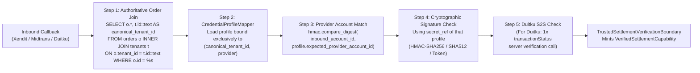
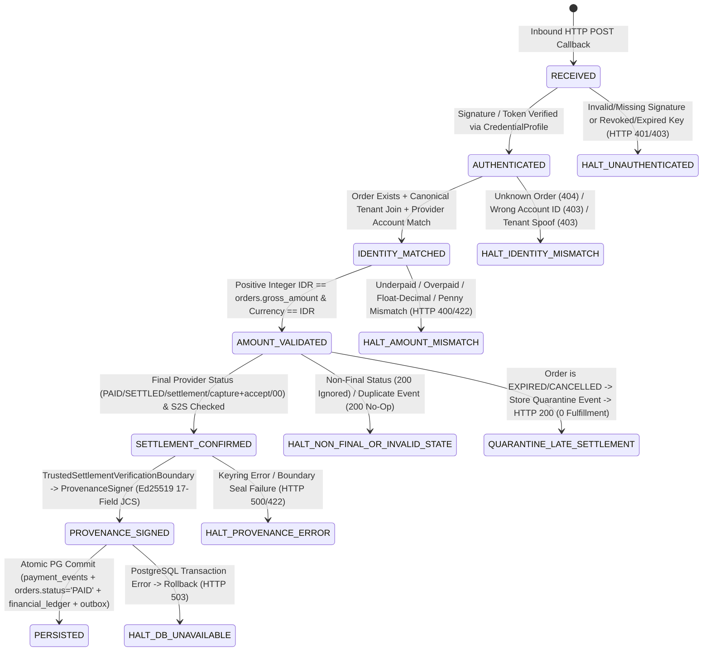

# PHASE 1 — STAGE 3 IMPLEMENTATION PLAN (v1.1)
## NATIVE PAYMENT GATEWAY WEBHOOK HARDENING, CREDENTIAL PROFILE BINDING, & SETTLEMENT PROVENANCE SIGNING

| Metadata | Detail |
| :--- | :--- |
| **Dokumen** | `PHASE-1-STAGE-3-IMPLEMENTATION-PLAN.md` (v1.1) |
| **Repository** | `boontrack-core` |
| **Baseline Commit** | `HEAD 6f1858d` (`docs/rev4-1-remediation-and-review`) |
| **Stage 1 Status** | `CLOSED` (Ed25519 Provenance Authority, RFC 8785 JCS, Canonical Tenant Resolver, PG Anti-Replay Store) |
| **Stage 2 Status** | `CLOSED` (Perimeter Lockdown, Dummy Account `1234567890` Removal, Direct Tenant Rail Disabled, Checkout Session Guard) |
| **Stage 3 Status** | `PLANNING REVISED (v1.1)` — **IMPLEMENTATION ON HOLD** |
| **Stage 4–5 Status** | `HOLD` |
| **Cakupan Provider** | **Xendit**, **Midtrans**, **Duitku** (Native Payment Gateway Rail — `rail_type = "NATIVE_PG"`) |
| **Database & Prod Status** | `ZERO-TOUCH` (Read-Only Source Inspection; No Code Edits, No Migrations, No Live PG Calls) |

---

## 1. Current Provider Webhook Map

Berdasarkan audit *read-only* terhadap kode sumber pada baseline `HEAD 6f1858d` (beserta modul fondasi Stage 1 dan kontainmen perimeter Stage 2), berikut adalah peta lengkap seluruh endpoint webhook pembayaran, adapter, dan fungsi penulis penyelesaian transaksi (*settlement writers*) di `boontrack-core`:

### 1.1 Peta Endpoint & Handler Webhook Saat Ini

| # | Provider / Kategori | Endpoint Path | Runner (`FastAPI` / `aiohttp`) | Lokasi File & Fungsi Handler | Mekanisme Verifikasi Saat Ini | Resolusi Tenant & Akun Provider Saat Ini | Penulisan `payment_events` & Provenance Saat Ini | Kerentanan / Gap Stage 3 |
| :-: | :--- | :--- | :---: | :--- | :--- | :--- | :--- | :--- |
| **1** | **Xendit** (Primary Core) | `POST /api/v1/webhooks/xendit`<br>`POST /webhook/payment/xendit`<br>`POST /api/v1/payments/xendit/callback`<br>`POST /api/v1/payment/xendit/callback`<br>`POST /webhook/xendit` | FastAPI & aiohttp *(kecuali `/api/v1/webhooks/xendit` belum di `register_xendit_routes` aiohttp)* | `app/routes/xendit.py:L695-L1299`<br>`process_xendit_webhook_core()` & `_record_settlement_and_ledger_sync()` (`L411-L688`) | Cek `x-callback-token` terhadap **1 variabel env global** (`XENDIT_CALLBACK_TOKEN`) via `_adapter.handle_webhook()` (`gateway_xendit.py:L46-L57`) menggunakan `==` biasa. | 1. Cabang `TOPUP-` (`L758-L794`) mem-parsing `tenant_slug` dari `external_id.split("-")[1]` tanpa lookup order DB.<br>2. Order reguler (`L903-L1033`) query `orders` tanpa `INNER JOIN tenants`, fallback ke `stored_intent` in-memory.<br>3. **Tidak memeriksa `business_id`**. | Menulis `INSERT INTO payment_events (... status='PROCESSED')` mentah (`L432-L453`) **tanpa signature Ed25519 `_provenance`**. Jika `cur.rowcount == 0`, melakukan **auto-insert order `PAID` baru** (`L481-L508`). | **CRITICAL**: Global token tunggal, zero `business_id` binding, `external_id` string parsing (`TOPUP-`), ghost order auto-insert, synthetic `event_id = f"xendit_{external_id}"` (`L727`). Per CTO Decision #2, jalur `TOPUP-` dikunci `HTTP 403 HOLD` (`SAAS_BILLING_WEBHOOK_STAGE3_HOLD`). |
| **2** | **Xendit** (Secondary Wrapper) | `POST /webhook/xendit` | FastAPI & aiohttp | `app/api/webhook_payment.py:L42-L138`<br>`xendit_payment_webhook()` & `aiohttp_xendit_webhook_handler()` | `get_verified_webhook_supabase_client()` (`L42-L52`) cek `inbound_token != configured_token` dari env global `XENDIT_CALLBACK_TOKEN`, lalu memanggil `process_xendit_webhook_core()`. | Sama dengan #1 (mendelegasikan ke `process_xendit_webhook_core`). | Sama dengan #1. | **HIGH**: Duplikasi route `/webhook/xendit` dengan pemeriksaan token global non-constant-time. |
| **3** | **Xendit** (Aliases in `payment.py`) | `POST /api/v1/payments/webhook/xendit`<br>`POST /api/v1/payment/webhook/xendit`<br>`POST /api/webhook/payment/xendit` | FastAPI & aiohttp | `app/routes/payment.py:L393-L415, L744-L755`<br>`handle_xendit_notification_logic()` | Mendelegasikan ke `process_xendit_webhook_core()`. | Sama dengan #1. | Sama dengan #1. | **HIGH**: Mewarisi seluruh celah `process_xendit_webhook_core`. |
| **4** | **Xendit** (Shop Subscriptions) | `POST /api/v1/shop/subscriptions/webhook/xendit` | FastAPI (`L317`) & aiohttp (`L266`) | `app/routes/shop_subscription_routes.py:L89-L136, L266-L275, L317-L320`<br>`handle_xendit_subscription_webhook_logic()` | **ZERO AUTHENTICATION!** Tidak memeriksa `x-callback-token` maupun header apa pun. | Mengambil `tenant_slug` dari `payload["metadata"]["tenant_slug"]` atau **mem-parsing string `external_id.split("_")`** (`sub_{slug}` / `sub_upgrade_{slug}` pada `L97-L103`). Zero `business_id` check. | **Tidak menulis ke `payment_events`** dan tidak memverifikasi provenance; langsung memanggil `process_successful_subscription()` (`L124`). | **CRITICAL (`CVSS 9.8`)**: Endpoint publik tanpa autentikasi yang mengizinkan spoofing aktivasi langganan & komisi afiliasi via `external_id` parsing. Per CTO Decision #2, jalur `sub_` dikunci `HTTP 403 HOLD` (`SAAS_BILLING_WEBHOOK_STAGE3_HOLD`). |
| **5** | **Midtrans** | `POST /webhook/payment/midtrans`<br>`POST /api/v1/payments/webhook/midtrans`<br>`POST /api/v1/payment/webhook/midtrans`<br>`POST /api/webhook/payment/midtrans` | FastAPI (`L375-L386`) & aiohttp (`L732-L742`) | `app/routes/payment.py:L192-L387, L732-L742`<br>`handle_midtrans_notification_logic()` & `app/services/midtrans_service.py:L53-L66` | Memanggil `midtrans_service.verify_signature()` menggunakan env global `MIDTRANS_SERVER_KEY` yang memiliki **default hardcoded placeholder** `"SB-Mid-server-placeholder-development-key"` (`midtrans_service.py:L33-L36`). | Mengambil `tenant_id` dari `order_record.tenant_slug` di Supabase atau jatuh ke `"boontrack-career"` (`L304-L309`). **Tidak memeriksa `merchant_id`** pada payload callback terhadap `CredentialProfile` tenant. | Tidak menandatangani provenance Ed25519; langsung update Supabase `orders.status = 'PAID'` (`L256-L264`), memanggil `reconcile_payment_webhook` (`L319`), serta mengirim WABA e-receipt & CAPI bahkan jika order tidak ada di DB! | **CRITICAL**: Default placeholder server key, zero `merchant_id` account binding, menerima `capture` dengan `fraud_status == ""` (`L224`), tidak memvalidasi `gross_amount == orders.gross_amount`, dan tanpa Ed25519 provenance. |
| **6** | **Duitku** | `POST /api/v1/payments/duitku/callback` | Hanya di `APIRouter` (`app/routes/duitku_routes.py:L18`), **belum di-mount di `app/main.py` maupun `app/core/server.py`!** | `app/routes/duitku_routes.py:L18-L98`<br>`app/payments/duitku_adapter.py:L76-L163`<br>`app/services/payment/gateway_duitku.py:L72-L221` | Menghitung `HMAC_SHA256(merchantCode + amount + merchantOrderId, apiKey)` dengan `hmac.compare_digest`. Diperlukan verifikasi server-to-server ke `transactionStatus` Duitku untuk setiap transaksi baru. | `PaymentCoreService.process_webhook_settlement()` (`app/payments/service.py:L330-L340`) mencocokkan intent berdasarkan **nominal (`amount`) saja** jika `order_id` tidak ditemukan! | Mencatat in-memory `self._payment_events` tanpa signature Ed25519; `provenance_authority.py` belum mencantumkan `"DUITKU"` di `ALLOWED_PROVIDERS` (`L100`). | **CRITICAL**: Belum terdaftar di kedua runner, `merchantCode` tidak diikat ke `CredentialProfile`, pencocokan order via nominal semata, `except Exception: return "OK"`, dan ketiadaan verifikasi server-to-server `transactionStatus`. |
| **7** | **Unified / Generic Webhook** (3 Varian) | (a) `POST /api/v1/payments/webhook`, `/api/v1/payments/callback`, `/api/v1/payment/callback`<br>(b) `POST /api/v1/payment/webhook`, `/payment/webhook`<br>(c) `POST /webhooks/payment`, `/api/v1/webhooks/payment`, `/api/v1/webhook/payment` | FastAPI | (a) `app/routes/payment.py:L417-L600`<br>(b) `app/api/v1/endpoints/payment_webhook.py:L33-L285`<br>(c) `app/routes/d2c_order_routes.py:L173-L192` | (a) Hanya cek token global Xendit.<br>(b) Menggabungkan `PAYMENT_WEBHOOK_SECRET`, `XENDIT_CALLBACK_TOKEN`, dan `MIDTRANS_SERVER_KEY` dalam satu list (`L35-L41`).<br>(c) Dikunci `HTTP 403` pada Stage 2. | (a) & (b) Memercayai `payload.get("tenant_id")` atau jatuh ke `"onlineboost"` / `"default_tenant"`. Zero `CredentialProfile` binding. | (a) Jika `execute_order_settlement_transaction` gagal (`L528-L537`), blok `except` tetap mengubah `orders.status = 'PAID'` di Supabase!<br>(b) Auto-register order `PAID` baru (`L213-L221`). | **CRITICAL**: Pencampuran token lintas provider di (b), fallback `except -> PAID` di (a) dan `checkout_flow_service.py:L332-L340`. Per CTO Decision #3, seluruh generic webhook **DITUTUP PERMANEN** dengan `HTTP 403 DEPRECATED_GENERIC_WEBHOOK_USE_PROVIDER_SPECIFIC_ROUTE`. |
| **8** | **Academy Webhook** | `POST /api/v1/academy/webhook/paid` | FastAPI & aiohttp | `app/routes/academy_routes.py:L281-L303, L416-L439` | Dikunci pada Stage 2 (`HTTP 403 UNVERIFIED_WEBHOOK_MUTATION_BLOCKED`). | Tidak memiliki ikatan provider atau `CredentialProfile`. | Diblokir pada Stage 2. | Tetap ditutup untuk payload unverified. |
| **9** | **Direct Tenant Rail** (DANA / Android Reader) | `POST /webhook/dana`, `/api/webhook/dana`, `/api/webhook/payment-reader`, `/api/payments/webhook`, `/api/v1/reader/mutations` | FastAPI & aiohttp | `app/api/endpoints/dana.py`<br>`app/routes/payment_webhook.py`<br>`app/routes/payment.py:L697`<br>`app/api/v1/reader.py` & `reader_router.py` | **HARD-LOCKED (`HTTP 403 DIRECT_TENANT_RAIL_DISABLED`)** pada Stage 2. | Direct Tenant Rail dinonaktifkan (`EXPERIMENTAL / PENDING_REVIEW`). | Ditolak di `TrustedSettlementVerificationBoundary`, `ProvenanceSigner`, dan `ProvenanceVerifier`. | Wajib tetap **DISABLED (`HTTP 403`)** sepanjang Stage 3. |

### 1.2 Peta Penulis Settlement Service-Layer Saat Ini

| # | Modul / Fungsi | Lokasi Kode | Perilaku Saat Ini | Celah Keamanan yang Wajib Ditutup pada Stage 3 |
| :-: | :--- | :--- | :--- | :--- |
| **S1** | `reconcile_payment_webhook` | `app/services/checkout_flow_service.py:L282-L403` | Dipanggil oleh `handle_midtrans_notification_logic` (`payment.py:L319`). Memanggil `execute_order_settlement_transaction`. | Pada `L332-L340`, jika transaksi PostgreSQL gagal (`except Exception as tx_err:`), fungsi melakukan **fallback update `orders.status = 'PAID'` langsung ke Supabase** lalu tetap mengirimkan link produk digital ke WhatsApp pembeli! |
| **S2** | `execute_order_settlement_transaction` | `app/services/checkout_service.py:L137-L366` | Melakukan `INSERT INTO payment_events (... status='PROCESSED')` (`L182-L204`) dan `UPDATE orders SET status='PAID'` (`L278-L286`). | 1. Menerima parameter `provider`, `event_id`, `tenant_id`, dan `amount` mentah tanpa `VerifiedSettlementCapability` maupun signature Ed25519.<br>2. Pada `L287-L313`, jika `cur.rowcount == 0 and not ord_row`, melakukan **auto-insert order `PAID` baru** ke tabel `orders`. |
| **S3** | `PaymentCoreService.process_webhook_settlement` | `app/payments/service.py:L295-L420` | Dipanggil oleh `duitku_payment_callback` (`duitku_routes.py:L60`). | Pada `L330-L340`, jika `order_id` tidak cocok di memori, melakukan **pencocokan liar berdasarkan nominal (`candidate.total_amount == webhook.amount`)** lintas intent `PENDING`, dan tidak menulis provenance Ed25519 ke PostgreSQL `payment_events`. |

---

## 2. Credential Profile Data Model (`CredentialProfileMapper`)

Untuk memenuhi mandat Bagian 2 Direktif CTO, komponen `CredentialProfileMapper` dirancang di dalam `app/core/security/payment_auth_guard.py` (dengan definisi kontrak di `app/core/security/provenance_authority.py`).

### 2.1 Invarian Keamanan `CredentialProfileMapper`
1. **Strict 1-to-1 Canonical Tenant Identity Binding:**
   - Setiap `credential_profile_id` terikat secara eksklusif dan *immutable* kepada tepat **satu** `canonical_tenant_id` (`tenants.id` berformat canonical lowercase UUID v4).
   - Validasi menolak setiap profil yang menggunakan `tenant_slug` (mis. `"onlineboost"`) sebagai pengganti UUID `canonical_tenant_id`.
2. **Internal Relational Provider Account Mapping:**
   - Identitas akun eksternal pada provider (`business_id` pada Xendit, `merchant_id` pada Midtrans, `merchantCode` pada Duitku) disimpan sebagai `expected_provider_account_id` di dalam `TenantCredentialProfile`.
   - Resolusi selalu bergerak **satu arah dari dalam ke luar**:
     `order_id` $\xrightarrow{\text{INNER JOIN}}$ `orders.tenant_id == tenants.id` (`canonical_tenant_id`) $\xrightarrow{\text{Internal Profile Relation}}$ `TenantCredentialProfile(credential_profile_id, canonical_tenant_id, provider, expected_provider_account_id)` $\xrightarrow{\text{compare\_digest}}$ `inbound_provider_account_id`.
3. **Pengamanan Secret Credential Profile (`secret_ref` Pointer Architecture):**
   - Kolom `tenants.metadata->'payment_config'->'credential_profiles'` **HANYA** menyimpan metadata profil dan `secret_ref` (referensi/pointer unik ke Secret Manager atau encrypted vault dengan kontrol akses ketat).
   - **DILARANG KERAS** menyimpan `secret_value` secara plaintext di dalam `tenants.metadata` database.
   - Nilai rahasia kredensial hanya di-resolve secara dinamis di dalam memori verifier oleh secret resolver / vault client internal saat proses verifikasi berlangsung.
4. **Zero `external_id` String Parsing for Tenant Authorization:**
   - Dilarang keras mengekstrak `tenant_id` atau `tenant_slug` menggunakan operasi string seperti `external_id.split("-")`, `external_id.split("_")`, regex prefix `INV-{slug}-*`, `ORD-{slug}-*`, `TOPUP-{slug}-*`, atau `sub_{slug}` untuk menentukan pemilik order atau memilih credential profile.
5. **Zero Callback Payload Tenant Switching:**
   - Field `tenant_id`, `tenant_slug`, `merchant_slug`, atau `metadata.tenant_id` di dalam payload JSON/Form callback **tidak pernah** dapat mengubah `canonical_tenant_id` maupun memindahkan `credential_profile_id` ke tenant lain. Apabila payload menyertakan klaim `tenant_id` yang bertentangan dengan `orders.tenant_id`, callback langsung ditolak secara *fail-closed* (`HTTP 403 ORDER_TENANT_MISMATCH`).
6. **Credential Rotation Lifecycle & Append-Only Audit Trail:**
   - Setiap credential profile mendukung daftar versi rahasia verifikasi (`verification_secrets: Tuple[CredentialSecretVersion, ...]`) dengan status siklus hidup:
     - `ACTIVE`: Digunakan untuk verifikasi callback aktif (wajib tepat 1 kunci `ACTIVE` per profil aktif).
     - `VERIFY_ONLY` (`ROTATING_GRACE`): Kunci lama yang sedang dalam masa transisi rotasi; masih diizinkan memverifikasi callback yang sedang *in-flight* hingga batas waktu wajib `not_after_epoch` (`int` Unix timestamp). Jika `now_epoch > not_after_epoch`, kunci otomatis ditolak (`EXPIRED_CREDENTIAL_SECRET_VERSION`).
     - `REVOKED`: Kunci yang telah dicabut karena kompromi atau pensiun; langsung ditolak (`REVOKED_CREDENTIAL_SECRET_VERSION`).
   - Setiap penggunaan maupun kegagalan verifikasi rahasia kredensial menghasilkan catatan audit terstruktur (`CredentialVerificationAuditEntry`) yang merekam `credential_profile_id`, `canonical_tenant_id`, `provider`, `secret_version_id`, `key_status`, `order_id`, `verification_outcome`, dan `verified_at_utc`.
   - **Pencegahan Kebocoran Secret:** Objek hasil verifikasi (`CredentialVerificationResult`) **tidak memuat** nilai rahasia (`matched_secret_value` dihapus). Secret verifikasi tidak pernah dikembalikan ke luar modul verifier atau dicatat ke log.

### 2.2 Spesifikasi Data Model (`dataclass` & Skema Konfigurasi)

```python
@dataclass(frozen=True)
class CredentialSecretVersion:
    """Satu versi rahasia verifikasi callback (callback_token / server_key / api_key)
    dalam siklus hidup rotasi Credential Profile.
    Menyimpan secret_ref (pointer ke Secret Manager/Encrypted Vault), BUKAN plaintext.
    """
    secret_version_id: str          # e.g., "ver_xnd_ob_2026_11_v1"
    secret_ref: str                 # Pointer ke Secret Manager / Encrypted Vault; BUKAN plaintext secret
    status: str                     # "ACTIVE" | "VERIFY_ONLY" | "REVOKED"
    created_at_utc: str             # ISO-8601 UTC
    rotated_at_utc: Optional[str] = None
    not_after_epoch: Optional[int] = None  # Wajib diisi jika status == "VERIFY_ONLY"


@dataclass(frozen=True)
class TenantCredentialProfile:
    """Profil kredensial Payment Gateway internal yang terikat 1-ke-1 dengan canonical_tenant_id."""
    credential_profile_id: str          # e.g., "cred_xendit_onlineboost_prod" (UNIQUE)
    canonical_tenant_id: str            # Canonical UUID dari tenants.id (e.g., "11111111-...")
    provider: str                       # "XENDIT" | "MIDTRANS" | "DUITKU"
    verification_method: str            # "XENDIT_CALLBACK_TOKEN" | "MIDTRANS_SHA512" | "DUITKU_CALLBACK_HMAC_SHA256"
    expected_provider_account_id: str   # Xendit business_id / Midtrans merchant_id / Duitku merchantCode
    environment: str                    # "production" | "sandbox"
    profile_status: str                 # "ACTIVE" | "SUSPENDED" | "REVOKED"
    verification_secrets: Tuple[CredentialSecretVersion, ...]
    updated_at_utc: str
    rotated_by_principal: Optional[str] = None


@dataclass(frozen=True)
class CredentialVerificationResult:
    """Bukti hasil resolusi dan verifikasi rahasia pada CredentialProfileMapper.
    Catatan Keamanan: matched_secret_value DIHAPUS. Rahasia kredensial hanya digunakan
    secara internal di dalam boundary verifier dan tidak pernah dikembalikan sebagai return value.
    """
    credential_profile_id: str
    canonical_tenant_id: str
    provider: str
    verification_method: str
    expected_provider_account_id: str
    matched_secret_version_id: str
    matched_secret_status: str
    environment: str
    audit_entry: Dict[str, Any]
```

### 2.3 Struktur Penyimpanan di Database (`tenants.metadata->'payment_config'`) & Registry Konfigurasi

Tanpa memerlukan migrasi DDL destruktif pada Stage 3 (`ZERO-TOUCH DB`), `CredentialProfileMapper` membaca definisi profil dari relasi tabel `tenants` (`SELECT t.id::text, t.slug, t.metadata FROM tenants t WHERE t.id = %s::uuid`) pada atribut `metadata->'payment_config'->'credential_profiles'`. Kunci rahasia direferensikan melalui pointer `secret_ref`:

```json
{
  "payment_config": {
    "mode": "NATIVE_PG",
    "active_provider": "XENDIT",
    "credential_profiles": {
      "XENDIT": {
        "credential_profile_id": "cred_xendit_onlineboost_prod",
        "canonical_tenant_id": "7f9c2a10-4b3e-4d1a-9c88-112233445566",
        "provider": "XENDIT",
        "verification_method": "XENDIT_CALLBACK_TOKEN",
        "expected_provider_account_id": "64a1b2c3d4e5f60011223344",
        "environment": "production",
        "profile_status": "ACTIVE",
        "updated_at_utc": "2026-11-06T00:00:00Z",
        "rotated_by_principal": "secops:key_custodian_01",
        "verification_secrets": [
          {
            "secret_version_id": "xnd_cb_v2_202611",
            "secret_ref": "vault://tenants/7f9c2a10-4b3e-4d1a-9c88-112233445566/xendit/cb_token_v2",
            "status": "ACTIVE",
            "created_at_utc": "2026-11-06T00:00:00Z"
          },
          {
            "secret_version_id": "xnd_cb_v1_202610",
            "secret_ref": "vault://tenants/7f9c2a10-4b3e-4d1a-9c88-112233445566/xendit/cb_token_v1",
            "status": "VERIFY_ONLY",
            "created_at_utc": "2026-10-01T00:00:00Z",
            "rotated_at_utc": "2026-11-06T00:00:00Z",
            "not_after_epoch": 1794009600
          }
        ]
      }
    }
  }
}
```

**Aturan Validasi Invarian pada `CredentialProfileMapper`:**
1. Jika `profile["canonical_tenant_id"] != joined_tenant_uuid` $\rightarrow$ tolak dengan `SettlementProvenanceError(error_code="CREDENTIAL_PROFILE_TENANT_MISMATCH", http_status=403)`.
2. Jika `credential_profile_id` yang sama terdaftar pada lebih dari satu `canonical_tenant_id` $\rightarrow$ tolak dengan `SettlementProvenanceError(error_code="AMBIGUOUS_CREDENTIAL_PROFILE_BINDING", http_status=403)`.
3. Jika `order.metadata` memiliki `credential_profile_id` yang direkam saat pembuatan invoice/QRIS, maka `profile.credential_profile_id` **wajib** sama persis (`hmac.compare_digest`) dengan yang tercatat pada order tersebut.
4. Jika `profile.environment` (`"sandbox"` vs `"production"`) tidak sesuai dengan mode runtime (`APP_ENV`), callback ditolak dengan `CREDENTIAL_PROFILE_ENVIRONMENT_MISMATCH` (`HTTP 403`).
5. Jika `secret_ref` tidak dapat di-resolve atau nilai rahasia di dalam vault kosong/tidak valid $\rightarrow$ fail-closed dengan `CREDENTIAL_SECRET_UNAVAILABLE` (`HTTP 503`).

---

## 3. Xendit Callback Security Design

Xendit menggunakan model autentikasi dan struktur payload yang berbeda dari Midtrans dan Duitku. Desain keamanan Xendit tidak boleh disamakan dengan provider lain.

### 3.1 Mekanisme Autentikasi Callback Resmi Xendit
1. **Header Verification Token (`x-callback-token`):**
   - Xendit mengirimkan token verifikasi webhook pada HTTP header `x-callback-token`.
   - Berbeda dengan Midtrans (yang menandatangani field transaksi di body), `x-callback-token` Xendit adalah *per-business webhook verification secret* statis.
   - Oleh sebab itu, verifikasi `x-callback-token` wajib:
     1. Mengekstrak `x-callback-token` dari header yang telah dinormalisasi (`lowercase`). Jika header tidak ada atau kosong $\rightarrow$ tolak (`HTTP 401/403 PG_WEBHOOK_SIGNATURE_INVALID`).
     2. Melakukan pencocokan *constant-time* (`hmac.compare_digest(callback_token, resolved_secret)`) hanya terhadap daftar `verification_secrets` berstatus `ACTIVE` atau `VERIFY_ONLY` (yang belum melewati `not_after_epoch`) milik `TenantCredentialProfile` untuk `(canonical_tenant_id, "XENDIT")`.
     3. **Dilarang** membandingkan dengan `os.getenv("XENDIT_CALLBACK_TOKEN")` global tanpa ikatan `TenantCredentialProfile`.
2. **Kombinasi Wajib dengan Ikatan Akun (`business_id`) dan Bukti Order Pre-Registered:**
   - Karena `x-callback-token` bersifat statis per akun bisnis Xendit, keaslian transaksi dikunci melalui verifikasi silang terhadap:
     - `business_id` pada payload == `profile.expected_provider_account_id`,
     - `external_id` / `reference_id` == `orders.id` yang sudah ada di PostgreSQL dengan status `PENDING` / `WAITING_PAYMENT`,
     - `provider_transaction_id` (`qr_id` / `invoice_id`) cocok dengan referensi yang disimpan pada `orders.metadata['provider_transaction_id']` saat pembuatan QRIS/Invoice (jika ada),
     - `amount` integer eksak == `orders.gross_amount` dan `currency == "IDR"`.

### 3.2 Pemetaan Field Callback Xendit

Xendit memiliki dua skema payload resmi yang digunakan di ekosistem `boontrack-core`:
- **Skema A — Xendit Event Wrapper (QR Codes API `2022-07-31`, Payment Requests, eWallets):** memiliki wrapper top-level `{"event": "qr.payment", "id": "evt_...", "business_id": "5f...", "created": "...", "data": {...}}`.
- **Skema B — Xendit Invoices API (`v2/invoices`):** memiliki struktur flat top-level `{"id": "64...", "external_id": "ORD-...", "user_id": "5f...", "status": "PAID", "amount": 249000, "paid_amount": 249000, "currency": "IDR", ...}`.

| Atribut Keamanan | Sumber Field pada Callback Xendit | Aturan Validasi & Normalisasi (Fail-Closed) |
| :--- | :--- | :--- |
| **Merchant Order ID (`order_id`)** | `data.external_id` (atau `data.reference_id` pada QR API `2022-07-31`) atau top-level `external_id`. Jika keduanya ada, **wajib identik**. | Wajib `str` non-empty. Dilarang fallback ke `payload["id"]` (karena `id` adalah ID internal Xendit, bukan `orders.id`). |
| **Provider Transaction ID (`provider_event_id`)** | `data.payment_id` $\rightarrow$ `data.qr_id` $\rightarrow$ `data.id` $\rightarrow$ top-level `payment_id` $\rightarrow$ top-level `qr_id` $\rightarrow$ top-level `id`. | Wajib `str` non-empty yang berasal asli dari Xendit. **Dilarang keras** sama dengan `order_id` atau hasil konstruksi lokal. |
| **Provider Event / Callback ID (`event_id`)** | Header `webhook-id` / `x-webhook-id` $\rightarrow$ top-level `event_id` $\rightarrow$ top-level `id` (pada Event Wrapper) $\rightarrow$ `provider_event_id`. | Wajib `str` non-empty unik dari Xendit. **Hapus** fallback sintetis `f"xendit_{external_id}"` pada `app/routes/xendit.py:L727`. Jika kosong $\rightarrow$ tolak `PROVENANCE_EMPTY_EVENT_ID` (`HTTP 422`). |
| **Provider Account / Business Identity (`provider_account_id`)** | Top-level `business_id` $\rightarrow$ `data.business_id` $\rightarrow$ top-level `user_id` (khusus Invoice v2 callback). Jika hadir di top-level dan `data`, keduanya **wajib sama persis**. | Wajib `str` non-empty dan wajib cocok (`hmac.compare_digest`) dengan `profile.expected_provider_account_id`. Jika tidak cocok $\rightarrow$ tolak `HTTP 403 PROVIDER_ACCOUNT_BINDING_MISMATCH`. |
| **Amount (`verified_amount`)** | `data.amount` $\rightarrow$ top-level `amount`. Jika `paid_amount` juga dikirim (Invoice v2), maka `paid_amount` **wajib sama dengan** `amount`. | Wajib bertipe `int` murni (`not isinstance(val, bool) and isinstance(val, int) and val > 0`). Dilarang konversi `int(float(raw_amount))` yang memangkas desimal. Wajib `== orders.gross_amount`. |
| **Currency (`currency`)** | `data.currency` $\rightarrow$ top-level `currency`. | Wajib eksplisit `"IDR"`. Jika bernilai selain `"IDR"` (mis. `"USD"`, `"SGD"`) atau kosong $\rightarrow$ tolak `HTTP 422 PROVENANCE_INVALID_CURRENCY`. |
| **Final Settlement Status** | `data.status` $\rightarrow$ top-level `status` (serta jika `event` ada, wajib termasuk `{"qr.payment", "payment.succeeded", "invoices.paid", "ewallet.capture"}`). | Hanya status final resmi Xendit: `{"PAID", "SETTLED", "SUCCEEDED", "COMPLETED"}`. **Hapus `"LUNAS"`** dari `_PAID_STATUSES`. Status `PENDING`, `ACTIVE`, `EXPIRED`, `FAILED` dihentikan tanpa fulfillment. |

### 3.3 Penghapusan Celah Spesifik Xendit & Keputusan Final CTO #2
1. **Lockdown SaaS Quota Top-Up (`TOPUP-`) — CTO Decision #2:**
   - Cabang parsing string `if external_id.startswith("TOPUP-"):` pada `app/routes/xendit.py:L758-L794` **DIKUNCI TOTAL** dengan `HTTP 403 HOLD` (`SAAS_BILLING_WEBHOOK_STAGE3_HOLD`).
   - Setiap inbound callback yang membawa prefix `TOPUP-` langsung ditolak fail-closed tanpa mutasi apa pun sampai modul billing SaaS direfaktor dengan pre-registered order di tabel `orders` dan verifikasi yang sah.
2. **Lockdown Shop Subscription Webhook (`sub_`) — CTO Decision #2:**
   - Endpoint `POST /api/v1/shop/subscriptions/webhook/xendit` pada `app/routes/shop_subscription_routes.py:L89-L136` **DIKUNCI TOTAL** dengan `HTTP 403 HOLD` (`SAAS_BILLING_WEBHOOK_STAGE3_HOLD`).
   - String parsing `sub_{slug}` dan `sub_upgrade_{slug}` dinonaktifkan sepenuhnya. Seluruh aktivasi langganan toko via webhook ditahan hingga arsitektur subscription lifecycle yang aman diimplementasikan.
3. **Penghapusan Ghost Order Auto-Insert (`app/routes/xendit.py:L481-L508`):**
   - Blok `INSERT INTO orders ... VALUES (..., 'PAID')` ketika `cur.rowcount == 0` dihapus permanen. Order yang tidak terdaftar wajib ditolak dengan `HTTP 404 ORDER_NOT_FOUND`.
4. **Idempotency & Replay Semantics Xendit (Composite Provider Key):**
   - Pengecekan idempotensi wajib menggunakan kunci komposit per-provider: `(provider='XENDIT', event_id)` serta `(provider='XENDIT', provider_event_id)`.
   - Apabila event sudah tercatat di `payment_events` dengan `status='PROCESSED'` **dan** parameter (`order_id`, `verified_amount`, `provider_account_id`) identik setelah verifikasi token, kembalikan `HTTP 200 OK` (`{"status": "ALREADY_PROCESSED", "idempotent": True}`) tanpa mutasi ulang dan tanpa duplikasi fulfillment/CAPI.
   - Apabila `event_id` sama tetapi payload memiliki data yang bertentangan (*conflicting replay*), tolak keras dengan `HTTP 409 CONFLICTING_PAYMENT_EVENT_REPLAY`.

---

## 4. Midtrans Callback Security Design

Midtrans menggunakan skema notifikasi HTTP POST JSON dengan tanda tangan kriptografis SHA-512 di dalam body payload, format nominal desimal string (`"249000.00"`), serta matriks kombinasi `transaction_status` + `fraud_status` + `status_code`.

### 4.1 Mekanisme Autentikasi Callback Resmi Midtrans
1. **Formula Signature SHA-512 Resmi Midtrans:**
   $$\text{signature\_key} = \text{HEX}\big(\text{SHA512}(\text{order\_id} \mathbin{\Vert} \text{status\_code} \mathbin{\Vert} \text{gross\_amount} \mathbin{\Vert} \text{ServerKey})\big)$$
   - `order_id`, `status_code`, dan `gross_amount` wajib diambil sebagai **exact raw string sebagaimana tertera pada JSON body** (mis. `gross_amount = "249000.00"`) sebelum konversi numerik apa pun.
   - `ServerKey` di-resolve secara eksklusif dari `secret_ref` pada `TenantCredentialProfile` milik `(canonical_tenant_id, "MIDTRANS")` (mendukung status `ACTIVE` dan `VERIFY_ONLY` dalam masa rotasi).
   - Perbandingan digest wajib menggunakan `hmac.compare_digest(computed_sig.lower(), provided_sig.lower())`.
2. **Penghapusan Placeholder Server Key (`app/services/midtrans_service.py:L33-L36`):**
   - Default hardcoded `"SB-Mid-server-placeholder-development-key"` pada `MidtransService.__init__` dihapus total. Ketidaktersediaan `ServerKey` pada profil kredensial wajib *fail-closed* (`INVALID_CREDENTIAL_PROFILE` / `PG_WEBHOOK_SIGNATURE_INVALID`).

### 4.2 Pemetaan Field Callback Midtrans

| Atribut Keamanan | Sumber Field pada Callback Midtrans | Aturan Validasi & Normalisasi (Fail-Closed) |
| :--- | :--- | :--- |
| **Merchant Order ID (`order_id`)** | `payload["order_id"]` | Wajib `str` non-empty (dilarang fallback ke `payload["id"]` pada `payment.py:L198`). Wajib cocok dengan `orders.id` di PostgreSQL. |
| **Provider Transaction ID (`provider_event_id`)** | `payload["transaction_id"]` | Wajib `str` UUID/identifier non-empty asli dari Midtrans Core API. Dilarang fallback ke `order_id` (`payment.py:L322`). |
| **Provider Event / Callback ID (`event_id`)** | `payload["transaction_id"]` | Untuk event settlement (`settlement`/`capture`), `event_id` adalah `str(payload["transaction_id"]).strip()` yang unik per transaksi Midtrans. |
| **Provider Account / Business Identity (`provider_account_id`)** | `payload["merchant_id"]` (mis. `"G123456789"`) | Wajib `str` non-empty dan wajib cocok (`hmac.compare_digest`) dengan `profile.expected_provider_account_id`. Jika tidak cocok $\rightarrow$ tolak `HTTP 403 PROVIDER_ACCOUNT_BINDING_MISMATCH`. |
| **Amount (`verified_amount`)** | `payload["gross_amount"]` (dikirim sebagai string desimal, mis. `"249000.00"`) | 1. String mentah digunakan untuk verifikasi SHA-512.<br>2. Di-parse dengan `Decimal(gross_amount_raw)`: wajib `dec_val > 0`, wajib bernilai bulat penuh tanpa pecahan sen (`dec_val == int(dec_val)`), dan `int(dec_val) == orders.gross_amount`. Pecahan seperti `"249000.50"` ditolak (`PROVENANCE_INVALID_AMOUNT`). |
| **Currency (`currency`)** | `payload.get("currency", "IDR")` | Wajib `"IDR"`. Jika field `currency` ada dan bernilai selain `"IDR"` $\rightarrow$ tolak `PROVENANCE_INVALID_CURRENCY`. |
| **Final Settlement Status & Fraud Guard** | Kombinasi 3 field: `status_code`, `transaction_status`, dan `fraud_status` | Wajib memenuhi:<br>1. `status_code == "200"`<br>2. `(transaction_status == "settlement" and fraud_status in ("accept", ""))` **ATAU** `(transaction_status == "capture" and fraud_status == "accept")`.<br>*Perbaikan Bug Kritis:* Pada `provenance_authority.py:L500` dan `payment.py:L224`, `capture` dengan `fraud_status == "challenge"`, `"deny"`, atau `""` **dilarang** dianggap settled! Status `pending`, `deny`, `cancel`, `expire`, `failure`, `refund` dihentikan tanpa fulfillment. |

### 4.3 Idempotency & Replay Semantics Midtrans
- **Eliminasi In-Memory Set & Direct Supabase Bypass (`app/routes/payment.py:L228-L266`):**
  - Pengecekan idempotensi tidak boleh hanya mengandalkan `midtrans_service._processed_transactions` di RAM atau langsung melakukan `.update({"status": "PAID"})` ke Supabase.
  - Seluruh settlement Midtrans wajib melalui transaksi atomik PostgreSQL (`commit_verified_settlement_transaction`) dengan `SELECT ... FOR UPDATE` pada `orders` dan constraint unik komposit pada `payment_events (provider, event_id)`.

---

## 5. Duitku Callback Security Design

Duitku V2 menggunakan model callback dengan payload `application/x-www-form-urlencoded` (atau JSON). Berdasarkan standar teknis resmi terbaru Duitku dan Keputusan Final CTO #1, metode autentikasi callback Duitku ditetapkan menggunakan **`DUITKU_CALLBACK_HMAC_SHA256`** ditambah **panggilan verifikasi server-to-server ke API `transactionStatus` Duitku**.

### 5.1 Mekanisme Autentikasi Callback Resmi Duitku & Verifikasi Server-to-Server
1. **Formula Signature Callback Inbound Resmi Duitku (`DUITKU_CALLBACK_HMAC_SHA256`):**
   $$\text{callback\_signature} = \text{HEX\_LOWER}\big(\text{HMAC\_SHA256}(\text{merchantCode} \mathbin{\Vert} \text{amount} \mathbin{\Vert} \text{merchantOrderId}, \text{apiKey})\big)$$
   - Di mana `merchantCode`, `amount`, dan `merchantOrderId` adalah string mentah dari callback inbound, dan `apiKey` di-resolve dari `secret_ref` pada `TenantCredentialProfile` untuk `(canonical_tenant_id, "DUITKU")`.
   - Perbandingan signature wajib menggunakan `hmac.compare_digest(computed_hmac.lower(), provided_sig.lower())`.
   - Seluruh referensi lama terhadap `DUITKU_CALLBACK_MD5` digantikan secara menyeluruh oleh `DUITKU_CALLBACK_HMAC_SHA256`.

2. **Formula Signature Request Outbound `transactionStatus` Duitku (`DUITKU_S2S_CHECK_HMAC_SHA256`):**
   $$\text{request\_signature} = \text{HEX\_LOWER}\big(\text{HMAC\_SHA256}(\text{merchantCode} \mathbin{\Vert} \text{merchantOrderId}, \text{apiKey})\big)$$
   - **Berbeda secara kriptografis dari callback inbound:** Request ke `transactionStatus` menyandikan string `merchantCode + merchantOrderId` (**tanpa `amount`**) menggunakan `HMAC-SHA256(..., apiKey)`.
   - Payload request S2S: `{"merchantCode": merchant_code, "merchantOrderId": order_id, "signature": request_signature}`.
   - Stub pengujian lokal wajib memvalidasi bahwa request outbound menggunakan `HMAC-SHA256(merchantCode + merchantOrderId, apiKey)` dan menolak digest MD5 maupun digest callback inbound.

3. **Tahapan Wajib: Verifikasi Server-to-Server ke API `transactionStatus` Duitku dengan Concurrency-Safe Claim/Lease & Recovery:**
   Setelah callback inbound lolos autentikasi signature HMAC-SHA256, sistem **WAJIB** melakukan SATU KALI panggilan verifikasi server-to-server ke endpoint `transactionStatus` Duitku untuk setiap transaksi baru sebelum menerbitkan `VerifiedSettlementCapability`:
   - **Endpoint Resmi Duitku:** `https://passport.duitku.com/webapi/api/merchant/transactionStatus` (Production) atau `https://sandbox.duitku.com/webapi/api/merchant/transactionStatus` (Sandbox).
   - **Kompensasi Kriptografis:** Karena callback payload dikirim dari perimeter publik, `resultCode` callback **TIDAK BOLEH** dijadikan satu-satunya bukti penyelesaian transaksi (*settlement*). Bukti primer adalah respons otoritatif dari server Duitku.
   - **Pencocokan Data Server Response:**
     Sistem mencocokkan data yang dikembalikan oleh API `transactionStatus`:
     1. `merchantOrderId` dari respons server == `orders.id` internal.
     2. `reference` dari respons server == `payload["reference"]` == `orders.metadata['provider_reference']`.
     3. `amount` dari respons server == integer `orders.gross_amount`.
     4. `statusCode == "00"` (Success) dari respons server Duitku.
   - **Protokol Klaim S2S Concurrency-Safe & Recovery (`DuitkuS2SVerifier`):**
     1. **Kolom State `DuitkuS2SVerifier` pada `public.payment_events`:** `s2s_verification_status VARCHAR(64)`, `s2s_claimed_at TIMESTAMPTZ`, `s2s_lease_expires_at TIMESTAMPTZ`, `s2s_claimed_by VARCHAR(128)`, `s2s_attempt_count INT NOT NULL DEFAULT 0`, `s2s_last_error TEXT`, `s2s_verified_at TIMESTAMPTZ`, `s2s_status_code VARCHAR(32)`, `s2s_reference VARCHAR(128)`, dan `s2s_response_payload JSONB`.
     2. **Phase 1 (Short Atomic DB Claim Sebelum Network I/O):** `DuitkuS2SVerifier` mengeklaim baris `(provider='DUITKU', event_id, provider_event_id)` pada `payment_events` dengan `status='PROCESSING'`, `s2s_verification_status='S2S_IN_FLIGHT'`, `s2s_claimed_at=NOW()`, `s2s_lease_expires_at=NOW() + INTERVAL '15 seconds'`, `s2s_attempt_count=1` dan langsung `COMMIT` sebelum melakukan HTTP request agar tidak menahan row lock selama I/O jaringan.
     3. **Deduplikasi Konkuren:** Jika baris sudah `PROCESSED` / `QUARANTINED_LATE_SETTLEMENT`, langsung kembalikan `HTTP 200` (`0` panggilan S2S). Jika klaim sedang aktif (`s2s_verification_status='S2S_IN_FLIGHT'` dalam jendela lease 15 detik), gabungkan melalui *in-process singleflight* atau tolak duplikasi in-flight (`0` panggilan S2S ganda). Jika payload konflik (`amount` / `order_id` / `reference` berbeda), tolak `HTTP 409 CONFLICTING_WEBHOOK_REPLAY`.
     4. **Recovery atas Kegagalan S2S / Timeout:** Jika panggilan S2S gagal (timeout / HTTP 5xx), tandai baris `PROCESSING` menjadi `s2s_verification_status='S2S_RETRYABLE_FAILURE'` dan `s2s_last_error`. Saat retry berikutnya tiba (atau jika lease `S2S_IN_FLIGHT` telah kedaluwarsa $>15$ detik akibat crash worker), klaim diambil alih secara atomik (`s2s_attempt_count + 1`, diizinkan oleh trigger `trg_payment_events_append_only` karena `OLD.status='PROCESSING'` dan kolom identitas tidak berubah) hingga berhasil mencapai `PROCESSED` / `QUARANTINED_LATE_SETTLEMENT`.
     **DILARANG KERAS** menjalankan background cron atau polling berulang untuk transaksi yang sama.
   - **Fail-Closed Guarantees:**
     Jika panggilan verifikasi server-to-server `transactionStatus` gagal, menghasilkan error non-200, mengalami timeout, atau data respons tidak cocok, sistem wajib fail-closed: **TIDAK menerbitkan** `VerifiedSettlementCapability`, **TIDAK melunaskan** order, dan mengembalikan `HTTP 502/503` (untuk kegagalan upstream) atau `HTTP 422` (untuk ketidakcocokan data).
   - **Isolasi Pengujian (Zero Live Network Calls):**
     Pada seluruh unit test dan negative test di Bab 11 dan Bab 13, pemanggilan `transactionStatus` wajib menggunakan local mock / stub transport tanpa menyentuh internet live Duitku.

3. **Registrasi Resmi `"DUITKU"` pada `TrustedSettlementVerificationBoundary`:**
   - `"DUITKU"` ditambahkan ke `ALLOWED_PROVIDERS`.
   - `"DUITKU_CALLBACK_HMAC_SHA256"` ditambahkan ke `ALLOWED_VERIFICATION_METHODS` (menggantikan `DUITKU_CALLBACK_MD5`).
   - Implementasi cabang `elif norm_provider == "DUITKU" and norm_method == "DUITKU_CALLBACK_HMAC_SHA256":` di dalam `TrustedSettlementVerificationBoundary.verify_pg_webhook_and_issue_capability()`.

### 5.2 Pemetaan Field Callback Duitku

| Atribut Keamanan | Sumber Field pada Callback Duitku | Aturan Validasi & Normalisasi (Fail-Closed) |
| :--- | :--- | :--- |
| **Merchant Order ID (`order_id`)** | `merchantOrderId` (form field) | Wajib `str` non-empty; wajib cocok dengan `orders.id` pre-registered di PostgreSQL. |
| **Provider Transaction ID (`provider_event_id`)** | `reference` (Duitku Reference Number) | Wajib `str` non-empty asli dari Duitku. Wajib cocok dengan `orders.metadata['provider_reference']` yang direkam saat inquiry dan diverifikasi ulang via `transactionStatus`. |
| **Provider Event / Callback ID (`event_id`)** | `f"duitku:{merchantCode}:{reference}"` (atau `reference`) | Deterministik dan unik per transaksi settlement Duitku; dilarang sintetis dari `order_id` saja. |
| **Provider Account / Business Identity (`provider_account_id`)** | `merchantCode` (form field, mis. `"D12345"`) | Wajib `str` non-empty dan cocok (`hmac.compare_digest`) dengan `profile.expected_provider_account_id`. |
| **Amount (`verified_amount`)** | `amount` (form field string bulat, mis. `"249000"`) | Wajib string digit bulat positif murni (`amount_raw.isdigit() and int(amount_raw) > 0`), diverifikasi via `transactionStatus`, lalu `int(amount_raw) == orders.gross_amount`. **Hapus** `int(float(amount))`. |
| **Currency (`currency`)** | Implisit / Eksplisit `"IDR"` | Duitku beroperasi dalam Rupiah (`"IDR"`). Jika payload menyertakan `currency` selain `"IDR"` $\rightarrow$ tolak `PROVENANCE_INVALID_CURRENCY`. |
| **Final Settlement Status** | `resultCode` pada callback **DAN** `statusCode` pada `transactionStatus` server response | Wajib `resultCode == "00"` pada callback **DAN** `statusCode == "00"` pada respons resmi `transactionStatus` Duitku. Nilai selain `"00"` dihentikan tanpa fulfillment. |

### 5.3 Pendaftaran Dual-Runner & Perbaikan Error Handling Duitku
1. **Mounting di Kedua Runner (`FastAPI` & `aiohttp`):**
   - Daftarkan `duitku_router` (`POST /api/v1/payments/duitku/callback` dan alias `/webhook/payment/duitku`) pada `app/main.py` (FastAPI) serta `register_duitku_routes(app)` pada `app/core/server.py` (aiohttp) dengan dukungan penuh untuk `application/x-www-form-urlencoded` dan `application/json`.
2. **Penghapusan Blanket `except Exception: return "OK"` (`app/routes/duitku_routes.py:L95-L98`):**
   - Kegagalan signature (`HTTP 401/403`), ketidakcocokan `merchantCode` (`HTTP 403`), ketidakcocokan `amount` (`HTTP 400`), order tidak ditemukan (`HTTP 404`), kegagalan verifikasi server-to-server (`HTTP 503`), dan kegagalan database (`HTTP 503`) **dilarang** mengembalikan HTTP 200 `"OK"`. Hanya settlement sukses atau duplikat yang sudah `PROCESSED` (`ALREADY_PROCESSED`) yang mengembalikan HTTP 200 `"OK"`.

---

## 6. Provider Account Binding Rules

Setiap callback yang masuk ke endpoint Xendit, Midtrans, maupun Duitku wajib melewati **5-Tahap Protokol Ikatan Akun Provider (*5-Step Provider Account Binding Protocol*)** sebelum mutasi database apa pun diizinkan:



### 6.1 Aturan Normatif Provider Account Binding
1. **Larangan Identifikasi Langsung (`provider_account_id != tenant_id`):**
   - `business_id` (Xendit), `merchant_id` (Midtrans), dan `merchantCode` (Duitku) adalah identifier milik sistem pihak ketiga. Sistem **menolak keras** setiap payload di mana pemanggil mencoba mengirim `merchant_id == canonical_tenant_id` atau `business_id == tenant_slug` kecuali nilai tersebut memang terdaftar secara eksplisit sebagai `expected_provider_account_id` yang sah di `TenantCredentialProfile`.
2. **Proteksi Terhadap Serangan *Cross-Merchant Webhook Replay*:**
   - Skenario serangan: Penyerang memiliki akun Xendit/Midtrans/Duitku sendiri (atau merupakan Tenant B di BoonTrack), lalu mengarahkan webhook URL akunnya ke server BoonTrack atau menandatangani callback menggunakan kunci akun B untuk `order_id` milik Tenant A.
   - Mitigasi: Karena Step 1 me-resolve `canonical_tenant_id` (`Tenant A`) dari baris `orders` milik `order_id`, dan Step 2 memuat `TenantCredentialProfile` milik `Tenant A` (`expected_provider_account_id = Account_A`), maka callback dari `Account_B` akan langsung gagal pada Step 3 (`PROVIDER_ACCOUNT_BINDING_MISMATCH`, `HTTP 403`) **dan** gagal pada Step 4 (`PG_WEBHOOK_SIGNATURE_INVALID`, `HTTP 403`).
3. **Verifikasi Konsistensi `order.metadata['credential_profile_id']` (Creation-to-Settlement Pinning):**
   - Saat order/QRIS dibuat pada tahap checkout (`XenditAdapter`, `MidtransService`, `DuitkuAdapter`), sistem merekam `credential_profile_id` dan `expected_provider_account_id` yang digunakan ke dalam `orders.metadata`.
   - Saat callback masuk, `CredentialProfileMapper` memverifikasi bahwa `credential_profile_id` yang di-resolve saat settlement sama persis dengan `orders.metadata['credential_profile_id']`.
4. **Larangan Mutlak `external_id` String Parsing & Payload Tenant Override:**
   - Semua pola ekstraksi tenant dari string ID (`TOPUP-{slug}-...`, `sub_{slug}`, `INV-{slug}-...`, `ORD-{slug}-...`) dan pembacaan `payload["tenant_id"]` / `payload["metadata"]["tenant_slug"]` sebagai sumber otorisasi dihapus.

---

## 7. Provenance Signing Workflow & Stage 3/4 Boundary

Seluruh penyelesaian pembayaran (*settlement*) dari webhook Native Payment Gateway wajib melewati arsitektur penandatanganan asimetris **Ed25519** yang telah dibangun pada Stage 1 di [`app/core/security/provenance_authority.py`](file:///c:/boontrack-core/app/core/security/provenance_authority.py).

### 7.1 Alur Kriptografis End-to-End & Batas Tegas Stage 3 vs Stage 4
1. **Boundary Minting (`TrustedSettlementVerificationBoundary.verify_pg_webhook_and_issue_capability`):**
   - Hanya `TrustedSettlementVerificationBoundary` yang memegang token privat modul `_BOUNDARY_MINT_TOKEN` dan fungsi `_compute_capability_seal`.
   - Setelah memverifikasi signature provider, `provider_account_id`, verifikasi server-to-server (Duitku), status settled final, dan kecocokan nominal integer `authoritative_order_amount`, boundary mengikat identitas verifier secara deterministik:
     $$\text{actor\_principal} = \texttt{f"pg\_webhook:\{provider.lower()\}:\{credential\_profile\_id\}"}$$
   - Boundary menerbitkan objek immutable `VerifiedSettlementCapability` dengan `proof_source = "VERIFIED_PG_WEBHOOK_ADAPTER"`.
2. **Ed25519 Private Signing (`ProvenanceSigner.sign_verified_settlement`):**
   - `ProvenanceSigner` memuat kunci privat Ed25519 berstatus `ACTIVE` dari `ProvenanceSigningKeyring` (`PAYMENT_PROVENANCE_SIGNING_PRIVATE_KEYRING_JSON`).
   - `capability.to_unsigned_17_field_dict(prov_key_id=key_record.key_id)` membangun tepat **17 field kontrak provenance** dan memvalidasi `_capability_seal`.
   - Payload 17 field diserialisasi secara deterministik menggunakan **RFC 8785 (JCS — JSON Canonicalization Scheme)** (`canonicalize_rfc8785(fields_17)`).
   - Kunci privat Ed25519 menandatangani byte kanonik RFC 8785 dan menghasilkan signature 64-byte (128 karakter hex lowercase).
3. **Public-Key-Only Verification (`ProvenanceVerifier.verify_provenance_envelope`):**
   - Sebelum baris `payment_events` di-commit, `ProvenanceVerifier` (yang **hanya** memuat `PAYMENT_PROVENANCE_VERIFY_PUBLIC_KEYRING_JSON` tanpa akses ke private key) memverifikasi ulang signature Ed25519 terhadap `(order_id, canonical_tenant_id, verified_amount, sku_id, rail_type="NATIVE_PG")`.
4. **Batas Mutlak Stage 3 vs Stage 4 (HOLD on Fulfillment & CAPI):**
   - **Stage 4 MASIH BERSTATUS HOLD.** Stage 3 **TIDAK BOLEH** mengaktifkan fulfillment maupun CAPI sebelum Stage 4 disetujui dan verifier-nya diterapkan.
   - Saat transaksi settlement di-commit pada Stage 3, sistem hanya menyimpan settlement yang sah dan mencatat *durable pending/outbox state* (misalnya `fulfillment_status = 'PENDING_STAGE4_VERIFICATION'` atau outbox record) sebagai penghubung ke Stage 4.
   - Stage 3 menjamin **TEPAT 0 Telegram invite link**, **0 entitlement granting**, **0 WhatsApp delivery dispatch**, dan **0 Meta/TikTok CAPI dispatch**.
5. **Direct Tenant Rail Hard-Lock:**
   - `LOCKED_RAIL_TYPES = frozenset({"MANUAL_DIRECT_TENANT"})` tetap dikunci keras pada `TrustedSettlementVerificationBoundary`, `VerifiedSettlementCapability.__post_init__`, `ProvenanceSigner`, dan `ProvenanceVerifier` (`HTTP 403 DIRECT_TENANT_RAIL_SIGNING_LOCKED`).

### 7.2 Kontrak 17-Field Provenance (`PROVENANCE_CONTRACT_FIELDS`) untuk Xendit, Midtrans, & Duitku

| # | Nama Field (Urutan Kanonik UTF-16) | Tipe & Invarian | Nilai pada Xendit | Nilai pada Midtrans | Nilai pada Duitku |
| :-: | :--- | :--- | :--- | :--- | :--- |
| **1** | `actor_principal` | `str` non-empty (ditetapkan boundary) | `f"pg_webhook:xendit:{profile_id}"` | `f"pg_webhook:midtrans:{profile_id}"` | `f"pg_webhook:duitku:{profile_id}"` |
| **2** | `canonical_tenant_id` | `str` canonical UUID v4 (`tenants.id`) | `orders.tenant_id` (`INNER JOIN tenants`) | `orders.tenant_id` (`INNER JOIN tenants`) | `orders.tenant_id` (`INNER JOIN tenants`) |
| **3** | `credential_profile_id` | `str` non-empty | `profile.credential_profile_id` | `profile.credential_profile_id` | `profile.credential_profile_id` |
| **4** | `currency` | `str` literal `"IDR"` | `"IDR"` | `"IDR"` | `"IDR"` |
| **5** | `event_id` | `str` non-empty (unik per event) | `webhook-id` / `event_id` / `id` | `transaction_id` | `f"duitku:{merchantCode}:{reference}"` |
| **6** | `order_id` | `str` non-empty (`orders.id`) | `orders.id` (`== external_id`) | `orders.id` (`== order_id`) | `orders.id` (`== merchantOrderId`) |
| **7** | `prov_key_id` | `str` non-empty (`ACTIVE` Ed25519 key ID) | `key_record.key_id` | `key_record.key_id` | `key_record.key_id` |
| **8** | `provider` | `str` $\in$ `{"XENDIT","MIDTRANS","DUITKU"}` | `"XENDIT"` | `"MIDTRANS"` | `"DUITKU"` |
| **9** | `provider_account_id` | `str` non-empty (`== expected_acct`) | `business_id` | `merchant_id` | `merchantCode` |
| **10** | `provider_event_id` | `str` non-empty (provider tx ID) | `payment_id` / `qr_id` / `id` | `transaction_id` | `reference` |
| **11** | `rail_type` | `str` literal `"NATIVE_PG"` | `"NATIVE_PG"` | `"NATIVE_PG"` | `"NATIVE_PG"` |
| **12** | `schema_version` | `str` literal `"1.1"` | `"1.1"` | `"1.1"` | `"1.1"` |
| **13** | `settlement_status` | `str` literal `"SETTLED"` | `"SETTLED"` | `"SETTLED"` | `"SETTLED"` |
| **14** | `sku_id` | `str` non-empty (`orders.sku_id`/`product_id`) | `authoritative_sku_id` dari DB `orders` | `authoritative_sku_id` dari DB `orders` | `authoritative_sku_id` dari DB `orders` |
| **15** | `verification_method` | `str` metode kriptografis resmi | `"XENDIT_CALLBACK_TOKEN"` | `"MIDTRANS_SHA512"` | `"DUITKU_CALLBACK_HMAC_SHA256"` |
| **16** | `verified_amount` | `int` positif (`not bool`, `== gross_amount`) | `int(payload.amount)` | `int(Decimal(gross_amount))` | `int(payload.amount)` |
| **17** | `verified_at_utc` | `str` ISO-8601 UTC (`...Z` / `+00:00`) | Timestamp UTC saat verifikasi | Timestamp UTC saat verifikasi | Timestamp UTC saat verifikasi |

---

## 8. Payment Event Persistence, Accounting, and Idempotency

### 8.1 State Transition Machine Callback (7-State Lifecycle)

Sesuai Bagian 5 Direktif CTO dan Keputusan Final CTO #4, setiap callback mengikuti transisi 7-state yang deterministik dan *fail-closed*:



| Urutan State | Nama State | Kondisi Masuk & Pemeriksaan Wajib | Kondisi Berhenti Tanpa Fulfillment (*Halt Condition*) |
| :-: | :--- | :--- | :--- |
| **1** | **`RECEIVED`** | Payload JSON / Form-Urlencoded berhasil di-parse dari raw wire bytes; `order_id` dan `provider` teridentifikasi. | JSON/Form rusak $\rightarrow$ `HTTP 400 MALFORMED_PAYLOAD` (**0 fulfillment**). |
| **2** | **`AUTHENTICATED`** | `CanonicalTenantResolver` menemukan `order_id` $\rightarrow$ `CredentialProfileMapper` memuat profil `(canonical_tenant_id, provider)` $\rightarrow$ signature/token cocok secara *constant-time* (`hmac.compare_digest`) dengan secret `ACTIVE`/`VERIFY_ONLY`. | Token/signature salah, kosong, atau secret `REVOKED`/`EXPIRED` $\rightarrow$ `HTTP 401/403 PG_WEBHOOK_SIGNATURE_INVALID` (**0 fulfillment**). |
| **3** | **`IDENTITY_MATCHED`** | `orders.tenant_id == tenants.id::text` valid UUID, `inbound_provider_account_id == profile.expected_provider_account_id`, dan `orders.metadata['provider_reference']` (jika ada) cocok. | Order tidak ada (`HTTP 404 ORDER_NOT_FOUND`), akun provider salah (`HTTP 403 PROVIDER_ACCOUNT_BINDING_MISMATCH`), atau klaim tenant di body berbeda (`HTTP 403 ORDER_TENANT_MISMATCH`) (**0 fulfillment**). |
| **4** | **`AMOUNT_VALIDATED`** | Nominal callback adalah bilangan bulat positif IDR (`int`, bukan `bool`/`float`), `currency == "IDR"`, `amount == orders.gross_amount`, dan invariant SKU `TEST-PENNY-1500` ($\iff 1500$) terpenuhi. | Nominal tidak cocok (`HTTP 400/422 PROVENANCE_AMOUNT_MISMATCH`) atau mata uang bukan IDR (`HTTP 422 PROVENANCE_INVALID_CURRENCY`) (**0 fulfillment**). |
| **5** | **`SETTLEMENT_CONFIRMED`** | Status callback adalah status final settled (`PAID`/`SETTLED`/`SUCCEEDED`/`COMPLETED`, Midtrans `settlement` atau `capture`+`accept`, Duitku `resultCode == "00"` + respons resmi `transactionStatus` server-to-server `statusCode == "00"`), event belum pernah diproses (`idempotency check`), dan status order di DB adalah `PENDING`/`WAITING_PAYMENT`. | Status non-final (`HTTP 200 IGNORED_NON_FINAL_STATUS`), replay/duplikat identik (`HTTP 200 ALREADY_PROCESSED` *no-op*), replay bertentangan (`HTTP 409 CONFLICTING_REPLAY`). **Late settlement pada order `EXPIRED`/`CANCELLED` (CTO Decision #4):** Simpan durable event `QUARANTINED_LATE_SETTLEMENT` di `payment_events` $\rightarrow$ kembalikan `HTTP 200 OK` (**0 fulfillment**, **0 CAPI**, **0 order mutation**, **0 financial_ledger**). Jika DB gagal $\rightarrow$ `HTTP 503`. |
| **6** | **`PROVENANCE_SIGNED`** | `TrustedSettlementVerificationBoundary` menerbitkan `VerifiedSettlementCapability` $\rightarrow$ `ProvenanceSigner` menandatangani 17 field kanonik RFC 8785 dengan kunci privat Ed25519 $\rightarrow$ `ProvenanceVerifier` memverifikasi amplop provenance dengan kunci publik. | Kegagalan kontrak 17 field atau keyring $\rightarrow$ `SettlementProvenanceError` (**0 fulfillment**). |
| **7** | **`PERSISTED`** | Transaksi PostgreSQL tunggal berhasil melakukan `INSERT INTO payment_events`, `UPDATE orders SET status='PAID'`, penulisan pending outbox `fulfillment_status = 'PENDING_STAGE4_VERIFICATION'`, dan `INSERT INTO financial_ledger`, lalu `COMMIT`. | Kegagalan koneksi/transaksi PostgreSQL $\rightarrow$ `ROLLBACK` penuh & `HTTP 503 DATABASE_UNAVAILABLE` (**0 fulfillment**, **0 CAPI**). |

### 8.2 Spesifikasi Transaksi Atomik PostgreSQL (`commit_verified_settlement_transaction`)

Seluruh penulisan ke `payment_events` dengan `status = 'PROCESSED'` wajib dikonsolidasikan ke dalam satu gatekeeper transaksi di [`app/core/security/provenance_authority.py`](file:///c:/boontrack-core/app/core/security/provenance_authority.py):

1. **Input Gatekeeper:**
   - Menerima `capability: VerifiedSettlementCapability`, `signer: ProvenanceSigner`, `verifier: ProvenanceVerifier`, `raw_webhook_payload: Mapping[str, Any]`, dan `db_conn_factory`.
2. **Pre-Insert Cryptographic Verification:**
   - Memanggil `provenance_envelope = signer.sign_verified_settlement(capability)`.
   - Memanggil `verifier.verify_provenance_envelope(provenance_envelope, ...)` menggunakan kunci publik Ed25519 sebelum membuka cursor database.
3. **Urutan Operasi SQL Atomik di Dalam Satu Transaksi PostgreSQL:**
   - **Langkah A — Row-Level Lock & Canonical Join Verification (`FOR UPDATE`):**
     ```sql
     SELECT
         o.id,
         o.tenant_id,
         t.id::text AS canonical_tenant_id,
         COALESCE(o.gross_amount, o.amount, 0) AS gross_amount,
         COALESCE(o.sku_id, o.product_id, '') AS sku_id,
         COALESCE(UPPER(o.status), '') AS status,
         COALESCE(UPPER(o.payment_status), '') AS payment_status
     FROM orders o
     INNER JOIN tenants t ON o.tenant_id = t.id::text
     WHERE o.id = %s
     FOR UPDATE OF o;
     ```
   - **Langkah B — Composite Idempotency & Late Settlement Guard (CTO Decision #4):**
     - Pengecekan idempotensi dan konflik **TIDAK MENGASUMSIKAN** `event_id` unik lintas semua provider. Sistem wajib menggunakan kunci komposit: `(provider, event_id)` dan `(provider, provider_event_id)`:
       - Jika `(provider, event_id)` sudah ada dengan `status = 'PROCESSED'` dan parameter `(order_id, amount)` cocok $\rightarrow$ `conn.rollback()` dan kembalikan `{"status": "ALREADY_PROCESSED", "idempotent": True}`.
       - Jika `(provider, event_id)` sudah ada tetapi parameter `(order_id, amount)` bertentangan $\rightarrow$ `conn.rollback()` dan lempar `SettlementProvenanceError(error_code="CONFLICTING_PAYMENT_EVENT_REPLAY", http_status=409)`.
       - Jika `orders.status` sudah `'PAID'` / `'SETTLED'` $\rightarrow$ kembalikan `{"status": "ALREADY_PROCESSED", "idempotent": True}`.
       - **Late Settlement Handling (CTO Decision #4):** Jika `orders.status IN ('EXPIRED', 'CANCELLED', 'FAILED')`:
         ```sql
         INSERT INTO payment_events (
             provider, event_id, reference_id, event_type, payload, status,
             processed_at, created_at, updated_at, order_id, provider_event_id, amount, raw_payload, tenant_id
         ) VALUES (
             %s, %s, %s, 'PAYMENT_SETTLED_LATE', %s::jsonb, 'QUARANTINED_LATE_SETTLEMENT',
             %s, %s, %s, %s, %s, %s, %s::jsonb, %s
         )
         ON CONFLICT (provider, event_id) DO NOTHING;
         ```
         Jika insert berhasil, lakukan `conn.commit()` dan kembalikan `HTTP 200 OK` (`{"status": "QUARANTINED_LATE_SETTLEMENT", "message": "Late settlement quarantined without mutation"}`). **Order TIDAK diubah**, **financial ledger TIDAK ditulis**, dan **0 fulfillment** dikirim. Jika database write gagal, rollback dan kembalikan `HTTP 503 DATABASE_UNAVAILABLE`.
   - **Langkah C — Append-Only `payment_events` Insert dengan Composite Provider Uniqueness:**
     ```sql
     INSERT INTO payment_events (
         provider, event_id, reference_id, event_type, payload, status,
         processed_at, created_at, updated_at, order_id, provider_event_id, amount, raw_payload, tenant_id
     )
     VALUES (%s, %s, %s, 'PAYMENT_SETTLED', %s::jsonb, 'PROCESSED', %s, %s, %s, %s, %s, %s, %s::jsonb, %s)
     ON CONFLICT (provider, event_id) DO NOTHING
     RETURNING event_id;
     ```
     Jika `RETURNING event_id` kosong (race condition), lakukan evaluasi idempotensi komposit.
   - **Langkah D — Strict Order Status Update & Durable Outbox Record:**
     ```sql
     UPDATE orders
     SET status = 'PAID',
         payment_status = 'PAID',
         order_status = 'PAID',
         fulfillment_status = 'PENDING_STAGE4_VERIFICATION',
         paid_at = COALESCE(orders.paid_at, %s),
         updated_at = %s
     WHERE id = %s
       AND tenant_id = %s
       AND COALESCE(gross_amount, amount, 0) = %s
       AND COALESCE(UPPER(status), '') IN ('PENDING', 'WAITING_PAYMENT', 'UNPAID', '');
     ```
     Jika `cur.rowcount != 1`, rollback transaksi fail-closed (zero auto-insert).
   - **Langkah E — Akuntansi Financial Ledger yang Benar:**
     - Simpan `gross_amount` sebagai nominal transaksi pelanggan yang dibayarkan.
     - **DILARANG** menetapkan `fee_amount = 0` dan `net_amount = gross_amount` jika biaya transaksi gateway sebenarnya belum diverifikasi dari provider!
     - Pisahkan antara status pencatatan transaksi (`transaction_status = 'SETTLED'`) dengan status rekonsiliasi settlement bersih provider (`reconciliation_status = 'PENDING_RECONCILIATION'`).
     - Catat `fee_amount` dan `net_amount` sebagai `NULL` sampai data settlement resmi / laporan rekonsiliasi gateway diterima dan diverifikasi:
     ```sql
     INSERT INTO financial_ledger (
         order_id, tenant_id, provider, event_id, gross_amount, fee_amount, net_amount,
         currency, transaction_type, transaction_status, reconciliation_status, metadata, created_at
     ) VALUES (
         %s, %s, %s, %s, %s, NULL, NULL,
         'IDR', 'PAYMENT_CREDIT', 'SETTLED', 'PENDING_RECONCILIATION', %s::jsonb, %s
     )
     ON CONFLICT (order_id) WHERE (transaction_type = 'PAYMENT_CREDIT') DO NOTHING;
     ```
   - **Langkah F — Atomic Commit:** `conn.commit()`.

4. **Eliminasi Jalur Bypass `except -> PAID`:**
   - Seluruh blok `except Exception: supabase.table("orders").update({"status": "PAID"})` pada [`app/services/checkout_flow_service.py:L332-L340`](file:///c:/boontrack-core/app/services/checkout_flow_service.py#L332-L340) dan [`app/routes/payment.py:L528-L537`](file:///c:/boontrack-core/app/routes/payment.py#L528-L537) dihapus permanen.

---

## 9. File-by-File Implementation Sequence

Saat otorisasi implementasi Stage 3 diberikan oleh CTO, perubahan akan dieksekusi dalam **12 langkah berurutan berdasarkan dependensi bawah-ke-atas** (setiap unit edit dijaga $\le 150$ baris diff agar atomik, mudah diaudit, dan bebas *timeout*):

| Urutan | Path File Target | Komponen / Fungsi yang Diubah | Deskripsi Perubahan & Alasan Urutan |
| :-: | :--- | :--- | :--- |
| **Step 0** | `migrations/033a_stage3_payment_settlement_expand_phase.sql`, `migrations/033b_stage3_payment_settlement_migrate_validate_phase.sql`, `migrations/033c_stage3_payment_settlement_contract_phase.sql`, `migrations/033a_stage3_payment_settlement_expand_phase_rollback.sql`, `migrations/033b_stage3_payment_settlement_migrate_validate_phase_rollback.sql`, `migrations/033c_stage3_payment_settlement_contract_phase_rollback.sql`, `app/core/database.py`, `app/models/payment_event.py`, `app/schemas/payment_event.py`, `scripts/init_test_postgres_schema.py`, `scripts/staging_baseline_generated.sql` | **Expand–Migrate–Contract Schema Hardening & Preflight Audit** | 1. **Phase A (Expand — `033a`):** Menambahkan kolom `tenants.metadata`, `orders.(sku_id, amount, payment_status, order_status, fulfillment_status, paid_at, metadata, fulfillment_metadata)`, `payment_events.(provider_event_id, reference_id, order_id, tenant_id VARCHAR(100) NOT NULL, amount, payload, raw_payload, record_classification, s2s_verification_status, s2s_claimed_at, s2s_lease_expires_at, s2s_claimed_by, s2s_attempt_count, s2s_last_error, s2s_verified_at, s2s_status_code, s2s_reference, s2s_response_payload)`, serta menghapus `NOT NULL` pada `financial_ledger.(fee_amount, net_amount)` dan menambah `(transaction_status, reconciliation_status)`. Mempertahankan `payment_events_event_id_key` selama seluruh writer legacy masih menggunakannya.<br>2. **Phase B (Migrate & Validate — `033b`):** Preflight audit fail-closed atas proyeksi nilai akhir setelah backfill (mendeteksi tabrakan antara `provider_event_id` lama dan nilai hasil backfill dari bukti payload provider); **larangan mutlak backfill sintetis `provider_event_id = event_id`** (hanya dari bukti provider `payment_id`/`qr_id`/`transaction_id`/`reference`; baris historis tanpa bukti provider tetap `provider_event_id IS NULL` dengan klasifikasi `record_classification = 'LEGACY_MISSING_PROVIDER_EVENT_ID'`); CHECK constraint `chk_payment_events_stage3_provider_event_id_required` yang membedakan legacy records dari settlement Stage 3 baru; klasifikasi baris historis `financial_ledger` (`fee_amount=0`) menjadi `'HISTORICAL_UNVERIFIED_ZERO_FEE'`; validasi full table constraints `uq_payment_events_provider_event_id` & `uq_payment_events_provider_provider_event_id`; pemasangan narrowed trigger `trg_payment_events_append_only`.<br>3. **Phase C (Contract — `033c`) & Rollback:** Penghapusan `payment_events_event_id_key` ditunda setelah 100% writer bermigrasi ke `ON CONFLICT (provider, event_id)`; rollback tidak pernah mengembalikan `NOT NULL` atau mengisi nol pada `fee_amount`/`net_amount` maupun mengubah data historis. |
| **Step 1** | `app/core/security/provenance_authority.py` | `ALLOWED_PROVIDERS`, `ALLOWED_VERIFICATION_METHODS`, `TrustedSettlementVerificationBoundary.verify_pg_webhook_and_issue_capability`, `commit_verified_settlement_transaction` | 1. Menambahkan `"DUITKU"` ke `ALLOWED_PROVIDERS` dan `"DUITKU_CALLBACK_HMAC_SHA256"` ke `ALLOWED_VERIFICATION_METHODS`.<br>2. Memperbaiki validasi `fraud_status` Midtrans (`capture` wajib `fraud_status == "accept"`).<br>3. Menambahkan verifikasi `DUITKU_CALLBACK_HMAC_SHA256` (`hmac.compare_digest` atas `HMAC_SHA256(merchantCode + amount + merchantOrderId, apiKey)` + verifikasi server-to-server `transactionStatus` dengan request signature `HMAC_SHA256(merchantCode + merchantOrderId, apiKey)`).<br>4. Menambahkan `commit_verified_settlement_transaction()` dengan composite uniqueness `(provider, event_id)` dan `(provider, provider_event_id)`, durable outbox state, dan financial ledger akuntansi (`fee_amount = NULL`, `reconciliation_status = 'PENDING_RECONCILIATION'`). |
| **Step 2** | `app/core/security/payment_auth_guard.py` | `CredentialSecretVersion`, `TenantCredentialProfile`, `CredentialVerificationResult`, `CredentialProfileMapper` | Mengimplementasikan `CredentialProfileMapper` dengan `secret_ref` pointer architecture (menghapus plaintext `secret_value` dari metadata dan menghapus `matched_secret_value` dari hasil fungsi), ikatan 1-ke-1 ke `canonical_tenant_id` UUID, siklus rotasi, dan audit trail terstruktur. |
| **Step 3** | `app/services/midtrans_service.py` | `MidtransService.__init__`, `verify_signature` | Menghapus default placeholder `"SB-Mid-server-placeholder-development-key"`, mewajibkan `ServerKey` dari `secret_ref` pada `TenantCredentialProfile`, dan menyimpan `credential_profile_id` + `transaction_id` saat `create_qris_charge`. |
| **Step 4** | `app/services/payment/gateway_xendit.py` & `app/services/xendit_service.py` | `XenditAdapter.verify_webhook_token`, `handle_webhook` | Mengganti perbandingan `==` dengan `hmac.compare_digest`, menghapus `"LUNAS"` dari `_PAID_STATUSES`, mengekstrak `business_id` & `currency`, dan menolak fallback `event_id` sintetis. |
| **Step 5** | `app/services/payment/gateway_duitku.py` & `app/payments/duitku_adapter.py` | `DuitkuAdapter.verify_callback_signature`, `handle_webhook`, `verify_transaction_status_s2s` | Mengimplementasikan verifikasi signature `HMAC_SHA256(merchantCode + amount + merchantOrderId, apiKey)` dengan `hmac.compare_digest`, verifikasi server-to-server `transactionStatus`, validasi `merchantCode == expected_provider_account_id`, pencocokan `reference`, dan menghapus `int(float(amount))`. |
| **Step 6** | `app/services/checkout_service.py` & `app/services/checkout_flow_service.py` & `app/payments/service.py` | `execute_order_settlement_transaction`, `reconcile_payment_webhook`, `PaymentCoreService.process_webhook_settlement` | 1. Mewajibkan `VerifiedSettlementCapability` / `commit_verified_settlement_transaction` untuk setiap insert `payment_events` (`PROCESSED`).<br>2. Menghapus auto-insert ghost order (`checkout_service.py:L287-L313`).<br>3. Menghapus blok fallback `except Exception -> PAID` (`checkout_flow_service.py:L332-L340`).<br>4. Menghapus pencocokan intent berbasis nominal (`app/payments/service.py:L330-L340`). |
| **Step 7** | `app/routes/xendit.py` & `app/api/webhook_payment.py` | `process_xendit_webhook_core`, `_record_settlement_and_ledger_sync`, `register_xendit_routes` | Mengintegrasikan 7-state machine Xendit (`CanonicalTenantResolver` $\rightarrow$ `CredentialProfileMapper` $\rightarrow$ `TrustedSettlementVerificationBoundary` $\rightarrow$ `commit_verified_settlement_transaction`), **mengunci cabang `TOPUP-` dengan `HTTP 403 SAAS_BILLING_WEBHOOK_STAGE3_HOLD` (CTO Decision #2)**, menghapus ghost order auto-insert, dan mendaftarkan `/api/v1/webhooks/xendit` di aiohttp. |
| **Step 8** | `app/routes/payment.py` | `handle_midtrans_notification_logic`, `unified_qris_payment_webhook`, `register_payment_routes` | Mengintegrasikan 7-state machine Midtrans (`MIDTRANS_SHA512` + `merchant_id` binding + `capture` fraud guard + `commit_verified_settlement_transaction`), menghapus bypass update Supabase & fallback `except -> PAID`, **menutup seluruh generic webhook dengan `HTTP 403 DEPRECATED_GENERIC_WEBHOOK_USE_PROVIDER_SPECIFIC_ROUTE` (CTO Decision #3)**, dan menyamakan route alias Midtrans di FastAPI & aiohttp. |
| **Step 9** | `app/routes/duitku_routes.py`, `app/main.py`, & `app/core/server.py` | `duitku_payment_callback`, `aiohttp_duitku_callback`, `register_duitku_routes` | Mengintegrasikan 7-state machine Duitku (`DUITKU_CALLBACK_HMAC_SHA256` + `merchantCode` binding + 1x verifikasi server-to-server `transactionStatus` + `commit_verified_settlement_transaction`), menghapus `except Exception: return "OK"`, dan me-mount router Duitku di FastAPI (`app/main.py`) dan aiohttp (`app/core/server.py`). |
| **Step 10** | `app/routes/shop_subscription_routes.py`, `app/api/v1/endpoints/payment_webhook.py`, & `app/routes/d2c_order_routes.py` | `handle_xendit_subscription_webhook_logic`, `payment_webhook_callback`, `payment_webhook_listener` | 1. **Mengunci webhook langganan Xendit (`sub_`) dengan `HTTP 403 SAAS_BILLING_WEBHOOK_STAGE3_HOLD` (CTO Decision #2)**.<br>2. Menutup generic payment webhooks di `app/api/v1/endpoints/payment_webhook.py` dengan `HTTP 403 DEPRECATED_GENERIC_WEBHOOK_USE_PROVIDER_SPECIFIC_ROUTE` (CTO Decision #3). |
| **Step 11** | `tests/test_phase1_stage3_webhook_hardening.py` *(Baru)* | Suite pengujian otomatis Stage 3 (FastAPI & aiohttp) | Menguji seluruh matriks positif & negatif Xendit, Midtrans, dan Duitku (`DUITKU_CALLBACK_HMAC_SHA256` + mock S2S `transactionStatus`), `CredentialProfileMapper` dengan `secret_ref`, rotasi kunci, composite idempotency, zero fulfillment/CAPI, dan paritas dual-runner. |
| **Step 12** | Legacy Webhook Tests Reconciliation | `tests/payments/test_xendit_qris.py`, `tests/test_payment_adapters.py`, `tests/test_payment_reconciliation.py` | Menyelaraskan fixture test lama agar menyediakan pre-registered `orders` + `TenantCredentialProfile` yang sah tanpa melanggar invariant Stage 3. |

---

## 10. Dependency dan Compatibility Risks

| Risk ID | Kategori Risiko | Deskripsi Risiko & Dampak Kompatibilitas | Strategi Mitigasi (Fail-Closed & Zero Regression) |
| :--- | :--- | :--- | :--- |
| **RISK-S3-01** | **In-Flight Legacy Orders Tanpa `credential_profile_id` di `orders.metadata`** | Order yang dibuat tepat sebelum deployment Stage 3 mungkin belum memiliki atribut `orders.metadata['credential_profile_id']`. | Jika `orders.metadata['credential_profile_id']` sudah ada, wajib cocok eksak. Jika belum ada (order transisi), `CredentialProfileMapper` me-resolve profil tunggal yang `ACTIVE` milik `(canonical_tenant_id, provider)` dari `tenants.metadata->'payment_config'` dan tetap mewajibkan kecocokan `expected_provider_account_id` serta signature callback. |
| **RISK-S3-02** | **SaaS Quota Top-Up (`TOPUP-`) & Shop Subscription (`sub_`) Dikunci (CTO Decision #2)** | Saat ini alur top-up kuota (`xendit.py:L758`) dan langganan toko (`shop_subscription_routes.py:L97`) tidak memiliki pre-registered order yang aman di tabel `orders`. | Sesuai Keputusan Final CTO #2, kedua alur ini **DIKUNCI TOTAL (`HTTP 403 SAAS_BILLING_WEBHOOK_STAGE3_HOLD`)** pada Stage 3 sampai modul billing SaaS dan lifecycle langganan direfaktor dengan pembuatan order pre-registered dan otorisasi yang sah. |
| **RISK-S3-03** | **Perbedaan Content-Type Duitku (`form-urlencoded` vs `json`) di FastAPI & aiohttp** | Duitku mengirim `application/x-www-form-urlencoded` secara default di produksi, tetapi beberapa simulator/test mengirim `application/json`. | Handler Duitku di FastAPI dan aiohttp memeriksa header `Content-Type`: mengekstrak field melalui `await request.form()` / `await request.post()` jika `application/x-www-form-urlencoded`, atau `await request.json()` jika `application/json`, tanpa mengubah string mentah `amount` dan `merchantCode`. |
| **RISK-S3-04** | **Batas Tanggung Jawab Stage 3 vs Stage 4 (Fulfillment Verifier)** | Stage 4 (Fulfillment Provenance Verification Guard) masih berstatus **HOLD**. Callback settlement tidak boleh langsung memicu fulfillment atau CAPI. | Stage 3 hanya bertugas menandatangani dan menyimpan `_provenance` Ed25519 di `payment_events`, mengupdate order status menjadi `PAID`, menulis status pending outbox `fulfillment_status = 'PENDING_STAGE4_VERIFICATION'`, dan mencatat akuntansi di `financial_ledger`. **Stage 3 TIDAK memicu Telegram invite, entitlement, WA delivery, maupun Meta/TikTok CAPI.** |

---

## 11. Negative Test Matrix

Seluruh skenario pada tabel di bawah ini wajib diuji secara otomatis di `tests/test_phase1_stage3_webhook_hardening.py` pada kedua runner (`FastAPI` dan `aiohttp`) tanpa menyentuh jaringan eksternal atau database produksi (menggunakan local mock/stub transport untuk panggilan `transactionStatus` Duitku):

| Test ID | Skenario Serangan / Kasus Uji Negatif | Provider Target | Input & Kondisi Awal | Expected Result & HTTP Status (Fail-Closed) | Invarian Database & Side-Effect (`0 Fulfillment`) |
| :---: | :--- | :---: | :--- | :--- | :--- |
| **S3-T01** | **Missing atau Invalid `x-callback-token`** | Xendit | Callback `PAID` dengan `x-callback-token` kosong, salah, atau menggunakan `APP_MASTER_KEY`. | `HTTP 401/403` (`PG_WEBHOOK_SIGNATURE_INVALID`) | `orders.status == 'PENDING'`, `0` baris `payment_events`, `0` WA/Telegram/CAPI. |
| **S3-T02** | **Tampered Midtrans `signature_key` (SHA-512)** | Midtrans | Callback `settlement` di mana `gross_amount` atau `order_id` diubah setelah perhitungan SHA-512, atau ditandatangani dengan placeholder key. | `HTTP 401/403` (`PG_WEBHOOK_SIGNATURE_INVALID`) | `orders.status == 'PENDING'`, `0` baris `payment_events`, `0` WA/CAPI. |
| **S3-T03** | **Tampered Duitku `signature` (HMAC-SHA256)** | Duitku | Callback form `resultCode="00"` dengan digest HMAC-SHA256 salah, kosong, atau dihitung dengan algoritma usang. | `HTTP 401/403` (`PG_WEBHOOK_SIGNATURE_INVALID`) | `orders.status == 'PENDING'`, `0` baris `payment_events`, `0` fulfillment. |
| **S3-T04** | **Cross-Merchant Account Replay (`business_id` / `merchant_id` / `merchantCode` Mismatch)** | Xendit, Midtrans, Duitku | Signature/token valid milik Akun Merchant B, tetapi `order_id` milik Tenant A (yang terikat ke `expected_provider_account_id` A). | `HTTP 403` (`PROVIDER_ACCOUNT_BINDING_MISMATCH`) | `orders.status == 'PENDING'`, `0` baris `payment_events`, `0` fulfillment. |
| **S3-T05** | **Direct `merchant_id == tenant_id` Spoofing Attempt** | Xendit, Midtrans, Duitku | Penyerang mengisi `business_id` / `merchant_id` / `merchantCode` dengan UUID `canonical_tenant_id` atau `tenant_slug` (`"onlineboost"`). | `HTTP 403` (`PROVIDER_ACCOUNT_BINDING_MISMATCH`) | `orders.status == 'PENDING'`, `0` fulfillment. |
| **S3-T06** | **Callback Payload Tenant Switching Attempt** | Xendit, Midtrans, Duitku | Order milik Tenant A, namun payload JSON/Form menyertakan `"tenant_id": "<tenant_b_uuid>"` atau `"metadata": {"tenant_slug": "tenant-b"}`. | `HTTP 403` (`ORDER_TENANT_MISMATCH`) | Credential profile tidak berpindah tenant; `0` mutasi order. |
| **S3-T07** | **Lockdown String Parsing Spoofing (`TOPUP-` & `sub_`) — CTO Decision #2** | Xendit | Mengirim callback dengan `external_id = "TOPUP-onlineboost-99999-123"` atau `"sub_upgrade_onlineboost_999"`. | `HTTP 403` (`SAAS_BILLING_WEBHOOK_STAGE3_HOLD`) | Zero penambahan kuota sesi AI, zero upgrade tier langganan, zero komisi afiliasi. |
| **S3-T08** | **Unregistered / Ghost `order_id`** | Xendit, Midtrans, Duitku | Callback `PAID` dengan signature valid untuk `order_id = "ORD-GHOST-404"` yang tidak ada di tabel `orders`. | `HTTP 404` (`ORDER_NOT_FOUND`) | **Zero auto-insert** ke tabel `orders`, `0` baris `payment_events`, `0` `financial_ledger`. |
| **S3-T09** | **Underpayment / Overpayment Amount Mismatch** | Xendit, Midtrans, Duitku | Order di DB memiliki `gross_amount = 249000`, namun callback mengirim `amount = 10000` atau `250000`. | `HTTP 400/422` (`PROVENANCE_AMOUNT_MISMATCH`) | `orders.status == 'PENDING'`, `0` baris `payment_events`, `0` fulfillment. |
| **S3-T10** | **Non-Integer / Float / Boolean / Fractional Amount Injection** | Xendit, Midtrans, Duitku | Callback mengirim `amount: True`, `amount: 249000.50`, `gross_amount: "249000.50"`, atau `amount: -249000`. | `HTTP 400/422` (`PROVENANCE_INVALID_AMOUNT`) | Ditolak sebelum penandatanganan provenance; `0` mutasi DB. |
| **S3-T11** | **Non-IDR Currency Rejection** | Xendit, Midtrans, Duitku | Callback mengirim `"currency": "USD"` atau `"SGD"`. | `HTTP 422` (`PROVENANCE_INVALID_CURRENCY`) | `orders.status == 'PENDING'`, `0` fulfillment. |
| **S3-T12** | **Non-Final Payment Status (`PENDING`, `EXPIRED`, `FAILED`, `resultCode="01"/"02"`)** | Xendit, Midtrans, Duitku | Callback mengirim status `PENDING`, `EXPIRED`, `FAILED` (Xendit/Midtrans) atau `resultCode="01"`/`"02"` (Duitku). | `HTTP 200` (`IGNORED_NON_FINAL_STATUS`) atau `PG_WEBHOOK_NOT_SETTLED` | Berhenti pada state `SETTLEMENT_CONFIRMED`; `orders.status` tidak menjadi `PAID`; `0` fulfillment. |
| **S3-T13** | **Midtrans `capture` dengan `fraud_status = "challenge"` / `"deny"` / `""`** | Midtrans | Callback mengirim `transaction_status="capture"` dan `fraud_status="challenge"` atau `""`. | Ditolak sebagai non-settled (`PG_WEBHOOK_NOT_SETTLED`) | Tidak melunaskan order dan tidak memicu fulfillment/CAPI. |
| **S3-T14** | **Duitku Server-to-Server `transactionStatus` Verification Failure / Timeout** | Duitku | Callback signature HMAC-SHA256 valid, namun panggilan server-to-server ke API `transactionStatus` menghasilkan error 500, timeout, atau `statusCode != "00"`. | `HTTP 503` (`DUITKU_S2S_VERIFICATION_FAILED`) | Fail-closed: tidak menerbitkan capability, `orders.status == 'PENDING'`, `0` fulfillment. |
| **S3-T15** | **Identical Webhook Replay & Concurrent 5x Parallel Delivery** | Xendit, Midtrans, Duitku | 5 request callback identik dikirim bersamaan (`asyncio.gather`) untuk order `PENDING` yang valid. | Tepat **1** memproses transisi `PENDING -> PAID`; **4** lainnya mengembalikan `HTTP 200` (`ALREADY_PROCESSED`, `idempotent=True`). | Tepat **1** baris `payment_events`, **1** baris `financial_ledger`, durable outbox `fulfillment_status = 'PENDING_STAGE4_VERIFICATION'`, tetapi **0 fulfillment dan 0 CAPI**. |
| **S3-T16** | **Conflicting Webhook Replay (Same Composite `(provider, event_id)`, Different Payload)** | Xendit, Midtrans, Duitku | `(provider, event_id)` yang sudah `PROCESSED` dikirim ulang dengan `amount` atau `order_id` yang berbeda. | `HTTP 409` (`CONFLICTING_PAYMENT_EVENT_REPLAY`) | Ditolak keras; tidak menimpa data lama dan tidak memicu fulfillment. |
| **S3-T17** | **Late Settlement pada Order `EXPIRED` / `CANCELLED` (CTO Decision #4)** | Xendit, Midtrans, Duitku | Order di DB sudah berstatus `EXPIRED` atau `CANCELLED`, lalu masuk callback `PAID` yang terverifikasi kriptografis. | `HTTP 200 OK` (`{"status": "QUARANTINED_LATE_SETTLEMENT"}`) | Event tersimpan di `payment_events` dengan status `QUARANTINED_LATE_SETTLEMENT`. Order **TETAP** `EXPIRED`/`CANCELLED`, **0 financial ledger**, **0 fulfillment**, **0 CAPI**. Jika DB write gagal $\rightarrow$ `HTTP 503`. |
| **S3-T18** | **Credential Secret Rotation (`ACTIVE`, `VERIFY_ONLY` Grace Window, Expired `VERIFY_ONLY`, `REVOKED`)** | Xendit, Midtrans, Duitku | (a) Callback dengan secret `VERIFY_ONLY` sebelum `not_after_epoch`; (b) setelah `not_after_epoch`; (c) dengan secret `REVOKED`. | (a) `HTTP 200` sukses + tercatat di audit trail; (b) & (c) `HTTP 403` (`EXPIRED_CREDENTIAL_SECRET_VERSION` / `REVOKED_CREDENTIAL_SECRET_VERSION`). | Hanya (a) yang berhasil; (b) & (c) ditolak tanpa mutasi. |
| **S3-T19** | **PostgreSQL Outage Saat Webhook Masuk (Zero `except -> PAID` Fallback)** | Xendit, Midtrans, Duitku | Koneksi PostgreSQL gagal / roll back saat memproses callback settlement. | `HTTP 503` (`DATABASE_UNAVAILABLE`) | **Zero fallback update ke Supabase**; **0 WA delivery**, **0 CAPI**. |
| **S3-T20** | **Direct Tenant Rail Webhook Hard-Lock & Dual-Runner Parity** | DANA / Reader + Semua Route | Mengirim callback ke `/webhook/dana`, `/api/webhook/payment-reader`, `/api/v1/reader/mutations` di FastAPI & aiohttp. | `HTTP 403` (`DIRECT_TENANT_RAIL_DISABLED`) identik di FastAPI & aiohttp. | Direct Tenant Rail tetap terkunci rapat. |

---

## 12. Rollback Strategy

Seluruh prosedur rollback pada Stage 3 tunduk secara mutlak pada **Zero Insecure Revival Rule**:

### 12.1 Prosedur Rollback Terkendali Tanpa Menurunkan Keamanan
1. **Rollback Rotasi Credential Secret Provider (`TenantCredentialProfile`):**
   - Jika rotasi `callback_token` (Xendit), `ServerKey` (Midtrans), atau `apiKey` (Duitku) menyebabkan kegagalan verifikasi akibat dashboard provider belum memperbarui secret baru, kembalikan `secret_version_id` lama dari `VERIFY_ONLY` menjadi `ACTIVE` (atau perpanjang `not_after_epoch`) di konfigurasi profil tanpa mematikan pemeriksaan signature atau `expected_provider_account_id`.
2. **Rollback Rotasi Kunci Penandatangan Provenance (`PAYMENT_PROVENANCE_SIGNING_PRIVATE_KEYRING_JSON`):**
   - Jika kunci Ed25519 baru mengalami kendala sinkronisasi pada worker verifier, kembalikan `prov_key_id` sebelumnya ke status `ACTIVE` dan pastikan public key keduanya berstatus `ACTIVE` / `VERIFY_ONLY` pada `PAYMENT_PROVENANCE_VERIFY_PUBLIC_KEYRING_JSON`.
3. **Rollback Kode Aplikasi (Application-Only Revert):**
   - Karena Stage 3 bersifat *zero-destructive DDL* (kolom `_provenance` disimpan di dalam kolom JSONB `payment_events.payload` / `raw_payload` yang sudah ada), rollback kode aplikasi tidak memerlukan `DROP COLUMN` atau `DELETE` pada tabel buku besar (`payment_events`, `financial_ledger`, `orders`).

### 12.2 Larangan Keras Saat Rollback (*Zero Insecure Revival*)
- **DILARANG** mengembalikan placeholder `"SB-Mid-server-placeholder-development-key"` pada `MidtransService`.
- **DILARANG** menghidupkan kembali blok `except Exception: supabase.table("orders").update({"status": "PAID"})` di `checkout_flow_service.py` atau `payment.py`.
- **DILARANG** menghidupkan kembali auto-insert ghost order (`INSERT INTO orders ... VALUES (..., 'PAID')`) saat order tidak ditemukan.
- **DILARANG** menghidupkan kembali pencocokan order berdasarkan nominal semata (`_intents_by_amount`) di `PaymentCoreService`.
- **DILARANG** membuka kembali Direct Tenant Rail atau public `/mark-paid`.
- **DILARANG** membuka kembali generic webhook atau mengaktifkan parser `TOPUP-` / `sub_` unverified.

---

## 13. Production Isolation Requirements

1. **Zero Live Provider Network Calls:**
   - Seluruh pengembangan dan pengujian Stage 3 dilarang melakukan panggilan jaringan ke API live maupun sandbox Xendit (`api.xendit.co`), Midtrans (`api.midtrans.com` / `api.sandbox.midtrans.com`), atau Duitku (`passport.duitku.com` / `sandbox.duitku.com`).
   - Panggilan verifikasi server-to-server `transactionStatus` Duitku di lingkungan pengujian wajib menggunakan mock/stub transport lokal.
2. **Zero Shared Database / Supabase / Cloudflare R2 Touch:**
   - Dilarang menyentuh instance Supabase bersama, database staging/produksi, atau bucket Cloudflare R2. Pengujian database menggunakan fixture mock transaksional atau database lokal *disposable* (`127.0.0.1` dengan prefix `bt_stage1_disposable_test_*`).
3. **Strict Environment Isolation (`sandbox` vs `production` Credential Profiles):**
   - `CredentialProfileMapper` menegakkan bahwa ketika aplikasi berjalan dengan `APP_ENV="production"`, profil kredensial berlabel `environment="sandbox"` ditolak secara *fail-closed* (`CREDENTIAL_PROFILE_ENVIRONMENT_MISMATCH`), dan sebaliknya secret test/CI tidak pernah dapat digunakan di produksi.
4. **Golden Penny & Case Study Record Protection (`TEST-PENNY-1500` & `BTA-PENNY-0097A53F`):**
   - Record historis `BTA-PENNY-0097A53F` tidak boleh dimodifikasi atau dihapus.
   - Settlement untuk SKU internal `TEST-PENNY-1500` wajib terkunci pada nominal tepat `Rp1.500` (`verified_amount == 1500`) dan terisolasi dari pengiriman invite link Telegram publik maupun event konversi Meta/TikTok CAPI.

---

## 14. Acceptance Criteria

Stage 3 hanya dapat dinyatakan selesai (**CLOSED**) apabila seluruh kriteria berikut terbukti lulus dengan bukti terukur:

1. **`CredentialProfileMapper` Invariants & Secret Protection Enforced:**
   - Setiap `credential_profile_id` terikat 1-ke-1 ke `canonical_tenant_id` (`tenants.id` UUID).
   - Kolom `tenants.metadata->'payment_config'` HANYA menyimpan `secret_ref` (pointer), DILARANG menyimpan plaintext `secret_value`. Objek `CredentialVerificationResult` tidak mengembalikan nilai rahasia (`matched_secret_value` dihapus).
   - Tidak ada ekstraksi tenant dari string `external_id` (`TOPUP-`, `sub_`, `INV-`, `ORD-`).
   - Payload callback tidak dapat memindahkan credential profile lintas tenant. Rotasi secret (`ACTIVE`, `VERIFY_ONLY` + `not_after_epoch`, `REVOKED`) dan audit trail berjalan sesuai spesifikasi.
2. **Distinct Provider Callback Verification (Xendit, Midtrans, Duitku):**
   - **Xendit:** `x-callback-token` (`hmac.compare_digest`), `business_id == expected_provider_account_id`, `amount` integer positif == `orders.gross_amount`, `currency == "IDR"`, status final `{"PAID", "SETTLED", "SUCCEEDED", "COMPLETED"}`.
   - **Midtrans:** `SHA512(order_id + status_code + gross_amount + ServerKey)` (`hmac.compare_digest`), `merchant_id == expected_provider_account_id`, `gross_amount` desimal `.00` bulat == `orders.gross_amount`, `status_code == "200"`, `settlement` atau `capture` + `fraud_status == "accept"`.
   - **Duitku:** `HMAC_SHA256(merchantCode + amount + merchantOrderId, apiKey)` (`hmac.compare_digest`), SATU KALI verifikasi server-to-server ke API `transactionStatus` Duitku (`statusCode == "00"`, `merchantOrderId`, `reference`, `amount` match), `merchantCode == expected_provider_account_id`, `amount` digit bulat == `orders.gross_amount`.
3. **End-to-End Ed25519 Provenance Signing & Composite Idempotency:**
   - Seluruh settlement webhook wajib melalui `TrustedSettlementVerificationBoundary` $\rightarrow$ `ProvenanceSigner` (Ed25519 private key, 17-field RFC 8785 JCS) $\rightarrow$ `ProvenanceVerifier` (Ed25519 public-key-only) $\rightarrow$ `commit_verified_settlement_transaction()`.
   - Tidak ada satu pun perintah `INSERT INTO payment_events` (`PROCESSED`) yang berjalan di luar gatekeeper provenance.
   - Idempotensi dan deteksi konflik menggunakan composite key: `(provider, event_id)` dan `(provider, provider_event_id)`.
4. **Akuntansi Financial Ledger & Outbox Settlement:**
   - `financial_ledger` mencatat `gross_amount` transaksi pelanggan. `fee_amount` dan `net_amount` bernilai `NULL` dengan status `reconciliation_status = 'PENDING_RECONCILIATION'` hingga laporan settlement provider terverifikasi.
   - Status fulfillment dicatat sebagai durable pending outbox state (`fulfillment_status = 'PENDING_STAGE4_VERIFICATION'`).
5. **Stage 3 Boundary: ZERO Fulfillment & ZERO CAPI:**
   - Pada Stage 3, pengujian positif (`S3-T15`) membuktikan tepat 1 mutasi settlement tersimpan di database (`PERSISTED` + durable outbox state), tetapi menghasilkan **TEPAT 0 Telegram invite**, **0 entitlement granting**, **0 WhatsApp delivery**, dan **0 Meta/TikTok CAPI**.
6. **Penegakan Keputusan Final CTO:**
   - Jalur `TOPUP-` dan `sub_` dikunci dengan `HTTP 403 SAAS_BILLING_WEBHOOK_STAGE3_HOLD` (CTO Decision #2).
   - Seluruh generic webhook route ditutup dengan `HTTP 403 DEPRECATED_GENERIC_WEBHOOK_USE_PROVIDER_SPECIFIC_ROUTE` (CTO Decision #3).
   - Late settlement pada order `EXPIRED` / `CANCELLED` mengembalikan `HTTP 200 OK` dengan status `QUARANTINED_LATE_SETTLEMENT` di `payment_events` tanpa mengubah order, tanpa `financial_ledger`, dan tanpa fulfillment (CTO Decision #4).
7. **Dual-Runner Parity & Direct Tenant Rail Lock:**
   - Seluruh endpoint webhook Xendit, Midtrans, dan Duitku memberikan respons dan status HTTP yang identik pada runner FastAPI (`app/main.py`) dan aiohttp (`app/core/server.py`).
   - Direct Tenant Rail tetap terkunci (`HTTP 403 DIRECT_TENANT_RAIL_DISABLED`).

---

## 15. CTO Final Approved Decisions

Berikut adalah 4 keputusan teknis final yang telah ditetapkan dan disetujui secara resmi oleh CTO untuk Stage 3:

### CTO Decision #1 — Duitku Callback Verification: `DUITKU_CALLBACK_HMAC_SHA256` + Server-to-Server `transactionStatus` Verification
**Status: APPROVED**

1. Protokol verifikasi callback Duitku V2 diperbarui dari MD5 menjadi `DUITKU_CALLBACK_HMAC_SHA256`:
   $$\text{signature} = \text{HEX\_LOWER}\big(\text{HMAC\_SHA256}(\text{merchantCode} \mathbin{\Vert} \text{amount} \mathbin{\Vert} \text{merchantOrderId}, \text{apiKey})\big)$$
   dengan perbandingan `hmac.compare_digest`.
2. Setelah callback inbound lolos autentikasi HMAC-SHA256, sistem **wajib melakukan SATU KALI panggilan verifikasi server-to-server ke API `transactionStatus` Duitku** untuk setiap transaksi baru sebelum menerbitkan `VerifiedSettlementCapability`.
3. Sistem mencocokkan `merchantOrderId`, `reference`, `amount`, dan `statusCode == "00"` dari respons server resmi Duitku dengan data order internal. `resultCode` callback tidak boleh dijadikan satu-satunya bukti settlement.
4. Pengecekan idempotensi komposit `(provider, event_id)` dijalankan sebelum memanggil API `transactionStatus` agar callback duplikat tidak memicu request berulang. Dilarang menjalankan polling atau cron berulang untuk status yang sama.
5. Jika verifikasi server-to-server `transactionStatus` gagal, timeout, atau data tidak cocok, sistem wajib fail-closed: tolak penerbitan capability, jangan melunaskan order, dan kembalikan `HTTP 503 SERVICE_UNAVAILABLE`.
6. Seluruh pengujian otomatis menggunakan local mock/stub transport (zero live network calls).

### CTO Decision #2 — SaaS Quota Top-Up (`TOPUP-`) & Shop Subscription (`sub_`): Locked on `HTTP 403 HOLD`
**Status: APPROVED**

1. Alur top-up kuota sesi AI (`TOPUP-{slug}-...` pada `app/routes/xendit.py:L758-L794`) dan aktivasi langganan toko (`sub_{slug}` pada `app/routes/shop_subscription_routes.py:L89-L136`) **DIKUNCI TOTAL** pada Stage 3.
2. Setiap inbound callback yang membawa identifier tersebut ditolak fail-closed dengan respons eksplisit `HTTP 403 HOLD` (`{"error_code": "SAAS_BILLING_WEBHOOK_STAGE3_HOLD", "detail": "SaaS billing webhook mutation is held until pre-registered order architecture and secure billing refactor are deployed"}`).
3. String parsing terhadap `external_id` dilarang digunakan untuk memutasi kuota maupun mengaktifkan status langganan.
4. Jalur ini akan dibuka kembali pada fase terpisah setelah modul billing SaaS merekam order `PENDING` secara pre-registered di tabel `orders` dengan `orders.tenant_id = tenants.id` UUID yang sah.

### CTO Decision #3 — Generic / Unified Payment Webhook Routes: Permanently Deprecated & Closed (Option A Approved)
**Status: APPROVED**

1. **Opsi A Disetujui Secara Penuh.** Seluruh generic/unified webhook endpoint:
   - `POST /api/v1/payments/webhook`
   - `POST /api/v1/payments/callback`
   - `POST /api/v1/payment/callback`
   - `POST /api/v1/payment/webhook`
   - `POST /payment/webhook`
   - `POST /webhooks/payment`
   - `POST /api/v1/webhooks/payment`
   - `POST /api/v1/webhook/payment`
   **DITUTUP PERMANEN** untuk mutasi pembayaran.
2. Registrasi route dipertahankan di router aplikasi semata-mata untuk mengembalikan respons penolakan eksplisit dan terstandarisasi:
   `HTTP 403` (`{"error_code": "DEPRECATED_GENERIC_WEBHOOK_USE_PROVIDER_SPECIFIC_ROUTE", "detail": "Generic webhook endpoints are deprecated and permanently disabled. Callbacks must be delivered exclusively to dedicated provider routes: /webhook/payment/xendit, /webhook/payment/midtrans, or /api/v1/payments/duitku/callback"}`).
3. Seluruh logika dispatching multi-provider yang mencampur secret keyring pada `app/api/v1/endpoints/payment_webhook.py` dihapus.

### CTO Decision #4 — Late Settlement pada Order `EXPIRED` / `CANCELLED`: `HTTP 200 OK` with Durable Quarantine (`QUARANTINED_LATE_SETTLEMENT`)
**Status: APPROVED**

1. Ketika callback pembayaran `PAID` yang valid secara kriptografis diterima untuk order yang statusnya di database sudah `EXPIRED`, `CANCELLED`, atau `FAILED`:
   - Sistem **TIDAK MENGUBAH** status order menjadi `PAID`.
   - Sistem **TIDAK MENULIS** ke tabel `financial_ledger`.
   - Sistem **TIDAK MEMICU** fulfillment (0 link Telegram, 0 entitlement, 0 WA delivery) dan **TIDAK MEMICU** CAPI (0 Meta/TikTok CAPI).
2. Sistem wajib menyimpan catatan event ke tabel `payment_events` dengan status **`QUARANTINED_LATE_SETTLEMENT`** dan payload yang dilengkapi bukti provenance `_provenance`.
3. Setelah penyimpanan database berhasil di-commit, handler mengembalikan **`HTTP 200 OK`** (`{"status": "QUARANTINED_LATE_SETTLEMENT", "message": "Late settlement quarantined successfully for manual review"}`) agar payment gateway menghentikan percobaan retry berulang yang tidak perlu.
4. Jika penyimpanan ke database gagal atau database tidak tersedia saat event dicatat, sistem wajib rollback dan mengembalikan **`HTTP 503 DATABASE_UNAVAILABLE`** agar gateway mengirimkan retry di kemudian waktu saat sistem pulih.

---

### CTO Scope Decision — Dodo Payments Scope Deferral
**Status: APPROVED (DEFERRED / OUT OF SCOPE FOR PHASE 1 STAGE 3)**

Dodo Payments ditunda ke fase integrasi terpisah setelah Phase 1 Remediation dinyatakan selesai dan release gates terkait telah terpenuhi. Tidak ada kode, profile, atau adapter Dodo Payments yang diimplementasikan pada Stage 3.

---
**END OF STAGE 3 IMPLEMENTATION PLAN (v1.1) — AWAITING CTO AUTHORIZATION FOR STAGE 3 IMPLEMENTATION**
