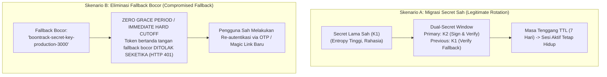

# PHASE 2A CLOSURE AND PHASE 2B READINESS AUDIT REPORT
*(CTO REVIEW EVIDENCE CORRECTIONS REVISION)*

**Dokumen:** `PHASE_2A_CLOSURE_AND_PHASE_2B_READINESS.md`  
**Repository:** `B055OB/boontrack-core`  
**Workspace:** `C:\boontrack-core`  
**Branch:** `fix/onlineboost-batch1-canary-readiness`  
**Baseline Commit HEAD:** `70a8c5186437837c846c74a1eabca3d4465286d2`  
**Tanggal Audit & Koreksi:** 30 Oktober 2026  
**Klasifikasi:** INTERNAL EXECUTIVE & CTO SECURITY DIRECTIVE  
**Status Operasional:** **PHASE 2A CLOSED / PHASE 2B READINESS ON STRICT HOLD**

---

## 1. Status Penutupan Phase 2A & Bukti Pengujian (Test Evidence)

Phase 2A (Remediasi Cacat P0/P1, Rekonsiliasi Kontrak Meta WABA, Opt-Out Durability, dan Credential Integrity) telah diselesaikan secara lokal dalam mode **STRICT READ-ONLY**.

### 1.1 Perintah Pengujian, Nama Suite, dan Log Eksekusi Aktual

Pengujian regresi dijalankan secara lokal menggunakan test runner `pytest` terhadap mock dan sandbox fixtures internal tanpa mengirim paket jaringan ke Meta Graph API atau gateway Xendit. Seluruh **144 test kasus tercatat 100% PASSING (0 FAILED, 0 SKIPPED)**.

#### Suite 1: Mandatory Safety & Regression Battery (94 Tests Passing)
- **Perintah Eksekusi:**
  ```powershell
  python -m pytest tests/test_academy_warm_launch.py tests/test_onlineboost_phase4_consultation.py tests/test_waba_tenant_isolation_and_opt_out.py tests/test_opt_out_durability_and_acknowledgment.py -q
  ```
- **Cuplikan Log Eksekusi Aktual:**
  ```text
  ........................................................................ [ 76%]
  ......................                                                   [100%]
  94 passed in 56.42s
  ```
- **Rincian Per Suite:**
  - `tests/test_academy_warm_launch.py`: **22 passed** (Verifikasi template `alumni_cpm_metode`, fail-closed broadcast hold, dan credential-pair integrity).
  - `tests/test_onlineboost_phase4_consultation.py`: **41 passed** (Verifikasi state machine konsultasi, FAQ, dan transisi intent).
  - `tests/test_waba_tenant_isolation_and_opt_out.py`: **18 passed** (Verifikasi isolasi multi-tenant WABA dan pembatasan akses data).
  - `tests/test_opt_out_durability_and_acknowledgment.py`: **13 passed** (Verifikasi durabilitas opt-out `STOP`, `BERHENTI`, dan `BATAL` di TrafficSplitter).

#### Suite 2: Companion Isolation & Flow Battery (50 Tests Passing)
- **Perintah Eksekusi:**
  ```powershell
  python -m pytest tests/test_onlineboost_flows_orchestration_phase5.py tests/test_webhook_url_reconciliation.py tests/test_onlineboost_ctwa_funnel.py tests/test_ctwa_payment_to_access_e2e.py tests/test_pilot_internal_whitelist_p0.py tests/test_xendit_hardening.py tests/test_xendit_3x_idempotency_simulation.py -q
  ```
- **Cuplikan Log Eksekusi Aktual:**
  ```text
  ..................................................                       [100%]
  50 passed, 2 warnings in 61.49s (0:01:01)
  ```
- **Rincian Per Suite:**
  - `tests/test_onlineboost_flows_orchestration_phase5.py`: **14 passed**
  - `tests/test_webhook_url_reconciliation.py`: **11 passed**
  - `tests/test_onlineboost_ctwa_funnel.py`: **7 passed**
  - `tests/test_ctwa_payment_to_access_e2e.py`: **4 passed**
  - `tests/test_pilot_internal_whitelist_p0.py`: **12 passed**
  - `tests/test_xendit_hardening.py`: **1 passed**
  - `tests/test_xendit_3x_idempotency_simulation.py`: **1 passed**

**Total Akumulasi Eksekusi:** **144 PASSED, 0 FAILED, 0 SKIPPED.**

### 1.2 Pembedaan Keberhasilan Pengujian vs Integritas Repositori

- **Batas Pembuktian Tes:**
  Hasil tes 144/144 membuktikan keabsahan logika bisnis, penanganan payload, dan integrasi penegakan guard internal pada lingkungan lokal mock. Keberhasilan pengujian ini **TIDAK SAMA** dengan otorisasi produksi dan tidak membuktikan kesiapan konektivitas Meta Graph API / Xendit riil di luar mock.
- **Integritas Repositori & Whitespace (`git diff --check`):**
  Lolos verifikasi whitespace dengan **0 error**, tanpa trailing whitespace pada baris baru, dan normalisasi baris (CRLF/LF) terjaga.
- **Status Git Working Tree (`git status --short`):**
  Terdiri dari 11 file kode yang dimodifikasi secara lokal untuk penutupan P1/P2, dan 1 file laporan audit (`PHASE_2A_CLOSURE_AND_PHASE_2B_READINESS.md`). Seluruh file belum di-stage (`git add`), belum di-commit, dan belum di-push.

---

## 2. Pemisahan Pemetaan Jalur JWT vs HMAC di Codebase

Audit forensik membedakan secara tegas antara modul yang menerbitkan dan memvalidasi token JWT standar dengan modul yang mengeksekusi verifikasi signature manual HMAC-SHA256:

```mermaid
flowchart TD
    subgraph Flow_A ["Jalur A: Merchant Magic Link (JWT Issuer Murni)"]
        A1["app/routes/auth_routes.py\ngenerate_session_jwt()"] -->|"Klaim: sub, email, tenant_slug, role: merchant"| A2["Client / Cookie access_token"]
        A2 -. "Diverifikasi oleh Consumer Eksternal (Next.js Dashboard)" .-> A3["Consumer: dashboard.boontrack.com"]
    end

    subgraph Flow_B ["Jalur B: Affiliate Portal (JWT Issuer & Verifier)"]
        B1["app/routes/affiliate_auth.py\ngenerate_jwt_token()"] -->|"Klaim: sub, user_id, email, role, exp"| B2["Bearer Token"]
        B2 --> B3["app/routes/affiliate_auth.py\ndecode_jwt_token()\n(options={'verify_aud': False})"]
        B3 --> B4["Consumer: Portal Mitra / Affiliate"]
    end

    subgraph Flow_C ["Jalur C: Partner Verification (Manual HMAC-SHA256 Verifier)"]
        C1["Inbound Token"] --> C2["app/services/partner_service.py\ndecode_jwt_token()"]
        C2 -->|"Fallback: clean_token.split('.')\nhmac.compare_digest(expected, actual)"| C3["Consumer: GET /api/v1/partner/me"]
    end
```



### 2.1 Matriks Pemetaan Jalur Independen

| Atribut Arsitektur | Jalur A: Merchant Magic Link | Jalur B: Affiliate Portal Auth | Jalur C: Partner Service Validation |
| :--- | :--- | :--- | :--- |
| **Lokasi File** | [`app/routes/auth_routes.py`](file:///c:/boontrack-core/app/routes/auth_routes.py#L32-L138) | [`app/routes/affiliate_auth.py`](file:///c:/boontrack-core/app/routes/affiliate_auth.py#L26-L115) | [`app/services/partner_service.py`](file:///c:/boontrack-core/app/services/partner_service.py#L21-L82) & [`partner_routes.py`](file:///c:/boontrack-core/app/routes/partner_routes.py#L78) |
| **Peran Komponen** | **Issuer Murni** (Tidak ada fungsi verifikasi lokal di Core) | **Issuer & Verifier** | **Verifier Murni** (Manual HMAC decoder) |
| **Fungsi / Metode** | `generate_session_jwt()` (L111) | `generate_jwt_token()` (L34)<br>`decode_jwt_token()` (L59) | `decode_jwt_token()` (L43)<br>Tidak menerbitkan token. |
| **Sumber Secret** | `JWT_SECRET = os.getenv("JWT_SECRET", "boontrack-secret-key-production-3000")` (L32) | `JWT_SECRET = os.getenv("JWT_SECRET", "boontrack-secret-key-production-3000")` (L26) | `JWT_SECRET = os.getenv("JWT_SECRET", "boontrack-secret-key-production-3000")` (L21) |
| **Mekanisme Verifikasi** | Tidak diverifikasi di `boontrack-core`. Token didelegasikan ke frontend browser / Next.js. | `jwt.decode(..., options={"verify_aud": False})` (L75) + fallback manual HMAC-SHA256 (L108-L145). | `jwt.decode(...)` (L48) + fallback manual split string Base64 & `hmac.compare_digest()` (L52-L81). |
| **Audience Check** | Tidak didefinisikan (klaim `aud` tidak disertakan dalam payload). | **Bypass Eksplisit** (`verify_aud: False` pada line 75). | Menggunakan default library (tidak ada flag bypass eksplisit). |
| **Consumer Target** | Merchant pada `dashboard.boontrack.com`. | Mitra affiliate & admin pada portal affiliate. | Pemanggil endpoint onboarding `GET /api/v1/partner/me`. |
| **Dampak Rotasi Secret** | **UNKNOWN / POTENTIAL IMPACT** pada sesi magic link aktif. | **DIRECT IMPACT** (Sesi affiliate aktif terputus). | **DIRECT IMPACT** (Panggilan partner API gagal verifikasi). |

### 2.2 Penegasan Stateless Token

Token pada ketiga jalur di atas beroperasi secara **stateless**:
- Core tidak mencatat token yang diterbitkan ke dalam tabel session database (kecuali mekanisme blacklist/single-use pada magic-link token sebelum ditukarkan).
- Integritas autentikasi bergantung secara eksklusif pada validitas tanda tangan kriptografis berbasis `JWT_SECRET` dan klaim masa berlaku `exp`.
- Ketergantungan pada fallback default statis yang sama (`"boontrack-secret-key-production-3000"`) menciptakan celah kopling lateral antar jalur.

---

## 3. Bukti Dependensi Code-Level: Analisis Dampak Dashboard, Shop, Studio, dan Creator

Klaim awal "Zero Impact" diuji ulang terhadap keterlacakan kode sumber di Core. Hasil audit membagi status menjadi **VERIFIED ZERO IMPACT** dan **UNKNOWN (Missing Evidence)**:

### 3.1 Buyer Storefront (`shop.boontrack.com/{tenant_slug}`) — [STATUS: VERIFIED ZERO IMPACT]
- **Bukti Penelusuran Kode:**
  - [`app/routes/creator_storefront.py:5-7`](file:///c:/boontrack-core/app/routes/creator_storefront.py#L5-L7):
    ```python
    # GET /api/v1/creator/{slug}/products
    #   - No authentication required (public storefront)
    ```
  - [`app/routes/tenant_routes.py`](file:///c:/boontrack-core/app/routes/tenant_routes.py): Endpoint katalog produk pembeli (`/api/v1/storefront/{tenant_slug}/products`) melakukan query langsung ke tabel `products` Supabase tanpa parameter `Header(Authorization)` atau dependency token.
  - Alur checkout menggunakan guest session yang menghasilkan invoice dinamis QRIS via `order_id`. Pembeli tidak pernah menerima atau mengirimkan JWT Core.
- **Kesimpulan Dampak:** **VERIFIED ZERO IMPACT**.

### 3.2 Creator UGC Studio Generator (`studio.boontrack.com` Script API) — [STATUS: VERIFIED ZERO IMPACT]
- **Bukti Penelusuran Kode:**
  - [`app/routers/creator_ugc.py:22-24`](file:///c:/boontrack-core/app/routers/creator_ugc.py#L22-L24):
    ```python
    @router.post("/generate", summary="Generate 9-Scene UGC Script")
    async def handle_generate_ugc(req: UGCGenerateRequest):
    ```
  - Endpoint publik untuk men-generate naskah video iklan 9-scene via Google Gemini Flash. Tidak memuat dependensi autentikasi JWT (`Depends`), tidak membaca cookie `access_token`, dan murni menerima request body JSON.
- **Kesimpulan Dampak:** **VERIFIED ZERO IMPACT** (Khusus untuk fungsi generator naskah di Core).

### 3.3 Studio Workspace & Billing Transaksi — [STATUS: UNKNOWN (Missing Evidence in Core)]
- **Bukti Penelusuran Kode:**
  - `ARCHITECTURE.md` §57.2 mereferensikan alur billing token Studio pada endpoint `/api/studio/billing/create-invoice`.
  - **Temuan Forensik:** Endpoint `/api/studio/billing/*` **TIDAK DITEMUKAN** di dalam repositori `boontrack-core`. Alur ini di-hosting pada layer Next.js App Router (`boontrack-inbox` di Vercel).
  - Repositori `boontrack-core` tidak memiliki bukti kode lengkap mengenai bagaimana middleware Vercel atau Next.js API me-relay identitas pengguna Studio ke Core.
- **Kesimpulan Dampak:** **UNKNOWN**. Dilarang mengklaim Zero Impact tanpa audit kode di repositori `boontrack-inbox`.

### 3.4 Merchant Dashboard (`dashboard.boontrack.com`) — [STATUS: UNKNOWN / POTENTIAL IMPACT]
- **Bukti Penelusuran Kode:**
  - Meskipun `ARCHITECTURE.md` §1 menyebutkan Merchant Dashboard menggunakan Supabase Auth cookie untuk sesi browser, file [`app/routes/auth_routes.py:264-302`](file:///c:/boontrack-core/app/routes/auth_routes.py#L264-L302) membuktikan bahwa endpoint Core `/api/v1/auth/magic-link/verify` secara eksplisit menerbitkan token JWT menggunakan `generate_session_jwt()`:
    ```python
    jwt_token = generate_session_jwt(email=email, tenant_slug=tenant_slug)
    response.set_cookie(key="access_token", value=token, httponly=True, secure=True, samesite="Lax")
    ```
  - Core tidak memiliki kontrol atas apakah layer Next.js Dashboard memeriksa validitas signature `access_token` ini pada private API routes miliknya.
  - Jika secret diubah secara sepihak di Core tanpa koordinasi dengan consumer frontend, merchant yang melakukan autentikasi via Magic Link berpotensi mengalami kegagalan otorisasi.
- **Kesimpulan Dampak:** **UNKNOWN / POTENTIAL IMPACT**.

---

## 4. Penyesuaian Ledger BA-004: Spesifikasi `usage_ledger_entries`

Penyebutan informal `tenant_credit_ledger` (dari catatan historis `ARCHITECTURE.md` §57) secara resmi diselaraskan dengan spesifikasi arsitektur yang disetujui Chief Architect: **`usage_ledger_entries`** (standar BA-004).

> [!IMPORTANT]
> **Batasan Audit:** Bagian ini murni pendokumentasian spesifikasi teknis dan analisis verifikasi. **TIDAK ADA PERUBAHAN DATABASE ATAU MIGRASI SKEMA YANG DIEKSEKUSI PADA GILIRAN INI.**

### 4.1 Spesifikasi Skema Database Kanonikal `usage_ledger_entries`

```sql
CREATE TABLE public.usage_ledger_entries (
    id UUID PRIMARY KEY DEFAULT gen_random_uuid(),
    tenant_id VARCHAR(64) NOT NULL,
    feature_type VARCHAR(32) NOT NULL, -- 'STUDIO_RENDER', 'AI_BOT_TOKEN', 'WHATSAPP_SESSION'
    action VARCHAR(32) NOT NULL,       -- 'GRANT', 'USAGE', 'TOPUP', 'REVERSAL'
    amount NUMERIC(14, 4) NOT NULL,    -- Nilai positif (penambahan kredit) atau negatif (pemakaian kredit)
    idempotency_key VARCHAR(128) UNIQUE NOT NULL,
    metadata JSONB NOT NULL DEFAULT '{}'::jsonb,
    created_at TIMESTAMPTZ NOT NULL DEFAULT NOW()
);

CREATE INDEX idx_usage_ledger_tenant_feature ON public.usage_ledger_entries(tenant_id, feature_type);
CREATE INDEX idx_usage_ledger_idempotency ON public.usage_ledger_entries(idempotency_key);
```

### 4.2 Verifikasi Penegakan Append-Only pada 4 Tingkat Lapisan

Penegakan sifat kekal (immutable) pada `usage_ledger_entries` wajib dibuktikan pada 4 lapisan terpisah:

1. **Database Privilege Level (Least Privilege Role):**
   Role database aplikasi (`application_user` / `anon` / `authenticated`) dicabut hak mutasi dan penghapusannya:
   ```sql
   GRANT INSERT, SELECT ON public.usage_ledger_entries TO application_user;
   REVOKE UPDATE, DELETE, TRUNCATE ON public.usage_ledger_entries FROM application_user, public;
   ```
2. **Database Trigger Level (PostgreSQL Engine Invariant):**
   Trigger database PL/pgSQL menolak secara mutlak setiap percobaan eksekusi `UPDATE` atau `DELETE`:
   ```sql
   CREATE OR REPLACE FUNCTION prevent_usage_ledger_mutation()
   RETURNS TRIGGER AS $$
   BEGIN
       RAISE EXCEPTION 'IMMUTABLE_LOG_VIOLATION: Table usage_ledger_entries is append-only. UPDATE and DELETE operations are strictly prohibited.'
       USING ERRCODE = '55000';
   END;
   $$ LANGUAGE plpgsql;

   CREATE TRIGGER trg_usage_ledger_no_mutation
   BEFORE UPDATE OR DELETE ON public.usage_ledger_entries
   FOR EACH ROW EXECUTE FUNCTION prevent_usage_ledger_mutation();
   ```
3. **Database Transaction & Aggregation Level:**
   - Dilarang membuat kolom saldo mutabel (misal `credits INT` pada tabel tenant) yang di-update di tempat (`UPDATE tenants SET credits = credits - 1`).
   - Saldo kredit efektif dihitung secara matematis melalui fungsi agregasi transaksi murni:
     $$\text{Effective Credit Balance} = \sum_{i} \text{amount}_i \quad \text{WHERE } \text{tenant\_id} = T \text{ AND } \text{feature\_type} = F$$
   - Pemotongan kredit diverifikasi secara atomik dalam transaksi `SERIALIZABLE` atau menggunakan `SELECT FOR UPDATE` sebelum baris `USAGE` baru di-insert.
4. **Application & ORM Level:**
   Model SQLAlchemy membind event listener sebelum query dikirim ke socket database (mengikuti pola yang telah terbukti pada [`app/models/payment_event.py:39-62`](file:///c:/boontrack-core/app/models/payment_event.py#L39-L62)):
   ```python
   @event.listens_for(UsageLedgerEntry, "before_update")
   def _prevent_usage_ledger_update(mapper, connection, target):
       raise ImmutableLogViolationException("Table 'usage_ledger_entries' is append-only. UPDATE is prohibited.")

   @event.listens_for(UsageLedgerEntry, "before_delete")
   def _prevent_usage_ledger_delete(mapper, connection, target):
       raise ImmutableLogViolationException("Table 'usage_ledger_entries' is append-only. DELETE is prohibited.")
   ```

---

## 5. Revisi Desain Dual-Secret Rollover: Larangan Fallback Bocor & Strategi Rollback

Usulan transisi secret pada Phase 2B direvisi total guna mematuhi prinsip *zero trust* dan larangan kompromi kredensial:

### 5.1 Larangan Keras Penerimaan Fallback Bocor (`boontrack-secret-key-production-3000`)
- **Fakta Keamanan:**
  String `"boontrack-secret-key-production-3000"` adalah nilai statis publik yang telah terekspos di dalam kode sumber repositori. Token apapun yang ditandatangani dengan secret ini berstatus **COMPROMISED & UNTRUSTED**.
- **Aturan Tegas:**
  Dilarang keras memasukkan nilai `"boontrack-secret-key-production-3000"` ke dalam variabel `JWT_SECRET_PREVIOUS`, `JWT_SECRET_FALLBACK`, atau whitelist verifikasi sekunder apapun dalam implementasi staging maupun produksi.

### 5.2 Pembedaan: Migrasi Secret Sah vs Invalidation Fallback Bocor

Harus dibedakan secara fundamental antara dua skenario rotasi kredensial:



1. **Skenario A (Migrasi Secret Kustom yang Sah):**
   - Berlaku jika environment produksi telah memiliki secret kustom acak dengan entropi tinggi ($K_1$) dan ingin dirotasi berkala ke secret baru ($K_2$).
   - Skema dual-secret ($K_2$ sebagai penanda tangan utama, $K_1$ sebagai verifikator fallback) diperbolehkan selama jendela masa berlaku (TTL maksimum 7 hari).
2. **Skenario B (Invalidation Fallback Bocor):**
   - Berlaku saat meniadakan fallback statis `"boontrack-secret-key-production-3000"`.
   - **TIDAK ADA MASA TENGGANG (ZERO GRACE PERIOD).**
   - Seluruh token yang diverifikasi menggunakan fallback statis wajib langsung ditolak (`HTTP 401 Unauthorized`).
   - Pengguna sah akan diminta melakukan re-autentikasi melalui alur normal OTP WhatsApp atau Magic Link, menghasilkan token baru yang ditandatangani oleh secret berkekuatan tinggi dari environment variable resmi.

### 5.3 Strategi Rollback: Hardened-Build-Only

Jika terjadi kegagalan sistem atau anomali operasional saat peluncuran build baru:
1. **Larangan Rollback ke Unhardened Build:**
   Dilarang keras melakukan rollback ke container image atau commit lama yang masih mengaktifkan hardcoded fallback `"boontrack-secret-key-production-3000"`, atau yang mengabaikan fail-closed startup check.
2. **Hardened-Build-Only Rollback Invariant:**
   Rollback hanya diizinkan mengarah ke versi rilis yang telah tersertifikasi memiliki status **Hardened Build** (di mana validasi `JWT_SECRET` wajib hadir dan `verify_aud` ditegakkan).
3. **Recovery Jalur Kredensial:**
   Jika terjadi masalah startup akibat konfigurasi secret di Railway, perbaikan dilakukan dengan menyuntikkan environment variable `JWT_SECRET` yang valid pada Railway Settings, bukan dengan menurunkan level keamanan kode aplikasi.

---

## 6. Konfirmasi Kesiapan Operasional Phase 2B (STRICT HOLD)

- [x] **Phase 2A Code Remediation:** 100% Selesai & Lolos Pengujian Unit Lokal (144/144 tests passing).
- [x] **Meta WABA Template & Credential Pairing:** Reconciled ke `alumni_cpm_metode` dan fail-closed validation.
- [x] **Status Operasional Phase 2B:** **FULL HOLD**.
- [x] **No Code Changes:** Tidak ada kode produksi yang dimutasi dalam proses penyusunan bukti audit ini.
- [x] **No Diagnostic Endpoints:** Menolak tegas pembuatan endpoint inspeksi JWT baru di API publik/produksi.
- [x] **No Secret Rotation:** Tidak ada rotasi secret agresif yang dijalankan di Railway production.
- [x] **Gate Flags Aktif:** `ONLINEBOOST_ALUMNI_BROADCAST_HOLD=true` dan `ONLINEBOOST_PAYMENT_STRICT_HOLD=true` tetap terkunci.

*Dokumen ini diperbarui secara khusus untuk memenuhi standar pembuktian teknis dan kepatuhan audit CTO.*
