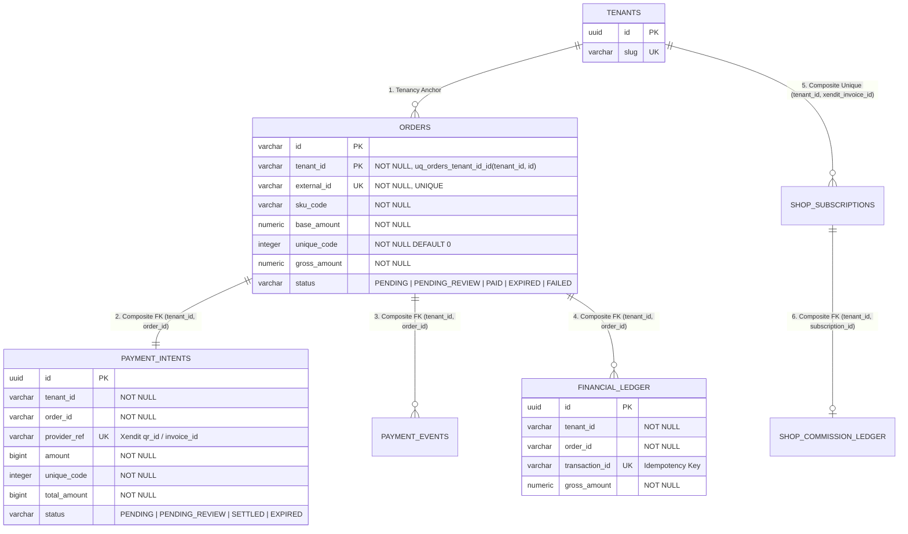

# RFC-Payment-Remediation-v1.1: Eliminasi Static QRIS Fallback, Standarisasi Xendit QR API (`2022-07-31`), Isolasi Tenant Berbasis Relasi Database, & Tata Kelola Kode Unik Direct Tenant Rail

| Metadata | Detail |
| :--- | :--- |
| **Dokumen** | `RFC-Payment-Remediation-v1.1.md` |
| **Versi** | `1.1` (Konsolidasi Audit QRIS Gateway + Addendum Audit Kode Unik Tiga Digit) |
| **Status** | `IMPLEMENTATION HOLD` — **STRICT READ-ONLY AUDIT & DESIGN SPECIFICATION** |
| **Target Sistem** | `boontrack-core` Payment Engine, Webhook Reconciliation, Direct Tenant Rail, & Multi-Tenant Ledger |
| **Klasifikasi Prioritas** | **P0 — Critical Financial & Multi-Tenant Security Boundary** |
| **Tanggal** | 5 November 2026 |

---

## 1. Ringkasan Eksekutif & Root Cause Analysis (RCA)

Pada pengujian *The Golden Penny Test* (`TEST-PENNY-1500`, nominal `Rp1.500`) serta investigasi anomali transaksi tenant (di mana pembeli menerima tagihan tanpa kode unik tiga digit), audit *read-only* terhadap kode sumber membuktikan empat kelemahan arsitektural kritis:

1. **Mutasi Lokal EMVCo Tag 54 di Atas Payload QRIS Statis (`ID.DANA.WWW` & QRIS Statis Merchant):**
   - Fungsi [`generate_academy_qris_invoice`](file:///c:/boontrack-core/app/services/academy_service.py#L1296-L1372) pada [`app/services/academy_service.py`](file:///c:/boontrack-core/app/services/academy_service.py#L79-L84) dan [`app/services/ctwa_state_engine.py`](file:///c:/boontrack-core/app/services/ctwa_state_engine.py#L70-L76) mendefinisikan konstanta `DEFAULT_STATIC_QRIS` yang jatuh (*fallback*) ke string statis merchant DANA Bisnis (`00020101021126570011ID.DANA.WWW...5909BoonTrack6012Kab. Bandung61054028663048DC1`).
   - Fungsi [`generate_dynamic_qris_payload`](file:///c:/boontrack-core/app/utils/qris_generator.py#L34-L98) memodifikasi string EMVCo secara lokal: mengubah Point of Initiation Method dari statis (`010211`) menjadi dinamis (`010212`), menyuntikkan Tag `54` (Transaction Amount), dan menghitung ulang checksum CRC16-CCITT pada Tag `6304`.
   - **Dampak Sistemik:** Menurut standar ASPI/EMVCo QRIS Nasional, mengubah tag `010211` menjadi `010212` secara lokal **tanpa** mendaftarkan *Dynamic Payment Intent* ke server Acquirer/Switching (Xendit/PTEN) menghasilkan payload QRIS dinamis tidak berizin (*unregistered dynamic intent*) yang ditolak oleh *issuer mobile banking*. Sekalipun *issuer* tertentu mengizinkan transaksi statis dengan nominal, dana akan masuk langsung ke dompet statis tanpa pernah melalui Xendit, sehingga **webhook Xendit tidak akan pernah terpanggil**.

2. **Silent Fallback dari Gateway Resmi ke QRIS Statis & Dummy Adapter:**
   - Pada [`app/routes/payment.py`](file:///c:/boontrack-core/app/routes/payment.py#L131-L156), blok resolusi `static_payload` milik tenant dieksekusi **sebelum** blok integrasi Xendit/Midtrans ([`L176-L201`](file:///c:/boontrack-core/app/routes/payment.py#L176-L201)).
   - Pada [`app/services/midtrans_service.py`](file:///c:/boontrack-core/app/services/midtrans_service.py#L124-L144), kegagalan HTTP API gateway ditangkap (`except Exception`) dan secara diam-diam (*silent fallback*) dialihkan ke [`get_dynamic_qris_string`](file:///c:/boontrack-core/app/utils/qris_generator.py#L138-L154) berbasis `BOONTRACK_STATIC_QRIS`.
   - Pada [`PaymentAdapterFactory.resolve`](file:///c:/boontrack-core/app/services/payment/factory.py#L72-L104), konfigurasi pembayaran yang kosong, `null`, atau tidak dikenali secara diam-diam jatuh ke `ManualTransferAdapter` dengan nomor rekening hardcoded default `BCA 1234567890 a.n. Merchant Store`.

3. **Resolusi Tenant Berbasis Parsing String `external_id` & Auto-Insert Order Tanpa Pre-Registrasi:**
   - Pada [`app/routes/xendit.py`](file:///c:/boontrack-core/app/routes/xendit.py#L758-L768), alur *SaaS Quota Top-Up* mengekstrak `tenant_slug` dan jumlah kuota dengan memotong string `external_id.split("-")` (`TOPUP-{tenant_slug}-{sessions}-{timestamp}`).
   - Pada [`app/routes/xendit.py`](file:///c:/boontrack-core/app/routes/xendit.py#L481-L508) dan [`app/services/payment_orchestrator.py`](file:///c:/boontrack-core/app/services/payment_orchestrator.py#L131-L148), apabila `external_id` dari payload webhook tidak ditemukan di tabel `orders`, handler secara otomatis melakukan `INSERT INTO orders` baru dengan status `PAID`/`LUNAS` dan `tenant_id` default `"onlineboost"`. Hal ini melanggar prinsip *strict relational provenance* dan membuka celah *cross-tenant state injection*.

4. **Bypass & Inkonsistensi Mekanisme Kode Unik Tiga Digit pada Direct Tenant Rail:**
   - Delapan jalur kode aktif (termasuk interceptor `DIRECT_PAY_TRIGGERS` di [`app/services/unified_conversation_service.py`](file:///c:/boontrack-core/app/services/unified_conversation_service.py#L782-L958) yang diperluas pada commit `7523c70`, serta 4 endpoint Web/API Checkout di [`checkout_router.py`](file:///c:/boontrack-core/app/routes/checkout_router.py#L43-L60), [`d2c_order_routes.py`](file:///c:/boontrack-core/app/routes/d2c_order_routes.py#L83-L105), [`checkout_flow_service.py`](file:///c:/boontrack-core/app/services/checkout_flow_service.py#L98-L118), dan [`payment.py`](file:///c:/boontrack-core/app/routes/payment.py#L131-L175)) menerbitkan instruksi pembayaran kepada pembeli menggunakan **nominal dasar (`base_amount`) tanpa kode unik tiga digit**.
   - Ketiadaan reservasi unik berbasis database serta penggunaan klausa `ORDER BY created_at DESC LIMIT 1` pada [`reader_router.py`](file:///c:/boontrack-core/app/api/v1/reader_router.py#L58-L64), [`reader_validation_service.py`](file:///c:/boontrack-core/app/services/reader_validation_service.py#L141-L153), dan [`hybrid_reader_service.py`](file:///c:/boontrack-core/app/services/hybrid_reader_service.py#L330-L340) menyebabkan risiko *collision* antar-order aktif dan salah-settle (*false settlement*).

---

## 2. Arsitektur Target: Standarisasi Xendit QR Code API & Official Sandbox Simulator (`2022-07-31`)

### 2.1 Larangan Mutlak Static QRIS Fallback (Fail-Closed Gateway Policy)
Seluruh alur pembuatan invoice yang membutuhkan rekonsiliasi webhook otomatis **WAJIB** memanggil API resmi Payment Gateway (Xendit).
- Jika kredensial `XENDIT_SECRET_KEY` tidak tersedia, tidak valid, atau API Xendit mengembalikan error (`4xx`/`5xx`/timeout), sistem **WAJIB Fail-Closed** (melempar `HTTPException(502/503)` atau `RuntimeError`).
- **DILARANG KERAS** melakukan *fallback* ke `DEFAULT_STATIC_QRIS`, `BOONTRACK_STATIC_QRIS`, `ONLINEBOOST_STATIC_QRIS`, `DANA_STATIC_QRIS`, maupun mutasi lokal [`generate_dynamic_qris_payload`](file:///c:/boontrack-core/app/utils/qris_generator.py#L34-L98).

### 2.2 Kontrak Pembuatan Dynamic QRIS via Xendit API (`api-version: 2022-07-31`)
Pembuatan QRIS Dinamis wajib menggunakan endpoint resmi Xendit QR Codes API versi `2022-07-31`:

- **Endpoint:** `POST https://api.xendit.co/qr_codes`
- **Headers Wajib:**
  - `Authorization: Basic <base64(XENDIT_SECRET_KEY + ":")>`
  - `api-version: 2022-07-31`
  - `Content-Type: application/json`
  - `Idempotency-Key: <deterministic_uuid_or_reference_id>`
- **Request Payload:**
  ```json
  {
    "reference_id": "PENNY-1762340000-A1B2C3",
    "type": "DYNAMIC",
    "currency": "IDR",
    "amount": 1500,
    "expires_at": "2026-11-05T12:30:00Z"
  }
  ```
- **Response Invariant:**
  - Menyimpan `id` (`qr_...` dari Xendit) ke kolom `gateway_reference_id` / `provider_ref` pada tabel internal sebelum mengembalikan `qr_string` milik Xendit ke klien.
  - Memastikan `qr_string` murni berasal dari field `qr_string` pada response JSON Xendit tanpa modifikasi karakter, tanpa injeksi Tag 54 lokal, dan tanpa perhitungan ulang CRC16.

### 2.3 Kontrak Simulasi Settlement Resmi di Xendit Test Mode
Ketika sistem berjalan menggunakan kredensial Xendit Test/Development Mode (`xnd_development_...`), QRIS yang dihasilkan merupakan payload sandbox yang tidak dapat di-scan menggunakan aplikasi *mobile banking* produksi (BCA/Mandiri/BRI Live).

Untuk menguji alur *end-to-end* dari pembuatan QRIS hingga rekonsiliasi webhook di lingkungan Test Mode, pengujian **WAJIB** menggunakan endpoint simulasi resmi Xendit (dan **bukan** mengganti QRIS ke DANA statis):

- **Endpoint Simulasi Resmi (Payment Requests / QR API v2022-07-31):**
  ```http
  POST https://api.xendit.co/id/payments/simulate
  Authorization: Basic <base64(XENDIT_SECRET_KEY_DEVELOPMENT + ":")>
  api-version: 2022-07-31
  Content-Type: application/json
  ```
  *(Catatan Kompatibilitas Xendit QR Object: Untuk objek `qr_codes` spesifik dengan ID `qr_...`, Xendit juga mendukung `POST https://api.xendit.co/qr_codes/{qr_id}/payments/simulate` dengan header `api-version: 2022-07-31`. Standar orkestrasi pengujian harus menyertakan header `api-version: 2022-07-31` secara eksplisit).*
- **Request Body (`POST https://api.xendit.co/id/payments/simulate`):**
  ```json
  {
    "reference_id": "PENNY-1762340000-A1B2C3",
    "amount": 1500
  }
  ```
- **Alur Eksekusi Simulasi:**
  1. Layanan internal membuat order di PostgreSQL (`status = 'PENDING'`) dan memanggil `POST https://api.xendit.co/qr_codes` (`api-version: 2022-07-31`) dengan `XENDIT_SECRET_KEY` (`xnd_development_...`).
  2. Harness pengujian memanggil `POST https://api.xendit.co/id/payments/simulate` (header `api-version: 2022-07-31`).
  3. Server Xendit secara asinkron menembakkan HTTP POST webhook (`qr_code.payment` / `payment.succeeded`) beserta header `x-callback-token` resmi ke endpoint webhook `boontrack-core`.
  4. Untuk pengujian uang riil (*Live M-Banking Scan* `Rp1.500`), environment runtime **wajib** dikonfigurasi dengan `XENDIT_SECRET_KEY` Live (`xnd_production_...`) sehingga `qr_string` terdaftar di switching PTEN/ASPI atas nama acquirer Xendit.

---

## 3. Penegakan Isolasi Tenant Berbasis Relasi Database Internal (Zero `external_id` String Parsing)

### 3.1 Larangan Parsing `external_id` untuk Resolusi Tenant atau Atribut Bisnis
String `external_id` / `reference_id` yang datang dari payload eksternal (webhook Xendit/Midtrans/Duitku) harus diperlakukan sebagai **opaque lookup key** semata, **BUKAN** pembawa metadata otoritatif.

Praktik-praktik berikut **DILARANG KERAS** dan wajib dihapus pada fase implementasi:
1. **String Splitting untuk Resolusi Tenant/Kuota:**
   - Memecah `external_id.split("-")` pada [`app/routes/xendit.py`](file:///c:/boontrack-core/app/routes/xendit.py#L758-L768) (`TOPUP-{tenant_slug}-{sessions}-{timestamp}`) atau membaca prefix `ORD-{slug[:4]}` ([`app/routes/checkout_router.py`](file:///c:/boontrack-core/app/routes/checkout_router.py#L31)), `INV-{slug[:6]}` ([`app/routes/d2c_order_routes.py`](file:///c:/boontrack-core/app/routes/d2c_order_routes.py#L92)).
2. **Trusting `tenant_id` dari Payload JSON Eksternal:**
   - Membaca `payload.get("tenant_id")` atau `metadata.get("tenant_id")` dari body webhook tanpa memvalidasi kesamaannya terhadap baris order yang sudah terpersisten di database internal.
3. **Auto-Insert Order pada Saat Webhook Tiba (`Ghost Order Creation`):**
   - Blok `if not order_row: INSERT INTO orders ...` pada [`app/routes/xendit.py`](file:///c:/boontrack-core/app/routes/xendit.py#L481-L508) dan [`app/services/payment_orchestrator.py`](file:///c:/boontrack-core/app/services/payment_orchestrator.py#L131-L148) wajib dihapus. Jika `external_id` tidak ditemukan di database internal, webhook wajib **Fail-Closed (`HTTP 404 ORDER_NOT_FOUND`)**.

### 3.2 Arsitektur Relasional & Constraint Database (Composite FK, Unique Constraint, RLS)
Seluruh resolusi identitas tenant, nominal tagihan, SKU, dan kuota top-up pada saat pemrosesan webhook **WAJIB** bersumber dari *pre-persisted database record* yang diikat oleh tiga lapis pertahanan skema PostgreSQL (selaras dengan fondasi [`migrations/005_create_core_payment_tables.sql`](file:///c:/boontrack-core/migrations/005_create_core_payment_tables.sql), [`migrations/024_create_payment_orders.sql`](file:///c:/boontrack-core/migrations/024_create_payment_orders.sql), dan [`migrations/031_b2_remediation_suite.sql`](file:///c:/boontrack-core/migrations/031_b2_remediation_suite.sql)):



#### Lapis 1: Unique Constraints (Kunci Kebenaran Tunggal)
1. **Parent Composite Key pada `orders`:**
   - `CONSTRAINT uq_orders_tenant_id_id UNIQUE (tenant_id, id)` (sudah ditegakkan di [`migrations/031_b2_remediation_suite.sql#L243-L244`](file:///c:/boontrack-core/migrations/031_b2_remediation_suite.sql#L243-L244)).
   - `CONSTRAINT uq_orders_external_id UNIQUE (external_id)` dan `CONSTRAINT uq_orders_tenant_external_id UNIQUE (tenant_id, external_id)`.
2. **Composite Unique pada `payment_intents` & `shop_subscriptions`:**
   - `CONSTRAINT uq_payment_intent_tenant_order UNIQUE (tenant_id, order_id)` ([`migrations/005_create_core_payment_tables.sql#L17`](file:///c:/boontrack-core/migrations/005_create_core_payment_tables.sql#L17)).
   - `CONSTRAINT uq_shop_subscriptions_tenant_invoice UNIQUE (tenant_id, xendit_invoice_id)` ([`migrations/031_b2_remediation_suite.sql#L252-L253`](file:///c:/boontrack-core/migrations/031_b2_remediation_suite.sql#L252-L253)).
3. **Idempotency Constraint pada Webhook Events & Settlements:**
   - `CONSTRAINT uq_payment_settlement_ref UNIQUE (provider_ref)` ([`migrations/005_create_core_payment_tables.sql#L30`](file:///c:/boontrack-core/migrations/005_create_core_payment_tables.sql#L30)) dan `UNIQUE (event_id)` pada `payment_events` serta `UNIQUE (transaction_id)` pada `financial_ledger`.

#### Lapis 2: Composite Foreign Keys (Anti Cross-Tenant Contamination)
Seluruh tabel turunan pembayaran dan fulfillment (`payment_intents`, `payment_events`, `financial_ledger`, `commission_ledger`, `product_orders`, `delivery_orders`, `attributions`, `attribution_sessions`) **wajib** mereferensikan pasangan komposit `(tenant_id, order_id)` ke `public.orders (tenant_id, id)`:
```sql
ALTER TABLE public.payment_intents
    ADD CONSTRAINT fk_payment_intents_order_composite
    FOREIGN KEY (tenant_id, order_id)
    REFERENCES public.orders (tenant_id, id)
    ON DELETE RESTRICT;

ALTER TABLE public.financial_ledger
    ADD CONSTRAINT fk_financial_ledger_order_composite
    FOREIGN KEY (tenant_id, order_id)
    REFERENCES public.orders (tenant_id, id)
    ON DELETE RESTRICT;
```

#### Lapis 3: PostgreSQL Row-Level Security (RLS) Context Binding
Setelah handler webhook mengambil baris `order` secara atomik (`SELECT id, tenant_id, gross_amount, status, sku_code FROM public.orders WHERE external_id = $1 FOR UPDATE`), transaksi database wajib mengikat konteks sesi tenant sebelum mengeksekusi mutasi tabel hilir:
```sql
SELECT set_config('app.current_tenant_id', v_order.tenant_id::text, true);
```

---

## 4. Tata Kelola & Kebijakan Arsitektur Direct Tenant Rail (`EXPERIMENTAL / PENDING_REVIEW`)

### 4.1 Klasifikasi Status Arsitektural
Seluruh komponen **Direct Tenant Rail**—yang mencakup pembayaran langsung ke rekening bank pribadi merchant (`ManualTransferAdapter`), QRIS statis merchant (`SELLER_NATIVE_QRIS`), generator kode unik tiga digit, dan pencocokan mutasi via *Android Notification Reader*—secara resmi diklasifikasikan sebagai:

> [!WARNING]
> **STATUS: `EXPERIMENTAL / PENDING_REVIEW` (BELUM LAYAK PRODUKSI / TIDAK DISETUJUI UNTUK PRODUKSI)**

Jalur ini **dilarang** diaktifkan di produksi tanpa persetujuan arsitektur tertulis dan harus memenuhi ketujuh kebijakan wajib di bawah ini sebelum dapat dipertimbangkan untuk keluar dari status `EXPERIMENTAL / PENDING_REVIEW`.

### 4.2 Tujuh Kebijakan Arsitektur Wajib untuk Direct Tenant Rail

#### Kebijakan 1: Kepatuhan Ketat Kode Unik Tiga Digit terhadap Konfigurasi Pembayaran Tenant Tervalidasi
- Sistem wajib memiliki **satu skema konfigurasi kanonik** pada `payment_config` (menghapus dualisme nama atribut `use_unique_code` pada [`app/schemas/tenant_config.py#L96`](file:///c:/boontrack-core/app/schemas/tenant_config.py#L96) vs `unique_code_enabled` pada [`app/services/whatsapp/commerce.py#L502-L506`](file:///c:/boontrack-core/app/services/whatsapp/commerce.py#L502-L506)).
- Arah perhitungan kode unik (`UPWARD` `base_amount + unique_code` vs `DOWNWARD` `base_amount - unique_code`) dan rentang digit (`100..999`) wajib ditentukan secara deterministik oleh kebijakan `payment_config` tenant yang tervalidasi, dengan batas harga dasar minimum (`base_amount >= 10000` untuk mode `DOWNWARD`) agar nominal akhir tidak pernah terpotong menjadi angka di bawah `Rp1.000`.
- Seluruh titik masuk pembuatan pesanan untuk tenant Direct Tenant Rail—baik melalui percakapan WhatsApp ([`unified_conversation_service.py`](file:///c:/boontrack-core/app/services/unified_conversation_service.py), [`whatsapp/commerce.py`](file:///c:/boontrack-core/app/services/whatsapp/commerce.py)) maupun API/Web Checkout ([`checkout_router.py`](file:///c:/boontrack-core/app/routes/checkout_router.py), [`d2c_order_routes.py`](file:///c:/boontrack-core/app/routes/d2c_order_routes.py), [`checkout_flow_service.py`](file:///c:/boontrack-core/app/services/checkout_flow_service.py), [`payment.py`](file:///c:/boontrack-core/app/routes/payment.py))—wajib memanggil satu layanan terpusat yang menegakkan kebijakan kode unik tenant tersebut tanpa kecuali.

#### Kebijakan 2: Konsistensi Mutlak Nominal Akhir (`Single Canonical Nominal`) di Seluruh Lapisan
- Nominal yang **(a) direservasi di backend**, **(b) disimpan di database** (`orders.gross_amount`, `orders.total_amount`, `payment_intents.total_amount`), **(c) dikirim melalui respons JSON API & webhook internal**, **(d) ditampilkan kepada pembeli** (pada rincian pesan WhatsApp, ringkasan lead capture, maupun halaman Web Checkout), dan **(e) digunakan oleh Payment Matcher** harus menggunakan nilai integer `final_amount` yang **100% identik**.
- Dilarang menampilkan harga dasar (`prod_price`) pada header pesan penagihan sementara bagian bawah menampilkan nominal yang telah dikurangi/ditambah kode unik (seperti yang ditemukan pada [`whatsapp_gateway_routes.py#L1147-L1148`](file:///c:/boontrack-core/app/routes/whatsapp_gateway_routes.py#L1147-L1148)).
- Dilarang menyimpan hanya kolom `total_amount` tanpa mengisi `gross_amount` pada tabel `orders` (seperti pada [`transaction_dispatcher.py#L123`](file:///c:/boontrack-core/app/services/whatsapp/transaction_dispatcher.py#L123)), dan dilarang menghitung ulang `unique_code` secara terbalik menggunakan operasi `incoming_amount % 1000` (seperti pada [`reader_validation_service.py#L277`](file:///c:/boontrack-core/app/services/reader_validation_service.py#L277) dan [`document_engine.py#L631`](file:///c:/boontrack-core/app/services/document_engine.py#L631)). Nilai `base_amount`, `unique_code`, dan `gross_amount` wajib disimpan secara eksplisit pada kolom masing-masing saat pembuatan order.

#### Kebijakan 3: Reservasi Nominal Anti-Collision Antar-Order Aktif
- Generator kode unik dilarang menggunakan `random.randint(100, 999)` buta tanpa pemeriksaan keterpakai (*collision check*) seperti yang saat ini terjadi pada [`app/utils/qris_generator.py#L29-L31`](file:///c:/boontrack-core/app/utils/qris_generator.py#L29-L31) dan [`app/services/whatsapp/commerce.py#L282, L613`](file:///c:/boontrack-core/app/services/whatsapp/commerce.py#L282).
- Reservasi nominal akhir (`final_amount`) wajib menjamin bahwa **tidak ada dua order aktif (`status IN ('PENDING', 'WAITING_PAYMENT')` dan `expires_at > NOW()`) dalam lingkup `(tenant_id, final_amount)` yang sama** memiliki nominal akhir yang identik.
- Apabila seluruh kandidat kode unik dalam rentang `100..999` untuk kombinasi `(tenant_id, base_amount)` sedang terpakai oleh order aktif, pembuatan invoice wajib **Fail-Closed** (`HTTP 429/503 UNIQUE_CODE_POOL_EXHAUSTED`) dan dilarang mengeluarkan kode duplikat (menghapus fallback `return random.randint(min_val, max_val)` pada [`app/payments/service.py#L192`](file:///c:/boontrack-core/app/payments/service.py#L192)).

#### Kebijakan 4: Persistensi Database Relasional sebagai Sumber Kebenaran Tunggal (Bukan Redis TTL / In-Memory Dict)
- Reservasi kode unik, waktu kedaluwarsa (`expires_at`), dan siklus hidup status pembayaran (`PENDING` $\rightarrow$ `PENDING_REVIEW` / `PAID` / `EXPIRED`) **wajib** dipersistenkan secara transaksional di database PostgreSQL sebelum instruksi pembayaran dikirimkan kepada pembeli.
- Struktur dictionary di memori proses Python (`PAYMENT_INTENTS` pada [`reconciliation_service.py#L11`](file:///c:/boontrack-core/app/services/reconciliation_service.py#L11), `self._intents_by_id` pada [`app/payments/service.py#L68`](file:///c:/boontrack-core/app/payments/service.py#L68), `_INVOICE_MEMORY_STORE` pada [`academy_service.py`](file:///c:/boontrack-core/app/services/academy_service.py), dan `GLOBAL_USER_STATES` pada [`cv_state_engine.py`](file:///c:/boontrack-core/app/services/cv_state_engine.py)) maupun kunci Redis TTL (`acquire_payment_lock` dengan `EX 300`) **dilarang keras** menjadi satu-satunya sumber kebenaran (*Single Source of Truth*), karena hilang saat *restart* kontainer dan tidak konsisten lintas *worker process*.
- Penegakan keunikan reservasi aktif wajib dikunci di level database PostgreSQL melalui *partial unique index* atau tabel reservasi atomik:
  ```sql
  CREATE UNIQUE INDEX CONCURRENTLY IF NOT EXISTS uq_active_pending_order_amount_per_tenant
      ON public.orders (tenant_id, gross_amount)
      WHERE status IN ('PENDING', 'WAITING_PAYMENT');
  ```

#### Kebijakan 5: Fail-Closed atas Konfigurasi Tenant yang Kosong, Null, atau Tidak Valid
- Apabila `tenant_ctx` tidak ditemukan, `payment_config` bernilai `null`/kosong, nomor rekening tujuan belum dikonfigurasi, atau metode pembayaran tidak memiliki konfigurasi yang sah dan terverifikasi, sistem **wajib Fail-Closed** (`HTTP 422 MERCHANT_PAYMENT_NOT_CONFIGURED`).
- **Dilarang keras** melakukan *fallback* diam-diam ke `ManualTransferAdapter` dengan nomor rekening fiktif (`bank_name="BCA"`, `account_number="1234567890"`, `account_holder="Merchant Store"` pada [`app/services/payment/factory.py#L73, L98-L104`](file:///c:/boontrack-core/app/services/payment/factory.py#L73)) atau mengirim instruksi transfer tanpa membuat record order yang valid di database (seperti pada [`unified_conversation_service.py#L912-L958`](file:///c:/boontrack-core/app/services/unified_conversation_service.py#L912-L958)).

#### Kebijakan 6: Pembayaran Non-Deterministik Wajib Berstatus `PENDING_REVIEW` (Dilarang Auto-`PAID`)
- Pencocokan pembayaran pada Direct Tenant Rail wajib bersifat deterministik dan tunggal: tepat **1 (satu)** baris order berstatus `PENDING` yang belum melewati `expires_at` untuk pasangan `(tenant_id, gross_amount)`.
- Penggunaan kueri `ORDER BY created_at DESC LIMIT 1` tanpa memeriksa kardinalitas hasil (`COUNT(*)`) pada [`app/api/v1/reader_router.py#L58-L64`](file:///c:/boontrack-core/app/api/v1/reader_router.py#L58-L64), [`app/services/reader_validation_service.py#L141-L153`](file:///c:/boontrack-core/app/services/reader_validation_service.py#L141-L153), [`app/services/hybrid_reader_service.py#L330-L340`](file:///c:/boontrack-core/app/services/hybrid_reader_service.py#L330-L340), dan [`app/payments/matcher.py#L131`](file:///c:/boontrack-core/app/payments/matcher.py#L131) **wajib dihapus**.
- Setiap mutasi atau klaim pembayaran yang memenuhi salah satu kondisi berikut **WAJIB** ditempatkan ke status **`PENDING_REVIEW`** (dan **dilarang** mengubah status order menjadi `PAID` atau memicu pengiriman produk/CAPI otomatis):
  1. **Ambiguitas / Collision (`match_count > 1`):** Terdapat lebih dari satu order `PENDING` dengan nominal yang sama pada tenant tersebut.
  2. **Near-Match / Selisih Nominal:** Nominal transfer berbeda dari `gross_amount` yang direservasi (termasuk ketika pembeli mentransfer harga dasar tanpa 3 digit kode unik).
  3. **Late Mutation (`NOW() > expires_at`):** Mutasi masuk setelah masa berlaku reservasi nominal berakhir.
  4. **Klaim Tanpa Bukti Mutasi Terverifikasi:** Pemanggilan endpoint administratif manual (seperti `/mark-paid`, `/status`, dan `/approve-and-deliver` pada [`app/routes/d2c_order_routes.py`](file:///c:/boontrack-core/app/routes/d2c_order_routes.py#L193-L517)) tanpa autentikasi RBAC yang sah dan tanpa referensi bukti mutasi yang tervalidasi.

#### Kebijakan 7: Larangan Mutlak Mutasi Lokal Payload QRIS Statis dengan Tag 54 atau CRC16
- Sistem **dilarang keras** memodifikasi string EMVCo QRIS statis milik merchant (`010211` $\rightarrow$ `010212`), menyuntikkan Tag `54` (`Transaction Amount`), atau menghitung ulang checksum Tag `6304` (`crc16_ccitt`) untuk menyematkan nominal berkode unik tiga digit ke dalam QRIS statis.
- QRIS statis bukan instrumen pembayaran dinamis; memutasi payload EMVCo secara lokal tanpa otorisasi switching Acquirer melanggar spesifikasi EMVCo/ASPI dan menyebabkan penolakan transaksi di aplikasi *mobile banking* pembeli.

---

## 5. Rencana Pengujian Negatif — Gate G4 (Xendit Test Mode)

Sebelum perubahan kode pembayaran apa pun diizinkan naik ke lingkungan Staging/Produksi, sistem wajib lulus rangkaian pengujian negatif **Gate G4** di lingkungan **Xendit Test Mode** (`xnd_development_...`) menggunakan simulator resmi `POST https://api.xendit.co/id/payments/simulate` (`api-version: 2022-07-31`) dan harness pengujian webhook.

### 5.1 Matriks Skenario Pengujian Negatif Gate G4

| ID Test | Skenario Negatif | Vektor Input / Simulasi | Ekspektasi Respons & Invarian Database (Fail-Closed) |
| :--- | :--- | :--- | :--- |
| **G4-01** | **Gateway Key Missing / API Error (Zero Static Fallback)** | Kosongkan `XENDIT_SECRET_KEY` atau simulasikan respons HTTP `503` dari `api.xendit.co/qr_codes` saat membuat invoice `onlineboost`. | Endpoint menolak request (`HTTP 502/503`). **0 fallback** ke `ID.DANA.WWW` / `BOONTRACK_STATIC_QRIS`. Tidak ada QR lokal yang dibuat. |
| **G4-02** | **Invalid / Missing Webhook Token (`x-callback-token`)** | Kirim payload webhook `PAID` ke `/api/xendit/webhook` tanpa header `x-callback-token` atau dengan token yang salah. | Ditolak dengan **`HTTP 403 Forbidden`**. Status order di DB tetap `PENDING`. **0** penulisan ke `financial_ledger`. |
| **G4-03** | **Nominal Settlement Tidak Sesuai (`AMOUNT_MISMATCH`)** | Buat order `TEST-PENNY-1500` (`amount = 1500`) atau order reguler (`amount = 149000`). Tembakkan webhook/simulasi dengan `amount = 1000` atau `amount = 1500` untuk SKU reguler. | Ditolak dengan **`HTTP 400 Bad Request`** (`status: "AMOUNT_MISMATCH"`). Status order tetap `PENDING`. **0** invite link Telegram, **0** CAPI event. |
| **G4-04** | **Cross-Tenant `external_id` Spoofing Attempt** | Buat order milik `tenant_id = 'tenant_a'`. Kirim payload webhook dengan `external_id` tersebut tetapi sertakan `tenant_id = 'onlineboost'` di body JSON atau format string `TOPUP-onlineboost-...`. | Sistem mengabaikan string `external_id` pattern & `payload.tenant_id`, memvalidasi murni dari baris DB `orders`. Jika terjadi ketidakcocokan konteks tenant, tolak **`HTTP 403/400 TENANT_MISMATCH`**. Composite FK menahan segala mutasi lintas-tenant. |
| **G4-05** | **Unregistered / Ghost `external_id` (`ORDER_NOT_FOUND`)** | Kirim webhook `PAID` dengan `external_id = "ORD-GHOST-999999"` yang belum pernah dibuat di tabel `orders`. | Ditolak dengan **`HTTP 404 Not Found`** (`ORDER_NOT_FOUND`). **0 auto-insert** ke tabel `orders`, `financial_ledger`, maupun `payment_events`. |
| **G4-06** | **Concurrent & Duplicate Webhook Replay (Idempotency)** | Tembakkan 5 request webhook identik secara paralel (`asyncio.gather`) untuk `external_id` yang valid setelah simulasi `POST /id/payments/simulate`. | Tepat **1** request memproses transisi `PENDING -> PAID`, **4** request lainnya mengembalikan `HTTP 200 OK` (`ALREADY_PROCESSED`) berkat `SELECT ... FOR UPDATE` dan constraint unik `transaction_id`/`event_id`. Tepat **1** baris di `financial_ledger`. |
| **G4-07** | **Expired / Cancelled Order Settlement Rejection** | Buat order, ubah status di DB menjadi `EXPIRED` atau `FAILED`, lalu kirimkan webhook settlement `PAID`. | Transisi ditolak atau ditandai `PENDING_REVIEW` (`LATE_SETTLEMENT_QUARANTINE`) tanpa memicu fulfillment otomatis (tidak mengirim akses produk/grup). |
| **G4-08** | **Isolasi Penuh `TEST-PENNY-1500` di Xendit Test Mode** | Buat order `TEST-PENNY-1500` dengan header `X-Internal-Secret`, jalankan `POST https://api.xendit.co/id/payments/simulate` (`api-version: 2022-07-31`, `amount: 1500`). | Order berubah menjadi `PAID`, namun jumlah panggilan ke `create_telegram_single_use_invite_link` = **0**, `dispatch_capi_event` = **0**, dan `financial_ledger` publik = **0** (terisolasi sebagai verifikasi sistem internal). |

### 5.2 Kriteria Kelulusan (Exit Criteria) Gate G4
1. Seluruh 8 skenario negatif (`G4-01` s.d. `G4-08`) terotomasi dalam suite `pytest` dan lulus 100%.
2. Bukti log respons dari `POST https://api.xendit.co/id/payments/simulate` (`api-version: 2022-07-31`) tercatat tanpa satu pun ketergantungan pada string EMVCo statis (`ID.DANA.WWW` atau `ID.CO.BCA.WWW`).
3. Audit kueri katalog PostgreSQL (`pg_constraint` dan `pg_policies`) mengonfirmasi keberadaan Composite Foreign Keys dan RLS aktif pada tabel-tabel pembayaran.
4. Seluruh jalur Direct Tenant Rail tetap terkunci dalam status `EXPERIMENTAL / PENDING_REVIEW` dan tidak aktif pada profil produksi.
