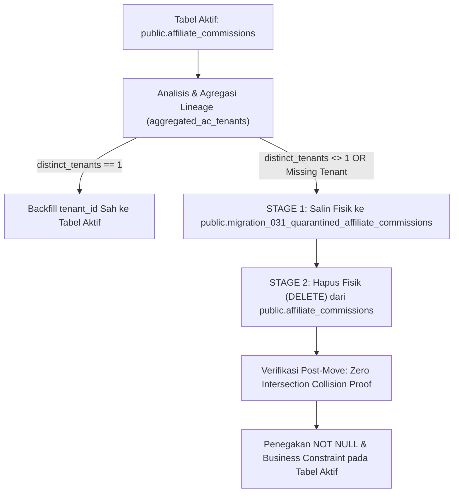

# DOKUMENTASI FORMAL: MEKANISME & ALUR PEMINDAHAN FISIK KARANTINA KOMISI (REV 4.1.6.2.11)
**Document ID:** `BOONTRACK-QUARANTINE-PHYSICAL-ISOLATION-SPEC`  
**Domain:** Database Reliability Engineering & Financial Data Integrity  
**Target:** Formal CTO Audit Pack & Production Migration Safety Proof  
**Author:** Lead Database Reliability Engineer (DBRE) & Principal Systems Architect  
**Date:** 2026-11-03  

---

## 1. Landasan Filosofis & Koreksi Arsitektural (`[ID-02]`)

Pada arsitektur sistem sebelumnya (REV 4.1.2 kebawah), komisi bermasalah atau anomali multi-tenant sempat diusulkan ditandai menggunakan nilai placeholder *sentinel string* pada kolom `tenant_id` (misalnya `'__QUARANTINED_TENANT_CONFLICT'`).

CTO Directive secara tegas menolak dan merevisi pendekatan tersebut dengan prinsip arsitektural:
1. **Karantina Bukan Entitas Bisnis:** String sentinel pada tabel operasional melanggar integritas relasional, merusak indeks multi-tenant, dan menimbulkan risiko fatal di mana transaksi karantina tidak sengaja terbaca oleh agregasi payout komisi atau settlement keuangan.
2. **Isolasi Fisik Total (*Physical Table Separation*):** Seluruh baris komisi anomali yang tidak dapat direkonsiliasi secara deterministik wajib **dipindahkan secara fisik keluar dari tabel aktif `public.affiliate_commissions`** ke tabel karantina khusus **`public.migration_031_quarantined_affiliate_commissions`**.
3. **Syarat Mutlak Constraint Enactment:** Penegakan `ALTER TABLE public.affiliate_commissions ALTER COLUMN tenant_id SET NOT NULL;` dan check constraint `CHECK (tenant_id NOT LIKE '__QUARANTINED_%')` hanya sah dieksekusi setelah 100% data komisi yang tersisa di tabel utama adalah data operasional valid.

---

## 2. Alur Eksekusi Pemindahan Fisik (Atomic SQL Flow)

Alur pemindahan fisik data komisi dijalankan di dalam satu blok transaksi atomik migrasi (`BEGIN ... COMMIT`) melalui langkah-langkah terstruktur:



### Tahap 1: Deteksi Anomali & Agregasi Lineage
Query pendeteksi mengagregasikan seluruh kandidat tenant dari relasi pesanan (`orders`), afiliasi (`affiliates`), sesi atribusi (`attribution_sessions`), dan pengiriman (`delivery_orders`). Baris diklasifikasikan ke dalam anomali karantina jika:
- Jumlah tenant yang terhubung lebih dari 1 (`distinct_tenants > 1` $\to$ Konflik Tenant).
- Tidak ada kandidat tenant yang dapat dibuktikan (`distinct_tenants = 0` $\to$ Komisi Yatim/Orphan).

### Tahap 2: Penyalinan Fisik Lengkap (INSERT + Lineage Snapshot)
Seluruh kolom komisi disalin ke tabel karantina beserta metadata forensik:
```sql
INSERT INTO public.migration_031_quarantined_affiliate_commissions (
    id,
    migration_batch_id,
    original_tenant_id,
    affiliate_id,
    order_id,
    order_amount,
    amount,
    commission_type,
    description,
    original_status,
    product_type,
    paid_at,
    original_created_at,
    original_updated_at,
    quarantine_reason,
    candidate_sources,
    distinct_tenant_count,
    row_snapshot,
    approval_status
)
SELECT 
    ac.id,
    'MIG_031_BATCH_CANONICAL',
    ac.tenant_id,
    ac.affiliate_id,
    ac.order_id,
    ac.order_amount,
    ac.amount,
    ac.commission_type,
    ac.description,
    ac.status,
    ac.product_type,
    ac.paid_at,
    ac.created_at,
    ac.updated_at,
    anom.reason,
    anom.candidate_sources,
    anom.distinct_tenant_count,
    to_jsonb(ac),
    'QUARANTINED_LOCKED'
FROM public.affiliate_commissions ac
JOIN anomalous_commissions anom ON anom.id = ac.id;
```

### Tahap 3: Penghapusan Fisik (DELETE) dari Tabel Aktif
Baris yang telah disalin dihapus secara fisik dari tabel aktif:
```sql
DELETE FROM public.affiliate_commissions ac
WHERE EXISTS (
    SELECT 1 
    FROM public.migration_031_quarantined_affiliate_commissions q
    WHERE q.id = ac.id
);
```

---

## 3. Integrasi Pembuktian pada Gate B1 vs Batasan Lingkup Pengujian

> [!IMPORTANT]
> **Klarifikasi Batasan Lingkup Pengujian Gate B1:**  
> Harness Gate B1 (`harness_b1.sql`) dirancang untuk memverifikasi **keadaan akhir (*postcondition*) isolasi data karantina**, bukan mengeksekusi pipeline ETL pemindahan fisik secara end-to-end. Mekanisme `INSERT ... DELETE` fisik di atas merupakan bagian dari skrip migrasi operasional Migration 031, sedangkan Gate B1 membuktikan bahwa apabila baris karantina telah berada di tabel karantina, sistem menjamin isolasi 100% tanpa tabrakan PK dan tanpa pergeseran relasi.

### A. Verifikasi Zero-Intersection Collision (`STEP 1`, Baris 178–184)
Harness menjalankan asersi fail-closed sebelum pemrosesan inventaris:
```sql
IF EXISTS (
    SELECT 1 
    FROM public.affiliate_commissions reg
    JOIN public.migration_031_quarantined_affiliate_commissions quar ON reg.id = quar.id
) THEN
    RAISE EXCEPTION 'QUARANTINE_PRIMARY_KEY_COLLISION_DETECTED' USING ERRCODE = 'P0001';
END IF;
```
*Pembuktian Keamanan:* Skenario anomali tabrakan PK telah diuji pada `test_negative_assertions.py` (Test 1) dan terbukti menggagalkan transaksi dengan kode error fail-closed `P0001` serta diverifikasi bersih pasca-rollback.

### B. Proyeksi Kontraktual 6-Kolom pada Buku Besar Mutasi
Pada buku besar mutasi `pg_temp._mig031_staging_field_mutations`, baris karantina dicatat secara deterministik pada kolom fisik yang diputus/diisolasi:
- `table_name`: `'public.affiliate_commissions'`
- `row_pk`: `q.id::text`
- `mutated_attribute`: `'affiliate_id'` (Kolom kunci asing fisik yang diputus dari tabel aktif)
- `disposition`: `'PHYSICALLY_QUARANTINED'`
- `original_entity_id`: `q.affiliate_id::text`
- `target_survivor_id`: `NULL::text`

### C. Proteksi Konsolidasi Model A (Step 4F)
Pada fase konsolidasi Model A, harness memaksakan target survivor komisi karantina bernilai `NULL`:
```sql
CASE 
    WHEN sfm.disposition = 'PHYSICALLY_QUARANTINED' THEN NULL::text
    ...
END AS target_survivor_id
```
Aturan ini mencegah sistem salah mengalihkan (*repointing*) saldo komisi yang belum jelas kepemilikan tenant-nya ke afiliasi lain.

---

## 4. Tata Kelola Akses & Prosedur Pemulihan (RBAC & Recovery)

1. **Akses Read-Only Aplikasi:** Default peran database aplikasi (`authenticated`, `anon`) dibatasi tanpa izin akses `SELECT`, `UPDATE`, atau `DELETE` pada tabel karantina.
2. **Finance Reconciliation Portal:** Akses ke `public.migration_031_quarantined_affiliate_commissions` hanya diberikan kepada peran khusus `service_role` melalui fungsi verifikasi RPC berpembatasan audit ketat.
3. **Pemberesan Sengketa (*Dispute Resolution*):** Apabila tim keuangan mengonfirmasi tenant yang sah, data dikembalikan ke tabel operasional melalui prosedur formal `fn_release_quarantined_commission(p_quarantine_id, p_target_tenant_id)` yang mencatat log audit forensik permanen.
