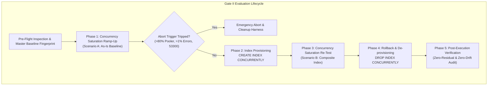
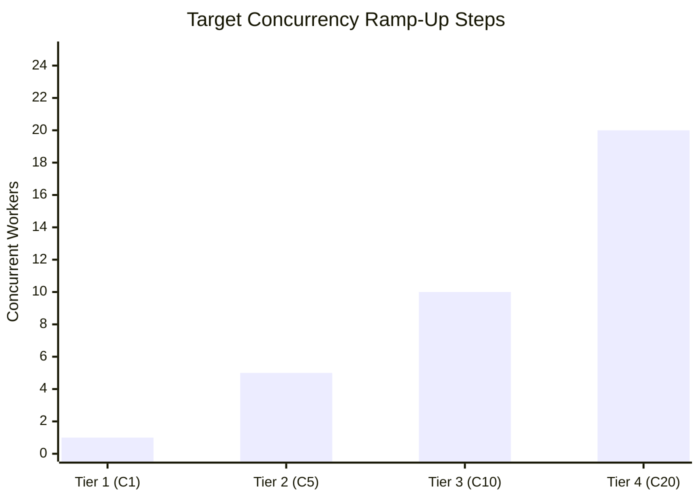
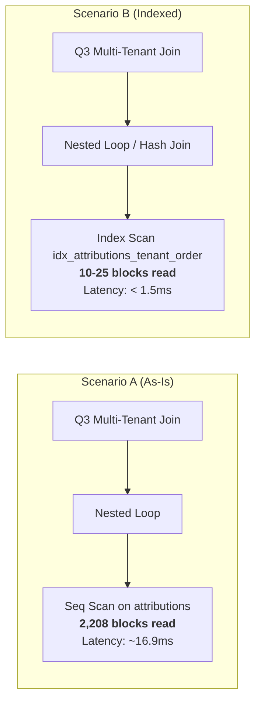
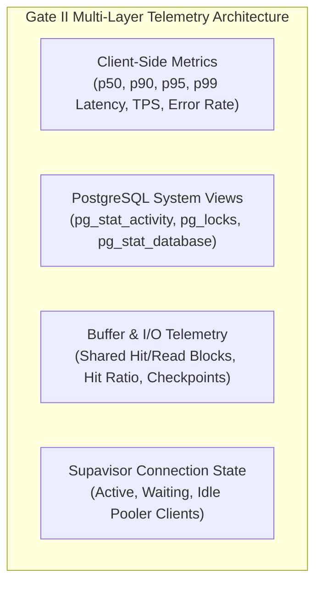

# GATE II TECHNICAL SPECIFICATION: CONCURRENCY SATURATION & COMPOSITE INDEX EVALUATION PLAN

**Document Reference:** `DOC-BNC-GATE-II-001`  
**Classification:** DBRE Technical Blueprint & Engineering Proposal  
**Lead DBRE & Systems Architect:** Lead Database Reliability Engineer & Principal Systems Architect  
**Reviewer:** Chief Technology Officer (CTO)  
**Status:** DRAFT / PROPOSED (PENDING CTO GATE II MANDATE)  
**Target Environment:** Staging Supabase PostgreSQL 17.11 (`xkhqirhurnjqglmajghn:5432`)  
**Repository Branch:** `docs/rev4-1-remediation-and-review`  
**Perimeter Guardrail:** Production Database (`mpluz...`) & Cloudflare R2 are **STRICT ZERO-TOUCH**  

---

## EXECUTIVE SUMMARY

Following the successful execution and closure of **Gate I (Single-Threaded Option B Baseline)** under commit `7fa21e2`, the system's baseline query performance and master catalog immutability have been definitively proven:
- Fixture lifecycle: Atomic insertion of 800 rows across 4 tables with negative PK allocation (`-60001` to `-60200`) and deterministic reverse-FK zero-residual cleanup.
- Sequence preservation: `product_orders_id_seq` remained 100% untouched (`last_value=1, is_called=false`).
- Baseline queries: Q1 (0.14ms warm, 5 blocks), Q2 (0.20ms warm, 8 blocks), Q3 (16.9ms warm, 2,208 root blocks).

**Gate II** advances the reliability engineering lifecycle into **Concurrency Saturation** and **A/B Index Evaluation**. The objectives are twofold:
1. **Stress-test the connection and locking topology** up to the Staging Supavisor connection pooler ceiling ($C=1 \rightarrow 5 \rightarrow 10 \rightarrow 20$).
2. **Evaluate the architectural trade-off** of introducing a composite index (`idx_attributions_tenant_order`) on `public.attributions` to eliminate the Q3 Nested Loop sequential scan bottleneck versus the associated write amplification and disk bloat.



---

## PILAR 1: PROFIL CONCURRENCY RAMP-UP (SATURATION FRAMEWORK)

### 1.1 Concurrency Matrix & Ramp-Up Profile
The concurrency harness operates on a stepped worker model to observe latency degradation curves, queue depth, lock contention, and connection pooler saturation.

| Concurrency Tier | Worker Threads ($C$) | Purpose & Workload Target | Target Ingestion / Query Rate | Expected Contention Profile |
| :--- | :---: | :--- | :--- | :--- |
| **Tier 1 (C1)** | 1 worker | Baseline verification & regression anchor against Gate I results. | 1 worker serial loop (Q1–Q3 + order ingestion). | Zero contention; pure execution baseline. |
| **Tier 2 (C5)** | 5 workers | Typical steady-state multi-tenant workload simulation. | 5 workers concurrent (~50–80 TPS). | Minimal row-lock contention; shared buffer cache warm. |
| **Tier 3 (C10)** | 10 workers | Peak-hour multi-tenant traffic simulation. | 10 workers concurrent (~120–180 TPS). | Observable buffer lock waits; CPU utilization step-up. |
| **Tier 4 (C20)** | 20 workers | **Supavisor Saturation Boundary Target** for Staging. | 20 workers concurrent (Max sustainable TPS). | Severe pooler slot contention; connection queuing. |



### 1.2 Durasi, Sampling Quotas, & Workload Mix
- **Sampling Window:** Each tier runs for a fixed sampling duration of **30 seconds** OR until **100 transactions per worker thread** have completed, whichever threshold is met first.
- **Cool-Down Period:** A mandatory **15-second quiet window** separates consecutive tiers to allow WAL flushing, buffer cache stabilization, and connection draining.
- **Workload Composition per Worker:**
  - 60% Read Operations: Weighted distribution of Q1 (Order Lookup, 20%), Q2 (Affiliate Aggregation, 20%), and Q3 (Multi-Tenant Join, 20%).
  - 40% Write Operations: Controlled insertion of synthetic tenant orders and attributions using negative PK allocation to maintain sequence immunity.

### 1.3 Operational Guardrails & Session Timeouts
To prevent runaway queries, hung transactions, or lock waterfalls from destabilizing the Staging cluster, strict session-level timeouts are enforced on every database connection:

```sql
-- Enforced per-connection session parameters
SET statement_timeout = '2000ms';         -- 2.0s hard cutoff on long query execution
SET lock_timeout = '500ms';               -- 500ms fail-fast on relation/tuple lock waits
SET idle_in_transaction_session_timeout = '1000ms'; -- 1.0s disconnect on abandoned transactions
```

### 1.4 Fail-Closed Circuit Breakers & Abort Criteria
The benchmark orchestrator features an asynchronous telemetry supervisor thread polling at 500ms intervals. An **immediate emergency abort** is triggered if any of the following conditions are met:
1. **Pooler Saturation:** Active connections in Staging Supavisor exceed **80% of configured pool capacity** (or active connections in `pg_stat_activity` exceed 20).
2. **Connection Exhaustion:** PostgreSQL error code `53300` (`too_many_connections`) or pooler timeout (`PGBOUNCER_MAX_CONNECTIONS`).
3. **Transaction Error Threshold:** Failed transaction rate exceeds **1.0%** across any rolling 5-second sampling window.
4. **Shared Buffer Degradation:** Global shared buffer hit ratio drops below **95.0%**, indicating severe cache eviction thrashing.

**Emergency Action on Abort:**
1. Send cancellation signal (`SIGINT` / `terminate`) to all worker threads.
2. Sever all pooled client connections.
3. Automatically trigger `staging_populated_benchmark_recovery.sql` to purge all synthetic data.
4. Emit fatal incident report with timeline and telemetry snapshot.

---

## PILAR 2: RENCANA EVALUASI INDEX (A/B TESTING FRAMEWORK)

### 2.1 The Architectural Bottleneck in Q3 (As-Is Scenario A)
In Gate I, Query 3 (Multi-Tenant Join) exhibited an execution time of **16.9ms** and consumed **2,208 shared hit blocks** per execution. The root cause identified from the EXPLAIN ANALYZE tree is:

```
-> Nested Loop (po JOIN attr)
   -> Seq Scan on public.attributions attr
      Filter: (tenant_id = po.tenant_id AND order_id = po.order_id)
```

Because `public.attributions` lacks a composite index on `(tenant_id, order_id)`, PostgreSQL is forced to evaluate candidate rows via repeated sequential scans or filtering inside the join loop. Under high concurrency ($C=20$), 20 workers executing Q3 simultaneously generate $20 \times 2,208 = 44,160$ block reads per query cycle, causing severe memory bus contention.

### 2.2 Composite Index Candidate (Scenario B)
To resolve this, Scenario B introduces a multi-column B-tree index tailored directly to the join predicate:

```sql
-- DDL Migration Candidate (Zero-Downtime, Non-Blocking)
CREATE INDEX CONCURRENTLY IF NOT EXISTS idx_attributions_tenant_order
ON public.attributions (tenant_id, order_id);
```

#### Expected Query Plan Optimization:
With `idx_attributions_tenant_order`, the PostgreSQL query planner can replace the sequential scan with a high-speed **Index Scan** or **Bitmap Index Scan**, seeking directly to the matching tuple:



### 2.3 Comprehensive Trade-Off Matrix

The introduction of any secondary index involves fundamental database trade-offs between read acceleration, write overhead, and storage footprint:

| Dimension / Metric | Scenario A (As-Is Baseline) | Scenario B (Composite Index) | Net Impact & Architectural Assessment |
| :--- | :--- | :--- | :--- |
| **Q3 Read Latency (p50)** | ~16.8 ms | **< 1.5 ms (projected)** | **~90% reduction** in read execution latency. |
| **Q3 Read Latency (p99)** | ~25.0 ms (estimated under C20) | **< 3.5 ms (projected)** | Eliminates tail-latency spikes caused by sequential table scans. |
| **Buffer Cache Consumption** | 2,208 blocks (~17.6 MB) per query | **~10–25 blocks (<200 KB)** per query | **>98% reduction** in buffer cache thrashing per execution. |
| **Write Latency on `attributions`** | Baseline (1 Heap Write + 1 PK Index Write) | **+1 B-tree Insert per row** | Projected **8%–15% write latency penalty** on `INSERT` into `attributions`. |
| **Write Amplification (WAL)** | Baseline WAL generation | **Increased by ~120–180 bytes** per attribution row inserted | Manageable on SSD; must be audited under C20 write bursts. |
| **HOT (Heap-Only Tuple) Updates**| Eligible for non-indexed columns | Not affected unless `order_id` or `tenant_id` are updated | No impact on status/timestamp updates if index columns remain unchanged. |
| **Disk Bloat & Memory Footprint**| 0 bytes additional | **~48 bytes per row** (~4.8 MB per 100k rows) | Negligible footprint relative to Staging/Production disk capacity. |

### 2.4 Index Adoption Decision Boundary
The engineering decision to promote `idx_attributions_tenant_order` from Staging to Production will be governed by the following deterministic pass-fail criteria:

$$\text{Read Improvement} = \frac{\text{Latency}_A(\text{p95}) - \text{Latency}_B(\text{p95})}{\text{Latency}_A(\text{p95})} \ge 60\%$$

$$\text{Write Degradation} = \frac{\text{WriteLatency}_B(\text{p95}) - \text{WriteLatency}_A(\text{p95})}{\text{WriteLatency}_A(\text{p95})} \le 15\%$$

If both inequalities hold true under Tier 4 ($C=20$), the index is declared an **Approved Production Candidate**.

---

## PILAR 3: OBSERVABILITY, TELEMETRY & RECOVERY HARDENING

### 3.1 Real-Time Telemetry Pipeline
The Gate II test runner will collect high-fidelity metrics across four distinct telemetry layers:



#### Monitored Telemetry Attributes:
1. **Latency Distribution:** Nanosecond-resolution client-side timer measuring latency percentiles (p50, p90, p95, p99) for Q1, Q2, Q3, and write operations.
2. **Throughput:** Real-time Transactions Per Second (TPS) and Queries Per Second (QPS).
3. **Shared Buffer Hit Ratio:** Calculated cumulatively per tier:
   $$\text{Hit Ratio} = \frac{\text{Shared Hit Blocks}}{\text{Shared Hit Blocks} + \text{Shared Read Blocks}} \times 100\%$$
4. **Lock Contention:** Monitoring `pg_locks` for `ExclusiveLock`, `RowShareLock`, and `wait_event_type = 'Lock'`.
5. **Connection Pool Health:** Continuous sampling of `pg_stat_activity` state (`active`, `idle in transaction`, `waiting`).

### 3.2 Deterministic Rollback & Teardown Protocol
Post-benchmark de-provisioning is automated and deterministic to guarantee that no test artifacts or structural alterations persist in the Staging database.

#### Step 1: Concurrent Index Deletion
```sql
-- Safe, non-blocking index drop
DROP INDEX CONCURRENTLY IF EXISTS public.idx_attributions_tenant_order;
```

#### Step 2: Verification of Index Removal
```sql
SELECT indexname 
FROM pg_indexes 
WHERE schemaname = 'public' 
  AND indexname = 'idx_attributions_tenant_order';
-- MUST RETURN 0 ROWS
```

#### Step 3: Zero-Residual Synthetic Data Cleanup
Execute `scripts/benchmarks/staging_populated_benchmark_cleanup.sql` to purge all rows created during the concurrency run.

#### Step 4: Master Catalog & Sequence Immutability Verification
Validate that:
- `public.tenants` SHA-256 fingerprint matches `068288d4f885376562f8bd984394026721e9f27a6ffd8db3ced7df29dbc62ec2`.
- `public.affiliates` SHA-256 fingerprint matches `a5103cbba0dea455a29d68619af63a0a9a6b14129694baf55a34c68e727baf4f`.
- `product_orders_id_seq` has `last_value = 1` and `is_called = false`.
- Total residual benchmark rows across `orders`, `product_orders`, `commissions`, and `attributions` equal exactly **0**.

---

## IMPLEMENTATION TIMELINE & NEXT STEPS

1. **CTO Review & Sign-Off:** Submission of this technical specification for CTO review and authorization.
2. **Harness Development (`execute_gate_ii_concurrency_benchmark.py`):** Authoring the multi-threaded load generator and telemetry sampler incorporating the Pilar 1–3 guardrails.
3. **Staging Execution Window:** Execution of Gate II under Staging write authorization during a designated low-traffic window.
4. **Final Gate II Evaluation Report:** Compilation of A/B benchmark findings and submission of production index migration recommendation.
