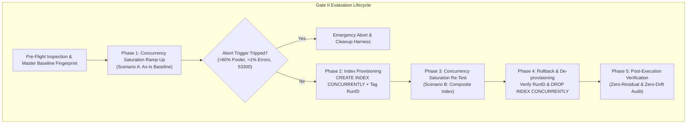
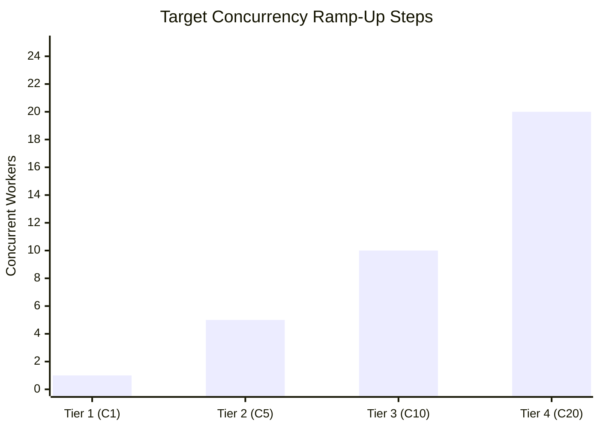
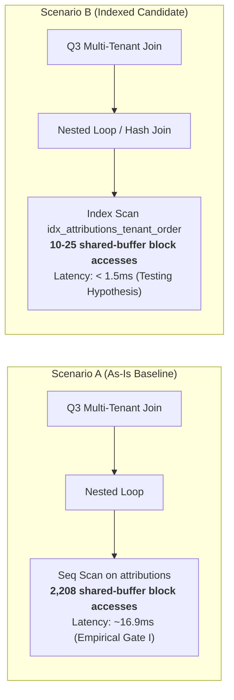
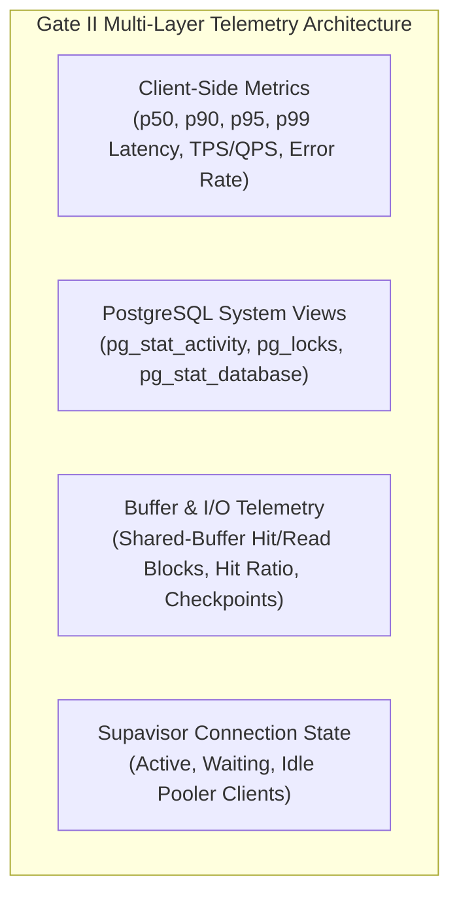
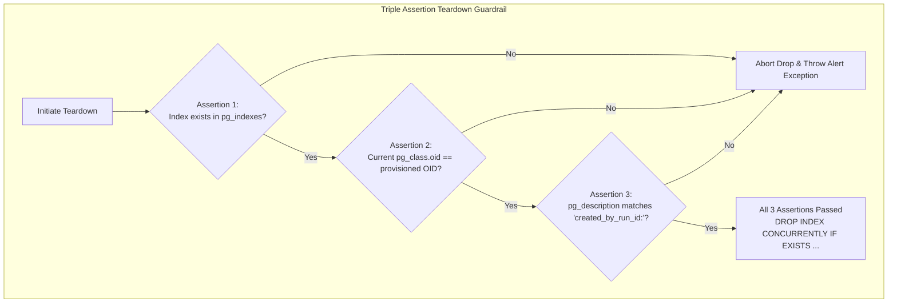

# GATE II TECHNICAL SPECIFICATION: CONCURRENCY SATURATION & COMPOSITE INDEX EVALUATION PLAN

**Document Reference:** `DOC-BNC-GATE-II-001-REV1`  
**Classification:** DBRE Technical Blueprint & Engineering Proposal  
**Lead DBRE & Systems Architect:** Lead Database Reliability Engineer & Principal Systems Architect  
**Reviewer:** Chief Technology Officer (CTO)  
**Status:** DRAFT / PROPOSED (REVISED PER CTO REVIEW — PENDING FINAL GATE II MANDATE)  
**Target Environment:** Staging Supabase PostgreSQL 17.11 (`xkhqirhurnjqglmajghn:5432`)  
**Repository Branch:** `docs/rev4-1-remediation-and-review`  
**Perimeter Guardrail:** Production Database (`mpluz...`) & Cloudflare R2 are **STRICT ZERO-TOUCH**  

---

## EXECUTIVE SUMMARY

Following the successful execution and closure of **Gate I (Single-Threaded Option B Baseline)** under commit `7fa21e2`, the system's baseline query performance and master catalog immutability have been definitively proven:
- Fixture lifecycle: Atomic insertion of 800 rows across 4 tables with negative PK allocation (`-60001` to `-60200`) and deterministic reverse-FK zero-residual cleanup.
- Sequence preservation: `product_orders_id_seq` remained 100% untouched (`last_value=1, is_called=false`).
- Baseline queries (Measured Empirical Data): Q1 (0.14ms warm, 5 shared-buffer block accesses), Q2 (0.20ms warm, 8 shared-buffer block accesses), Q3 (16.9ms warm, 2,208 root shared-buffer block accesses).

**Gate II** advances the reliability engineering lifecycle into **Concurrency Saturation** and **A/B Index Evaluation**. The objectives are twofold:
1. **Stress-test the connection and locking topology** up to the Staging Supavisor connection pooler ceiling ($C=1 \rightarrow 5 \rightarrow 10 \rightarrow 20$).
2. **Evaluate the architectural trade-off** of introducing a composite index (`idx_attributions_tenant_order`) on `public.attributions` to eliminate the Q3 Nested Loop sequential scan bottleneck versus the associated write amplification and disk bloat.



---

## PILAR 1: PROFIL CONCURRENCY RAMP-UP (SATURATION FRAMEWORK)

### 1.1 Concurrency Matrix & Ramp-Up Profile
The concurrency harness operates on a stepped worker model to observe latency degradation curves, queue depth, lock contention, and connection pooler saturation.

| Concurrency Tier | Worker Threads ($C$) | Purpose & Workload Target | Target Ingestion / Query Rate | Expected Contention Profile |
| :--- | :---: | :--- | :--- | :--- |
| **Tier 1 (C1)** | 1 worker | Baseline verification & regression anchor against Gate I results. | 1 worker serial loop (Q1–Q3 + order ingestion). | Zero contention; pure execution baseline. |
| **Tier 2 (C5)** | 5 workers | Typical steady-state multi-tenant workload simulation. | 5 workers concurrent (~50–80 TPS). | Minimal row-lock contention; shared buffer cache warm. |
| **Tier 3 (C10)** | 10 workers | Peak-hour multi-tenant traffic simulation. | 10 workers concurrent (~120–180 TPS). | Observable buffer lock waits; CPU utilization step-up. |
| **Tier 4 (C20)** | 20 workers | **Supavisor Saturation Boundary Target** for Staging. | 20 workers concurrent (Max sustainable TPS). | Severe pooler slot contention; connection queuing. |



### 1.2 Durasi, Minimum Sample Count, & Workload Mix
To ensure that percentile calculations (specifically **p95** and **p99**) satisfy statistical significance and do not suffer from small-sample distortion, the workload harness enforces strict minimum sample criteria:

1. **Statistically Guaranteed Minimum Sample Quota:**
   - Every Concurrency Tier ($C=1, 5, 10, 20$) **MUST collect a minimum of 100 valid samples per query type and per write transaction**, regardless of thread count:
     * **Q1 (Order Lookup):** $\ge 100$ completed executions.
     * **Q2 (Affiliate Aggregation):** $\ge 100$ completed executions.
     * **Q3 (Multi-Tenant Join):** $\ge 100$ completed executions.
     * **Write Ingestion (Order + Attribution):** $\ge 100$ completed write transactions.
   - A tier run is **NOT eligible for closure** until all 4 query/transaction categories have reached $\ge 100$ samples.
2. **Sampling Window & Time Box:**
   - Target sampling duration: **30 seconds** per tier.
   - If the 30-second window elapses before the 100-sample quota is fulfilled for any category (e.g., under Tier C1 serial execution), the harness continues running until the 100-sample threshold is reached, bounded by a hard ceiling timeout of **120 seconds**.
3. **Cool-Down Period:** A mandatory **15-second quiet window** separates consecutive tiers to allow WAL flushing, buffer cache stabilization, and connection draining.
4. **Workload Composition:**
   - Workload is divided into dedicated, decoupled worker streams: 60% Read Operations (evenly balanced across Q1, Q2, Q3) and 40% Write Operations (synthetic order and attribution ingestion).

### 1.3 Operational Guardrails & Session Timeouts
To prevent runaway queries, hung transactions, or lock waterfalls from destabilizing the Staging cluster, strict session-level timeouts are enforced on every database connection:

```sql
-- Enforced per-connection session parameters
SET statement_timeout = '2000ms';         -- 2.0s hard cutoff on long query execution
SET lock_timeout = '500ms';               -- 500ms fail-fast on relation/tuple lock waits
SET idle_in_transaction_session_timeout = '1000ms'; -- 1.0s disconnect on abandoned transactions
```

### 1.4 Fail-Closed Circuit Breakers & Abort Criteria
The benchmark orchestrator features an asynchronous telemetry supervisor thread polling at 500ms intervals. An **immediate emergency abort** is triggered if any of the following conditions are met:
1. **Pooler Saturation:** Active connections in Staging Supavisor exceed **80% of configured pool capacity** (or active connections in `pg_stat_activity` exceed 20).
2. **Connection Exhaustion:** PostgreSQL error code `53300` (`too_many_connections`) or pooler timeout (`PGBOUNCER_MAX_CONNECTIONS`).
3. **Transaction Error Threshold:** Failed transaction rate exceeds **1.0%** across any rolling 5-second sampling window.
4. **Shared Buffer Hit Degradation:** Global shared-buffer hit ratio drops below **95.0%**, indicating severe cache eviction thrashing.

**Emergency Action on Abort:**
1. Send cancellation signal (`SIGINT` / cooperative cancellation token) to all worker threads.
2. Drain and close all pooled client connections.
3. Automatically trigger `scripts/benchmarks/staging_populated_benchmark_cleanup.sql` to purge all synthetic data.
4. If in-process cleanup is interrupted, escalate to the out-of-band crash recovery protocol (SOP in Section 3.3).

---

## PILAR 2: RENCANA EVALUASI INDEX (A/B TESTING FRAMEWORK)

### 2.1 The Architectural Bottleneck in Q3 (As-Is Scenario A)
In Gate I, Query 3 (Multi-Tenant Join) exhibited an execution time of **16.9ms** and consumed **2,208 root shared-buffer block accesses** per execution. The root cause identified from the EXPLAIN ANALYZE tree is:

```
-> Nested Loop (po JOIN attr)
   -> Seq Scan on public.attributions attr
      Filter: (tenant_id = po.tenant_id AND order_id = po.order_id)
```

Because `public.attributions` lacks a composite index on `(tenant_id, order_id)`, PostgreSQL evaluates candidate rows via repeated sequential scans and filtering inside the join loop. Under high concurrency ($C=20$), 20 concurrent workers executing Q3 generate repeated shared-buffer page pin/read cycles and CPU-bound tuple filtering across worker backends.

### 2.2 Composite Index Candidate (Scenario B)
To resolve this, Scenario B introduces a multi-column B-tree index tailored directly to the join predicate.

#### Provisioning Protocol & Fail-Closed Pre-Check:
To eliminate blind-overwrite hazards and ensure the database starts from a pristine state, provisioning enforces a strict two-stage protocol:

1. **Explicit Fail-Closed Pre-Check:**
   Before issuing DDL, the runner queries `pg_indexes` to assert that no conflicting index exists:
   ```sql
   SELECT 1 FROM pg_indexes 
   WHERE schemaname = 'public' AND indexname = 'idx_attributions_tenant_order';
   ```
   *Guardrail:* If a row is returned, execution **immediately aborts** with `RuntimeError` ("PRE-CONDITION ABORT: Index already exists").

2. **Creation without `IF NOT EXISTS` Bypass Hazard:**
   `IF NOT EXISTS` is intentionally eliminated to prevent silent no-ops against pre-existing objects:
   ```sql
   -- DDL Migration Candidate (Zero-Downtime, Non-Blocking, Strict Fail-Closed)
   CREATE INDEX CONCURRENTLY idx_attributions_tenant_order
   ON public.attributions (tenant_id, order_id);
   ```

3. **RunID Provenance Tagging & Physical OID Capture:**
   Immediately following index creation, the runner annotates the index with its active execution Run ID and captures its physical object identifier (`oid`) from `pg_class`:
   ```sql
   -- Provenance Tagging Guardrail: Annotate index with experiment Run ID
   COMMENT ON INDEX public.idx_attributions_tenant_order IS 'created_by_run_id:<BENCHMARK_RUN_ID>';

   -- Capture Physical OID for Teardown Verification
   SELECT c.oid FROM pg_class c 
   JOIN pg_namespace n ON n.oid = c.relnamespace 
   WHERE n.nspname = 'public' AND c.relname = 'idx_attributions_tenant_order';
   ```
   The captured integer OID is held in the runner's memory (`self._created_index_oid`) for the teardown assertions.

#### Expected Query Plan Optimization:
With `idx_attributions_tenant_order`, the PostgreSQL query planner is expected to replace the sequential scan with a targeted **Index Scan** or **Bitmap Index Scan**, seeking directly to the matching tuple:



### 2.3 Comprehensive Trade-Off Matrix (Empirical Baseline vs Testing Hypotheses)

The introduction of any secondary index involves fundamental database trade-offs between read acceleration, write overhead, and storage footprint. The matrix below explicitly delineates between **measured Gate I baselines** and **unverified Gate II testing hypotheses**:

| Dimension / Metric | Scenario A (As-Is Baseline) [MEASURED] | Scenario B (Composite Index) [TESTING HYPOTHESIS] | Nature of Projection & Verification Plan |
| :--- | :--- | :--- | :--- |
| **Q3 Read Latency (p50)** | **16.86 ms** (Empirical Gate I) | **< 1.5 ms** (*Testing Hypothesis*) | **Hypothesis:** ~90% latency reduction via direct B-tree tuple lookup. To be verified via $\ge 100$ Q3 samples per tier. |
| **Q3 Read Latency (p99)** | ~25.0 ms (Projected under C20) | **< 3.5 ms** (*Testing Hypothesis*) | **Hypothesis:** Elimination of tail-latency spikes caused by sequential table scans. |
| **Shared-Buffer Block Accesses** | **2,208 blocks** per query (Empirical Gate I) | **~10–25 blocks** (*Testing Hypothesis*) | **Hypothesis:** ~98% reduction in page pin/read cycles per execution. |
| **Write Latency on `attributions`** | Baseline (1 Heap Write + 1 PK Index Write) | **+8%–15% write penalty** (*Testing Hypothesis*) | **Hypothesis:** Additional B-tree leaf insert per write. Must be measured via $\ge 100$ concurrent write tx. |
| **Write Amplification (WAL)** | Baseline WAL generation | **+120–180 bytes WAL** per inserted attribution row (*Testing Hypothesis*) | Manageable on SSD; must be audited via `pg_stat_database` WAL metrics under C20 write bursts. |
| **HOT (Heap-Only Tuple) Updates**| Eligible for non-indexed columns | Not affected unless `order_id` or `tenant_id` are mutated | No impact on status/timestamp updates if index columns remain unchanged. |
| **Disk Bloat & Memory Footprint**| 0 bytes additional | **~48 bytes per row** (~4.8 MB per 100k rows) (*Engineering Estimate*) | Negligible footprint relative to Staging/Production disk capacity. |

> [!IMPORTANT]
> All figures labeled **Testing Hypothesis** are theoretical modeling targets based on PostgreSQL query cost formulas ($Cost \approx \text{depth} \times \text{random\_page\_cost}$). They **MUST NOT** be treated as certified facts until confirmed by Gate II benchmark telemetry.

### 2.4 Index Adoption Decision Boundary
The engineering decision to promote `idx_attributions_tenant_order` from Staging to Production will be governed by the following deterministic pass-fail criteria:

$$\text{Read Improvement} = \frac{\text{Latency}_A(\text{p95}) - \text{Latency}_B(\text{p95})}{\text{Latency}_A(\text{p95})} \ge 60\%$$

$$\text{Write Degradation} = \frac{\text{WriteLatency}_B(\text{p95}) - \text{WriteLatency}_A(\text{p95})}{\text{WriteLatency}_A(\text{p95})} \le 15\%$$

If both inequalities hold true under Tier 4 ($C=20$), the index is declared an **Approved Production Candidate**.

---

## PILAR 3: OBSERVABILITY, TELEMETRY & RECOVERY HARDENING

### 3.1 Real-Time Telemetry Pipeline
The Gate II test runner collects high-fidelity metrics across four distinct telemetry layers:



#### Monitored Telemetry Attributes:
1. **Latency Distribution:** Nanosecond-resolution client-side timer measuring latency percentiles (p50, p90, p95, p99) calculated from $\ge 100$ independent samples per category.
2. **Throughput:** Real-time Transactions Per Second (TPS) and Queries Per Second (QPS).
3. **Shared-Buffer Hit Ratio:** Calculated cumulatively per tier:
   $$\text{Hit Ratio} = \frac{\text{Shared Hit Blocks}}{\text{Shared Hit Blocks} + \text{Shared Read Blocks}} \times 100\%$$
4. **Lock Contention:** Monitoring `pg_locks` for `ExclusiveLock`, `RowShareLock`, and `wait_event_type = 'Lock'`.
5. **Connection Pool Health:** Continuous sampling of `pg_stat_activity` state (`active`, `idle in transaction`, `waiting`).

---

### 3.2 Index Rollback Guardrail (Triple Assertion Pre-Check)
To strictly prevent an accidental or errant `DROP INDEX` from destroying a legitimate index in Staging or Production, the teardown protocol enforces a **Triple Assertion Guardrail (OID + Name + RunID Tag)** before executing the concurrent drop:



#### The Three Mandatory Assertions:
1. **Assertion 1 (Catalog Presence):**
   ```sql
   SELECT 1 FROM pg_indexes 
   WHERE schemaname = 'public' AND indexname = 'idx_attributions_tenant_order';
   ```
   *Failure Trigger:* If 0 rows return, the runner raises `TRIPLE ASSERTION ABORT (Assertion 1)`.

2. **Assertion 2 (Physical OID Invariant Match):**
   The runner queries PostgreSQL's physical object catalog to verify that the target index was not dropped and recreated or substituted:
   ```sql
   SELECT c.oid FROM pg_class c 
   JOIN pg_namespace n ON n.oid = c.relnamespace 
   WHERE n.nspname = 'public' AND c.relname = 'idx_attributions_tenant_order';
   ```
   *Failure Trigger:* If `current_oid != self._created_index_oid`, the runner raises `TRIPLE ASSERTION ABORT (Assertion 2)` and halts.

3. **Assertion 3 (RunID Provenance Verification):**
   The runner checks the object's description table using the verified physical OID:
   ```sql
   SELECT description
   FROM pg_description
   WHERE objoid = :current_oid;
   ```
   *Failure Trigger:* If the comment does not match the active `created_by_run_id:<run_id>`, the runner raises `TRIPLE ASSERTION ABORT (Assertion 3)` and halts.

4. **Verified Non-Blocking Drop:**
   Only when all three assertions pass simultaneously does the orchestrator issue:
   ```sql
   DROP INDEX CONCURRENTLY IF EXISTS public.idx_attributions_tenant_order;
   ```

---

### 3.3 Crash Recovery Protocol & Out-Of-Band SOP

> [!CAUTION]
> **Limitations of In-Process `try...finally` Blocks:**  
> Python's language-level `try...finally` block guarantees cleanup execution **ONLY** for cooperative runtime exceptions, unhandled Python errors, and graceful process termination signals (`SIGINT`, `SIGTERM`).  
> It provides **ZERO PROTECTION** against:
> - Hard OS crashes (`SIGKILL`, `kill -9`).
> - Host kernel panic, out-of-memory (OOM) killer terminations.
> - Client hardware power loss or terminal abrupt termination.
> - Severe network partition cutting client-to-database communication mid-transaction.

To guarantee zero-residual state even under catastrophic client crash scenarios, the following **Out-Of-Band SOP (Standard Operating Procedure)** is mandated:

#### Standard Operating Procedure (SOP): Manual Out-of-Band Recovery
In any event where the benchmark runner dies abruptly without executing Sesi 3 cleanup:

1. **Verify Database Connectivity & Locks:**
   Ensure no hung backend connections remain active:
   ```sql
   SELECT pid, usename, state, query_start, query 
   FROM pg_stat_activity 
   WHERE query LIKE '%bench\_b1\_%' OR query LIKE '%idx_attributions_tenant_order%';
   ```
   If any hung worker processes exist, terminate them gracefully via `pg_terminate_backend(pid)`.

2. **Execute Standalone Recovery Harness:**
   Run the dedicated, standalone DBRE recovery script from a clean shell:
   ```bash
   python scripts/benchmarks/run_recovery.py
   ```
   *Alternative Direct SQL:* If Python environment is unavailable, execute via psql:
   ```bash
   psql "$STAGING_DATABASE_URL" -f scripts/benchmarks/staging_populated_benchmark_recovery.sql
   ```

3. **Verify Index Teardown & Catalog Immutability:**
   Execute the post-recovery audit query to confirm total zero-residual and zero-drift state:
   ```sql
   -- 1. Verify Index is Gone
   SELECT COUNT(*) AS index_residual 
   FROM pg_indexes 
   WHERE schemaname = 'public' AND indexname = 'idx_attributions_tenant_order';

   -- 2. Verify Table Residuals
   SELECT 
       (SELECT COUNT(*) FROM public.orders WHERE id LIKE 'bench\_b1\_%' ESCAPE '\') AS res_ord,
       (SELECT COUNT(*) FROM public.product_orders WHERE id BETWEEN -60200 AND -60001) AS res_po,
       (SELECT COUNT(*) FROM public.affiliate_commissions WHERE order_id LIKE 'bench\_b1\_%' ESCAPE '\') AS res_com,
       (SELECT COUNT(*) FROM public.attributions WHERE order_id LIKE 'bench\_b1\_%' ESCAPE '\') AS res_att;

   -- 3. Verify Sequence State
   SELECT last_value, is_called FROM public.product_orders_id_seq;
   ```
   *Expected Outcome:* All residual counts **0**, `last_value=1`, `is_called=false`.

---

## 4. IMPLEMENTATION TIMELINE & NEXT STEPS

1. **CTO Review & Sign-Off:** Submission of this revised technical specification (`DOC-BNC-GATE-II-001-REV1`) for final CTO approval.
2. **Offline Harness Development:** Build and validate `scripts/benchmarks/execute_gate_ii_concurrency_benchmark.py` with mock/dry-run capabilities and independent statistical metric extraction.
3. **Execution Gate:** No live write/DDL execution against Staging Supabase until authorized by formal CTO mandate.
